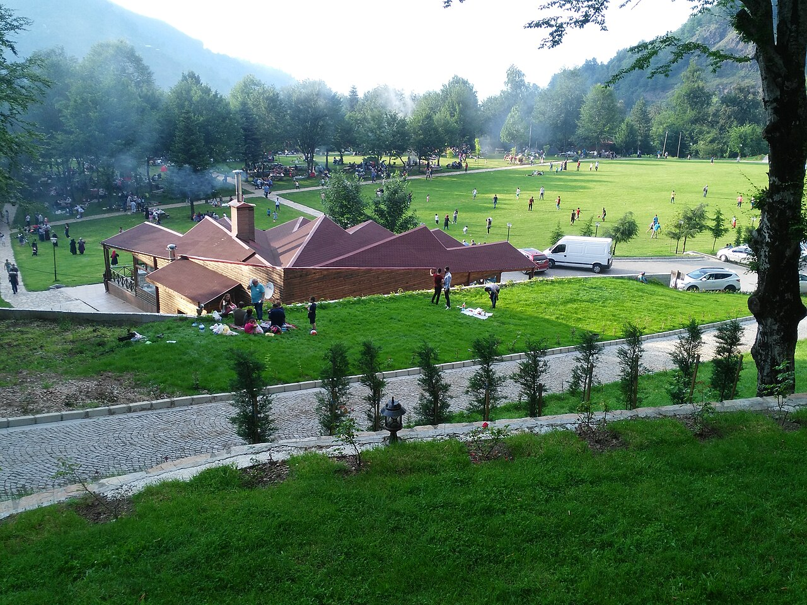
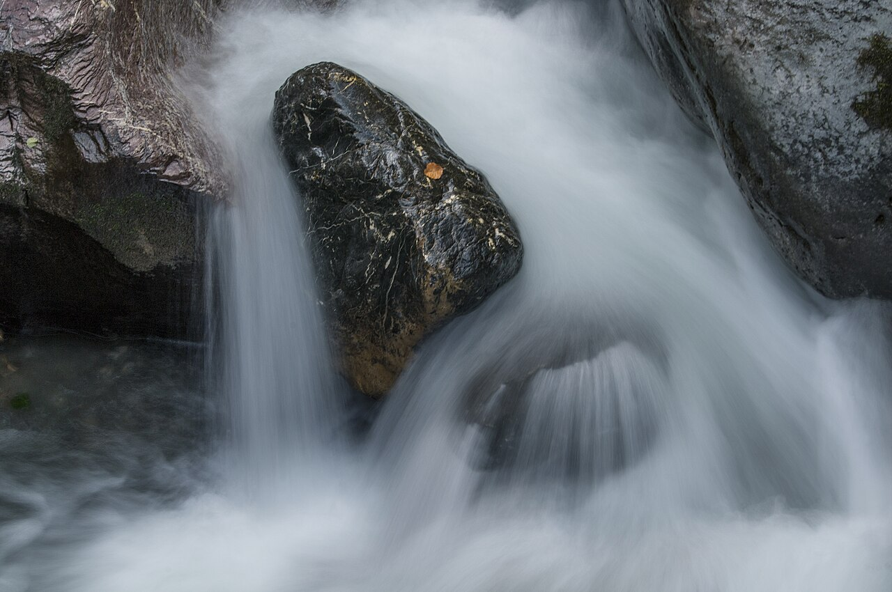

# 📍 Duzce - Seyahat Notları (Keşif Dosyası)

  

## 📜 Seyyahın Beklentisi
> "Güzeldere ve Samandere şelalelerinin gürül gürül akan sularında arınmak, Konuralp'in iki bin yıllık antik tiyatrosundan Akçakoca'nın Ceneviz surlarına uzanmak için bekleyen şelaleler ve yaylalar şehri."

### 🌍 Şehrin Dokusu ve Tarihsel Arka Planı
Batı Karadeniz'in Marmara'ya açılan yeşil kapısı olan Düzce, antik çağda *Prusias ad Hypium* (bugünkü Konuralp) adıyla Bitinya Krallığı'nın ve Roma İmparatorluğu'nun en parlak şehirlerinden biriydi. 1323 yılında Osman Gazi'nin silah arkadaşı Konuralp Bey tarafından fethedilerek Osmanlı topraklarına katılan bölge, bereketli Düzce Ovası, 130 metreden dökülen Güzeldere Şelalesi, Türkiye'nin ilk tescilli Tabiat Anıtı Samandere Şelalesi, Efteni Gölü kuş cenneti ve Karadeniz'in incisi Akçakoca sahilleriyle zengin bir coğrafi çeşitlilik sunar. Kafkasya'dan Balkanlar'a, Doğu Karadeniz'den Orta Anadolu'ya pek çok kültürün bir arada yaşadığı Düzce, aynı zamanda eşsiz bir gastronomi ve misafirperverlik mozaiğidir.

### 🕌 Manevi Mimarlar ve Tarihî Şahsiyetler
- **Konuralp Bey (ö. 1328):** Osman Gazi ve Orhan Gazi döneminin büyük akıncı komutanı; Düzce ve Akyazı havalisini fethederek bölgenin Türk-İslam kimliğini kurmuştur.
- **Akça Koca (ö. 1326):** Kocaeli ve Batı Karadeniz sahillerinin fatihi; Düzce'nin Karadeniz kıyısındaki şirin ilçesi Akçakoca adını bu büyük alpten alır.
- **Hemşin Köyü ve Orhangazi Ahşap Camileri:** Çivisiz ahşap geçme (çantı) tekniğiyle inşa edilen 14. ve 19. yüzyıl tarihî ahşap camileri, Düzce'nin ormanla bütünleşen manevi mimarisinin nadide eserleridir.

### 💬 Şehir Hakkında Edebi ve Tarihi Alıntılar
> "Prusias ad Hypium, tiyatrosu, su kemerleri ve verimli ovasıyla Bitinya'nın en mamur kentlerinden biridir." — Antik Kaynaklar
>
> "Düzce'nin dağlarından inen her şelale, kayın ve gürgen ormanlarının kalbinden kopup gelen bir ferahlık bestesidir." — Seyyah Beklentisi

### 🍽️ Planlanan Yöresel Lezzet Durakları
- **Düzce Köftesi & İsli Çerkes Peyniri:** Özel baharatlarla yoğrulan coğrafi işaretli Düzce köftesi ve meşe odununda tütsülenen isli Çerkes peyniri.
- **Abaza/Çerkes Mutfağı (Haluj & Çerkes Tavuğu):** Kafkas kültürünün Düzce sofralarına armağanı olan peynirli/patatesli haluj (mantı), mamursa ve cevizli Çerkes tavuğu.
- **Melengücceği Tatlısı & Akçakoca Mancarlı Pidesi:** Dardağan/manda kaymağı ile hazırlanan Osmanlı dönemi mirası melengücceği tatlısı ve Akçakoca'nın otlu pidesi.
- **Tefekkür Eşliğinde Çay:** Efteni Gölü seyir kulesinde veya Akçakoca Ceneviz Kalesi'nde deniz rüzgârı eşliğinde demli çay.

### ⛺ Konaklama ve Bütçe Planı
- **Modern Kervansaray Stratejisi:** GSB Seyahatsever projesi kapsamında Düzce KYK yurtlarında 5 gün boyunca ücretsiz konaklayarak bütçe verimliliği sağlanması hedeflenmektedir.
- **Komşu İl Optimizasyonu:** Sakarya → Düzce → Bolu / Zonguldak güzergâhında kesintisiz Batı Karadeniz geçişi.

### 💻 Planlanan Kütüphane Mesaisi
- **Kütüphane Durağı:** Düzce İl Halk Kütüphanesi (ve Düzce Üniversitesi Konuralp Merkez Kütüphanesi) – Sabah saatlerinde sakin okuma ve yazılım mesaisi, öğleden sonra şelale ve antik kent keşifleri.

### 🧭 5 Günlük Planlanan Menzil Rotası
- **1. Gün (Konuralp Antik Kenti ve Müze):** Sabah Düzce İl Halk Kütüphanesi'nde çalışma; öğleden sonra Konuralp'te 2.000 yıllık *Prusias ad Hypium* Antik Tiyatrosu, Roma Köprüsü, Atlı Kapı ve Konuralp Müzesi.
- **2. Gün (Güzeldere Şelalesi ve Efteni Gölü):** Gölyaka ilçesinde 130 metre yükseklikten dökülen Güzeldere Şelalesi Tabiat Parkı ve 150'den fazla kuş türünün uğrak noktası Efteni Gölü Yaban Hayatı Geliştirme Sahası.
- **3. Gün (Samandere Şelalesi ve Aydınpınar):** Türkiye'nin ilk Tabiat Anıtı Samandere Şelalesi'nde "Cadı Kazanı" ve ahşap köprüler boyunca yürüyüş; ardından Aydınpınar Şelaleleri ve Pürenli/Kardüz Yaylası havası.
- **4. Gün (Akçakoca – Deniz, Kale ve Mağara):** UNESCO Geçici Miras Listesi'ndeki Akçakoca Ceneviz Kalesi, tarihî Yukarı Mahalle sivil mimari evleri, Fakıllı Mağarası ve Aktaş Şelalesi.
- **5. Gün (Tarihi Ahşap Camiler ve Veda):** Sabah kütüphane mesaisi; öğleden sonra Cumayeri/Çilimli hattında tarihî ahşap cami ziyareti ve yerel pazardan isli peynir ile fındık temini.

### ✨ Keşfedilmesi Beklenen Duraklar ve Landmarks
- [ ] **Güzeldere Şelalesi Tabiat Parkı**
- [ ] **Samandere Şelalesi Tabiat Anıtı**
- [ ] **Prusias ad Hypium (Konuralp) Antik Tiyatrosu**
- [ ] **Akçakoca Ceneviz Kalesi ve Tarihi Mahalle**
- [ ] **Efteni Gölü Kuş Cenneti**
- [ ] **Fakıllı Mağarası**

### 📸 Menzil Fotoğraf Galerisi
<table>
  <tr>
    <td align="center" width="50%">
       
      <em>Kayın ormanlarının kalbinden dökülen Düzce şelaleleri (Planlanan Menzil)</em>
    </td>
    <td align="center" width="50%">
       
      <em>Konuralp antik mirası ve Akçakoca'nın mavi-yeşil kıyıları</em>
    </td>
  </tr>
</table>

---
*Henüz adımlanmamış bu kadim şehir, keşif defterinde sırasını bekleyen bir menzil olarak kayda geçirilmiştir.*
