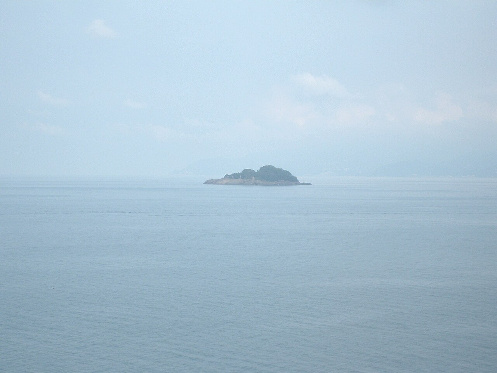

# 📍 Giresun - Seyahat ve Tefekkür Notları

  

## 📜 Şehrin Ruhu
> "Karadeniz'in tek yaşanabilir adasına sahip olan, fındığın ve yeşilin dalgalarla buluştuğu sahil şehri."

### 🌍 Şehrin Dokusu ve Tarihsel Arka Planı
Antik adı Kerasus olan Giresun, fındığın anavatanı kabul edilir. Tarihi kalesi ve adasıyla Karadeniz mitolojisinde önemli bir yer tutar. Kiraz meyvesinin dünyaya adını veren (Kerasus → Cerasus / Cherry) bu kadim kıyı kenti, Pontus Krallığı'ndan Roma'ya, Çepni Türkmenlerinin yerleşiminden Osmanlı'ya uzanan köklü bir kültürel harmana sahiptir. Doğu Karadeniz'in tek doğal adası olan Giresun Adası (Aretias), Argonotlar efsanesinden Bizans manastır kalıntılarına kadar binlerce yıllık denizcilik hafızasını korur.

### 🕌 Manevi Mimarlar ve Tarihî Şahsiyetler
- **Topal Osman Ağa (1883–1923):** Milli Mücadele yıllarında Giresun gönüllü alaylarını kurarak Sakarya ve Büyük Taarruz'da büyük kahramanlıklar gösteren, anıt mezarı Giresun Kalesi'nde yer alan tarihî kahraman.
- **Seyyid Vakkas:** Giresun'un fethi ve İslamlaşması sürecinde iz bırakan, şehrin merkezindeki türbesiyle anılan manevi öncülerden.
- **Can Akengin (1892–1942):** Giresun'un yetiştirdiği önemli şair, ressam ve fikir adamı; şehrin sanat ve edebiyat hayatına öncülük etmiştir.
- **Hacı Miktad & Tarihi Vakıf Banileri:** Giresun merkezindeki Hacı Miktad Camii ve Zeytinlik Mahallesi'nin tarihî dokusunu oluşturan hayır sahipleri.

### 💬 Şehir Hakkında Edebi ve Tarihi Alıntılar
> "Giresun Kalesi, denize tepeden bakan ve dalgaların sesini dinleyen bir bekçidir." — Evliya Çelebi
>
> "Giresun, fındık bahçelerinin yeşilliğinde saklanmış bir deniz güzelidir." — Bedri Rahmi Eyüboğlu
>
> "Kerasus'tan dünyaya yayılan kiraz ve fındık, bu bereketli sahilin insanlığa armağanıdır." — Antik Tarih Kaydı

### 🕊️ Gezginin Not Defterinden (Manevi Boyut ve Tefekkür)
Giresun Kalesi'nden Karadeniz'in sonsuz ufkuna bakarken, denizin azametini ve doğanın sunduğu sonsuz bereketi tefekkür edersiniz. Kuzalan'daki turkuaz Mavi Göl'ün sularında ve Kümbet Yaylası'nın serin sisinde, tabiatın insan ruhuna sunduğu şifayı derinden hissedersiniz.

### 🍽️ Yöresel Lezzet Tavsiyeleri
- **Giresun Pidesi & Karalahana Diblesi:** Yağlı ve çıtır hamuruyla ünlü Görele/Giresun pidesi ile pirinçli karalahana diblesi.
- **Isırgan Otu Çorbası & Fasulye Turşusu Kavurması:** Mısır unlu şifalı ısırgan otu çorbası ve Karadeniz sofralarının vazgeçilmezi tereyağlı turşu kavurması.
- **Giresun Tombul Fındığı:** Dünyanın en kaliteli aromasına sahip Giresun tombul fındığı ve fındıklı tel kadayıf.
- **Yerel Tatlar ve İkramlar:** Şehrin yerel esnaf lokantalarında ve pazar yerlerinde deneyimlenen bütçe dostu, kültürel dokuyu yansıtan eşsiz lezzetler.
- **Tefekkür Eşliğinde Çay/Kahve:** Şehrin tarihi kıraathanelerinde veya doğa manzaralı tepelerinde yudumlanan demli çaylar.

### ⛺ Konaklama ve Bütçe Stratejisi
- **Sıfır Konaklama Maliyeti (Modern Kervansaraylar):** GSB Seyahatsever projesi kapsamında şehirdeki KYK yurtlarında 5 gün boyunca ücretsiz konaklanarak bütçe korunmuştur.
- **Ulaşım ve Lojistik Planlama:** Rota optimizasyonuna uyularak komşu iller sırayla takip edilmiş, böylece hem yol maliyeti minimuma indirilmiş hem de karbon ayak izi azaltılmıştır.

### 💻 Yarı Göçebe Mesaisi (İlim Tahsili & Kütüphane)
- **Kütüphane Rutini:** Gündüz vakitlerinde şehrin İl Halk Kütüphanesinde zaman geçirilerek bilgisayar başında yazılım geliştirme ve ders çalışma faaliyetleri sürdürülmüştür.
  * *Seyyahın Kütüphane Notu:* Giresun İl Halk Kütüphanesi - Sessiz, çalışma disiplinine uygun, internet imkanı sunan verimli bir ilim yuvası.
- **Süre ve Uyum:** Kütüphane mesaisi bitiminde şehrin ruhuna karışmak üzere yollara düşülmüş, 5 günlük menzil süresiyle şehir sindirilerek keşfedilmiştir.

### 🧭 5 Günlük Menzil Rotası
- **1. Gün (Kale ve Zeytinlik Mahallesi):** Sabah Giresun İl Halk Kütüphanesi'nde mesai; öğleden sonra Giresun Kalesi, Topal Osman Ağa Anıt Mezarı, tarihî taş evlerin bulunduğu Zeytinlik Mahallesi ve Gogora Kilisesi (Giresun Müzesi).
- **2. Gün (Giresun Adası ve Sahil Şeridi):** Tekne turuyla Karadeniz'in tek adası Giresun Adası'na geçiş, Hamza Taşı ve antik sur kalıntılarını inceleme; akşam sahil parkında çay molası.
- **3. Gün (Kuzalan Şelalesi ve Mavi Göl):** Dereli ilçesi üzerinden Kuzalan Tabiat Parkı'na yolculuk; kireçtaşı ve sodalı suyun oluşturduğu turkuaz Mavi Göl ile Kuzalan Şelalesi'nde doğa yürüyüşü.
- **4. Gün (Kümbet Yaylası):** Yayla yolundan tırmanarak Giresun'un en meşhur yaylası Kümbet'te sisli çam ormanları arasında yürüyüş, yayla pazarı ve yöresel kahvaltı.
- **5. Gün (Tirebolu Kalesi ve Veda):** Sabah kütüphane çalışması; öğleden sonra sahil boyunca Tirebolu Kalesi'ne uğrayıp taze Giresun fındığı alarak Doğu Karadeniz rotasına devam.

### ✨ Keşfedilesi Duraklar ve Landmarks
Bu şehrin havasını solumak, ruhuna dokunmak için mutlaka adımlanması gereken köşe taşları:
- [ ] **Giresun Kalesi**
- [ ] **Giresun Adası**
- [ ] **Kuzalan Şelalesi ve Mavi Göl**
- [ ] **Kümbet Yaylası**
- [ ] **Zeytinlik Mahallesi ve Giresun Müzesi**
- [ ] **Tirebolu Kalesi**

### 📸 Menzil Fotoğraf Galerisi
<table>
  <tr>
    <td align="center" width="50%">
       
      <em>Giresun Kalesi'nden Karadeniz'in sonsuz maviliğine bakış</em>
    </td>
    <td align="center" width="50%">
       
      <em>Kuzalan Mavi Göl ve fındık yeşiliyle bezeli Giresun doğası</em>
    </td>
  </tr>
</table>

---
*Bu il bizzat deneyimlenmiş, yolları aşındırılmış ve seyahatnameye sevgiyle işlenmiştir.* ✅
