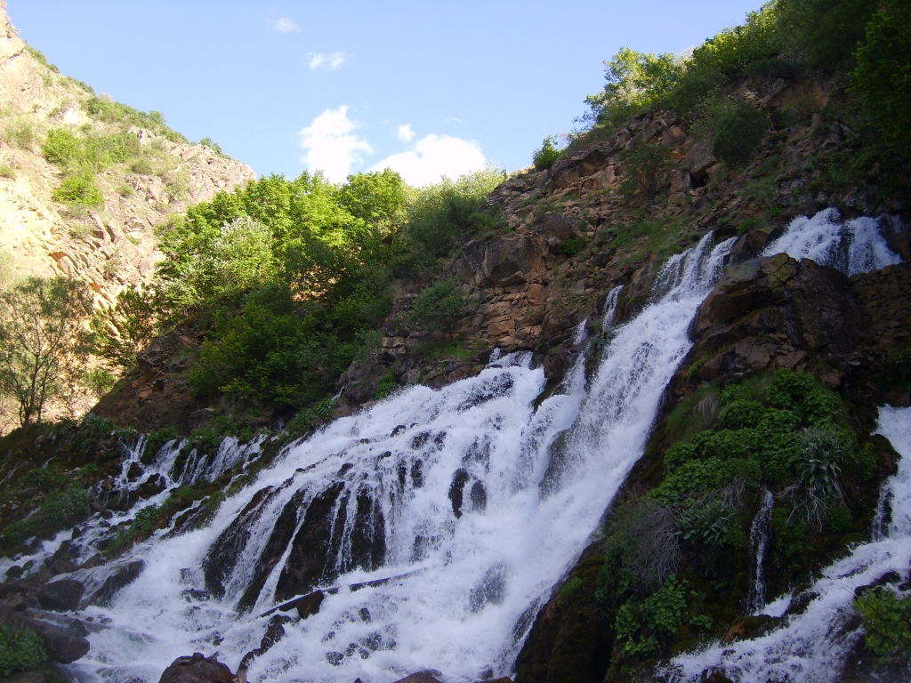

# 📍 Gumushane - Seyahat ve Tefekkür Notları

  

## 📜 Şehrin Ruhu
> "Karaca Mağarası'nın büyüleyici sarkıtlarıyla yeraltı saraylarını andıran, vadiler arasına gizlenmiş gümüş şehir."

### 🌍 Şehrin Dokusu ve Tarihsel Arka Planı
Tarih boyunca gümüş madenleriyle bilinen ve İpek Yolu'nun güvenliğini sağlayan Gümüşhane, tarihi konakları ve mağaralarıyla ünlüdür. Antik çağlarda *Argyropolis* (Gümüş Şehir) olarak anılan şehir, Zigana Geçidi'nin hemen güneyinde Harşit Çayı vadisinde konumlanır. Kanuni Sultan Süleyman'ın emriyle kurulan ve darphanesiyle Osmanlı hazinesine gümüş akçeler basan tarihi Süleymaniye Mahallesi; camileri, kiliseleri, hamamları ve konaklarıyla asırlar boyunca çok kültürlü bir medeniyet mozaiğine ev sahipliği yapmıştır.

### 🕌 Manevi Mimarlar ve Tarihî Şahsiyetler
- **Ahmed Ziyâüddin Gümüşhânevî (1813–1893):** 19. yüzyıl Osmanlı ilim ve tasavvuf dünyasının en büyük âlimlerinden, *Râmûzü'l-Ehâdîs* müellifi ve hadis üstadı; Gümüşhane'nin manevi mirasının zirve ismidir.
- **Çağırgan Baba (15. yüzyıl):** Şiran ve Kelkit havzasının manevi mimarlarından olan Horasan ereni; tekkesi ve türbesiyle bölgenin gönül coğrafyasını aydınlatmıştır.
- **Kanuni Sultan Süleyman:** Eski Gümüşhane'nin (Süleymaniye Mahallesi) imarına öncülük ederek şehri önemli bir maden ve darphane merkezine dönüştürmüştür.

### 💬 Şehir Hakkında Edebi ve Tarihi Alıntılar
> "Gümüşhane, adı gibi gümüş madenleriyle parlayan, vadilerin arasına gizlenmiş hazinedir." — Evliya Çelebi
>
> "Zigana'yı aşınca sisin yerini keskin bir dağ havası ve asırların gümüş hikâyeleri alır." — Seyyah Notu

### 🕊️ Gezginin Not Defterinden (Manevi Boyut ve Tefekkür)
Karaca Mağarası'nın derinliklerinde, binlerce yılda oluşan damlaların inşa ettiği sütunlara bakıp doğanın sabrını tefekkür edersiniz. Eski Süleymaniye Mahallesi'nin taş sokaklarında yürürken, bir zamanlar darphanenin çekiç sesleriyle yankılanan vadinin bugünkü dinginliğinde zamanın ve emeğin değerini hissedersiniz.

### 🍽️ Yöresel Lezzet Tavsiyeleri
- **Gümüşhane Pestili & Kömesi:** Dut şırası, bal, süt ve cevizle hazırlanan coğrafi işaretli Gümüşhane pestili ve cevizli kömesi, seyyahın yol azığıdır.
- **Siron & Kete:** Yufkanın rulo yapılıp tereyağı ve sarımsaklı yoğurtla buluşturulduğu siron ile tandır ketesi.
- **Gümüşhane Elması & Kuşburnu:** Harşit Vadisi'nin mis kokulu göbek elması ve şifalı kuşburnu nektarı.
- **Yerel Tatlar ve İkramlar:** Şehrin yerel esnaf lokantalarında ve pazar yerlerinde deneyimlenen bütçe dostu, kültürel dokuyu yansıtan eşsiz lezzetler.
- **Tefekkür Eşliğinde Çay/Kahve:** Şehrin tarihi kıraathanelerinde veya doğa manzaralı tepelerinde yudumlanan demli çaylar.

### ⛺ Konaklama ve Bütçe Stratejisi
- **Sıfır Konaklama Maliyeti (Modern Kervansaraylar):** GSB Seyahatsever projesi kapsamında şehirdeki KYK yurtlarında 5 gün boyunca ücretsiz konaklanarak bütçe korunmuştur.
- **Ulaşım ve Lojistik Planlama:** Rota optimizasyonuna uyularak komşu iller sırayla takip edilmiş, böylece hem yol maliyeti minimuma indirilmiş hem de karbon ayak izi azaltılmıştır.

### 💻 Yarı Göçebe Mesaisi (İlim Tahsili & Kütüphane)
- **Kütüphane Rutini:** Gündüz vakitlerinde şehrin İl Halk Kütüphanesinde zaman geçirilerek bilgisayar başında yazılım geliştirme ve ders çalışma faaliyetleri sürdürülmüştür.
  * *Seyyahın Kütüphane Notu:* Gumushane İl Halk Kütüphanesi - Sessiz, çalışma disiplinine uygun, internet imkanı sunan verimli bir ilim yuvası.
- **Süre ve Uyum:** Kütüphane mesaisi bitiminde şehrin ruhuna karışmak üzere yollara düşülmüş, 5 günlük menzil süresiyle şehir sindirilerek keşfedilmiştir.

### 🧭 5 Günlük Menzil Rotası
- **1. Gün (Eski Şehir Süleymaniye Mahallesi):** Sabah Gümüşhane İl Halk Kütüphanesi'nde çalışma; öğleden sonra Eski Gümüşhane (Süleymaniye) sokakları, Süleymaniye Camii, eski darphane kalıntıları ve tarihi konaklar.
- **2. Gün (Karaca Mağarası ve Torul Cam Teras):** Torul ilçesine hareket; damlataş oluşumlarıyla büyüleyen Karaca Mağarası ve 240 metre yükseklikteki Torul Kalesi Cam Seyir Terası.
- **3. Gün (Kromni Vadisi ve Santa Harabeleri):** Arkeolojik sit alanı olan Kromni Vadisi'ndeki tarihi taş yapılar, kiliseler ve yüksek dağ yaylalarının dingin atmosferi.
- **4. Gün (Limni Gölü ve Zigana):** Torul'un çam ormanları arasındaki Limni Gölü Tabiat Parkı'nda göl kenarında dinlenme ve Zigana Dağı geçidinde serin yayla havası.
- **5. Gün (Tomara Şelalesi ve Veda):** Sabah kütüphane mesaisi; öğleden sonra Şiran ilçesindeki 40 ayrı gözden fışkıran Tomara Şelalesi Tabiat Parkı ve merkezden pestil-köme alışverişiyle veda.

### ✨ Keşfedilesi Duraklar ve Landmarks
Bu şehrin havasını solumak, ruhuna dokunmak için mutlaka adımlanması gereken köşe taşları:
- [ ] **Karaca Mağarası**
- [ ] **Kromni Vadisi**
- [ ] **Tarihi Süleymaniye Mahallesi**
- [ ] **Torul Kalesi Cam Seyir Terası**
- [ ] **Limni Gölü Tabiat Parkı**
- [ ] **Tomara Şelalesi**

### 📸 Menzil Fotoğraf Galerisi
<table>
  <tr>
    <td align="center" width="50%">
       
      <em>Karaca Mağarası'nın binlerce yıllık sabırla işlenen damlataş sütunları</em>
    </td>
    <td align="center" width="50%">
       
      <em>Tarihi Süleymaniye Mahallesi ve Harşit Vadisi'nin kadim dokusu</em>
    </td>
  </tr>
</table>

---
*Bu il bizzat deneyimlenmiş, yolları aşındırılmış ve seyahatnameye sevgiyle işlenmiştir.* ✅
