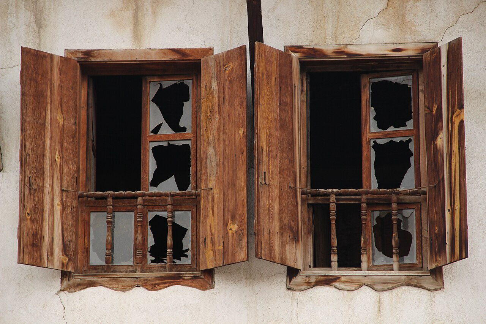
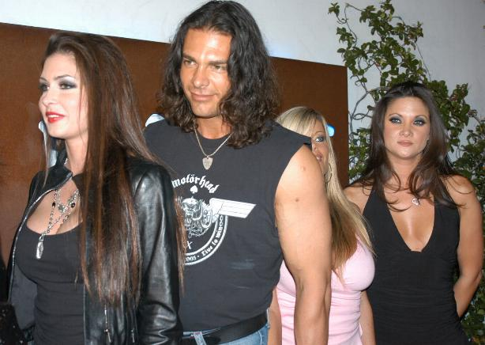

# 📍 Karabuk - Seyahat Notları (Keşif Dosyası)

  

## 📜 Seyyahın Beklentisi
> "UNESCO Dünya Mirası Safranbolu'nun Arnavut kaldırımlı sokaklarında Osmanlı'nın 'hiçbir ev diğerinin güneşini kesmez' ahlakını adımlamak, Tokatlı Kanyonu'nun derinliğinden Hadrianopolis mozaiklerine uzanmak için bekleyen kadim bir durak."

### 🌍 Şehrin Dokusu ve Tarihsel Arka Planı
Karabük, bir yanda Türkiye'nin ilk ağır sanayi hamlesi olan 1937 tarihli Demir Çelik Fabrikaları'yla Cumhuriyet'in sanayi hafızasını, diğer yanda 1994'te UNESCO Dünya Mirası Listesi'ne giren Safranbolu ile Osmanlı şehir medeniyetinin en saf ve eksiksiz açık hava müzesini barındırır. Antik Paflagonya coğrafyasının kalbinde yer alan Eskipazar'daki *Hadrianopolis* Antik Kenti ("Karadeniz'in Zeugma'sı"), görkemli kilise mozaikleriyle erken Bizans sanatına ışık tutar. Safranbolu'nun 300 yıllık konakları, Cinci Hanı, Yemeniciler Arastası ve Yenice'nin UNESCO tarafından dünya çapında korunması gereken sıcak nokta ilan edilen anıt ormanlarıyla Karabük, tarih ile tabiatın baş döndürücü bir buluşmasıdır.

### 🕌 Manevi Mimarlar ve Tarihî Şahsiyetler
- **Köprülü Mehmet Paşa (1578–1661):** Osmanlı'nın duraklama dönemine nefes aldıran büyük sadrazam; Safranbolu'da inşa ettirdiği Köprülü Mehmet Paşa Camii ve güneş saatli avlusu şehrin kalbidir.
- **Sadrazam İzzet Mehmet Paşa (1743–1812):** Safranbolu doğumlu Osmanlı sadrazamı; doğduğu şehre kendi adını taşıyan zarif külliyeyi, saat kulesini ve kütüphaneyi armağan etmiştir.
- **Safranbolu Ahileri ve Lonca Ustaları:** Yemeniciler Arastası, Demirciler Çarşısı ve Bakırcılar loncalarında "komşusu siftah etmeden ikinci satışı yapmayan" esnaf ahlakını yüzyıllar boyunca yaşatan gönül erleri.
- **Karabük Demir Çelik Emekçileri:** 3 Nisan 1937'de temeli atılan fabrikalarla "Cumhuriyet kenti" Karabük'ü yoktan var eden alın teri kahramanları.

### 💬 Şehir Hakkında Edebi ve Tarihi Alıntılar
> "Safranbolu, zamanın durduğu değil, zamanın nezaketle muhafaza edildiği bir Osmanlı rüyasıdır." — Kültür ve Mimari Notu
>
> "Bir şehrin ahlakını anlamak istersen evlerinin pencerelerine bak; Safranbolu'da hiçbir konak komşusunun güneşini ve manzarasını örtmez." — Seyyah Beklentisi
>
> "Safranbolu'nun havası latif, suları leziz, bağ ve bahçeleri cennet misalidir." — Evliya Çelebi

### 🍽️ Planlanan Yöresel Lezzet Durakları
- **Safranbolu Lokumu & Safran Çayı:** Ağırlığının yüz bin katı suyu sarıya boyayan mucizevi safran çiçeğinden yapılan safran çayı, zerde ve hafifliğiyle ünlü Safranbolu lokumu.
- **Kuyu Kebabı (Büryan) & Peruhi:** Derin taş kuyularda ağır ateşte pişen kuyu kebabı ile süzme yoğurtlu yöresel mantı peruhi.
- **Bükme Pide & Bağlar Gazozu:** Ispanaklı-kıymalı sac bükmesi ve 1936'dan beri üretilen nostaljik Safranbolu Bağlar gazozu.
- **Tefekkür Eşliğinde Kahve:** Cinci Hanı'nın veya Tarihi Arasta Kahvesi'nin gölgesinde közde pişmiş Türk kahvesi (yanında lokum ve soğuk su ikramıyla).

### ⛺ Konaklama ve Bütçe Planı
- **Modern Kervansaray Stratejisi:** GSB Seyahatsever projesi kapsamında Karabük/Safranbolu KYK yurtlarında 5 gün boyunca ücretsiz konaklama ile tarihî kenti acele etmeden sindirme planı.
- **Komşu İl Optimizasyonu:** Bartın → Karabük → Kastamonu hattı üzerinden Batı Karadeniz'in kültür üçgenini tamamlama.

### 💻 Planlanan Kütüphane Mesaisi
- **Kütüphane Durağı:** Karabük Zübeyde Hanım İl Halk Kütüphanesi ve Safranbolu İlçe Halk Kütüphanesi – Gündüz yazılım/ders mesaisi, öğleden sonra konak sokaklarında fotoğraf ve keşif.

### 🧭 5 Günlük Planlanan Menzil Rotası
- **1. Gün (Safranbolu Çarşı ve Konaklar):** Sabah kütüphane mesaisi; öğleden sonra Hıdırlık Tepesi'nden Safranbolu panoraması, Kaymakamlar Gezi Evi, Cinci Hanı, Köprülü Mehmet Paşa Camii (güneş saati), İzzet Paşa Camii ve Yemeniciler Arastası.
- **2. Gün (Kanyonlar, Teras ve Mağara):** Tokatlı Kanyonu yürüyüş parkuru, 80 metre yükseklikteki Kristal Cam Teras, İncekaya Su Kemeri ve 6 km uzunluğundaki Bulak Mencilis Mağarası.
- **3. Gün (Yörük Köyü ve Safran Tarlaları):** "Safranbolu'nun küçük maketi" olarak bilinen Türkmen yerleşimi Yörük Köyü, Sipahioğlu Konağı, Çamaşırhane ve Davutobası safran tarlaları.
- **4. Gün (Yenice Ormanları ve Şeker Kanyonu):** Biyoçeşitliliğiyle dünyaca ünlü Yenice Ormanları'nda doğa yürüyüşü, Ihlamur Teras ve Şeker Kanyonu'nun serin suları.
- **5. Gün (Eskipazar Hadrianopolis ve Veda):** "Karadeniz'in Zeugma'sı" Hadrianopolis Antik Kenti mozaikleri ziyareti; dönüşte Arasta'dan lokum ve safran alarak menzili tamamlama.

### ✨ Keşfedilmesi Beklenen Duraklar ve Landmarks
- [ ] **Safranbolu Tarihi Evleri ve Kaymakamlar Gezi Evi**
- [ ] **Cinci Hanı ve Yemeniciler Arastası**
- [ ] **Kristal Cam Teras ve Tokatlı Kanyonu**
- [ ] **Bulak Mencilis Mağarası**
- [ ] **Yörük Köyü**
- [ ] **Yenice Ormanları ve Şeker Kanyonu**
- [ ] **Hadrianopolis Antik Kenti (Eskipazar)**

### 📸 Menzil Fotoğraf Galerisi
<table>
  <tr>
    <td align="center" width="50%">
       
      <em>UNESCO Dünya Mirası Safranbolu'nun asırlık Osmanlı konakları (Planlanan Menzil)</em>
    </td>
    <td align="center" width="50%">
       
      <em>Tokatlı Kanyonu, İncekaya Su Kemeri ve Yenice'nin anıt ormanları</em>
    </td>
  </tr>
</table>

---
*Henüz adımlanmamış bu kadim şehir, keşif defterinde sırasını bekleyen bir menzil olarak kayda geçirilmiştir.*
