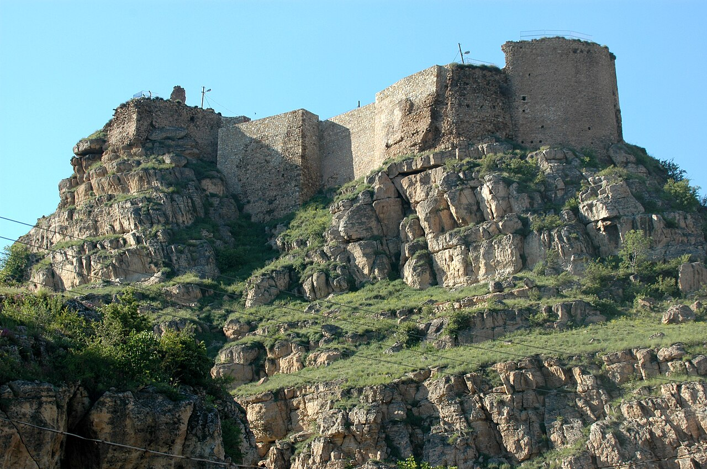
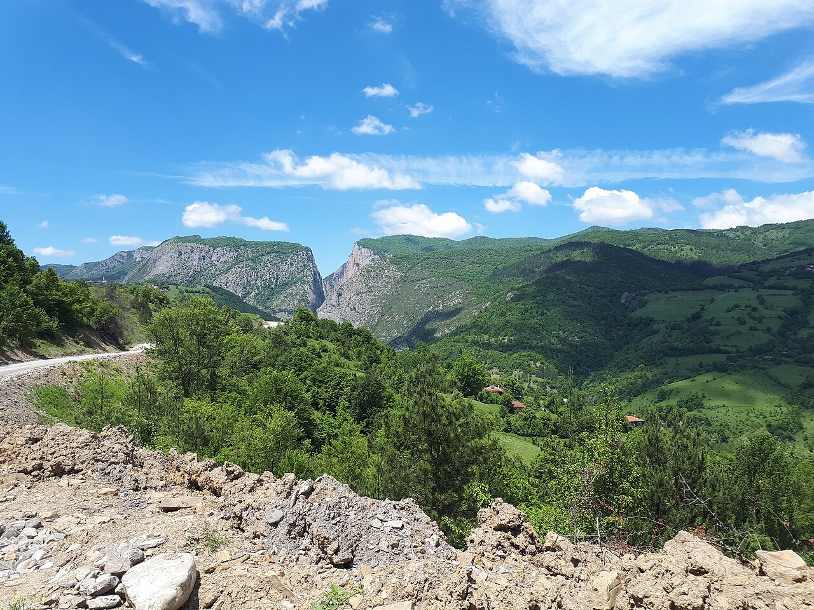

# 📍 Kastamonu - Seyahat Notları (Keşif Dosyası)

  

## 📜 Seyyahın Beklentisi
> "Anadolu'nun dört büyük manevi direğinden Şeyh Şaban-ı Veli'nin dergâhında soluklanmak, Nasrullah Meydanı'nda İstiklal Marşı'nın yankısını duymak ve Küre Dağları'nın heybetli kanyonlarına şahitlik etmek için bekleyen evliyalar şehri."

### 🌍 Şehrin Dokusu ve Tarihsel Arka Planı
"Evliyalar Şehri" ve Türk Dünyası Kültür Başkenti unvanlarıyla anılan Kastamonu, antik Paflagonya'nın başkenti olmasının ardından Danişmendliler, Çobanoğulları, Candaroğulları Beyliği ve Osmanlı dönemlerinde kesintisiz bir ilim, sanat ve devlet adamı yetiştirme merkezi olmuştur. UNESCO Dünya Mirası Listesi'ne giren 1366 tarihli **Kasaba Köyü Mahmut Bey Camii** (çivisiz ahşap direkli ve kalem işli şaheser), Kurtuluş Savaşı'nda İnebolu'dan Ankara'ya uzanan **İstiklal Yolu**'nun kalbi olması ve dünyanın en derin kanyonlarından Valla ile Horma kanyonlarına ev sahipliği yapmasıyla Kastamonu, Anadolu'nun en vakur kültür kalelerinden biridir.

### 🕌 Manevi Mimarlar ve Tarihî Şahsiyetler
- **Şeyh Şaban-ı Veli Hazretleri (1481–1569):** Anadolu'nun dört kutbundan (Hacı Bayram-ı Veli, Hacı Bektaş-ı Veli, Mevlânâ ve Şeyh Şaban-ı Veli) biri; Halvetî-Şabânî geleneğinin pîri. *"Gelişiniz güle güle, gidişiniz güle güle, her işiniz güle güle..."* duası asırlardır şehrin kapısında yankılanır.
- **Şerife Bacı (1900–1921):** İnebolu'dan cephane taşırken bebeğini ve mermileri ıslanmasın diye kazağıyla örtüp Kastamonu Kışlası önünde donarak şehit düşen Milli Mücadele'nin ölümsüz kahramanı.
- **Mehmet Âkif Ersoy (1873–1936):** 1920'de Kastamonu Nasrullah Camii kürsüsünden verdiği tarihî vaazlarla Anadolu halkını Milli Mücadele etrafında kenetlemiş, bu vaazlar *Sebîlürreşâd* ile tüm cephelere dağıtılmıştır.
- **Orhan Şaik Gökyay (1902–1994) & Rıfat Ilgaz (1911–1993):** *"Bu Vatan Kimin?"* şiirinin büyük edebiyatçısı Gökyay ile Cide'nin yetiştirdiği *Hababam Sınıfı* yazarı Rıfat Ilgaz Kastamonu'nun edebî mirasıdır.

### 💬 Şehir Hakkında Edebi ve Tarihi Alıntılar
> "Gelişiniz güle güle, gidişiniz güle güle, her işiniz güle güle..." — Şeyh Şaban-ı Veli Hazretleri
>
> "Nasrullah Şadırvanı'ndan su içen ya yedi yıl sonra yine gelir ya da Kastamonu'ya yerleşir." — Kadim Kastamonu Rivayeti
>
> "Kastamonu, uleması, şairleri ve velileri bol; kalesi göğe baş uzatmış mübarek bir şehirdir." — Evliya Çelebi

### 🍽️ Planlanan Yöresel Lezzet Durakları
- **Kastamonu Etli Ekmeği & Banduma:** İncecik açılmış sac ekmeği arasında baharatlı etli ekmek ve hindi suyu, ceviz, tereyağı ile hazırlanan şölen yemeği banduma.
- **Kuyu Kebabı (Büryan) & Kastamonu Pastırması:** Çam odunu közünde pişen kuyu kebabı ve doğal kurutma Kastamonu pastırması.
- **Siyez Bulguru & Çekme Helva:** 10.000 yıllık genetik mirasını koruyan İhsangazi siyez bulguru pilavı ve tereyağlı Kastamonu çekme helvası.
- **Tefekkür Eşliğinde Çay:** Münire Medresesi El Sanatları Çarşısı'nın taş avlusunda kumda pişen Türk kahvesi ve çay.

### ⛺ Konaklama ve Bütçe Planı
- **Modern Kervansaray Stratejisi:** GSB Seyahatsever projesi kapsamında Kastamonu KYK yurtlarında 5 gün boyunca ücretsiz konaklayarak hem şehir merkezini hem de Küre Dağları kanyonlarını keşfetme planı.
- **Komşu İl Optimizasyonu:** Karabük → Kastamonu → Sinop hattında Batı ve Orta Karadeniz geçişini birbirine bağlama.

### 💻 Planlanan Kütüphane Mesaisi
- **Kütüphane Durağı:** Kastamonu 100. Yıl İl Halk Kütüphanesi (ve tarihî Yazma Eser Kütüphanesi ziyareti) – Gündüz yazılım ve okuma mesaisi, öğleden sonra manevi ve tarihî duraklar.

### 🧭 5 Günlük Planlanan Menzil Rotası
- **1. Gün (Evliyalar ve Nasrullah Meydanı):** Sabah kütüphane mesaisi; öğleden sonra Şeyh Şaban-ı Veli Külliyesi ve Türbesi, Kastamonu Kalesi, Saat Kulesi, Nasrullah Camii ve Şadırvanı, Münire Medresesi ve Liva Paşa Konağı.
- **2. Gün (UNESCO Mirası Kasaba Köyü & Taşköprü):** Çivisiz ahşap mimarisiyle UNESCO Dünya Mirası olan 1366 tarihli Mahmut Bey Camii; ardından Taşköprü'de Pompeipolis Antik Kenti ve ünlü sarımsak çarşısı.
- **3. Gün (Pınarbaşı – Horma Kanyonu ve Ilıca Şelalesi):** Küre Dağları Milli Parkı'ndaki 3 km'lik ahşap yürüyüş platformuyla geçilen Horma Kanyonu, sonunda doğal havuzuyla büyüleyen Ilıca Şelalesi ve Valla Kanyonu Seyir Terası.
- **4. Gün (İnebolu – İstiklal Yolu ve Gideros Koyu):** Kurtuluş Savaşı'nın deniz kapısı İnebolu'nun aşı boyalı evleri ve Türk Ocağı binası; Cide sahilinde zümrüt yeşili Gideros Koyu.
- **5. Gün (Ilgaz Dağı veya Daday & Veda):** Sabah kütüphane mesaisi; öğleden sonra Ilgaz Dağı Milli Parkı'nda çam ormanları arasında yürüyüş, dönüşte çekme helva ve siyez bulguru teminiyle veda.

### ✨ Keşfedilmesi Beklenen Duraklar ve Landmarks
- [ ] **Şeyh Şaban-ı Veli Türbesi ve Külliyesi**
- [ ] **Kasaba Köyü Mahmut Bey Camii (UNESCO)**
- [ ] **Kastamonu Kalesi ve Saat Kulesi**
- [ ] **Nasrullah Camii, Şadırvanı ve Münire Medresesi**
- [ ] **Horma Kanyonu ve Ilıca Şelalesi**
- [ ] **Valla Kanyonu Seyir Terası**
- [ ] **İnebolu İstiklal Yolu ve Gideros Koyu**

### 📸 Menzil Fotoğraf Galerisi
<table>
  <tr>
    <td align="center" width="50%">
       
      <em>Evliyalar şehri Kastamonu'nun kalesi ve tarihî konak dokusu (Planlanan Menzil)</em>
    </td>
    <td align="center" width="50%">
       
      <em>Küre Dağları'nın kalbinde Horma Kanyonu ve Ilıca Şelalesi</em>
    </td>
  </tr>
</table>

---
*Henüz adımlanmamış bu kadim şehir, keşif defterinde sırasını bekleyen bir menzil olarak kayda geçirilmiştir.*
