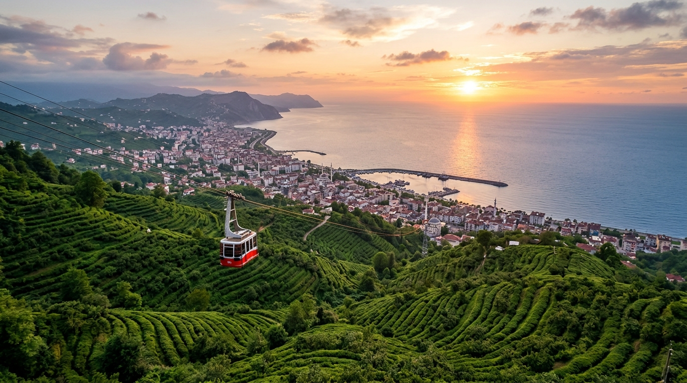
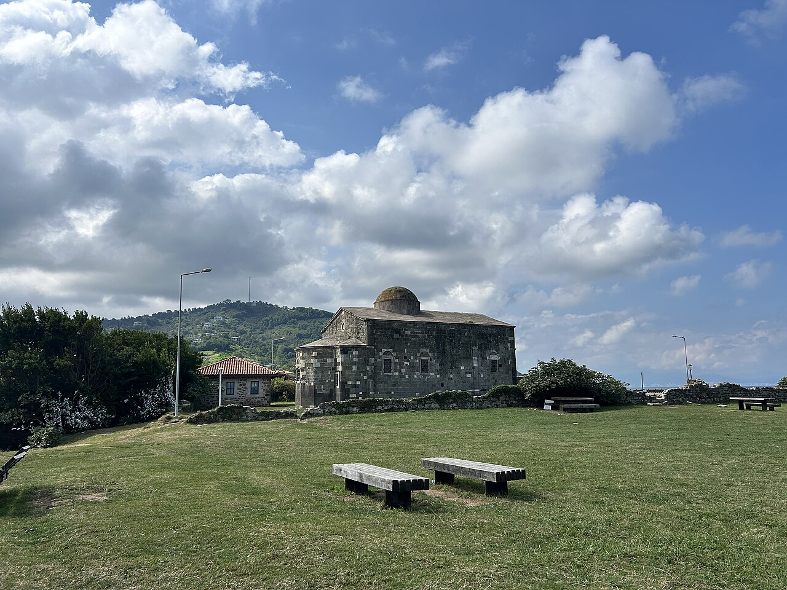

# 📍 Ordu - Seyahat ve Tefekkür Notları

  

## 📜 Şehrin Ruhu
> "Boztepe'den Karadeniz'i ayaklar altına seren, mavi ile yeşilin en kusursuz birleştiği huzurlu sahil şehri."

### 🌍 Şehrin Dokusu ve Tarihsel Arka Planı
Antik dönemde Cotyora adıyla kurulan Ordu, Karadeniz'in en sakin ve gelişmiş kültür kentlerinden biridir. Yason Burnu'ndaki Argonotlar efsanesiyle bilinir. Ksenophon'un *Anabasis* (On Binlerin Dönüşü) eserinde ordusunu dinlendirdiği liman olarak kayda geçen Cotyora, yüzyıllar sonra Hacıemiroğulları Beyliği'nin ve Osmanlı'nın fındık bahçeleriyle bezeli bereketli kıyı şehrine dönüşmüştür. Kurul Kalesi'nde ortaya çıkarılan 2.100 yıllık Ana Tanrıça Kibele heykeli ile Perşembe Yaylası'nın eşsiz menderesleri, Ordu'nun hem arkeolojik hem de doğal zenginliğini gözler önüne serer.

### 🕌 Manevi Mimarlar ve Tarihî Şahsiyetler
- **Şeyh Yunus (Yunus Emre Makamı – Ünye):** Ünye'de bulunan Yunus Emre türbesi/makamı, Anadolu'nun gönül dilinin Karadeniz sahillerindeki yankısıdır.
- **Emir Yakup & Hacıemiroğulları Beyliği:** 14. yüzyılda Ordu, Mesudiye ve Giresun havalisinde Türk-İslam kültürünü kökleştiren, Eskipazar ve Bayramlı yerleşimlerini kuran beylik önderleri.
- **Hamdullah Suphi Tanrıöver & Sıtkı Çebi:** Şehrin eğitim, kültür ve edebiyat hafızasına yön veren münevverler.
- **Perşembe (Vona) Sakin Şehir Kültürü:** Cittaslow unvanına sahip Perşembe ilçesi, denizle barışık, telaşsız Karadeniz yaşayışının yaşayan temsilcisidir.

### 💬 Şehir Hakkında Edebi ve Tarihi Alıntılar
> "Boztepe'ye çıkmalı ve Ordu'nun yeşilliğinde denizin nasıl eridiğini izlemeli." — Bedri Rahmi Eyüboğlu
>
> "Yason Burnu, Karadeniz'in hırçın sularına uzanan tarihi ve sakin bir limandır." — Evliya Çelebi
>
> "Ordu'nun dereleri aksa yukarı aksa..." — Anonim Ordu Türküsü

### 🕊️ Gezginin Not Defterinden (Manevi Boyut ve Tefekkür)
Boztepe'den şehri ve denizi seyrederken, yeryüzünün güzelliğini ve gökyüzüyle bütünleşen ufuk çizgisini tefekkür edersiniz. Perşembe Yaylası'nın kıvrıla kıvrıla akan mendereslerini yukarıdan izlerken, suyun bile önüne çıkan engellere kızmadan zarafetle yolunu bulduğunu görüp sabrı yeniden öğrenirsiniz.

### 🍽️ Yöresel Lezzet Tavsiyeleri
- **Ordu Pidesi (Yağlı Pide):** İncecik açılmış hamuru, yöresel yayla tereyağı ve kıymalı/peynirli çeşitleriyle taş fırından çıkan gerçek Ordu pidesi.
- **Pancar (Karalahana) Çorbası & Melocan Kavurması:** Mısır yarmalı pancar çorbası ve Karadeniz'in şifalı yabani otu melocan (diken ucu) kavurması.
- **Ordu Tostu & Fındık:** Özel bazlama ekmeğiyle yapılan meşhur Ordu tostu ve kavrulmuş taze Ordu fındığı.
- **Yerel Tatlar ve İkramlar:** Şehrin yerel esnaf lokantalarında ve pazar yerlerinde deneyimlenen bütçe dostu, kültürel dokuyu yansıtan eşsiz lezzetler.
- **Tefekkür Eşliğinde Çay/Kahve:** Şehrin tarihi kıraathanelerinde veya doğa manzaralı tepelerinde yudumlanan demli çaylar.

### ⛺ Konaklama ve Bütçe Stratejisi
- **Sıfır Konaklama Maliyeti (Modern Kervansaraylar):** GSB Seyahatsever projesi kapsamında şehirdeki KYK yurtlarında 5 gün boyunca ücretsiz konaklanarak bütçe korunmuştur.
- **Ulaşım ve Lojistik Planlama:** Rota optimizasyonuna uyularak komşu iller sırayla takip edilmiş, böylece hem yol maliyeti minimuma indirilmiş hem de karbon ayak izi azaltılmıştır.

### 💻 Yarı Göçebe Mesaisi (İlim Tahsili & Kütüphane)
- **Kütüphane Rutini:** Gündüz vakitlerinde şehrin İl Halk Kütüphanesinde zaman geçirilerek bilgisayar başında yazılım geliştirme ve ders çalışma faaliyetleri sürdürülmüştür.
  * *Seyyahın Kütüphane Notu:* Ordu İl Halk Kütüphanesi - Sessiz, çalışma disiplinine uygun, internet imkanı sunan verimli bir ilim yuvası.
- **Süre ve Uyum:** Kütüphane mesaisi bitiminde şehrin ruhuna karışmak üzere yollara düşülmüş, 5 günlük menzil süresiyle şehir sindirilerek keşfedilmiştir.

### 🧭 5 Günlük Menzil Rotası
- **1. Gün (Boztepe ve Sahil Yürüyüşü):** Sabah Ordu İl Halk Kütüphanesi'nde çalışma; öğleden sonra teleferikle 530 metre rakımlı Boztepe'ye çıkış, gün batımında Karadeniz manzarası eşliğinde çay ve Paşaoğlu Konağı Etnografya Müzesi.
- **2. Gün (Yason Burnu ve Perşembe Sakin Şehir):** Sahil yolundan Perşembe ilçesine uzanış; 1868 tarihli Yason Kilisesi, deniz feneri ve Hoynat Adası kuş cenneti.
- **3. Gün (Perşembe Yaylası Menderesleri):** Aybastı ilçesindeki Perşembe Yaylası'na tam günlük doğa rotası; dünyanın en estetik doğal mendereslerinin tepeden izlenmesi ve yayla gölü çevresinde yürüyüş.
- **4. Gün (Kurul Kalesi ve Ulugöl):** Sabah Kibele heykelinin bulunduğu antik Kurul Kalesi; öğleden sonra Gölköy'deki Ulugöl Tabiat Parkı'nın renk cümbüşünde sükunet molası.
- **5. Gün (Ünye ve Çambaşı / Veda):** Sabah kütüphane mesaisi sonrası Ünye Kalesi ve Çamlık sahilinde veda yürüyüşü, yerel fırından Ordu pidesiyle menzili tamamlama.

### ✨ Keşfedilesi Duraklar ve Landmarks
Bu şehrin havasını solumak, ruhuna dokunmak için mutlaka adımlanması gereken köşe taşları:
- [ ] **Ordu Boztepe ve Teleferik**
- [ ] **Yason Burnu ve Kilisesi**
- [ ] **Kurul Kalesi**
- [ ] **Perşembe Yaylası Menderesleri**
- [ ] **Ulugöl Tabiat Parkı**
- [ ] **Paşaoğlu Konağı ve Etnografya Müzesi**

### 📸 Menzil Fotoğraf Galerisi
<table>
  <tr>
    <td align="center" width="50%">
       
      <em>Boztepe'den Karadeniz'in mavi-yeşil ufkuna huzurlu bakış</em>
    </td>
    <td align="center" width="50%">
       
      <em>Yason Burnu'nun sakin suları ve Ordu'nun eşsiz yayla dokusu</em>
    </td>
  </tr>
</table>

---
*Bu il bizzat deneyimlenmiş, yolları aşındırılmış ve seyahatnameye sevgiyle işlenmiştir.* ✅
