

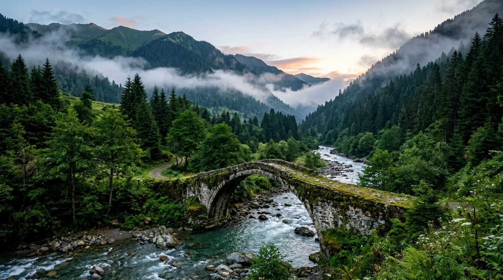

# 🌲 Karadeniz Bölgesi

> *Zikir, Orman & Dalga: Hırçın dalgaların yemyeşil yaylalarla buluştuğu doğanın muazzam senfonisi.*

**Keşif İlerlemesi:** `11 / 18 İl` (**%61.1**) &nbsp;•&nbsp; [🏠 Ana Sayfaya Dön](../README.md) &nbsp;•&nbsp; [🌐 Web Portalı](https://bahattinyunus.github.io/dijitalseyyah/)

---

## 🖼️ Bölge İlleri Görsel Rehberi

<table>
  <tr>
    <td align="center" width="33%" valign="top">
       
      <strong><a href="Amasya/README.md">05 • Amasya</a></strong> 
      ✅ Gezildi • 📍 Kral Kaya Mezarları 🍽️ Amasya Elması
    </td>
    <td align="center" width="33%" valign="top">
       
      <strong><a href="Artvin/README.md">08 • Artvin</a></strong> 
      ✅ Gezildi • 📍 Borçka Karagöl 🍽️ Karalahana Sarması
    </td>
    <td align="center" width="33%" valign="top">
      <a href="Bartin/README.md">
        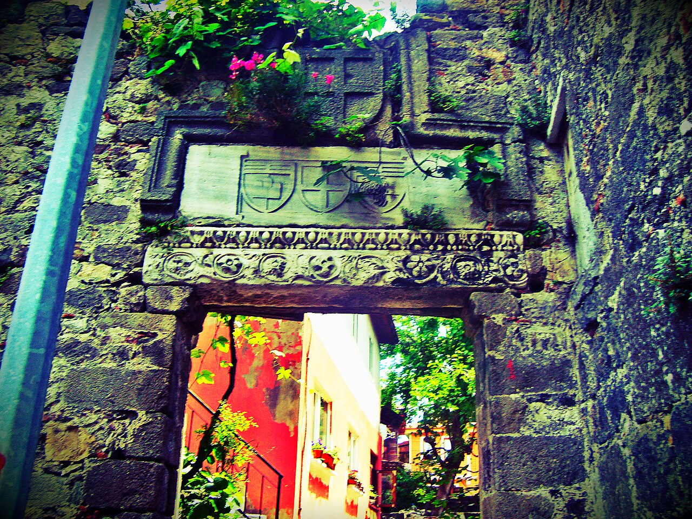
      </a> 
      <strong><a href="Bartin/README.md">74 • Bartın</a></strong> 
      ⏳ Bekliyor • 📍 Amasra Kalesi 🍽️ Amasra Salatası
    </td>
  </tr>
  <tr>
    <td align="center" width="33%" valign="top">
      <a href="Bayburt/README.md">
        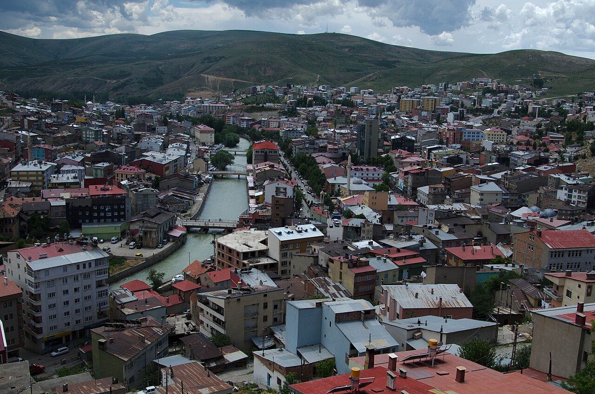
      </a> 
      <strong><a href="Bayburt/README.md">69 • Bayburt</a></strong> 
      ✅ Gezildi • 📍 Bayburt Kalesi 🍽️ Bayburt Ketesi
    </td>
    <td align="center" width="33%" valign="top">
      <a href="Bolu/README.md">
        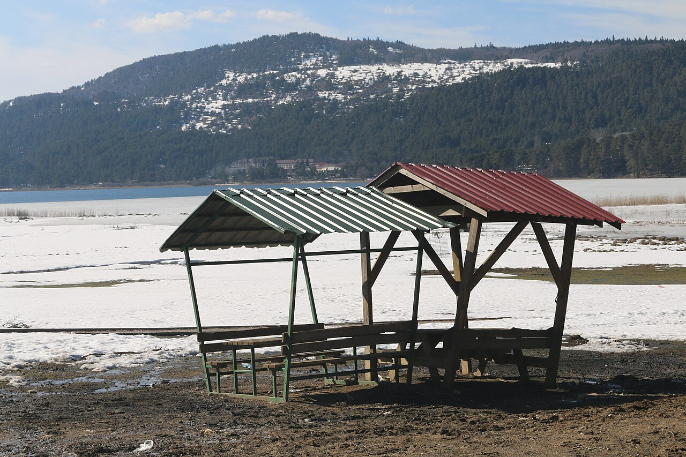
      </a> 
      <strong><a href="Bolu/README.md">14 • Bolu</a></strong> 
      ⏳ Bekliyor • 📍 Abant Gölü 🍽️ Mengen Aşçı Yemekleri
    </td>
    <td align="center" width="33%" valign="top">
       
      <strong><a href="Corum/README.md">19 • Çorum</a></strong> 
      ✅ Gezildi • 📍 Hattuşaş (Boğazkale) Hitit Başkenti 🍽️ Çorum Leblebisi
    </td>
  </tr>
  <tr>
    <td align="center" width="33%" valign="top">
      <a href="Duzce/README.md">
        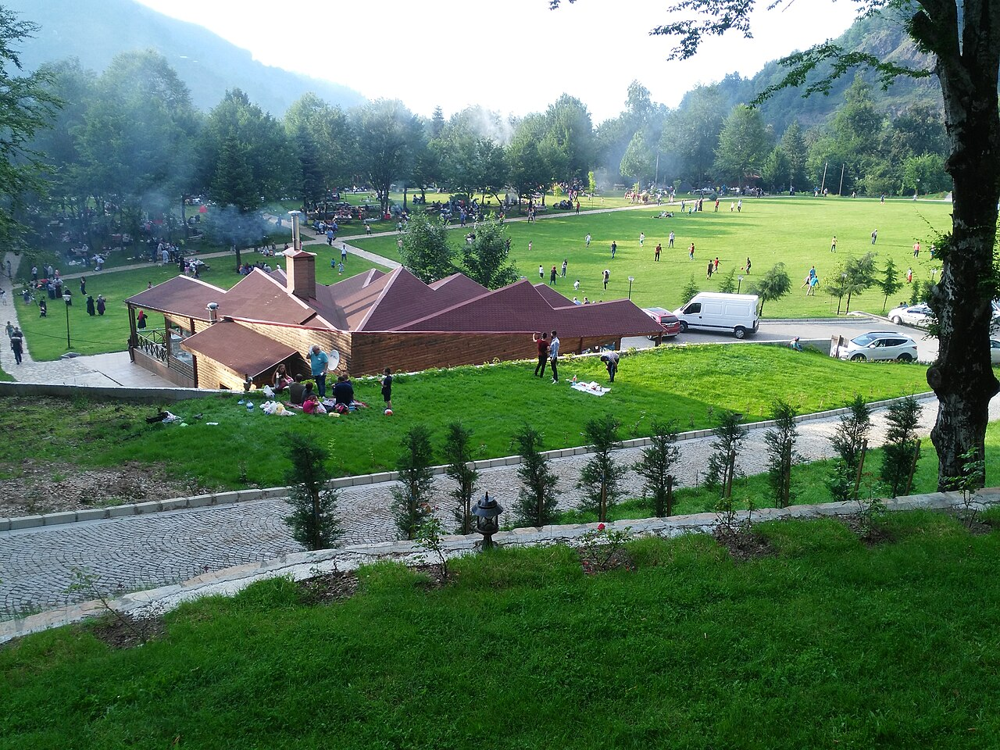
      </a> 
      <strong><a href="Duzce/README.md">81 • Düzce</a></strong> 
      ⏳ Bekliyor • 📍 Güzeldere Şelalesi 🍽️ Düzce Köftesi
    </td>
    <td align="center" width="33%" valign="top">
       
      <strong><a href="Giresun/README.md">28 • Giresun</a></strong> 
      ✅ Gezildi • 📍 Giresun Kalesi 🍽️ Giresun Fındığı
    </td>
    <td align="center" width="33%" valign="top">
       
      <strong><a href="Gumushane/README.md">29 • Gümüşhane</a></strong> 
      ✅ Gezildi • 📍 Karaca Mağarası 🍽️ Pestil & Köme
    </td>
  </tr>
  <tr>
    <td align="center" width="33%" valign="top">
      <a href="Karabuk/README.md">
        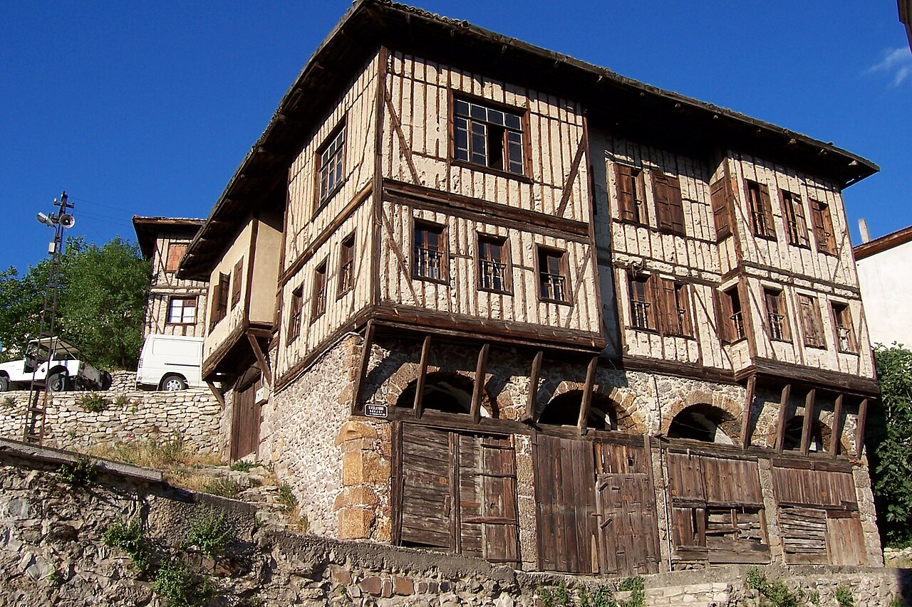
      </a> 
      <strong><a href="Karabuk/README.md">78 • Karabük</a></strong> 
      ⏳ Bekliyor • 📍 Safranbolu Tarihi Evleri 🍽️ Safranbolu Lokumu
    </td>
    <td align="center" width="33%" valign="top">
      <a href="Kastamonu/README.md">
        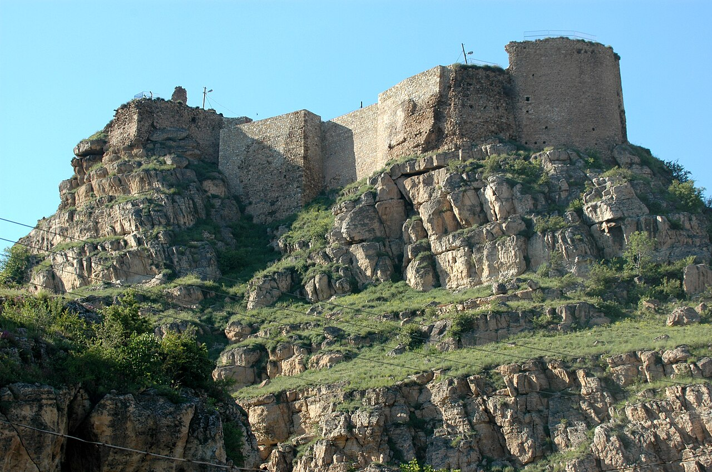
      </a> 
      <strong><a href="Kastamonu/README.md">37 • Kastamonu</a></strong> 
      ⏳ Bekliyor • 📍 Kastamonu Kalesi 🍽️ Kastamonu Pastırması
    </td>
    <td align="center" width="33%" valign="top">
      <a href="Ordu/README.md">
        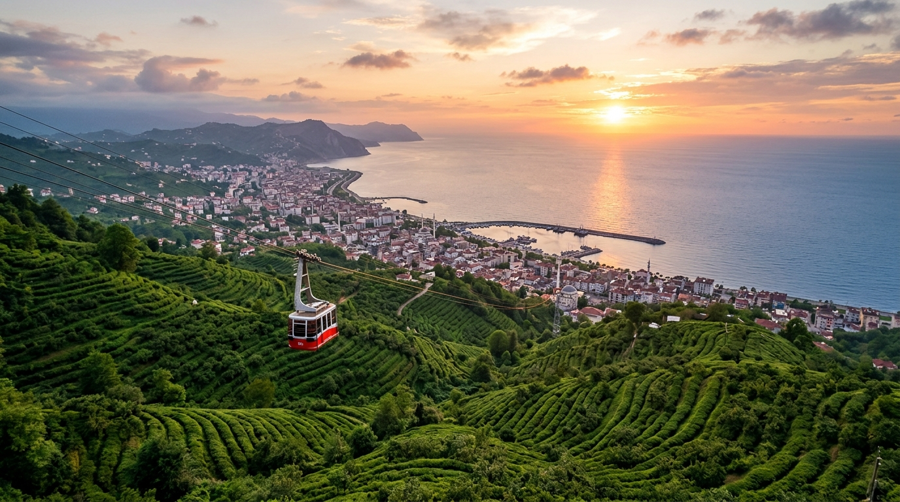
      </a> 
      <strong><a href="Ordu/README.md">52 • Ordu</a></strong> 
      ✅ Gezildi • 📍 Boztepe & Teleferik 🍽️ Ordu Pidesi
    </td>
  </tr>
  <tr>
    <td align="center" width="33%" valign="top">
       
      <strong><a href="Rize/README.md">53 • Rize</a></strong> 
      ✅ Gezildi • 📍 Ayder Yaylası 🍽️ Rize Çayı
    </td>
    <td align="center" width="33%" valign="top">
      <a href="Samsun/README.md">
        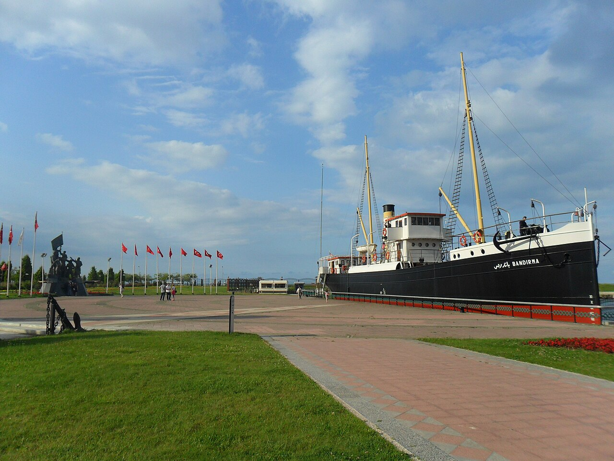
      </a> 
      <strong><a href="Samsun/README.md">55 • Samsun</a></strong> 
      ✅ Gezildi • 📍 Bandırma Vapuru Müzesi 🍽️ Samsun Pidesi (Bafra/Terme)
    </td>
    <td align="center" width="33%" valign="top">
       
      <strong><a href="Sinop/README.md">57 • Sinop</a></strong> 
      ✅ Gezildi • 📍 Tarihi Sinop Cezaevi 🍽️ Sinop Mantısı (Cevizli)
    </td>
  </tr>
  <tr>
    <td align="center" width="33%" valign="top">
      <a href="Tokat/README.md">
        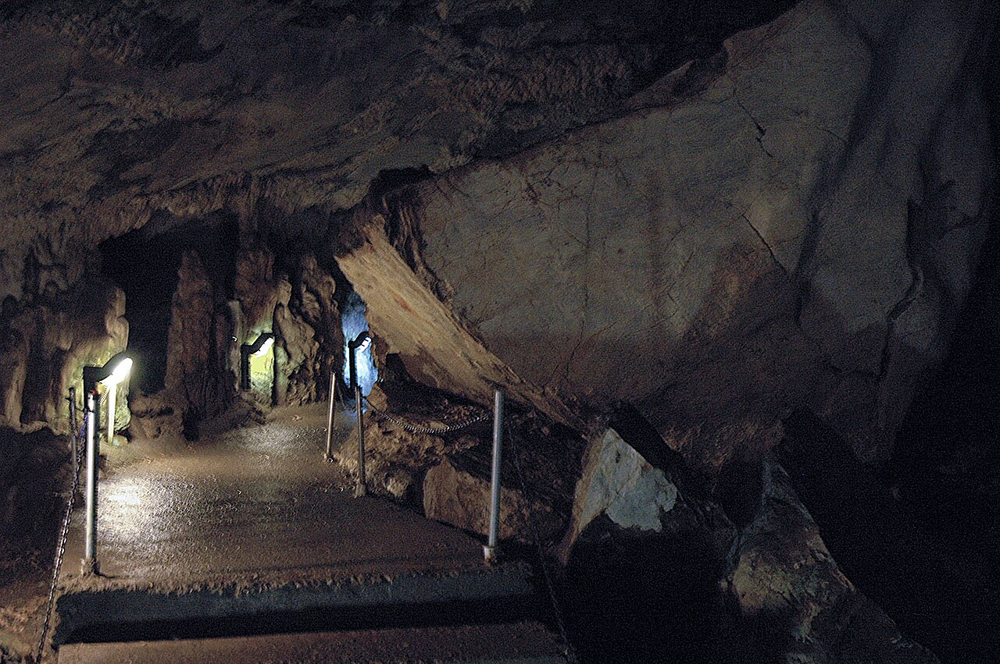
      </a> 
      <strong><a href="Tokat/README.md">60 • Tokat</a></strong> 
      ⏳ Bekliyor • 📍 Ballıca Mağarası 🍽️ Tokat Kebabı
    </td>
    <td align="center" width="33%" valign="top">
       
      <strong><a href="Trabzon/README.md">61 • Trabzon</a></strong> 
      ✅ Gezildi • 📍 Sümela Manastırı 🍽️ Akçaabat Köftesi
    </td>
    <td align="center" width="33%" valign="top">
      <a href="Zonguldak/README.md">
        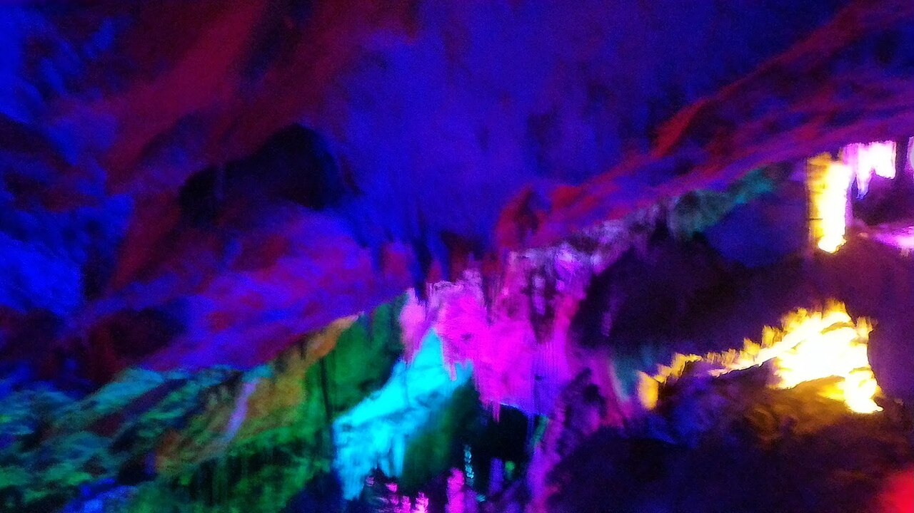
      </a> 
      <strong><a href="Zonguldak/README.md">67 • Zonguldak</a></strong> 
      ⏳ Bekliyor • 📍 Gökgöl Mağarası 🍽️ Uğmaç Çorbası
    </td>
  </tr>
</table>

---

*Anadolu Seyahatnamesi — Dijital Seyyah Bölge Dosyası*
