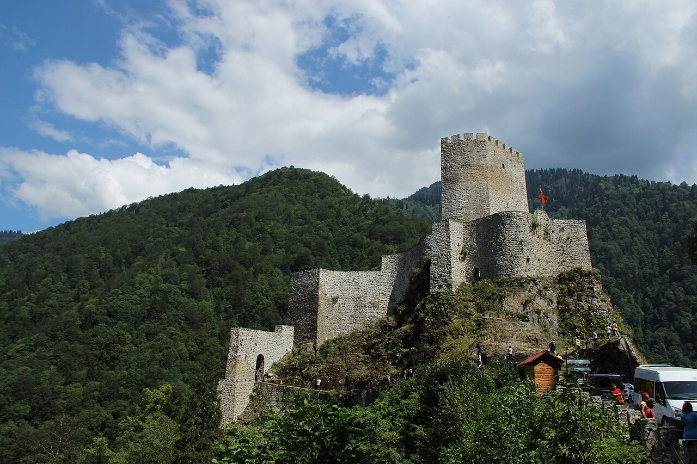

# 📍 Rize - Seyahat ve Tefekkür Notları

  

## 📜 Şehrin Ruhu
> "Fırtına Deresi'nin coşkulu sesi, Zil Kale'nin sarp kayalıklardaki asil duruşu ve yeşilin vatanı Rize."

### 🌍 Şehrin Dokusu ve Tarihsel Arka Planı
Çay tarımıyla özdeşleşen Rize, sarp vadileri, tarihi taş köprüleri ve geçit vermez kaleleriyle Karadeniz'in en karakteristik şehridir. Antik adı *Rhizus* (dağ eteği / kök) olan bu coğrafya; Kaçkar Dağları'nın 3.937 metrelik zirvelerinden Karadeniz'in hırçın dalgalarına dik inen vadileriyle dünyanın en yağışlı ve en yeşil ekosistemlerinden birini barındırır. 1461'de Trabzon'un fethiyle Osmanlı topraklarına katılan Rize, Cumhuriyet döneminde Zihni Derin'in öncülüğünde başlayan çay tarımıyla Türkiye'nin çay başkenti kimliğini kazanmış; kemer taş köprüleri, serenderleri ve bulut denizi üzerindeki yaylalarıyla eşsiz bir kültür havzası oluşturmuştur.

### 🕌 Manevi Mimarlar ve Tarihî Şahsiyetler
- **Zihni Derin (1880–1965):** "Çayın Babası" olarak anılan ziraat mühendisi; Rize'de çay tarımının kurumsallaşmasını sağlayarak bölge halkının kaderini değiştirmiştir.
- **Şeyh Mustafa Efendi & Rize Müderrisleri:** Osmanlı'dan Cumhuriyet'e Rize'nin cami ve medreselerinde (İslam Paşa / Kurşunlu Camii çevresinde) ilim ve irfan geleneğini yaşatan gönül insanları.
- **İslam Paşa (16. yüzyıl):** Rize merkezindeki tarihi İslam Paşa (Kurşunlu) Camii'ni inşa ettirerek şehrin Osmanlı dönemindeki mimari siluetini şekillendiren devlet adamı.
- **Ekrem Orhon (1911–1983):** "Efsane Başkan" olarak bilinen, Rize'nin modern şehircilik ve deniz dolgusu vizyonuna imza atan inşaat mühendisi ve belediye başkanı.

### 💬 Şehir Hakkında Edebi ve Tarihi Alıntılar
> "Zil Kale, bulutların arasında, sarp kayalarda yükselen manevi bir abide gibidir." — Evliya Çelebi
>
> "Rize, çay yapraklarının yeşilliğinde her sabah yeniden doğan şehirdir." — Bedri Rahmi Eyüboğlu
>
> "Kaçkarların tepesinde bulutlar ayaklarının altındayken, dünya gürültüsü çok uzaklarda bir fısıltıya dönüşür." — Seyyah Notu

### 🕊️ Gezginin Not Defterinden (Manevi Boyut ve Tefekkür)
Kaçkarların sisli zirvelerine bakarken, bulutların dağlarla yaptığı zikri izler, Zil Kale'nin yalnızlığında zamanın geçiciliğini düşünürsünüz. Yağmur damlalarının çay yapraklarından süzülürken çıkardığı ritmik ses, insanın içindeki telaşı yatıştıran ilahî bir musikiye dönüşür.

### 🍽️ Yöresel Lezzet Tavsiyeleri
- **Rize Kavurması & Muhlama:** Odun ateşinde ağır ağır pişen lokum gibi Rize kavurması ve uzayan koloti peynirli tereyağlı muhlama.
- **Laz Böreği & Enişte Lokumu:** İncecik açılmış şerbetli-muhallebili Laz böreği ve çay yanına eşlik eden tereyağlı enişte lokumu.
- **Kuru Fasulye (Çayeli) & Rize Çayı:** İspir fasulyesinden yapılan meşhur Çayeli kuru fasulyesi ve taze hasat tavşan kanı Rize çayı.
- **Yerel Tatlar ve İkramlar:** Şehrin yerel esnaf lokantalarında ve pazar yerlerinde deneyimlenen bütçe dostu, kültürel dokuyu yansıtan eşsiz lezzetler.
- **Tefekkür Eşliğinde Çay/Kahve:** Şehrin tarihi kıraathanelerinde veya doğa manzaralı tepelerinde yudumlanan demli çaylar.

### ⛺ Konaklama ve Bütçe Stratejisi
- **Sıfır Konaklama Maliyeti (Modern Kervansaraylar):** GSB Seyahatsever projesi kapsamında şehirdeki KYK yurtlarında 5 gün boyunca ücretsiz konaklanarak bütçe korunmuştur.
- **Ulaşım ve Lojistik Planlama:** Rota optimizasyonuna uyularak komşu iller sırayla takip edilmiş, böylece hem yol maliyeti minimuma indirilmiş hem de karbon ayak izi azaltılmıştır.

### 💻 Yarı Göçebe Mesaisi (İlim Tahsili & Kütüphane)
- **Kütüphane Rutini:** Gündüz vakitlerinde şehrin İl Halk Kütüphanesinde zaman geçirilerek bilgisayar başında yazılım geliştirme ve ders çalışma faaliyetleri sürdürülmüştür.
  * *Seyyahın Kütüphane Notu:* Rize İl Halk Kütüphanesi - Sessiz, çalışma disiplinine uygun, internet imkanı sunan verimli bir ilim yuvası.
- **Süre ve Uyum:** Kütüphane mesaisi bitiminde şehrin ruhuna karışmak üzere yollara düşülmüş, 5 günlük menzil süresiyle şehir sindirilerek keşfedilmiştir.

### 🧭 5 Günlük Menzil Rotası
- **1. Gün (Şehir Merkezi, Çay Bahçesi ve Kale):** Sabah Rize İl Halk Kütüphanesi'nde çalışma; öğleden sonra Rize Kalesi, Ziraat Botanik Çay Bahçesi'nde çay tarlaları arasında mola ve Rize Müzesi (Sarı Ev).
- **2. Gün (Fırtına Vadisi, Zil Kale ve Palovit):** Çamlıhemşin'e uzanış; tarihi Osmanlı taş kemer köprüleri, sarp kayalıklar üzerindeki Zil Kale, Şimşir Ormanları ve gürül gürül akan Palovit Şelalesi.
- **3. Gün (Ayder Yaylası ve Gelintülü Şelalesi):** Kaçkar Dağları Milli Parkı sınırındaki Ayder Yaylası'nda yürüyüş, Gelintülü Şelalesi manzarası ve sisli yayla kahvesinde dinlenme.
- **4. Gün (Pokut ve Sal Yaylaları):** 2.000 metre rakımdaki Pokut ve Sal Yaylaları'na çıkarak bulut denizinin üzerinde otantik ahşap yayla evleri arasında unutulmaz bir gün.
- **5. Gün (Çayeli, Ağaran Şelalesi ve Veda):** Sabah kütüphane mesaisi; öğleden sonra Çayeli'nde kuru fasulye tadımı, Ağaran Şelalesi ve Rize Bezi (Feretiko) atölyesi ziyaretiyle veda.

### ✨ Keşfedilesi Duraklar ve Landmarks
Bu şehrin havasını solumak, ruhuna dokunmak için mutlaka adımlanması gereken köşe taşları:
- [ ] **Zil Kale**
- [ ] **Ayder Yaylası ve Gelintülü Şelalesi**
- [ ] **Fırtına Deresi ve Tarihi Köprüler**
- [ ] **Pokut & Sal Yaylaları**
- [ ] **Palovit Şelalesi**
- [ ] **Rize Ziraat Botanik Çay Bahçesi ve Rize Kalesi**

### 📸 Menzil Fotoğraf Galerisi
<table>
  <tr>
    <td align="center" width="50%">
       
      <em>Fırtına Vadisi'nin sarp kayalıklarında yükselen asil Zil Kale</em>
    </td>
    <td align="center" width="50%">
       
      <em>Kaçkarların sisli zirveleri ve yeşilin vatanı Rize yaylaları</em>
    </td>
  </tr>
</table>

---
*Bu il bizzat deneyimlenmiş, yolları aşındırılmış ve seyahatnameye sevgiyle işlenmiştir.* ✅
