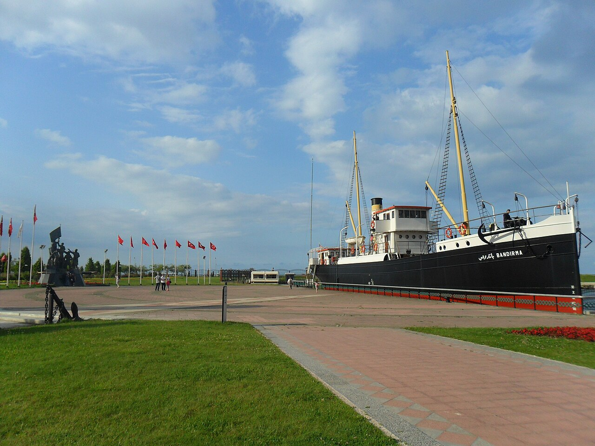
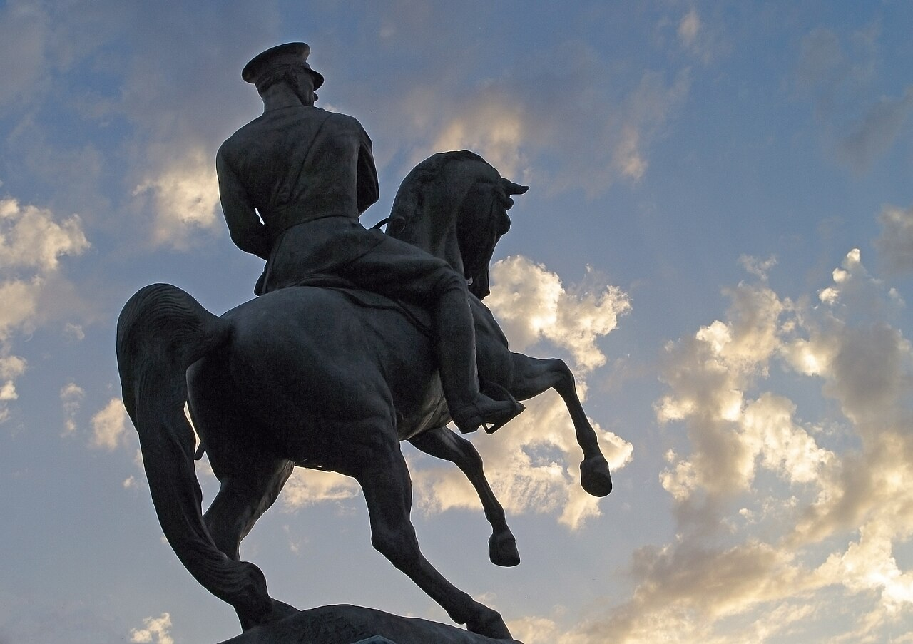

# 📍 Samsun - Seyahat ve Tefekkür Notları

  

## 📜 Şehrin Ruhu
> "Milli Mücadele'nin ilk adımının atıldığı, kurtuluş meşalesinin yandığı vakur ve öncü sahil şehri."

### 🌍 Şehrin Dokusu ve Tarihsel Arka Planı
19 Mayıs 1919'da Mustafa Kemal Atatürk'ün ayak basmasıyla Kurtuluş Savaşı'nın başlangıç noktası olan Samsun, Karadeniz'in en büyük limanı ve ticaret merkezidir. Antik çağlarda *Amisos* adıyla kurulan şehir, Kızılırmak ve Yeşilırmak gibi Anadolu'nun iki dev nehrinin oluşturduğu Bafra ve Çarşamba ovaları arasında bereketli bir coğrafyada yükselir. Danişmendliler ve Anadolu Selçukluları döneminde Karadeniz'e açılan en mühim Türk limanı olan Samsun; UNESCO Dünya Mirası Geçici Listesi'ndeki Kızılırmak Deltası Kuş Cenneti ve heybetli Şahinkaya Kanyonu ile hem tarihin hem de tabiatın görkemini bir arada sunar.

### 🕌 Manevi Mimarlar ve Tarihî Şahsiyetler
- **Gazi Mustafa Kemal Atatürk ve 19 Mayıs Ruhu:** 19 Mayıs 1919 sabahı Bandırma Vapuru ile Tütün İskelesi'ne çıkarak Türk milletinin bağımsızlık destanını Samsun'dan başlatmıştır.
- **Seyyid Kutbiddin (13. yüzyıl):** Abdülkadir Geylânî'nin torunlarından olduğu rivayet edilen, Samsun'un manevi banilerinden olan gönül sultanı; türbesi şehrin en kadim ziyaretgâhlarındandır.
- **Yaşar Doğu (1913–1961):** Samsun Kavak doğumlu, dünya ve olimpiyat şampiyonu efsanevi Türk güreşçisi; Türk spor tarihinin ahlak ve güç sembolüdür.
- **Çarşamba Göğceli Camii Ustaları (1206):** Çivi kullanılmadan (çantı tekniğiyle) inşa edilen ve 800 yılı aşkın süredir depremlere meydan okuyan Göğceli Camii, Anadolu ahşap mimarisinin şaheseridir.

### 💬 Şehir Hakkında Edebi ve Tarihi Alıntılar
> "Samsun, vatanın kurtuluş meşalesinin tutuşturulduğu mübarek limandır." — Mustafa Kemal Atatürk
>
> "Samsun limanı, Karadeniz'in en işlek ve bereketli iskelesidir." — Evliya Çelebi
>
> "Bir Mayıs sabahı Tütün İskelesi'nde atılan o ilk adım, bütün bir milletin makûs talihini değiştirdi." — Tarih Notu

### 🕊️ Gezginin Not Defterinden (Manevi Boyut ve Tefekkür)
Bandırma Vapuru'nun önünde durup bağımsızlık mücadelesinin ilk günlerini tefekkür eder, özgürlüğün ne büyük bir nimet olduğunu düşünürsünüz. Kızılırmak Deltası'nda gün batarken gökyüzünü süsleyen yüzlerce göçmen kuşu izlemek, hem vatan toprağının hem de yaratılışın eşsiz dengesini kalbinize işler.

### 🍽️ Yöresel Lezzet Tavsiyeleri
- **Bafra & Terme Pidesi:** İnce, çıtır ve kapalı Bafra pidesi ile açık ve bol tereyağlı Terme pidesi Samsun'un dünyaca ünlü gastronomi mirasıdır.
- **Bafra Nokulu & Kaz Tiridi:** Üzümlü-cevizli çıtır Bafra nokulu ile özellikle Kavak ve Ladik yöresinde kış sofralarının sultanı kaz tiridi.
- **Çakallı Menemeni:** Kavak Çakallı mevkiinde tereyağı, köy domatesi ve kaşarla bakır sahanda pişen efsanevi menemen.
- **Yerel Tatlar ve İkramlar:** Şehrin yerel esnaf lokantalarında ve pazar yerlerinde deneyimlenen bütçe dostu, kültürel dokuyu yansıtan eşsiz lezzetler.
- **Tefekkür Eşliğinde Çay/Kahve:** Şehrin tarihi kıraathanelerinde veya doğa manzaralı tepelerinde yudumlanan demli çaylar.

### ⛺ Konaklama ve Bütçe Stratejisi
- **Sıfır Konaklama Maliyeti (Modern Kervansaraylar):** GSB Seyahatsever projesi kapsamında şehirdeki KYK yurtlarında 5 gün boyunca ücretsiz konaklanarak bütçe korunmuştur.
- **Ulaşım ve Lojistik Planlama:** Rota optimizasyonuna uyularak komşu iller sırayla takip edilmiş, böylece hem yol maliyeti minimuma indirilmiş hem de karbon ayak izi azaltılmıştır.

### 💻 Yarı Göçebe Mesaisi (İlim Tahsili & Kütüphane)
- **Kütüphane Rutini:** Gündüz vakitlerinde şehrin İl Halk Kütüphanesinde zaman geçirilerek bilgisayar başında yazılım geliştirme ve ders çalışma faaliyetleri sürdürülmüştür.
  * *Seyyahın Kütüphane Notu:* Samsun İl Halk Kütüphanesi - Sessiz, çalışma disiplinine uygun, internet imkanı sunan verimli bir ilim yuvası.
- **Süre ve Uyum:** Kütüphane mesaisi bitiminde şehrin ruhuna karışmak üzere yollara düşülmüş, 5 günlük menzil süresiyle şehir sindirilerek keşfedilmiştir.

### 🧭 5 Günlük Menzil Rotası
- **1. Gün (19 Mayıs İzinde İlkadım):** Sabah Samsun İl Halk Kütüphanesi'nde çalışma; öğleden sonra Bandırma Vapuru ve Milli Mücadele Parkı, Tütün İskelesi, Onur Anıtı ve Gazi Müzesi.
- **2. Gün (Amisos Tepesi ve Arkeoloji):** Teleferikle Amisos Tepesi'ne çıkış, Pontus dönemi tümülüs mezarları, Samsun Arkeoloji ve Etnografya Müzesi ve Atakum sahilinde akşam yürüyüşü.
- **3. Gün (Kızılırmak Deltası Kuş Cenneti):** Bafra'ya hareket; 350'den fazla kuş türüne ve yılkı atlarına ev sahipliği yapan Kızılırmak Deltası'nda bisiklet/doğa turu, dönüşte Bafra pidesi ve nokulu.
- **4. Gün (Vezirköprü Şahinkaya Kanyonu):** Kızılırmak üzerindeki en dar ve en uzun geçit olan Şahinkaya Kanyonu'nda tekne turu ve Vezirköprü'nün tarihî Bedesten ve Taşhan sokakları.
- **5. Gün (Çarşamba Göğceli Camii ve Veda):** Sabah kütüphane mesaisi; öğleden sonra 1206 tarihli çivisiz ahşap şaheseri Göğceli Camii ve Seyyid Kutbiddin Türbesi ziyaretiyle Samsun'a veda.

### ✨ Keşfedilesi Duraklar ve Landmarks
Bu şehrin havasını solumak, ruhuna dokunmak için mutlaka adımlanması gereken köşe taşları:
- [ ] **Bandırma Vapuru Müzesi ve Tütün İskelesi**
- [ ] **Onur Anıtı ve Gazi Müzesi**
- [ ] **Amisos Tepesi**
- [ ] **Kızılırmak Deltası Kuş Cenneti**
- [ ] **Şahinkaya Kanyonu (Vezirköprü)**
- [ ] **Çarşamba Göğceli Camii (1206)**

### 📸 Menzil Fotoğraf Galerisi
<table>
  <tr>
    <td align="center" width="50%">
       
      <em>Milli Mücadele'nin ilk adımını simgeleyen Bandırma Vapuru ve Samsun kıyıları</em>
    </td>
    <td align="center" width="50%">
       
      <em>Kızılırmak'ın şekillendirdiği Şahinkaya Kanyonu ve bereketli Samsun doğası</em>
    </td>
  </tr>
</table>

---
*Bu il bizzat deneyimlenmiş, yolları aşındırılmış ve seyahatnameye sevgiyle işlenmiştir.* ✅
