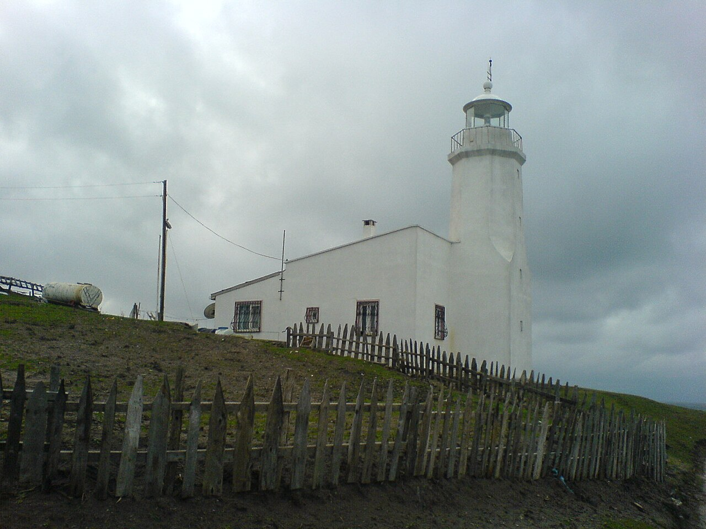

# 📍 Sinop - Seyahat ve Tefekkür Notları

  

## 📜 Şehrin Ruhu
> "Karadeniz'in en uç noktasında, Hamsilos fiyordu ve tarihi cezaeviyle sükunet bulmuş sakin şehir."

### 🌍 Şehrin Dokusu ve Tarihsel Arka Planı
Diyojen'in doğum yeri olan Sinop, Karadeniz'in tek doğal limanıdır. Tarihi surları ve ünlü cezaeviyle derin bir geçmişe sahiptir. MÖ 7. yüzyılda Miletoslular tarafından kurulan ve Pontus Krallığı'na başkentlik yapan Sinop, 1214 yılında Anadolu Selçuklu Sultanı I. İzzeddin Keykâvus tarafından fethedilerek Türk denizciliğinin Karadeniz'deki ilk tersanesine ev sahipliği yapmıştır. Candaroğulları ve Osmanlı dönemlerinde de stratejik bir tersane ve liman kenti olan şehir; Türkiye'nin en kuzey ucu İnceburun, Erfelek Tatlıca Şelaleleri ve trafik lambasına dahi ihtiyaç duymayan dingin şehir kültürüyle "Türkiye'nin en mutlu şehri" unvanını hak eder.

### 🕌 Manevi Mimarlar ve Tarihî Şahsiyetler
- **Sinoplu Diyojen (MÖ 412–323):** Kinik felsefenin kurucusu, Büyük İskender'e *"Gölge etme, başka ihsan istemem"* sözüyle kanaat ve özgürlük dersi veren antik çağ filozofu.
- **Seyyid İbrahim Bilâl (Seyyid Bilâl Hazretleri):** Sinop'un İslamlaşma döneminin manevi önderlerinden; denize hâkim tepedeki türbe ve camii şehrin en mühim manevi sığınağıdır.
- **Pervâne Muînüddin Süleyman:** 1262'de Sinop'u yeniden Selçuklu idaresine kazandırıp meşhur Pervâne Medresesi'ni ve Alaaddin Camii'ni imar eden devlet adamı.
- **Sabahattin Ali (1907–1948):** Tarihi Sinop Cezaevi'nde yattığı dönemde *"Aldırma Gönül"* (Hapishane Şarkısı) gibi unutulmaz şiirlerini kaleme alarak şehrin edebî hafızasına derin bir iz bırakmıştır.

### 💬 Şehir Hakkında Edebi ve Tarihi Alıntılar
> "Gölge etme, başka ihsan istemem." — Sinoplu Diyojen
>
> "Sinop, Karadeniz'in en güvenli limanı, kaleli asil bir yarımadadır." — Evliya Çelebi
>
> "Başın öne eğilmesin / Aldırma gönül aldırma / Ağladığın duyulmasın / Aldırma gönül aldırma..." — Sabahattin Ali (Sinop Cezaevi, 1933)

### 🕊️ Gezginin Not Defterinden (Manevi Boyut ve Tefekkür)
Hamsilos Koyu'nun sakin sularında doğanın sunduğu benzersiz fiyort yapısını ve yaratılış estetiğini hayranlıkla tefekkür edersiniz. Tarihi Sinop Cezaevi'nin nemli taş koğuşlarından çıkıp hemen yanı başındaki masmavi limana baktığınızda ise, hürriyetin ve gönül genişliğinin değerini iliklerinize kadar hissedersiniz.

### 🍽️ Yöresel Lezzet Tavsiyeleri
- **Sinop Mantısı (Cevizli & Yoğurtlu):** İncecik hamuruyla hazırlanan ve bir tabakta yarısı sarımsaklı yoğurt, yarısı tereyağlı cevizle servis edilen eşsiz Sinop mantısı.
- **Sinop Nokulu & Islama:** Üzümlü-cevizli veya kıymalı rulo hamur işi nokul ve yöresel et suyuyla hazırlanan islama.
- **Taze Karadeniz Balıkları (Palamut / Kalkan / Hamsi):** Doğal limanın bereketiyle günün taze balıkları, özellikle sonbaharda meşhur Sinop palamutu.
- **Yerel Tatlar ve İkramlar:** Şehrin yerel esnaf lokantalarında ve pazar yerlerinde deneyimlenen bütçe dostu, kültürel dokuyu yansıtan eşsiz lezzetler.
- **Tefekkür Eşliğinde Çay/Kahve:** Şehrin tarihi kıraathanelerinde veya doğa manzaralı tepelerinde yudumlanan demli çaylar.

### ⛺ Konaklama ve Bütçe Stratejisi
- **Sıfır Konaklama Maliyeti (Modern Kervansaraylar):** GSB Seyahatsever projesi kapsamında şehirdeki KYK yurtlarında 5 gün boyunca ücretsiz konaklanarak bütçe korunmuştur.
- **Ulaşım ve Lojistik Planlama:** Rota optimizasyonuna uyularak komşu iller sırayla takip edilmiş, böylece hem yol maliyeti minimuma indirilmiş hem de karbon ayak izi azaltılmıştır.

### 💻 Yarı Göçebe Mesaisi (İlim Tahsili & Kütüphane)
- **Kütüphane Rutini:** Gündüz vakitlerinde şehrin İl Halk Kütüphanesinde zaman geçirilerek bilgisayar başında yazılım geliştirme ve ders çalışma faaliyetleri sürdürülmüştür.
  * *Seyyahın Kütüphane Notu:* Sinop İl Halk Kütüphanesi - Sessiz, çalışma disiplinine uygun, internet imkanı sunan verimli bir ilim yuvası.
- **Süre ve Uyum:** Kütüphane mesaisi bitiminde şehrin ruhuna karışmak üzere yollara düşülmüş, 5 günlük menzil süresiyle şehir sindirilerek keşfedilmiştir.

### 🧭 5 Günlük Menzil Rotası
- **1. Gün (Yarımada, Cezaevi ve Kale):** Sabah Sinop İl Halk Kütüphanesi'nde (Dr. Rıza Nur Kütüphanesi) çalışma; öğleden sonra Tarihi Sinop Cezaevi, Sinop Kalesi surları ve limanda Sinop mantısı tadımı.
- **2. Gün (Hamsilos Koyu ve İnceburun Feneri):** Karadeniz'in ria tipi doğal fiyordu Hamsilos Koyu ve Akliman'da yürüyüş; ardından Anadolu'nun en kuzey noktası İnceburun Deniz Feneri'nde gün batımı.
- **3. Gün (Erfelek Tatlıca Şelaleleri):** 28 irili ufaklı şelalenin basamaklar hâlinde aktığı Erfelek Tatlıca Tabiat Parkı'nda orman içi tırmanış ve serin mola.
- **4. Gün (Selçuklu Mirası ve Maneviyat):** Alaaddin Camii, Pervâne Medresesi (el sanatları çarşısı), Sinop Arkeoloji Müzesi, Balatlar Kilisesi ve Seyyid Bilâl Türbesi ziyareti.
- **5. Gün (Boyabat veya Gerze Rotası & Veda):** Sabah kütüphane mesaisi; öğleden sonra Cittaslow Gerze sahili veya Boyabat Bazalt Kayalıkları ziyareti ile kuzeyin sakin kentine veda.

### ✨ Keşfedilesi Duraklar ve Landmarks
Bu şehrin havasını solumak, ruhuna dokunmak için mutlaka adımlanması gereken köşe taşları:
- [ ] **Tarihi Sinop Cezaevi**
- [ ] **Hamsilos Koyu ve Akliman**
- [ ] **Sinop Kalesi ve Pervâne Medresesi**
- [ ] **İnceburun Deniz Feneri (Türkiye'nin En Kuzeyi)**
- [ ] **Erfelek Tatlıca Şelaleleri**
- [ ] **Seyyid Bilâl Camii ve Türbesi**

### 📸 Menzil Fotoğraf Galerisi
<table>
  <tr>
    <td align="center" width="50%">
       
      <em>Karadeniz'in sakin fiyordu Hamsilos Koyu ve doğal liman silueti</em>
    </td>
    <td align="center" width="50%">
       
      <em>Asırlık Sinop surları ve Anadolu'nun en kuzey ucundaki sükunet</em>
    </td>
  </tr>
</table>

---
*Bu il bizzat deneyimlenmiş, yolları aşındırılmış ve seyahatnameye sevgiyle işlenmiştir.* ✅
