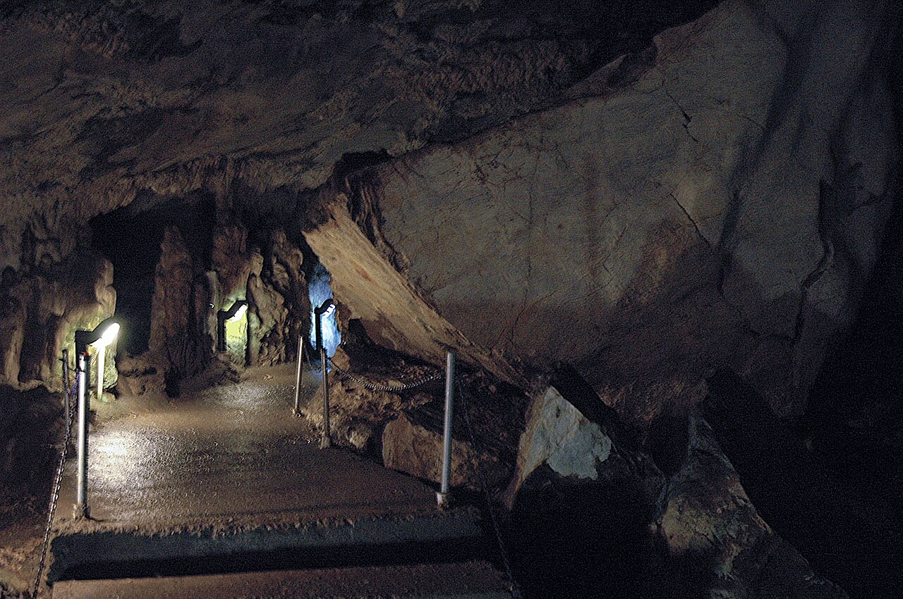
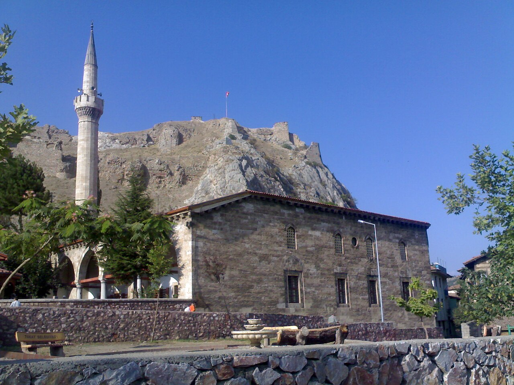

# 📍 Tokat - Seyahat Notları (Keşif Dosyası)

  

## 📜 Seyyahın Beklentisi
> "900 adımda 900 yıllık Danişmendli, Selçuklu ve Osmanlı tarihini kucaklayan sokaklarda yürümek, Evliya Çelebi'nin 'âlimler ve fazıllar yurdu' dediği Tokat'ta Ballıca Mağarası'nın mucizesine tanık olmak için bekleyen bereketli bir menzil."

### 🌍 Şehrin Dokusu ve Tarihsel Arka Planı
Yeşilırmak'ın beslediği verimli Kazova ve Niksar ovalarında kurulan Tokat, Hititlerden Roma'ya (*Comana Pontica* ve Sezar'ın *"Veni, Vidi, Vici"* dediği Zile), Anadolu'nun ilk Türk medresesini (Yağıbasan Medresesi, 1151) kuran Danişmendlilerden Selçuklu ve Osmanlı'ya uzanan 6.000 yıllık bir tarih hazinesidir. Şehir merkezindeki Sulusokak'ta yalnızca 900 adımda 900 yıllık Türk-İslam mimarisinin (Garipler Camii, Gökmedrese, Taşhan, Yağıbasan Medresesi, Arastalı Bedesten, Ali Paşa Camii) tamamı görülebilir. 3,4 milyon yıllık oluşumu ve benzersiz soğan sarkıtlarıyla UNESCO Dünya Mirası Geçici Listesi'ndeki **Ballıca Mağarası**, Tokat Mevlevihanesi ve yazmacılık sanatıyla Tokat, Anadolu'nun gizli başkentlerinden biridir.

### 🕌 Manevi Mimarlar ve Tarihî Şahsiyetler
- **Mevlânâ Celâleddîn-i Rûmî'nin Tokat Övgüsü:** Mevlânâ'nın *"Tokat'a gitmek gerek, çünkü Tokat'ta insan ve iklim mutedildir"* sözü şehrin zarif ve hoşgörülü ruhunu özetler. Tokat Mevlevihanesi bu muhabbetin mimari nişanesidir.
- **Gazi Osman Paşa (1832–1897):** Plevne Kahramanı, Osmanlı ordusunun efsanevi müşiri Tokat doğumludur; şehirde adını taşıyan müze ve üniversite bulunur.
- **İbn-i Kemal (Kemalpaşazâde, 1468–1534):** Osmanlı'nın en büyük Şeyhülislam ve tarihçilerinden biri olup Tokat'ın ilim geleneğinin zirve isimlerindendir.
- **Şeyhülislam Mustafa Sabri Efendi & Niksarlı Melik Danişmend Gazi:** Anadolu'nun ilk Türk beyliklerinden Danişmendlilerin başkentliğini yapan Niksar'da medfun Melik Gazi, bölgenin manevi ve tarihî kurucusudur.
- **Aşık Nuri & Cahit Külebi (1917–1997):** Zile doğumlu büyük Cumhuriyet şairi Cahit Külebi, Anadolu'nun sesini modern Türk şiirine taşımıştır.

### 💬 Şehir Hakkında Edebi ve Tarihi Alıntılar
> "Tokat'a gitmek gerek; çünkü Tokat'ta insan da iklim de mutedildir." — Mevlânâ Celâleddîn-i Rûmî
>
> "Tokat, âlimler ve fazıllar yurdu, bağlık bahçelik, suları bol, şirin ve mamur bir şehirdir." — Evliya Çelebi
>
> "Veni, Vidi, Vici! (Geldim, Gördüm, Yendim!)" — Jül Sezar (Zile / Zela Savaşı sonrası, MÖ 47)

### 🍽️ Planlanan Yöresel Lezzet Durakları
- **Tokat Kebabı:** Özel taş fırınlarda, kuzu eti, kuyruk yağı, patlıcan, biber, domates, patates ve bütün sarımsağın şişlere dizilip lavaş üzerine damlayan lezzetiyle pişen efsanevi Tokat kebabı.
- **Bat & Tokat Yaprağı Sarması:** Yeşil mercimek, ince bulgur, ceviz ve asma yaprağıyla hazırlanan serinletici yöresel "bat" ile incecik damarsız Erbaa/Tokat yaprağından zeytinyağlı ve etli sarma.
- **Zile Pekmezi & Çökelekli Tokat Çöreği:** Beyaz ve köpüklü Zile pekmezi, cevizli Tokat çöreği ve bez sucuk.
- **Tefekkür Eşliğinde Çay:** 1631 tarihli Taşhan'ın (Voyvoda Hanı) geniş avlusunda yazmacı atölyelerini izleyerek demli çay.

### ⛺ Konaklama ve Bütçe Planı
- **Modern Kervansaray Stratejisi:** GSB Seyahatsever projesi kapsamında Tokat KYK yurtlarında 5 gün boyunca sıfır konaklama maliyetiyle kalarak Sulusokak'tan Niksar'a kadar tüm ilçeleri keşfetmek.
- **Komşu İl Optimizasyonu:** Amasya → Tokat → Sivas / Ordu bağlantı hattında en verimli geçiş noktası.

### 💻 Planlanan Kütüphane Mesaisi
- **Kütüphane Durağı:** Tokat İl Halk Kütüphanesi – Sabah sakin çalışma ve kodlama mesaisi, öğleden sonra 900 yıllık Sulusokak ve çevre ilçe keşifleri.

### 🧭 5 Günlük Planlanan Menzil Rotası
- **1. Gün (900 Adımda 900 Yıl – Sulusokak):** Sabah Tokat İl Halk Kütüphanesi'nde çalışma; öğleden sonra Sulusokak boyunca Taşhan, Gökmedrese, Yağıbasan Medresesi, Tokat Mevlevihanesi, Latifoğlu Konağı, Ali Paşa Camii ve Saat Kulesi.
- **2. Gün (Ballıca Mağarası ve Kaz Gölü):** Pazar ilçesindeki 3,4 milyon yıllık Ballıca Mağarası'nın 8 salonunu keşif; ardından Selçuklu şaheseri Mahperi Hatun Kervansarayı ve Kaz Gölü kuş cenneti.
- **3. Gün (Tokat Kalesi ve Hıdırlık Köprüsü):** Selçuklu döneminden kalma Hıdırlık Köprüsü'nden geçiş, sarp kayalıklar üzerindeki Tokat Kalesi manzarası ve Gazi Osman Paşa Müzesi ile yazmacılık atölyesi ziyareti.
- **4. Gün (Niksar – Danişmendli Başkenti):** Anadolu'nun ilk medreselerinden Niksar Yağıbasan Medresesi, Niksar Kalesi, Melik Gazi Türbesi, Çamiçi Yaylası ve Leylekli Köprü.
- **5. Gün (Zile ve Veda):** Sezar'ın *"Veni, Vidi, Vici"* yazdığı Zile Kalesi, tarihî Zile evleri ve Amasya Caddesi'nde Zile pekmezi ile cevizli çörek alışverişi.

### ✨ Keşfedilmesi Beklenen Duraklar ve Landmarks
- [ ] **Ballıca Mağarası Tabiat Parkı (UNESCO Geçici Liste)**
- [ ] **Sulusokak Tarihi Kültür Yolu (Taşhan, Gökmedrese, Yağıbasan)**
- [ ] **Tokat Mevlevihanesi ve Latifoğlu Konağı**
- [ ] **Tokat Kalesi ve Saat Kulesi**
- [ ] **Mahperi Hatun Kervansarayı (Pazar)**
- [ ] **Niksar Kalesi ve Melik Gazi Türbesi**
- [ ] **Zile Kalesi ve Tarihi Evleri**

### 📸 Menzil Fotoğraf Galerisi
<table>
  <tr>
    <td align="center" width="50%">
       
      <em>900 yıllık tarihin yaşadığı Sulusokak ve Taşhan avlusu (Planlanan Menzil)</em>
    </td>
    <td align="center" width="50%">
       
      <em>3,4 milyon yıllık Ballıca Mağarası ve bereketli Tokat vadileri</em>
    </td>
  </tr>
</table>

---
*Henüz adımlanmamış bu kadim şehir, keşif defterinde sırasını bekleyen bir menzil olarak kayda geçirilmiştir.*
