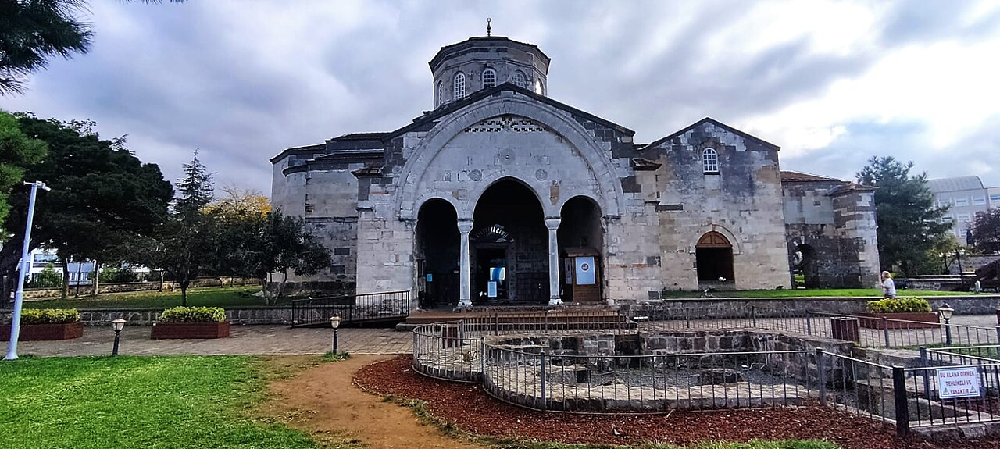

# 📍 Trabzon - Seyahat ve Tefekkür Notları

  

## 📜 Şehrin Ruhu
> "Sümela Manastırı'nın dik yamacında yükselen mistik duruşu, Uzungöl'ün sisli doğası ve köklü geçmişiyle Karadeniz'in kalbi."

### 🌍 Şehrin Dokusu ve Tarihsel Arka Planı
Trabzon İmparatorluğu'na başkentlik yapmış ve Fatih Sultan Mehmet tarafından fethedilmiş olan Trabzon, Osmanlı şehzadelerinin yetiştiği ulu bir şehirdir. MÖ 756'da *Trapezus* adıyla kurulan şehir, İpek Yolu'nun Karadeniz'e açılan en mühim kapısı olarak 2.800 yılı aşkın kesintisiz bir tarihî mirasa sahiptir. 1461'deki fethin ardından Yavuz Sultan Selim'in uzun yıllar sancak beyliği yaptığı ve cihan padişahı Kanuni Sultan Süleyman'ın dünyaya geldiği Trabzon; Altındere Vadisi'ndeki Sümela Manastırı, Trabzon Ayasofya Camii, Gülbahar Hatun Külliyesi ve sisli yaylalarıyla Doğu Karadeniz'in kültür ve tarih başkentidir.

### 🕌 Manevi Mimarlar ve Tarihî Şahsiyetler
- **Fatih Sultan Mehmet, Yavuz Sultan Selim & Kanuni Sultan Süleyman:** Trabzon'u fetheden, yöneten ve burada doğan üç büyük Osmanlı padişahı şehrin tarihî vakarına mührünü vurmuştur.
- **Gülbahar Hatun:** Yavuz Sultan Selim'in annesi; Trabzon'da yaptırdığı Gülbahar Hatun Camii ve Külliyesi şehrin en zarif Osmanlı eserlerindendir.
- **Ahi Evren Dede (Boztepe):** Trabzon Boztepe'de medfun bulunan manevi büyük; fethin ardından şehrin esnaf ve ahilik ahlakını yeşerten irfan öncüsüdür.
- **Bedri Rahmi Eyüboğlu (1911–1975) & Sabahattin Eyüboğlu:** Trabzon'un sanat, edebiyat ve düşünce dünyasına armağan ettiği büyük kültür insanları.
- **İskender Paşa & Ortahisar Vakıfları:** Fethin ardından Trabzon'un imarında, su yollarında ve medreselerinde iz bırakan Osmanlı valileri.

### 💬 Şehir Hakkında Edebi ve Tarihi Alıntılar
> "Trabzon, Karadeniz'in gözbebeği, fırtınanın ve yeşilin yurdudur." — Evliya Çelebi
>
> "Trabzon, koca bir tarihi sinesinde saklayan, Karadeniz'in serin rüzgarıyla yıkanan vakur şehirdir." — Bedri Rahmi Eyüboğlu
>
> "Burası Trabzon'dur; Fatih'in fethettiği, Yavuz'un yönettiği, Kanuni'nin doğduğu ulu şehir." — Tarihi Levha

### 🕊️ Gezginin Not Defterinden (Manevi Boyut ve Tefekkür)
Sümela Manastırı'nın merdivenlerini tırmanırken, insan inancının sarp kayaları nasıl aştığını ve inzivanın manevi gücünü tefekkür edersiniz. Ortahisar'ın kadim taş sokaklarından Boztepe'ye çıktığınızda, bir yanda engin Karadeniz diğer yanda asırlık cami kubbeleri arasında tarihin sürekliliğini derinden hissedersiniz.

### 🍽️ Yöresel Lezzet Tavsiyeleri
- **Akçaabat Köftesi & Kuymak:** Sarımsak ve yöresel etle hazırlanan meşhur Akçaabat köftesi, yanında piyaz ve sıcacık uzayan tereyağlı kuymak.
- **Hamsiköy Sütlacı & Trabzon Ekmeği:** Zigana eteklerindeki Hamsiköy'ün bol fındıklı fırın sütlacı ve ekşi mayalı taş fırın Vakfıkebir/Trabzon ekmeği.
- **Karalahana Çorbası & Hamsili Pilav:** Kış aylarında taze hamsi buğulama, hamsi tava ve yöresel karalahana yemekleri.
- **Yerel Tatlar ve İkramlar:** Şehrin yerel esnaf lokantalarında ve pazar yerlerinde deneyimlenen bütçe dostu, kültürel dokuyu yansıtan eşsiz lezzetler.
- **Tefekkür Eşliğinde Çay/Kahve:** Şehrin tarihi kıraathanelerinde veya doğa manzaralı tepelerinde yudumlanan demli çaylar.

### ⛺ Konaklama ve Bütçe Stratejisi
- **Sıfır Konaklama Maliyeti (Modern Kervansaraylar):** GSB Seyahatsever projesi kapsamında şehirdeki KYK yurtlarında 5 gün boyunca ücretsiz konaklanarak bütçe korunmuştur.
- **Ulaşım ve Lojistik Planlama:** Rota optimizasyonuna uyularak komşu iller sırayla takip edilmiş, böylece hem yol maliyeti minimuma indirilmiş hem de karbon ayak izi azaltılmıştır.

### 💻 Yarı Göçebe Mesaisi (İlim Tahsili & Kütüphane)
- **Kütüphane Rutini:** Gündüz vakitlerinde şehrin İl Halk Kütüphanesinde zaman geçirilerek bilgisayar başında yazılım geliştirme ve ders çalışma faaliyetleri sürdürülmüştür.
  * *Seyyahın Kütüphane Notu:* Trabzon İl Halk Kütüphanesi - Sessiz, çalışma disiplinine uygun, internet imkanı sunan verimli bir ilim yuvası.
- **Süre ve Uyum:** Kütüphane mesaisi bitiminde şehrin ruhuna karışmak üzere yollara düşülmüş, 5 günlük menzil süresiyle şehir sindirilerek keşfedilmiştir.

### 🧭 5 Günlük Menzil Rotası
- **1. Gün (Ortahisar, Ayasofya ve Boztepe):** Sabah Trabzon İl Halk Kütüphanesi'nde çalışma; öğleden sonra Trabzon Ayasofya Camii, Gülbahar Hatun Külliyesi, Ortahisar Fatih Camii, Tarihi Bedesten ve gün batımında Boztepe'de çay.
- **2. Gün (Maçka – Sümela Manastırı ve Hamsiköy):** Altındere Vadisi Milli Parkı içindeki Sümela Manastırı'na tırmanış; öğleden sonra Zigana yolundaki Hamsiköy'de hakiki Hamsiköy sütlacı tadımı.
- **3. Gün (Uzungöl ve Çaykara Yaylaları):** Çaykara ilçesindeki Uzungöl'e tam günlük rota; göl çevresinde yürüyüş, seyir terasından fotoğraf ve imkan dahilinde Haldizen/Demirkapı yayla havası.
- **4. Gün (Atatürk Köşkü, Sera Gölü ve Akçaabat):** Soğuksu sırtlarındaki zarif Atatürk Köşkü, ardından Akçaabat'ta Ortamahalle'nin tarihi Osmanlı evleri, Sera Gölü ve akşam Akçaabat köftesi.
- **5. Gün (Çal Mağarası veya Vazelon & Veda):** Sabah kütüphane mesaisi; öğleden sonra Düzköy'deki dünyanın en uzun ikinci mağarası Çal Mağarası (veya Vazelon Manastırı) ziyareti ve meydanda veda çayı.

### ✨ Keşfedilesi Duraklar ve Landmarks
Bu şehrin havasını solumak, ruhuna dokunmak için mutlaka adımlanması gereken köşe taşları:
- [ ] **Sümela Manastırı**
- [ ] **Uzungöl**
- [ ] **Trabzon Ayasofya Camii**
- [ ] **Atatürk Köşkü**
- [ ] **Boztepe ve Ahi Evren Türbesi**
- [ ] **Gülbahar Hatun Külliyesi ve Ortahisar**
- [ ] **Çal Mağarası / Hamsiköy**

### 📸 Menzil Fotoğraf Galerisi
<table>
  <tr>
    <td align="center" width="50%">
       
      <em>Altındere Vadisi'nin dik kayalıklarına yaslanan mistik Sümela Manastırı</em>
    </td>
    <td align="center" width="50%">
       
      <em>Sisli çam ormanlarının kucakladığı Uzungöl ve Karadeniz'in kalbi Trabzon</em>
    </td>
  </tr>
</table>

---
*Bu il bizzat deneyimlenmiş, yolları aşındırılmış ve seyahatnameye sevgiyle işlenmiştir.* ✅
