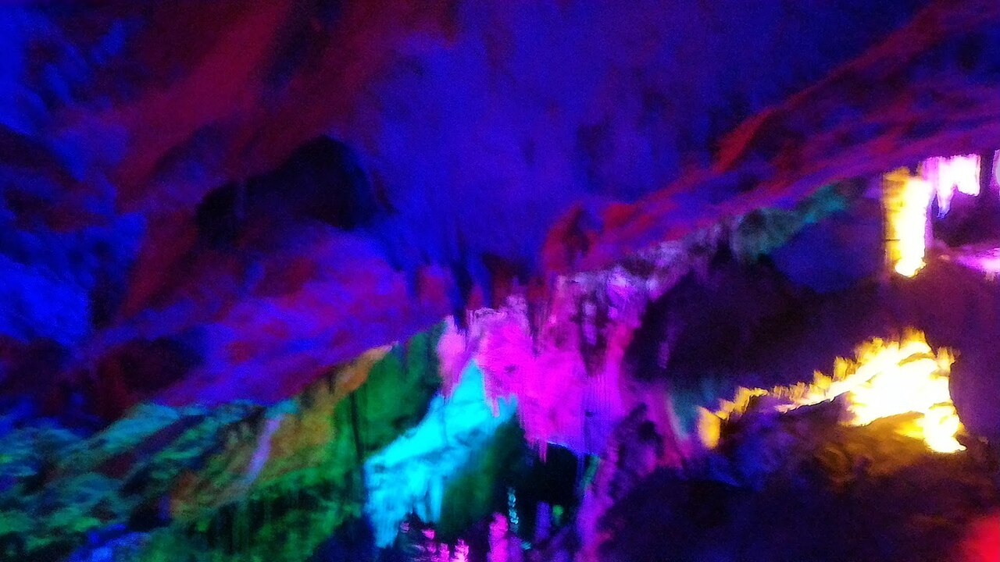
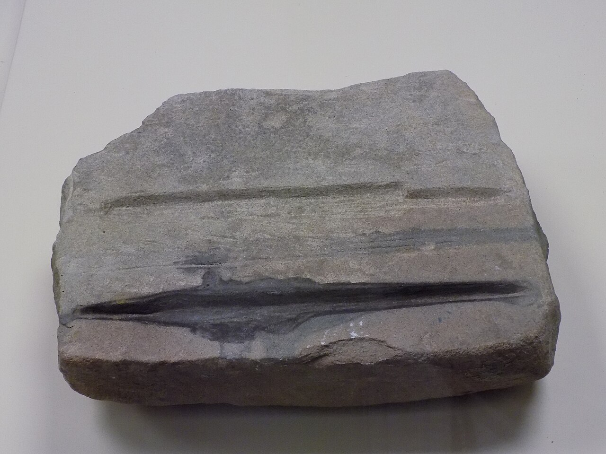

# 📍 Zonguldak - Seyahat Notları (Keşif Dosyası)

  

## 📜 Seyyahın Beklentisi
> "Yerin yüzlerce metre altında alın teriyle Türkiye'yi aydınlatan Karaelmas madencilerinin emeğine saygı duruşunda bulunmak, Gökgöl Mağarası'nın derinliğinden Filyos'un antik limanına uzanmak için bekleyen emeğin başkenti."

### 🌍 Şehrin Dokusu ve Tarihsel Arka Planı
"Emeğin ve Karaelmas'ın Başkenti" Zonguldak, Cumhuriyet'in ilk vilayeti (1924) olma onurunu taşır. 1829 yılında Ereğlili **Uzun Mehmet**'in taş kömürünü keşfetmesiyle kaderi değişen şehir, Osmanlı'nın son döneminden Cumhuriyet'in sanayileşme hamlesine kadar ülkenin enerji kalbi olmuştur. Ancak Zonguldak yalnızca maden ocaklarından ibaret değildir: MÖ 7. yüzyılda Miletosluların kurduğu **Tios (Filyos) Antik Kenti**, 350 milyon yıllık fosil izleri taşıyan **Gökgöl Mağarası**, mitolojide Herkül'ün yeraltı dünyasına indiği yer olarak anılan **Cehennemağzı Mağaraları** (Kdz. Ereğli) ve Devrek'in dünyaca ünlü baston ustalığı ile Zonguldak, derin bir tarih, sanat ve doğa zenginliği barındırır.

### 🕌 Manevi Mimarlar ve Tarihî Şahsiyetler
- **Uzun Mehmet (ö. 1830):** 8 Kasım 1829'da Kdz. Ereğli Köseağzı mevkiinde taş kömürünü bularak Türkiye'nin madencilik tarihini başlatan halk kahramanı.
- **Şair Orhan Veli Kanık & Zonguldak Şairleri (Rüştü Onur, Muzaffer Tayyip Uslu):** 1940'lı yıllarda Zonguldak'ta veremle mücadele ederken Türk şiirine unutulmaz mısralar bırakan "Kelebeğin Rüyası" şairleri Rüştü Onur ve Muzaffer Tayyip Uslu, şehrin hüzünlü ve zarif edebî ruhudur.
- **Gazi Alemdar Gemisi Kahramanları (1921):** Milli Mücadele'nin tek deniz zaferini Ereğli açıklarında kazanan Alemdar Gemisi mürettebatı, Karadeniz'deki bağımsızlık direnişinin sembolüdür.
- **Devrek Baston Ustaları:** Kızılcık ağacını sabır ve ince oymacılıkla sanat eserine dönüştüren asırlık zanaatkârlar.

### 💬 Şehir Hakkında Edebi ve Tarihi Alıntılar
> "Siyah akar Zonguldak'ın deresi / Yüz karası değil, kömür karası / Böyle kazanılır ekmek parası." — Orhan Veli Kanık
>
> "Zonguldak'ta deniz ile dağ birbirine yaslanır; yerin altında karaelmas, yerin üstünde yemyeşil kestane ormanları nefes alır." — Seyyah Beklentisi

### 🍽️ Planlanan Yöresel Lezzet Durakları
- **Uğmaç Çorbası & Malay:** Yöresel hamur taneleriyle yapılan sıcak uğmaç çorbası ve mısır unuyla hazırlanıp tereyağı-ceviz veya kaz ciğeriyle sunulan geleneksel malay.
- **Ereğli Pidesi & Osmanlı Çileği:** Kdz. Ereğli'nin taş fırın pidesi ve eşsiz kokusuyla coğrafi işaretli pembe Osmanlı çileği (reçeli ve tazesi).
- **Zonguldak Kestanesi & Devrek Simidi:** Karadeniz ormanlarının bereketi kuzu kestane ve pekmezli çıtır Devrek simidi.
- **Tefekkür Eşliğinde Çay:** Fener Mahallesi'ndeki tarihî deniz feneri kıyısında veya Kozlu sahilinde hırçın dalgalara karşı demli çay.

### ⛺ Konaklama ve Bütçe Planı
- **Modern Kervansaray Stratejisi:** GSB Seyahatsever projesi kapsamında Zonguldak KYK yurtlarında 5 gün boyunca ücretsiz konaklayarak maden mirası ve kıyı antik kentlerini keşfetme planı.
- **Komşu İl Optimizasyonu:** Düzce / Bolu → Zonguldak → Bartın → Karabük Batı Karadeniz döngüsünün deniz kapısı.

### 💻 Planlanan Kütüphane Mesaisi
- **Kütüphane Durağı:** Zonguldak İl Halk Kütüphanesi (ve Bülent Ecevit Üniversitesi Merkez Kütüphanesi) – Gündüz yazılım ve okuma mesaisi, öğleden sonra müze, mağara ve sahil yürüyüşleri.

### 🧭 5 Günlük Planlanan Menzil Rotası
- **1. Gün (Karaelmas Mirası ve Fener Mahallesi):** Sabah Zonguldak İl Halk Kütüphanesi'nde çalışma; öğleden sonra Türkiye'nin ilk ve tek **Zonguldak Maden Müzesi** ve Eğitim Ocağı ziyareti, ardından tarihî Fener Mahallesi ve Varagel Tüneli yürüyüşü.
- **2. Gün (Gökgöl Mağarası ve Harmankaya Şelaleleri):** 350 milyon yıllık Gökgöl Mağarası'nın aydınlatılmış galerilerinde yürüyüş; öğleden sonra orman içi patikadan Harmankaya Şelaleleri'ne ulaşım.
- **3. Gün (Filyos – Tios Antik Kenti ve Kalesi):** Çaycuma üzerinden Filyos'a hareket; Karadeniz'in kazılabilen tek antik kenti Tios'un akropolü, antik tiyatrosu, Filyos Kalesi ve geniş kumsalında gün batımı.
- **4. Gün (Karadeniz Ereğli – Cehennemağzı ve Alemdar):** Mitolojik Cehennemağzı Mağaraları (Ayazma, Kilise ve Koca Yusuf mağaraları), Gazi Alemdar Gemi Müzesi ve Ereğli sahilinde Osmanlı çileği & pide molası.
- **5. Gün (Devrek Baston Atölyeleri ve Veda):** Sabah kütüphane mesaisi; öğleden sonra Devrek'te baston ustalarının atölyelerini ziyaret, Devrek simidi tadımı ve Batı Karadeniz'in emek şehrine veda.

### ✨ Keşfedilmesi Beklenen Duraklar ve Landmarks
- [ ] **Zonguldak Maden Müzesi ve Eğitim Ocağı**
- [ ] **Gökgöl Mağarası**
- [ ] **Filyos Kalesi ve Tios Antik Kenti**
- [ ] **Cehennemağzı Mağaraları (Kdz. Ereğli)**
- [ ] **Gazi Alemdar Gemi Müzesi**
- [ ] **Harmankaya Şelaleleri**
- [ ] **Devrek Bastoncular Çarşısı ve Fener Mahallesi**

### 📸 Menzil Fotoğraf Galerisi
<table>
  <tr>
    <td align="center" width="50%">
       
      <em>Filyos Kalesi ve Tios Antik Kenti'nden Karadeniz'e bakış (Planlanan Menzil)</em>
    </td>
    <td align="center" width="50%">
       
      <em>350 milyon yıllık Gökgöl Mağarası ve Karaelmas'ın tarihî mirası</em>
    </td>
  </tr>
</table>

---
*Henüz adımlanmamış bu kadim şehir, keşif defterinde sırasını bekleyen bir menzil olarak kayda geçirilmiştir.*
