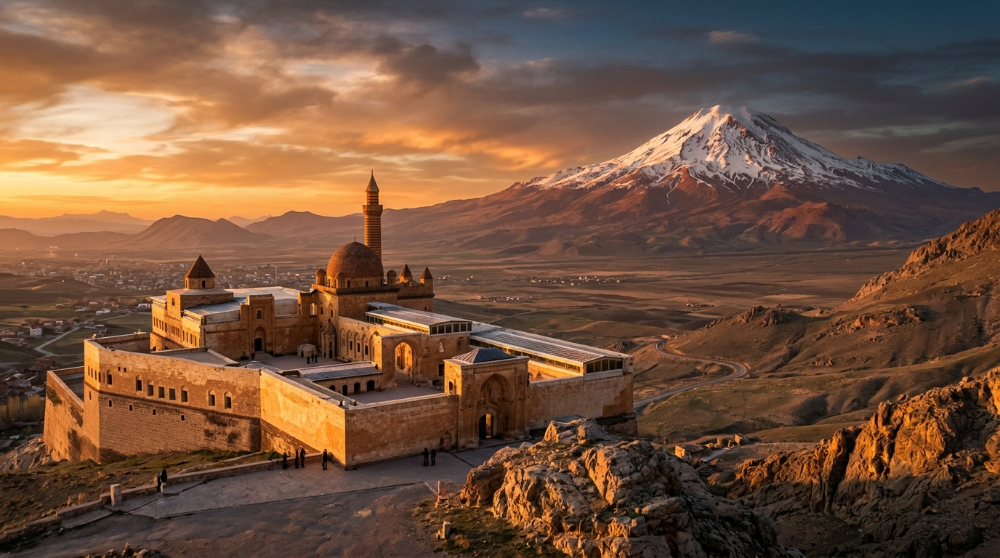
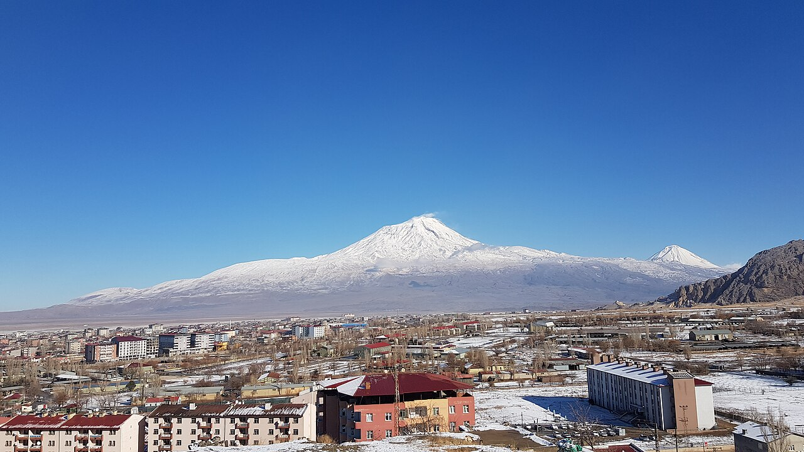

# 📍 Ağrı - Seyahat ve Tefekkür Notları

  

## 📜 Şehrin Ruhu
> "Türkiye'nin zirvesi Ağrı Dağı'nın heybeti, ovaya kartal yuvası gibi bakan İshak Paşa Sarayı'nın masalsı silüeti ve Doğubayazıt'ın kadim nefesi."

### 🌍 Şehrin Dokusu ve Tarihsel Arka Planı
Urartulardan Selçuklulara ve Osmanlı'ya uzanan tarihi İpekyolu kavşağı üzerinde kurulu olan Ağrı, Doğu Anadolu'nun en yüksek ve stratejik menzillerinden biridir. 17. yüzyılda inşa edilen ve Lale Devri'nin Doğu'daki en muhteşem eseri kabul edilen İshak Paşa Sarayı, saray mimarisi, camisi ve kalorifer sistemi benzeri taş ısıtma kanallarıyla mimarlık tarihinin şaheseridir.

Tarihi boyunca Anadolu'ya giriş kapılarından biri olan Ağrı platosu, Nuh Tufanı rivayetleriyle kutsal metinlerde ve efsanelerde adı geçen 5.137 metrelik Büyük Ağrı Dağı'nın gölgesinde şekillenmiştir. Diyadin kaplıcalarından Türkiye'nin en yüksek rakımlı göllerinden biri olan Balık Gölü'ne, Urartu kaya mezarlarından Osmanlı serhat kalelerine kadar uzanan bu coğrafya, sert ikliminin ardında derin bir misafirperverlik ve kadim bir kültür barındırır.

### 🕌 Manevi Mimarlar ve Tarihî Şahsiyetler
- **Ahmed-i Hânî (1651–1707):** Doğubayazıt'ta yaşamış büyük mütefekkir, şair, mutasavvıf ve astronom. *Mem û Zîn* ve *Nûbehara Biçûkan* gibi ölümsüz eserleriyle bölgenin ilim ve edebiyat hafızasını şekillendirmiştir. Türbesi, İshak Paşa Sarayı'nın hemen üst yamacında ovaya nazır vakur bir ziyaretgâhtır.
- **Çolak Abdi Paşa ve İshak Paşa:** 1685'te yapımına başlanıp 1784'te tamamlanan, 99 yıllık inşa serüveniyle Doğu'nun en görkemli külliyesi olan İshak Paşa Sarayı'nı bölgeye kazandıran Çıldır Beylerbeyleri.
- **Halife Yusuf (Yusuf-i Hânî) ve Bölge Müderrisleri:** Doğubayazıt medreselerinde yüzyıllar boyunca ilim halkaları kurarak serhat boyunun manevi direncini ayakta tutan âlimler.

### 💬 Şehir Hakkında Edebi ve Tarihi Alıntılar
> "Ağrı Dağı'nın doruğunda gökyüzü yeryüzüyle birleşir; insan kendi faniliğini ve Yaratıcı'nın celalini en derinden burada hisseder." — Seyyah Notu
>
> "İshak Paşa Sarayı, Osmanlı taş işçiliğinin, Selçuklu motiflerinin ve Fars estetiğinin ovaya bakan taşlaşmış rüyasıdır." — Sanat Tarihçileri

### 🕊️ Gezginin Not Defterinden (Manevi Boyut ve Tefekkür)
Doğubayazıt ovasına hakim bir tepede yükselen İshak Paşa Sarayı'nın avlusunda durup Ahmed-i Hânî Hazretleri'nin türbesine doğru tefekküre daldığınızda, dünya saraylarının faniliğini ve ilmin kalıcılığını idrak edersiniz. 5137 metrelik Ağrı Dağı'nın karlı zirvesini seyrederken doğanın sessiz zikrine ortak olursunuz.

### 🍽️ Yöresel Lezzet Tavsiyeleri
- **Yerel Tatlar ve İkramlar:** Taş dibeklerde dövülerek hazırlanan asırlık Abdigör Köftesi, Halise yemeği, Ağrı yayla balı ve taze lavaş.
- **Tefekkür Eşliğinde Çay/Kahve:** İshak Paşa Sarayı manzaralı seyir tepesinde ovaya karşı içilen demli çay.

### ⛺ Konaklama ve Bütçe Stratejisi
- **Sıfır Konaklama Maliyeti (Modern Kervansaraylar):** GSB Seyahatsever projesi kapsamında şehirdeki KYK yurtlarında 5 gün boyunca ücretsiz konaklanarak bütçe korunmuştur.
- **Ulaşım ve Lojistik Planlama:** Rota optimizasyonuna uyularak Erzurum ve Kars üzerinden geçiş yapılmış, Doğu rotasında minimum maliyet sağlanmıştır.

### 💻 Yarı Göçebe Mesaisi (İlim Tahsili & Kütüphane)
- **Kütüphane Rutini:** Gündüz vakitlerinde şehrin İl Halk Kütüphanesinde zaman geçirilerek bilgisayar başında yazılım geliştirme ve araştırma faaliyetleri sürdürülmüştür.
  * *Seyyahın Kütüphane Notu:* Ağrı İl Halk Kütüphanesi - Sessiz, geniş çalışma masaları ve odaklanmayı artıran vakur bir çalışma ortamı.
- **Süre ve Uyum:** Kütüphane mesaisi bitiminde şehrin tarihi mekanları sindirilerek keşfedilmiştir.

### 🧭 5 Günlük Menzil Rotası
- **1. Gün – Ağrı Merkez ve Şehir Dokusu:** KYK yurduna yerleşme, Ağrı İl Halk Kütüphanesi'nde ilk çalışma mesaisi, Merkez Camii çevresi, Murat Nehri kenarında akşam yürüyüşü ve yöresel Halise tadımı.
- **2. Gün – Doğubayazıt, İshak Paşa Sarayı ve Ahmed-i Hânî:** Sabah erken saatte Doğubayazıt'a geçiş; İshak Paşa Sarayı'nın harem, selamlık, cami ve taş ısıtma kanallarının incelenmesi; Ahmed-i Hânî Türbesi ziyareti ve Eski Bayazıt Camii ile Urartu Kalesi'nin keşfi.
- **3. Gün – Ağrı Dağı Etekleri, Nuh'un Gemisi İzi ve Meteor Çukuru:** Doğubayazıt ovasından Büyük ve Küçük Ağrı Dağı silüetlerinin fotoğraflanması, Telçeker köyü yakınlarındaki Nuh'un Gemisi doğal oluşum alanı ve Gürbulak sınır hattındaki Meteor Çukuru ziyareti; akşam Abdigör Köftesi molası.
- **4. Gün – Diyadin Kanyonu ve Kaplıcaları:** Kütüphane mesaisinin ardından Diyadin'e hareket; Murat Nehri'nin şekillendirdiği Diyadin Kanyonu yürüyüşü, Meya Mağaraları (Günbuldu) kaya yerleşimlerinin görülmesi ve şifalı kaplıca sularında dinlenme.
- **5. Gün – Balık Gölü ve Veda Tefekkürü:** 2.241 metre rakımlı Balık Gölü kıyısında sabah sessizliği ve alabalık molası; merkeze dönüşte kütüphane notlarının toparlanması ve Ağrı Dağı'na gün batımı vedası.

### ✨ Keşfedilesi Duraklar ve Landmarks
Bu şehrin havasını solumak, ruhuna dokunmak için mutlaka adımlanması gereken köşe taşları:
- [x] **İshak Paşa Sarayı (Doğubayazıt)**
- [x] **Ahmed-i Hânî Türbesi**
- [x] **Ağrı Dağı Milli Parkı & Seyir Noktaları**
- [x] **Doğubayazıt Kalesi ve Eski Bayazıt Camii**
- [x] **Meteor Çukuru ve Balık Gölü**

### 📸 Menzil Fotoğraf Galerisi
<table>
  <tr>
    <td align="center" width="50%">
       
      <b>İshak Paşa Sarayı & Ağrı Dağı Silüeti</b>
    </td>
    <td align="center" width="50%">
       
      <b>Serhat Ovası ve Kadim Mimari Dokusu</b>
    </td>
  </tr>
</table>

---
*Bu il bizzat deneyimlenmiş, yolları aşındırılmış ve seyahatnameye sevgiyle işlenmiştir.* ✅
