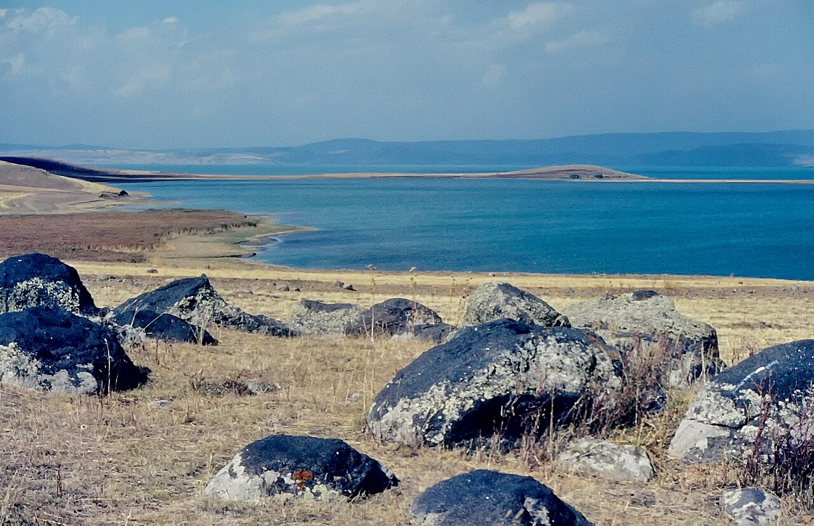
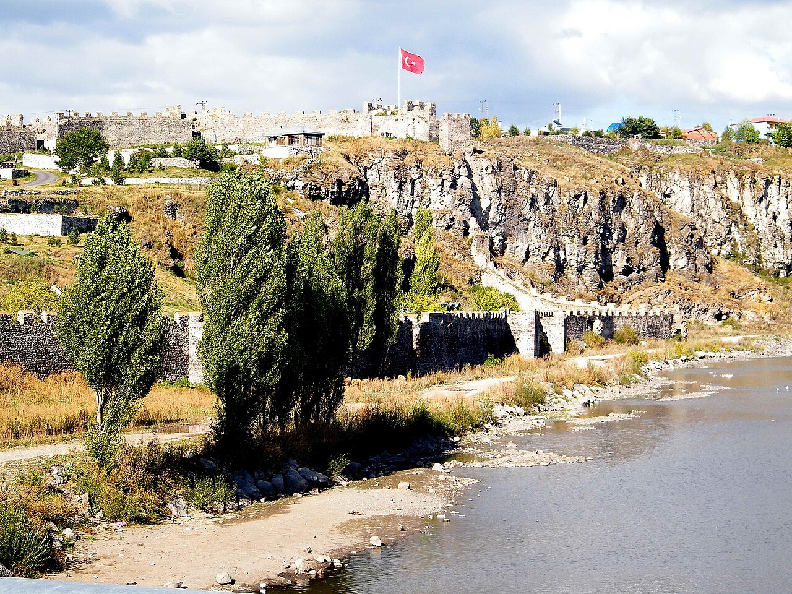

# 📍 Ardahan - Sefer Öncesi Hazırlık ve Seyahat Dosyası

  

## 📜 Seyyahın Beklentisi
> "Henüz adımlanmamış her yol, içinde koca bir hikaye saklar; Çıldır Gölü'nün buz tutan aynası, Kura Nehri'nin kuzeye süzülen suları ve Yalnızçam yaylalarının serin rüzgârı bu hikayenin kapısını aralar."

### 🌍 Şehrin Dokusu ve Tarihsel Arka Planı
Türkiye'nin kuzeydoğu sınırında, Doğu Anadolu ile Kafkasya'nın kesişim noktasında yer alan Ardahan, yüksek yaylaları, uçsuz bucaksız çayırları ve kadim kaleleriyle Anadolu'nun en vakur serhat şehirlerinden biridir. Urartular, İskitler, Kıpçaklar, Selçuklular ve Osmanlılar döneminde stratejik bir geçiş kapısı olan bölge, 1551'de Kanuni Sultan Süleyman zamanında Osmanlı topraklarına katılmış ve Kura Nehri kıyısında yükselen Ardahan Kalesi ile tahkim edilmiştir.

1878'den 1921'e kadar süren zorlu yılların ardından yeniden ana vatana kavuşan Ardahan, doğal güzellikleri bakımından bakir bir hazine niteliğindedir. Kış aylarında tamamen donarak üzerinde atlı kızaklarla gezilen **Çıldır Gölü**, buzun altından ağ çekilerek tutulan sarı balığı ve sarp kayalıklar üzerine kurulu **Şeytan Kalesi** ile benzersiz bir atmosfer sunar. Posof'un mikroklima vadilerinde yetişen içi kırmızı elmalar, Damal dağlarında her yıl haziran–temmuz aylarında oluşan Atatürk silüeti ve Yalnızçam ormanları şehrin çok katmanlı tabiatını tamamlar.

### 🕌 Manevi Mimarlar ve Tarihî Şahsiyetler
- **Âşık Şenlik (1850–1913):** Çıldır'ın Suhara (Yakınsu) köyünde yetişmiş, 93 Harbi'nde "Ehli İslam olan işitsin bilsin / Can sağ iken yurt vermeniz düşmana" dizeleriyle Anadolu ve Kafkasya'ya ruh veren büyük halk ozanı.
- **Âşık Zülali ve Posof Âşıklık Geleneği:** Sözlü kültürün ve saz eşliğinde hikmet aktarımının Serhat boyundaki asırlık temsilcileri.
- **Halit Paşa (Deli Halit Paşa):** Milli Mücadele'de Doğu Cephesi'nde Ardahan ve çevresinin kurtuluşunda öncü rol oynayan kahraman komutan.

### 💬 Şehir Hakkında Edebi ve Tarihi Alıntılar
> "Can sağ iken yurt vermeniz düşmana!" — Çıldırlı Âşık Şenlik
>
> "Kura suyunun kenarında yükselen Ardahan Kalesi, serhat boyunun rüzgârına göğüs geren metin bir taş nöbetçidir." — Evliya Çelebi

### 🍽️ Yöresel Lezzet Rehberi
- **Çıldır Sarı Balığı (Sazan):** Çıldır Gölü'nün buzlu sularından taze çıkarılıp tereyağında kızartılan eşsiz göl lezzeti.
- **Ardahan Kaz Eti ve Bulgur Pilavı:** Kış ayazında kurutulan kazların ağır ateşte pişirilerek bulgur pilavı üzerinde sunulması.
- **Kafkas Arı Balı & Damal Kaşarı:** Zengin yayla florasından elde edilen coğrafi işaretli çiçek balı, feselli (katmer) ve el açması hıngel.
- **Tefekkür Eşliğinde Çay:** Çıldır Gölü kıyısında ya da Kura Nehri köprüsü başında semaverden dökülen sıcak demli çay.

### ⛺ Planlanan Konaklama ve Lojistik Stratejisi
- **Konaklama Planı:** GSB Seyahatsever kapsamında Ardahan merkezdeki KYK yurtlarından yararlanılarak sıfır konaklama maliyetiyle 5 günlük keşif hedeflenmektedir.
- **Ulaşım ve Rota Entegrasyonu:** Kars–Çıldır–Ardahan–Artvin (Şavşat/Yalnızçam) hattı üzerinden kuzeydoğu ringi oluşturularak minimum yol maliyetiyle geçiş planlanmaktadır.

### 💻 Planlanan Kütüphane Mesaisi (Yarı Göçebe Ofis)
- **Hedef Çalışma Noktası:** Ardahan İl Halk Kütüphanesi (Merkez).
- **Mesai Planı:** Sabah 09:00–15:00 arası yazılım geliştirme, okuma ve seyahatname kayıtları; ikindi sonrası ise serhat kaleleri, yayla yürüyüşleri ve gün batımı fotoğrafçılığı.

### 🧭 5 Günlük Planlanan Menzil Rotası
- **1. Gün – Ardahan Merkez ve Kura Boyu:** Şehre varış, kütüphane keşfi, Kanuni döneminde inşa edilen Ardahan Kalesi, Kura Nehri taş köprüleri ve tarihi Rus evlerinin adımlanması.
- **2. Gün – Çıldır Gölü ve Akçakale Adası:** Çıldır Gölü kıyısında yürüyüş, göl içindeki Akçakale Adası kalıntıları, göl kenarında sarı balık molası ve Âşık Şenlik'in doğduğu Yakınsu köyü ziyareti.
- **3. Gün – Şeytan Kalesi ve Karaçay Kanyonu:** Sarp kayalıkların tepesinde kartal yuvası gibi duran Orta Çağ eseri Şeytan Kalesi'ne çıkış ve kanyon manzarasında tefekkür.
- **4. Gün – Damal, Posof ve Ilgar Dağı Geçidi:** Damal'da geleneksel bebek sanatı ve yayla kültürü, Ilgar Dağı üzerinden Posof vadisine iniş, Mere Kalesi ve Posof'un meşhur içi kırmızı elma bahçeleri.
- **5. Gün – Yalnızçam Yaylaları ve Göle Ormanları:** Yalnızçam Kayak Merkezi çevresindeki çam ormanlarında doğa yürüyüşü, Göle yaylalarında taze kaşar ve bal tadımı, ardından rotaya veda.

### ✨ Keşfedilecek Duraklar ve Landmarks
- [ ] **Çıldır Gölü ve Akçakale Adası**
- [ ] **Şeytan Kalesi (Çıldır)**
- [ ] **Ardahan Kalesi ve Kura Nehri Kıyısı**
- [ ] **Âşık Şenlik Türbesi ve Kültür Evi**
- [ ] **Yalnızçam Ormanları ve Posof Vadisi**

### 📸 Menzil Fotoğraf Galerisi
<table>
  <tr>
    <td align="center" width="50%">
       
      <b>Çıldır Gölü ve Serhat Ufku</b>
    </td>
    <td align="center" width="50%">
       
      <b>Kura Vadisi ve Yalnızçam Yaylaları</b>
    </td>
  </tr>
</table>

---
*Henüz adımlanmamış bu kadim serhat durağı, gelecek seferlerde keşfedilmek üzere seyir defterine özenle not düşülmüştür.*
