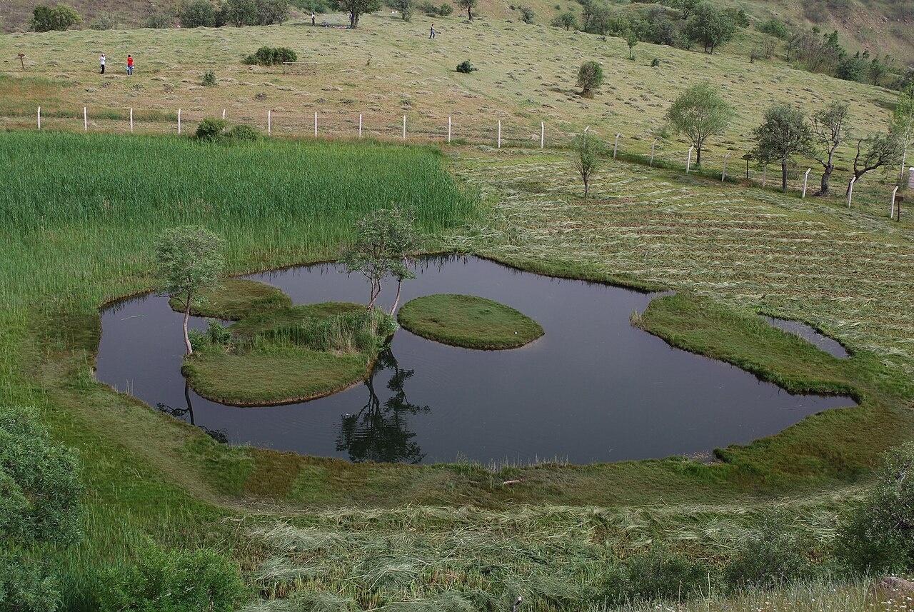
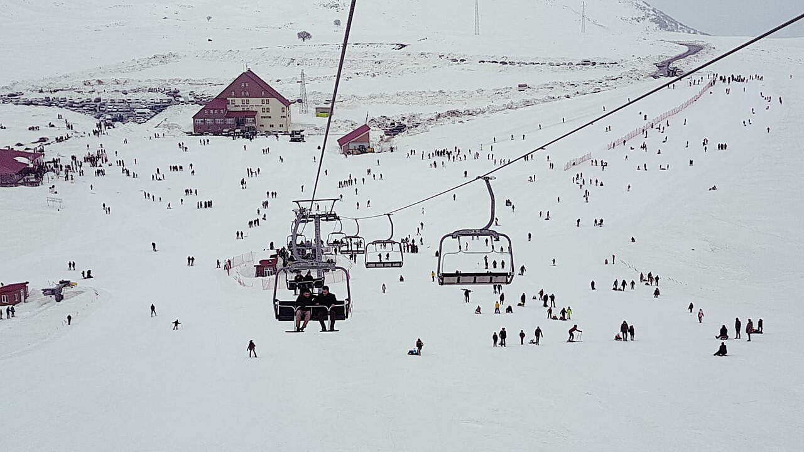

# 📍 Bingöl - Sefer Öncesi Hazırlık ve Seyahat Dosyası

  

## 📜 Seyyahın Beklentisi
> "Henüz adımlanmamış her yol, içinde koca bir hikaye saklar; bin gölün parıltısı, rüzgârla su üstünde süzülen Yüzen Adalar ve güneşin en berrak doğuşu Bingöl dağlarında seyyahını bekler."

### 🌍 Şehrin Dokusu ve Tarihsel Arka Planı
Adını yüksek dağlarının zirvelerinde ve yaylalarında saklı sayısız buzul gölünden alan Bingöl (tarihi adıyla Çapakçur), Fırat'ın kollarından Murat ve Peri sularının beslediği yemyeşil vadilerle çevrili bir Doğu Anadolu şehridir. Urartular döneminden kalma **Kral Kızı Kalesi** ve **Zağ Mağaraları**, Roma ve Selçuklu izleri ile Osmanlı döneminde Süveydi Beyliği'nin yönetimindeki Çapakçur kültürü, şehrin derin tarihini bugüne taşır.

Bingöl'ü Türkiye coğrafyasında benzersiz kılan tabiat harikalarının başında Solhan ilçesindeki **Yüzen Adalar** gelir; krater gölünün üzerinde birbirinden bağımsız üç kara parçası, tıpkı bir sal gibi suyun üstünde hareket eder. Şehir aynı zamanda Türkiye'nin en berrak gün doğumu manzaralarından birine sahne olan **Kale Tepesi (Güneşin Doğuşu Seyir Noktası)**, şifalı Kös Kaplıcaları, Hesarek Kayak Merkezi, Buban Bacaları ve dünyaca ödüllü Bingöl Balı ile doğa ve tefekkür gezginleri için saklı bir hazinedir.

### 🕌 Manevi Mimarlar ve Tarihî Şahsiyetler
- **Şeyh Ahmed-i Çapakçuri:** Bingöl ve çevresinde irşad faaliyetleriyle tanınan, bölge halkının gönlünde derin izler bırakan manevi önder.
- **İsfahan Bey ve Süveydi Beyleri:** Kiğı ve Çapakçur bölgesinde camiler, hanlar ve medreseler inşa ettirerek şehrin İslam mimarisi kimliğini şekillendiren tarihi beyler (Kiğı İsfahan Bey Camii).
- **Şeyh Ali Septi ve İlim Halkaları:** Bölgenin manevi eğitim geleneğini asırlar boyunca sürdüren müderris ve mutasavvıflar.

### 💬 Şehir Hakkında Edebi ve Tarihi Alıntılar
> "Çapakçur, suları gürül gürül akan, yaylaları cennet misali serin ve insanı vefalı bir beldedir." — Evliya Çelebi
>
> "Bingöl yaylalarında şafak sökerken dağların doruğundan süzülen ilk ışık, tabiatın uyanışına yazılmış sessiz bir kasidedir." — Seyyah Notu

### 🍽️ Yöresel Lezzet Rehberi
- **Bingöl Kavurması:** Yüksek rakımlı yaylalarda kekikle beslenen hayvanların etinden hazırlanan, coğrafi işaretli meşhur kavurma.
- **Löl (Zerfet) ve Mastuva:** Tandır ekmeği, sarımsaklı yoğurt ve kızdırılmış yayla tereyağıyla hazırlanan geleneksel lezzetler.
- **Bingöl Çiçek Balı:** Uluslararası yarışmalarda dereceler kazanmış, zengin endemik bitki örtüsünün hediyesi organik yayla balı.
- **Tefekkür Eşliğinde Çay:** Yüzen Adalar gölü kıyısında ya da Çır Şelalesi'nin serinliğinde yudumlanan sıcak çay.

### ⛺ Planlanan Konaklama ve Lojistik Stratejisi
- **Konaklama Planı:** GSB Seyahatsever programı kapsamında Bingöl merkezdeki KYK yurtlarında konaklanarak bütçe dostu 5 günlük keşif planlanmaktadır.
- **Ulaşım ve Rota Entegrasyonu:** Elazığ–Bingöl–Muş ekseni üzerinde kara yolu bağlantısıyla kolayca erişilebilen merkezi bir kavşak noktası olarak kurgulanmıştır.

### 💻 Planlanan Kütüphane Mesaisi (Yarı Göçebe Ofis)
- **Hedef Çalışma Noktası:** Bingöl İl Halk Kütüphanesi ve Bingöl Üniversitesi Merkez Kütüphanesi çevresi.
- **Mesai Planı:** Gündüz saatlerinde düzenli yazılım geliştirme ve kaynak taraması; öğleden sonra vadi, şelale ve tarihi ören yeri yürüyüşleri.

### 🧭 5 Günlük Planlanan Menzil Rotası
- **1. Gün – Bingöl Merkez ve Kös Kaplıcaları:** Şehre varış, İl Halk Kütüphanesi'nde çalışma mesaisi, şehir çarşısında Bingöl balı ve kavurması tadımı, akşam Kös Kaplıcaları çevresinde dinlenme.
- **2. Gün – Solhan Yüzen Adalar ve Turna Gölü:** Solhan ilçesine hareket; doğa harikası Yüzen Adalar'ın incelenmesi, göl kenarında tefekkür yürüyüşü ve çevredeki yayla köylerinin keşfi.
- **3. Gün – Karlıova Kale Tepesi (Gün Doğumu) ve Çır Şelalesi:** Şafak öncesi Karlıova Kale Tepesi'nde güneşin muazzam doğuşunun izlenmesi, dönüşte 50 metreden dökülen Çır Şelalesi ve Buban Bacaları gezisi.
- **4. Gün – Genç, Kral Kızı Kalesi ve Zağ Mağaraları:** Murat Nehri kıyısında yükselen Urartu eseri Kral Kızı Kalesi, kayalara oyulmuş çok katlı Zağ Mağaraları ve tarihi dokunun fotoğraflanması.
- **5. Gün – Kiğı Tarihi Mirası ve Hesarek Yaylası:** 15. yüzyıldan kalma Kiğı İsfahan Bey Camii, Peri Suyu vadisi manzaraları ve Hesarek Dağı eteklerinde veda yürüyüşü.

### ✨ Keşfedilecek Duraklar ve Landmarks
- [ ] **Yüzen Adalar Tabiat Anıtı (Solhan)**
- [ ] **Karlıova Kale Tepesi (Güneşin Doğuşu Noktası)**
- [ ] **Çır Şelalesi ve Buban Bacaları**
- [ ] **Zağ Mağaraları ve Kral Kızı Kalesi (Genç)**
- [ ] **Kiğı Kalesi ve İsfahan Bey Camii**

### 📸 Menzil Fotoğraf Galerisi
<table>
  <tr>
    <td align="center" width="50%">
       
      <b>Solhan Yüzen Adalar Tabiat Anıtı</b>
    </td>
    <td align="center" width="50%">
       
      <b>Bingöl Yaylaları ve Vadileri</b>
    </td>
  </tr>
</table>

---
*Henüz adımlanmamış bu huzurlu Doğu Anadolu durağı, gelecek seferlerde keşfedilmek üzere seyir defterine özenle not düşülmüştür.*
