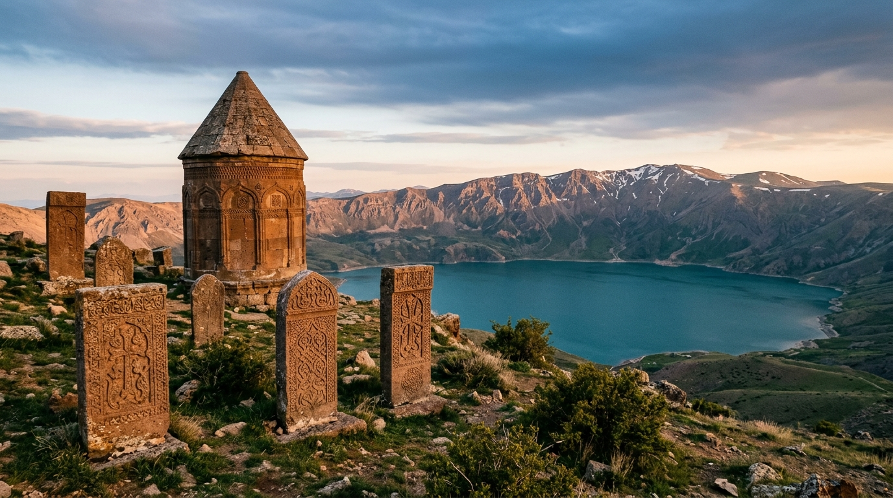
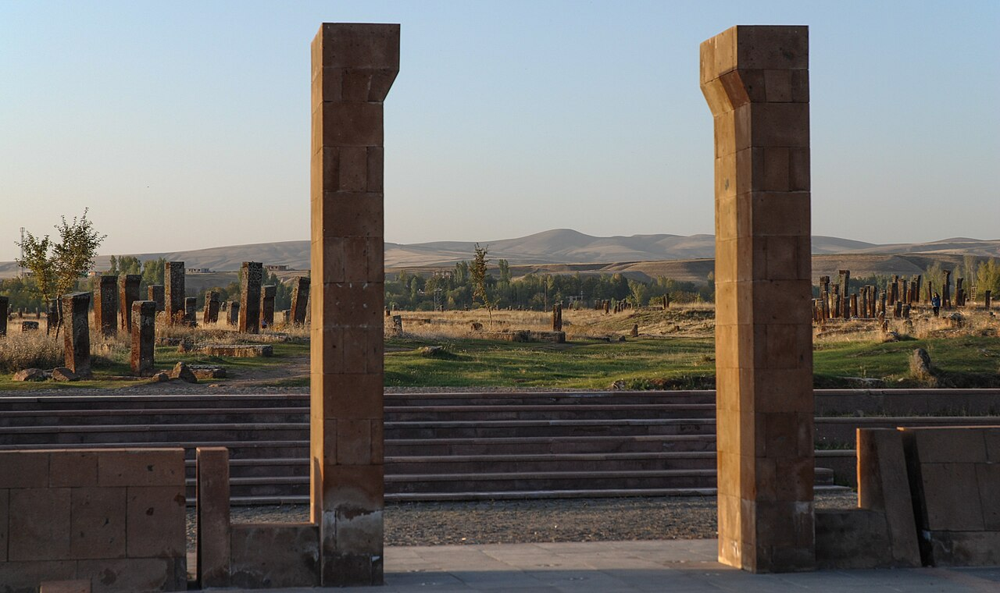

# 📍 Bitlis - Seyahat ve Tefekkür Notları

  

## 📜 Şehrin Ruhu
> "Kubbetü'l-İslam Ahlat'ın ulu Selçuklu mezar taşları, Van Gölü'nün turkuaz kıyıları ve dünyanın doğa harikası Nemrut Krater Gölü."

### 🌍 Şehrin Dokusu ve Tarihsel Arka Planı
Bitlis, İslam medeniyetinin Horasan'dan Anadolu'ya akışındaki en önemli üç "Kubbetü'l-İslam" (İslam'ın Kubbesi) merkezinden biri olan Ahlat'a ev sahipliği yapar. Dünyanın en büyük Türk-İslam mezarlığı olan Ahlat Selçuklu Meydan Mezarlığı, her biri sanat eseri niteliğindeki yüzlerce yıllık abidevi mezar taşları ve kümbetleriyle tarihin taşa kazınmış tapu senedidir. Ayrıca sönmüş bir volkan olan Nemrut Dağı zirvesindeki kaldera ve krater gölleri eşsiz bir tabiat harikasıdır.

Vadi tabanına kurulu tarihi Bitlis merkezi ise dik yamaçlara sıralanmış geleneksel kesme taş evleri, kemerli taş köprüleri, hanları ve türkülere konu olan beş minaresiyle adeta bir açık hava müzesidir. Büyük İskender'in komutanlarından Bedlis tarafından kurulduğu rivayet edilen Bitlis Kalesi'nin eteklerinde, asırlar boyunca Kürt, Türk ve Ermeni ustaların elinden çıkan taş işçiliği sanatı zirveye ulaşmıştır.

### 🕌 Manevi Mimarlar ve Tarihî Şahsiyetler
- **İdris-i Bitlisî (1457–1520):** Osmanlı tarihçisi, devlet adamı ve âlim. *Heşt Behişt* adlı eseriyle Osmanlı tarih yazıcılığında çığır açmış, Doğu Anadolu'nun Osmanlı birliğine barışçıl katılımında kilit rol oynamıştır.
- **Şeref Han (1543–1603):** Bitlis Beyliği'nin ilim ve kültür hamisi hükümdarı, meşhur *Şerefname* eserinin müellifi; adını taşıyan Şerefiye Külliyesi şehrin kalbindedir.
- **Abdurrahman Gazi ve Ahlat Erenleri:** Ahlat'ın fethinden itibaren şehri bir ilim ve irfan kubbesine dönüştüren sahabe, mutasavvıf ve taş ustası sanatkârlar (Emir Bayındır, Ulu Kümbet banileri).

### 💬 Şehir Hakkında Edebi ve Tarihi Alıntılar
> "Ahlat, İslam dünyasının ilim, hikmet ve sanat kubbesidir; her taşında bir arifin, bir fatihin nefesi saklıdır." — Tarihi Kayıtlar
>
> "Bitlis Kalesi ve vadideki taş medreseler, beş minarenin gölgesinde asırlardır nöbet tutar." — Evliya Çelebi

### 🕊️ Gezginin Not Defterinden (Manevi Boyut ve Tefekkür)
Ahlat Meydan Mezarlığı'nda 800 yıllık işlemeli şahidelerin arasında yürürken ölümün kaçınılmaz hakikatini, faniliğin ardındaki ebedi güzelliği ve ecdadın estetik anlayışını tefekkür edersiniz. Nemrut Krater Gölü'nün kıyısında buharı tüten sıcak sular ile masmavi soğuk gölün yan yana duruşunda doğanın muazzam dengesine şahit olursunuz.

### 🍽️ Yöresel Lezzet Tavsiyeleri
- **Yerel Tatlar ve İkramlar:** Asırlık kuyu ocaklarında pişirilen Bitlis Büryan Kebabı, Avsor çorbası, Katıklı Dolma ve Ahlat elması.
- **Tefekkür Eşliğinde Çay/Kahve:** Van Gölü kıyısında, Ahlat Kümbetleri silüetine karşı içilen çay.

### ⛺ Konaklama ve Bütçe Stratejisi
- **Sıfır Konaklama Maliyeti (Modern Kervansaraylar):** GSB Seyahatsever projesi kapsamında şehirdeki KYK yurtlarında 5 gün boyunca ücretsiz konaklanarak bütçe korunmuştur.
- **Ulaşım ve Lojistik Planlama:** Rota optimizasyonuna uyularak Muş ve Van hatlarıyla entegre şekilde gezilmiştir.

### 💻 Yarı Göçebe Mesaisi (İlim Tahsili & Kütüphane)
- **Kütüphane Rutini:** Gündüz vakitlerinde şehrin İl Halk Kütüphanesinde zaman geçirilerek bilgisayar başında yazılım geliştirme ve ders çalışma faaliyetleri sürdürülmüştür.
  * *Seyyahın Kütüphane Notu:* Bitlis İl Halk Kütüphanesi - Tarihi taş binalar arasında sükunet dolu, araştırmaya uygun ortam.
- **Süre ve Uyum:** Kütüphane mesaisi bitiminde şehrin tarihi dokusu ve Ahlat abideleri derinlemesine incelenmiştir.

### 🧭 5 Günlük Menzil Rotası
- **1. Gün – Bitlis Merkez ve Beş Minare Vadisi:** KYK yurduna yerleşme, Bitlis İl Halk Kütüphanesi mesaisi, Bitlis Kalesi, Şerefiye Camii, İhlasiye Medresesi, Ulu Camii ve tarihi taş çarşıda Büryan Kebabı molası.
- **2. Gün – Tatvan ve Nemrut Krater Gölü Kalderası:** Tatvan sahilinde sabah yürüyüşü, ardından 2.935 metrelik Nemrut Kalderası'na çıkış; soğuk göl, sıcak göl, buhar bacası ve krater içi sessiz tefekkür.
- **3. Gün – Kubbetü'l-İslam Ahlat:** Dünyanın en büyük Türk-İslam mezarlığı olan Ahlat Selçuklu Meydan Mezarlığı, Emir Bayındır Kümbeti, Ulu Kümbet, Harabe Şehir mağaraları ve Ahlat Müzesi ziyareti.
- **4. Gün – Adilcevaz ve Süphan Dağı Etekleri:** Van Gölü'nün kuzey kıyısındaki Adilcevaz'a geçiş; Tuğrul Bey Camii, Kef Kalesi kalıntıları, Arin Gölü kuş cenneti ve Süphan Dağı silüeti karşısında gün batımı.
- **5. Gün – Hizan Vadisi, El-Aman Hanı ve Veda:** Tarihi İpekyolu üzerindeki devasa El-Aman Hanı'nın görülmesi, kütüphanede notların derlenmesi ve Van Gölü'ne karşı son bir demli çay ile veda.

### ✨ Keşfedilesi Duraklar ve Landmarks
Bu şehrin havasını solumak, ruhuna dokunmak için mutlaka adımlanması gereken köşe taşları:
- [x] **Ahlat Selçuklu Meydan Mezarlığı ve Kümbetleri**
- [x] **Nemrut Krater Gölü & Kalderası**
- [x] **Bitlis Kalesi ve Tarihi Beş Minare**
- [x] **İhlasiye Medresesi ve Şerefiye Camii**
- [x] **Tarihi Taş Evler ve Bitlis Çarşısı**

### 📸 Menzil Fotoğraf Galerisi
<table>
  <tr>
    <td align="center" width="50%">
       
      <b>Kubbetü'l-İslam Ahlat & Selçuklu Şahideleri</b>
    </td>
    <td align="center" width="50%">
       
      <b>Nemrut Kalderası ve Van Gölü Kıyıları</b>
    </td>
  </tr>
</table>

---
*Bu il bizzat deneyimlenmiş, yolları aşındırılmış ve seyahatnameye sevgiyle işlenmiştir.* ✅
