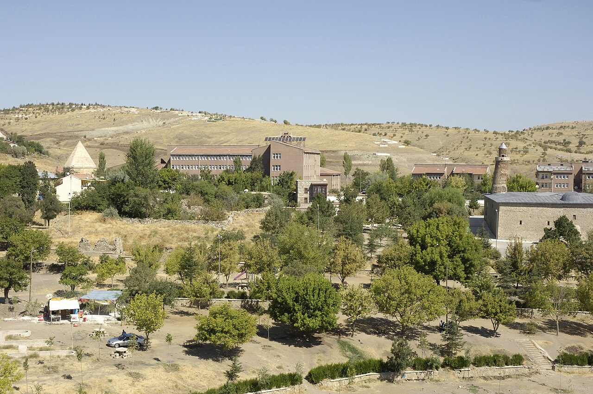

# 📍 Elazig - Seyahat ve Tefekkür Notları

  

## 📜 Şehrin Ruhu
> "Harput Kalesi'nin bin yıllık surları, Hazar Gölü'nün mavi sularıyla Doğu'nun köklü kültür havzası."

### 🌍 Şehrin Dokusu ve Tarihsel Arka Planı
Tarihi Harput kentinin devamı olan Elazığ, Urartulardan Selçuklu ve Osmanlıya uzanan zengin kültürü ve musikisiyle ünlüdür.

MÖ 2000'lere uzanan geçmişiyle Yukarı Fırat Havzası'nın kalbinde yer alan Harput, Artuklular döneminde Anadolu'nun en önemli ilim, mimari ve edebiyat merkezlerinden biri olmuştur. Harput'un 19. yüzyılda ovaya (Mezra'ya) inmesiyle kurulan bugünkü Elazığ; Kürsübaşı musikisi, Çayda Çıra halk oyunu, Keban Baraj Gölü'nün serinliği ve tektonik bir mücevher olan Hazar Gölü ile köklü geleneği modern şehir yaşamıyla buluşturur.

### 🕌 Manevi Mimarlar ve Tarihî Şahsiyetler
- **Arap Baba ve Mansur Baba:** Harput'un fethinden bu yana şehrin manevi muhafızları olarak kabul edilen ve türbeleri asırlardır ziyaret edilen ulu zatlar.
- **Belek Gazi (Balak Gazi):** Artuklu hükümdarı ve Haçlı seferlerine karşı Anadolu'nun savunulmasında büyük zaferler kazanan kahraman komutan; Harput Kalesi'nin hemen yanı başında hatırası yaşatılır.
- **Üryan Baba, Sara Hatun ve Harput Âlimleri:** Harput Ulu Camii ve Sara Hatun Camii etrafında asırlarca ilim ve irfan halkaları kuran mutasavvıf ve müderrisler.

### 💬 Şehir Hakkında Edebi ve Tarihi Alıntılar
> "Harput Kalesi, sinesinde bin yıllık efsaneleri saklayan Doğu'nun ulu nöbetçisidir." — Evliya Çelebi
>
> "Hazar Gölü, dağların arasında gizlenmiş turkuaz bir doğa mucizesidir." — Bedri Rahmi Eyüboğlu

### 🕊️ Gezginin Not Defterinden (Manevi Boyut ve Tefekkür)
Eğri minaresiyle meşhur Harput Ulu Camii'nin avlusunda, asırlardır secdeye varan insanların manevi izlerini tefekkür edersiniz.

### 🍽️ Yöresel Lezzet Tavsiyeleri
- **Yerel Tatlar ve İkramlar:** Şehrin yerel esnaf lokantalarında ve pazar yerlerinde deneyimlenen bütçe dostu, kültürel dokuyu yansıtan eşsiz lezzetler; özellikle Harput Köftesi, İçli Köfte, Sırın, Palu Tava, Ağın Leblebisi ve cevizli sucuk (Orcik).
- **Tefekkür Eşliğinde Çay/Kahve:** Şehrin tarihi kıraathanelerinde veya doğa manzaralı tepelerinde, özellikle Harput Balakgazi Parkı'nda ovaya karşı yudumlanan demli çaylar ve Kürsübaşı sohbetleri.

### ⛺ Konaklama ve Bütçe Stratejisi
- **Sıfır Konaklama Maliyeti (Modern Kervansaraylar):** GSB Seyahatsever projesi kapsamında şehirdeki KYK yurtlarında 5 gün boyunca ücretsiz konaklanarak bütçe korunmuştur.
- **Ulaşım ve Lojistik Planlama:** Rota optimizasyonuna uyularak komşu iller sırayla takip edilmiş, böylece hem yol maliyeti minimuma indirilmiş hem de karbon ayak izi azaltılmıştır.

### 💻 Yarı Göçebe Mesaisi (İlim Tahsili & Kütüphane)
- **Kütüphane Rutini:** Gündüz vakitlerinde şehrin İl Halk Kütüphanesinde zaman geçirilerek bilgisayar başında yazılım geliştirme ve ders çalışma faaliyetleri sürdürülmüştür.
  * *Seyyahın Kütüphane Notu:* Elazig İl Halk Kütüphanesi - Sessiz, çalışma disiplinine uygun, internet imkanı sunan verimli bir ilim yuvası.
- **Süre ve Uyum:** Kütüphane mesaisi bitiminde şehrin ruhuna karışmak üzere yollara düşülmüş, 5 günlük menzil süresiyle şehir sindirilerek keşfedilmiştir.

### 🧭 5 Günlük Menzil Rotası
- **1. Gün – Elazığ Merkez ve Kültür Park:** KYK yurduna yerleşme, Elazig İl Halk Kütüphanesi'nde ilk mesai, Kapalı Çarşı'da Orcik ve Ağın leblebisi keşfi, akşam Kültür Park yürüyüşü.
- **2. Gün – Kadim Harput Kenti:** Harput Kalesi (Süt Kalesi), eğri minaresiyle ünlü 12. yüzyıl Artuklu eseri Harput Ulu Camii, Sara Hatun Camii, Arap Baba Türbesi, Buzluk Mağarası ve Şefik Gül Kültür Evi.
- **3. Gün – Hazar Gölü ve Hazarbaba Zirvesi:** Sivrice ilçesindeki turkuaz Hazar Gölü kıyısında yürüyüş, Batık Şehir efsanesinin dinlenmesi, göl kenarında kitap okuma ve gün batımı.
- **4. Gün – Palu Kalesi ve Tarihi Köprü:** Murat Nehri kıyısındaki kadim Palu ilçesine geçiş; Urartu kitabesini barındıran Palu Kalesi, tarihi Palu Köprüsü, Alacalı Mescit ve Cemşit Bey Külliyesi.
- **5. Gün – Keban Baraj Gölü, Çırçır Şelalesi ve Veda:** Keban ilçesinde Fırat'ın birleşim noktası ve Çırçır Şelalesi ziyareti, alabalık molası, merkeze dönüşte kütüphane notlarının tamamlanması.

### ✨ Keşfedilesi Duraklar ve Landmarks
Bu şehrin havasını solumak, ruhuna dokunmak için mutlaka adımlanması gereken köşe taşları:
- [x] **Harput Kalesi ve Antik Kenti**
- [x] **Harput Ulu Camii**
- [x] **Hazar Gölü**
- [x] **Buzluk Mağarası ve Arap Baba Türbesi**
- [x] **Palu Kalesi ve Tarihi Köprüsü**

### 📸 Menzil Fotoğraf Galerisi
<table>
  <tr>
    <td align="center" width="50%">
       
      <b>Kadim Harput Kalesi ve Eğri Minare Silüeti</b>
    </td>
    <td align="center" width="50%">
       
      <b>Hazar Gölü ve Yukarı Fırat Manzarası</b>
    </td>
  </tr>
</table>

---
*Bu il bizzat deneyimlenmiş, yolları aşındırılmış ve seyahatnameye sevgiyle işlenmiştir.* ✅
