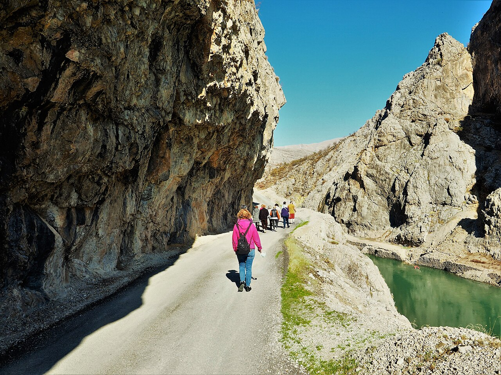

# 📍 Erzincan - Seyahat ve Tefekkür Notları

  

## 📜 Şehrin Ruhu
> "Girlevik Şelalesi'nin serin suları, Kemaliye Kanyonu'nun dik yamaçlarıyla depremlerden küllerinden doğan şehir."

### 🌍 Şehrin Dokusu ve Tarihsel Arka Planı
İpekyolu üzerinde yer alan Erzincan, yaşadığı büyük depremlere rağmen her seferinde yeniden kurulan dirayetli insanların şehridir. Kemaliye ilçesi özgün mimarisini korumuştur.

Mengüceklilerin başkenti olan ve Altıntepe Urartu Kalesi ile binlerce yıllık bir yerleşim geleneğini omuzlayan Erzincan, Fırat'ın (Karasu) bereketli ovasını çevreleyen Munzur ve Keşiş Dağları'nın ortasında geniş, düzenli bulvarlarıyla nefes alır. Tarihi adıyla Eğin olarak bilinen Kemaliye ilçesi ise ahşap kapı tokmakları, taş konakları, 132 yılda insan emeğiyle oyulan Taş Yol ve dünyanın en derin kanyonlarından Karanlık Kanyon ile Anadolu'nun en özgün kültür hazinelerinden biridir.

### 🕌 Manevi Mimarlar ve Tarihî Şahsiyetler
- **Terzi Baba (Muhammed Vehbi Hayyat, 1779–1848):** Erzincan'ın manevi kutbu, Nakşibendi-Halidi geleneğinin büyük mürşidi. *Kenzü'l-Fütuh* adlı manzum eseriyle tasavvuf edebiyatına derin izler bırakmıştır.
- **Pîr-i Sâmî (Abdurrahman Sami Niyazi) ve Salih Baba:** 19. yüzyıl Erzincan irfan geleneğinin, hikmetli sohbetleri ve divanlarıyla gönüllere dokunan manevi rehberleri.
- **Mama Hatun (Saltuklu Hükümdarı):** Tercan'da inşa ettirdiği eşsiz kervansaray, hamam ve dairesel kümbet külliyesiyle Türk-İslam mimarisinin öncü kadın banisi.
- **Behram Şah (Mengücekli Hükümdarı):** Erzincan'ı 12. yüzyılda bilim, sanat ve edebiyat merkezi haline getiren, Nizâmî-i Gencevî'nin *Mahzenü'l-Esrar* eserini ithaf ettiği âlim dostu bey.

### 💬 Şehir Hakkında Edebi ve Tarihi Alıntılar
> "Kemaliye, Fırat'ın kıyısında kayalara asılmış tarihi ve yemyeşil bir vaha gibidir." — Evliya Çelebi
>
> "Girlevik, dağlardan dökülen suların en güzel zikridir." — Bedri Rahmi Eyüboğlu

### 🕊️ Gezginin Not Defterinden (Manevi Boyut ve Tefekkür)
Kemaliye Karanlık Kanyonu'nun devasa kayalıkları arasında süzülürken, Fırat'ın coşkusunu ve doğanın haşmetini tefekkür edersiniz.

### 🍽️ Yöresel Lezzet Tavsiyeleri
- **Yerel Tatlar ve İkramlar:** Şehrin yerel esnaf lokantalarında ve pazar yerlerinde deneyimlenen bütçe dostu, kültürel dokuyu yansıtan eşsiz lezzetler; özellikle coğrafi işaretli Erzincan Tulum Peyniri, Cimin Üzümü, Erzincan Döneri, Kete, Babiko ve Kemaliye Lökü (dut ve ceviz ezmesi).
- **Tefekkür Eşliğinde Çay/Kahve:** Şehrin tarihi kıraathanelerinde veya doğa manzaralı tepelerinde, özellikle Girlevik Şelalesi'nin serinliğinde ve Kemaliye Mani Yolu'nda yudumlanan demli çaylar.

### ⛺ Konaklama ve Bütçe Stratejisi
- **Sıfır Konaklama Maliyeti (Modern Kervansaraylar):** GSB Seyahatsever projesi kapsamında şehirdeki KYK yurtlarında 5 gün boyunca ücretsiz konaklanarak bütçe korunmuştur.
- **Ulaşım ve Lojistik Planlama:** Rota optimizasyonuna uyularak komşu iller sırayla takip edilmiş, böylece hem yol maliyeti minimuma indirilmiş hem de karbon ayak izi azaltılmıştır.

### 💻 Yarı Göçebe Mesaisi (İlim Tahsili & Kütüphane)
- **Kütüphane Rutini:** Gündüz vakitlerinde şehrin İl Halk Kütüphanesinde zaman geçirilerek bilgisayar başında yazılım geliştirme ve ders çalışma faaliyetleri sürdürülmüştür.
  * *Seyyahın Kütüphane Notu:* Erzincan İl Halk Kütüphanesi - Sessiz, çalışma disiplinine uygun, internet imkanı sunan verimli bir ilim yuvası.
- **Süre ve Uyum:** Kütüphane mesaisi bitiminde şehrin ruhuna karışmak üzere yollara düşülmüş, 5 günlük menzil süresiyle şehir sindirilerek keşfedilmiştir.

### 🧭 5 Günlük Menzil Rotası
- **1. Gün – Erzincan Merkez ve Terzibaba Ziyareti:** KYK yurduna yerleşme, Erzincan İl Halk Kütüphanesi mesaisi, Terzibaba Camii ve Türbesi ziyareti, Bakırcılar Çarşısı'nda el işçiliği incelemesi ve akşam tulum peynirli döner molası.
- **2. Gün – Girlevik Şelalesi ve Ekşisu Mesire Alanı:** Dokuz farklı kaynaktan beslenip 40 metreden dökülen Girlevik Şelalesi yürüyüşü, ardından doğal maden sularıyla ünlü Ekşisu sazlıkları ve kuş gözlemi.
- **3. Gün – Kemaliye (Eğin), Karanlık Kanyon ve Taş Yol:** Sabah erken Kemaliye'ye hareket; Karanlık Kanyon tekne turu veya yürüyüşü, 38 tünelden oluşan efsanevi Taş Yol, Mani Yolu, tarihi Eğin konakları ve Prof. Dr. Ali Demirsoy Doğa Tarihi Müzesi.
- **4. Gün – Tercan Mama Hatun Külliyesi ve Altıntepe:** Urartu döneminin görkemli merkezi Altıntepe Ören Yeri'nin gezilmesi; ardından Tercan'da Saltuklu şaheseri Mama Hatun Kervansarayı ve Kümbeti ziyareti.
- **5. Gün – Ergan Dağı Etekleri, Otlukbeli Gölü ve Veda:** Dünyada nadir görülen traverten set gölü Otlukbeli Gölü (veya Ergan Dağı Ardıçlı Gölü) ziyareti, kütüphanede notların derlenmesi ve Cimin üzümü eşliğinde şehre veda.

### ✨ Keşfedilesi Duraklar ve Landmarks
Bu şehrin havasını solumak, ruhuna dokunmak için mutlaka adımlanması gereken köşe taşları:
- [x] **Kemaliye Karanlık Kanyon ve Taş Yol**
- [x] **Girlevik Şelalesi**
- [x] **Terzibaba Türbesi**
- [x] **Mama Hatun Külliyesi ve Kervansarayı (Tercan)**
- [x] **Altıntepe Urartu Kalesi**

### 📸 Menzil Fotoğraf Galerisi
<table>
  <tr>
    <td align="center" width="50%">
       
      <b>Girlevik Şelalesi ve Munzur Etekleri</b>
    </td>
    <td align="center" width="50%">
       
      <b>Kemaliye Karanlık Kanyon ve Fırat Vadisi</b>
    </td>
  </tr>
</table>

---
*Bu il bizzat deneyimlenmiş, yolları aşındırılmış ve seyahatnameye sevgiyle işlenmiştir.* ✅
