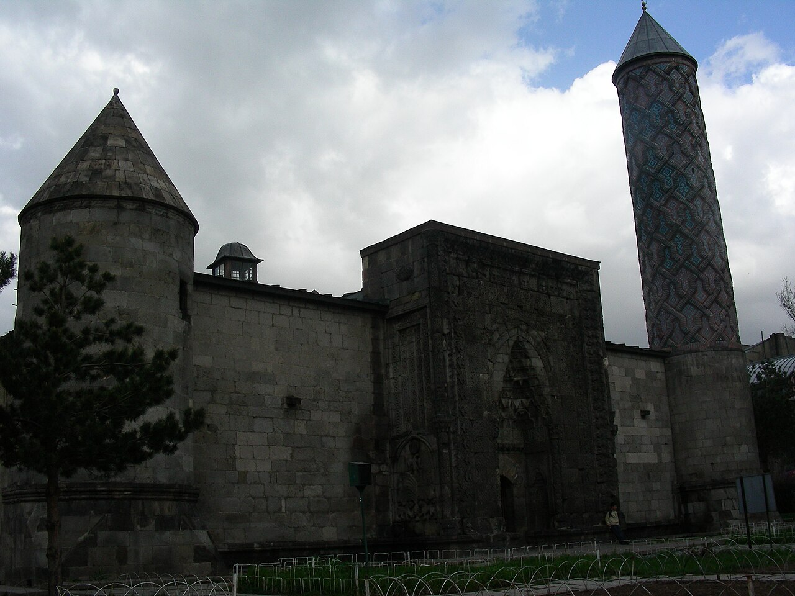

# 📍 Erzurum - Seyahat ve Tefekkür Notları

  

## 📜 Şehrin Ruhu
> "Palandöken Dağı'nın karlı zirveleri, Çifte Minareli Medrese'nin asil taş kapısıyla Doğu'nun kilit taşı vakur şehir."

### 🌍 Şehrin Dokusu ve Tarihsel Arka Planı
Selçuklu ve İlhanlı dönemlerinde önemli bir ilim merkezi olan Erzurum, Milli Mücadele döneminde Erzurum Kongresi ile vatanın bölünmezliğini dünyaya ilan etmiştir.

Anadolu'daki ilk Türk beyliklerinden Saltukluların başkenti olan bu 1.900 metre rakımlı yayla kenti; Ulu Camii, Üç Kümbetler, Çifte Minareli Medrese, Yakutiye Medresesi ve Rüstem Paşa Bedesteni (Taşhan) ile Selçuklu'dan Osmanlı'ya kesintisiz bir mimari şölen sunar. Aziziye Tabyaları'nda 93 Harbi'nin destansı direnişini, Tortum Şelalesi ve Narman Peribacaları'nda ise Doğu Anadolu ile Karadeniz'in kucaklaştığı eşsiz tabiat mucizelerini barındırır.

### 🕌 Manevi Mimarlar ve Tarihî Şahsiyetler
- **Erzurumlu İbrahim Hakkı Hazretleri (1703–1780):** Hasankale'de doğmuş, astronomi, tıp, psikoloji ve tasavvufu birleştiren *Marifetname* adlı ansiklopedik şaheserin müellifi büyük âlim ve mutasavvıf.
- **Alvarlı Efe (Muhammed Lütfi Efendi, 1868–1956):** *Hulâsatü'l-Hakâyık* divanının sahibi, merhamet ve hikmet dolu şiirleriyle Erzurum'un manevi ufkunu aydınlatan gönül sultanı.
- **Abdurrahman Gazi:** Erzurum'un manevi bekçisi olarak Palandöken eteklerinde medfun sahabe/gazi; şehri kuşbakışı gören türbesi asırlardır dua ve tefekkür makamıdır.
- **Nene Hatun (1857–1955):** 1877–1878 Osmanlı-Rus Harbi'nde Aziziye Tabyası'nı savunarak Türk kadınının cesaret ve vatan sevgisinin ebedi sembolü olmuş kahraman.
- **Erzurumlu Emrah ve Sümmani Baba:** Doğu Anadolu âşıklık geleneğinin ve saz eşliğinde hikmet söyleyişinin zirve isimleri.

### 💬 Şehir Hakkında Edebi ve Tarihi Alıntılar
> "Erzurum, Anadolu'nun kilididir, soğuk iklimin sıcak kalpli yiğit insanlarıdır." — Evliya Çelebi
>
> "Palandöken'in vakur duruşu, çift minarenin asil duruşu Erzurum'un ruhudur." — Ahmet Hamdi Tanpınar

### 🕊️ Gezginin Not Defterinden (Manevi Boyut ve Tefekkür)
Çifte Minareli Medrese'nin kapısındaki Selçuklu hayat ağacı motifini incelerken, medeniyetimizin köklerini ve ebediyet arayışını tefekkür edersiniz.

### 🍽️ Yöresel Lezzet Tavsiyeleri
- **Yerel Tatlar ve İkramlar:** Şehrin yerel esnaf lokantalarında ve pazar yerlerinde deneyimlenen bütçe dostu, kültürel dokuyu yansıtan eşsiz lezzetler; özellikle odun ateşinde pişen meşhur Oltu Cağ Kebabı, Kadayıf Dolması, Ayran Aşı, Civil Peyniri ve Lor Dolması.
- **Tefekkür Eşliğinde Çay/Kahve:** Şehrin tarihi kıraathanelerinde veya doğa manzaralı tepelerinde, özellikle Taşhan (Rüstem Paşa Bedesteni) avlusunda kıtlama şekerle yudumlanan demli çaylar.

### ⛺ Konaklama ve Bütçe Stratejisi
- **Sıfır Konaklama Maliyeti (Modern Kervansaraylar):** GSB Seyahatsever projesi kapsamında şehirdeki KYK yurtlarında 5 gün boyunca ücretsiz konaklanarak bütçe korunmuştur.
- **Ulaşım ve Lojistik Planlama:** Rota optimizasyonuna uyularak komşu iller sırayla takip edilmiş, böylece hem yol maliyeti minimuma indirilmiş hem de karbon ayak izi azaltılmıştır.

### 💻 Yarı Göçebe Mesaisi (İlim Tahsili & Kütüphane)
- **Kütüphane Rutini:** Gündüz vakitlerinde şehrin İl Halk Kütüphanesinde zaman geçirilerek bilgisayar başında yazılım geliştirme ve ders çalışma faaliyetleri sürdürülmüştür.
  * *Seyyahın Kütüphane Notu:* Erzurum İl Halk Kütüphanesi - Sessiz, çalışma disiplinine uygun, internet imkanı sunan verimli bir ilim yuvası.
- **Süre ve Uyum:** Kütüphane mesaisi bitiminde şehrin ruhuna karışmak üzere yollara düşülmüş, 5 günlük menzil süresiyle şehir sindirilerek keşfedilmiştir.

### 🧭 5 Günlük Menzil Rotası
- **1. Gün – Selçuklu ve Saltuklu Mirası (Tarihi Merkez):** KYK yurduna yerleşme, Erzurum İl Halk Kütüphanesi mesaisi, Çifte Minareli Medrese, Ulu Camii, Üç Kümbetler, Yakutiye Medresesi ve Erzurum Kalesi (Saat Kulesi) ziyareti.
- **2. Gün – Milli Mücadele Hafızası ve Taşhan:** Erzurum Kongre Binası Müzesi, Lala Mustafa Paşa Camii, Oltu taşı ustalarının bulunduğu Rüstem Paşa Bedesteni (Taşhan), Aziziye Tabyaları ve Nene Hatun Tarihi Milli Parkı; akşam Cağ Kebabı ve Kadayıf Dolması.
- **3. Gün – Palandöken ve Abdurrahman Gazi:** Sabah Abdurrahman Gazi Türbesi'nde şehre kuşbakışı tefekkür, ardından Palandöken Dağı eteklerinde yüksek irtifa yürüyüşü ve tarihi Erzurum Evleri'nde kıtlama çay molası.
- **4. Gün – Tortum Şelalesi, Öşvank ve Narman Peribacaları:** Kuzey rotasına günübirlik sefer; 48 metreden dökülen görkemli Tortum Şelalesi, Tortum Gölü, Orta Çağ eseri Öşvank Manastırı ve "Kırmızı Periler Diyarı" Narman Peribacaları.
- **5. Gün – Hasankale (Pasinler), Çobandede Köprüsü ve Veda:** Pasinler Kalesi ve 13. yüzyıl İlhanlı eseri Çobandede Köprüsü ziyareti; kütüphanede notların tamamlanması ve Dadaş diyarına veda.

### ✨ Keşfedilesi Duraklar ve Landmarks
Bu şehrin havasını solumak, ruhuna dokunmak için mutlaka adımlanması gereken köşe taşları:
- [x] **Çifte Minareli Medrese**
- [x] **Yakutiye Medresesi**
- [x] **Palandöken Dağı**
- [x] **Üç Kümbetler**
- [x] **Erzurum Kongre Binası ve Aziziye Tabyaları**
- [x] **Tortum Şelalesi ve Narman Peribacaları**

### 📸 Menzil Fotoğraf Galerisi
<table>
  <tr>
    <td align="center" width="50%">
       
      <b>Çifte Minareli Medrese ve Selçuklu Taş İşçiliği</b>
    </td>
    <td align="center" width="50%">
       
      <b>Palandöken Ufku ve Erzurum'un Kadim Dokusu</b>
    </td>
  </tr>
</table>

---
*Bu il bizzat deneyimlenmiş, yolları aşındırılmış ve seyahatnameye sevgiyle işlenmiştir.* ✅
