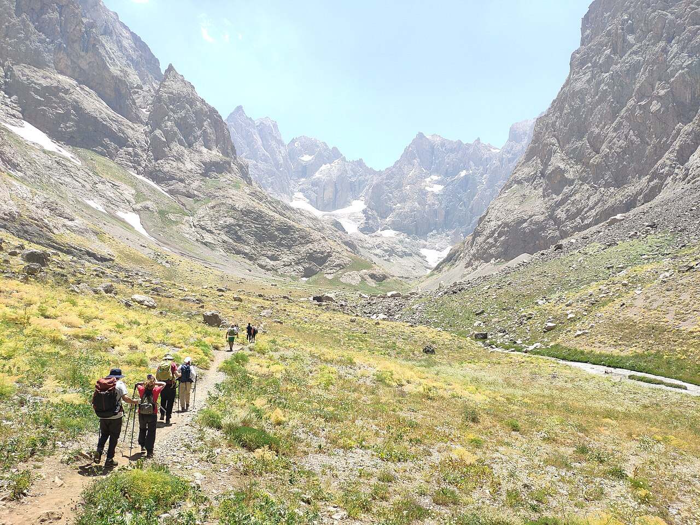
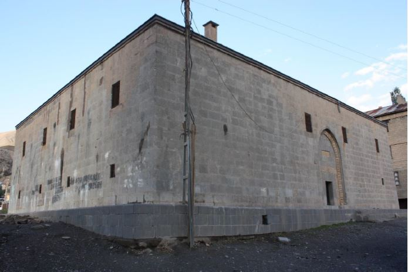

# 📍 Hakkari - Sefer Öncesi Hazırlık ve Seyahat Dosyası

  

## 📜 Seyyahın Beklentisi
> "Henüz adımlanmamış her yol, içinde koca bir hikaye saklar; Cilo Dağları'nın 20 bin yıllık buzulları, Sat Gölleri'nin zümrüt aynası ve Zap Suyu'nun sarp kanyonları Anadolu'nun en görkemli zirve hikayesini fısıldar."

### 🌍 Şehrin Dokusu ve Tarihsel Arka Planı
Türkiye'nin güneydoğu ucunda, 4.135 metrelik **Uludoruk (Reşko)** zirvesiyle Anadolu'nun ikinci en yüksek noktasına ev sahipliği yapan Hakkari, doğa ve tarih meraklıları için eşsiz bir coğrafyadır. Urartular, Medler, Persler, Abbasiler ve Selçukluların izlerini taşıyan bölge, uzun yüzyıllar boyunca Hakkari Beyliği (Çölemerik) yönetiminde özgün bir kültür ve ilim havzası olarak yaşamıştır.

Şehrin kalbinde yer alan 18. yüzyıl eseri **Meydan Medresesi**, iki katlı revaklı avlusu ve taş işçiliğiyle bölgenin kadim eğitim geleneğini yansıtır. Hakkari'nin 1998'de keşfedilen ve MÖ 2. binyıla tarihlenen **Hakkari Stelleri** ise Anadolu arkeolojisinin en gizemli buluntularındandır. Doğal miras bakımından **Cilo ve Sat Dağları Milli Parkı**, yazın ortasında bile erimeyen devasa buzulları, 3.000 metre rakımdaki buzul gölleri, endemik ters laleleri (Ağlayan Gelin), Cennet-Cehennem Vadisi ve derin Zap Vadisi ile Alpleri aratmayan bir ihtişam sunar.

### 🕌 Manevi Mimarlar ve Tarihî Şahsiyetler
- **İbrahim Bey ve Hakkari Beyleri:** 1700'lü yıllarda Meydan Medresesi'ni ve tarihi taş köprüleri inşa ettirerek Çölemerik'i bir ilim ve mimari merkezine dönüştüren baniler.
- **Seyyid Taha-i Hakkâri (1792–1853):** Şemdinli'nin Nehri (Bağlar) köyünde yaşamış, Mevlânâ Hâlid-i Bağdâdî'nin önde gelen halifelerinden büyük mutasavvıf; Kayme Sarayı ve Kelat Sarayı çevresinde asırlık bir irfan ocağı kurmuştur.
- **Pertev Bey ve Bölge Müderrisleri:** Çölemerik ve Nehri medreselerinde ilim, edebiyat ve tasavvuf halkalarını nesiller boyu yaşatan âlimler.

### 💬 Şehir Hakkında Edebi ve Tarihi Alıntılar
> "Cilo'nun karlı zirveleri bulutları deler; eteklerindeki buzul gölleri gökyüzünün yere düşmüş parçalarıdır." — Dağcı ve Seyyah Notları
>
> "Zap Suyu, sarp kayalıkların arasından çağlayarak Mezopotamya'ya dağların selamını taşır." — Bölge Folkloru

### 🍽️ Yöresel Lezzet Rehberi
- **Doğaba ve Kepaye:** Buğday, yoğurt ve kuzu etiyle hazırlanan doyurucu yöresel çorba (Doğaba) ile baharatlı iç pilavla doldurulmuş geleneksel Kepaye.
- **Kıris ve Lalaped:** Yayla tereyağı, taze otlar ve taş fırın lezzetleriyle bezenmiş dağ mutfağı; ayrıca meşhur **Şemdinli Balı** ve otlu peynir.
- **Tefekkür Eşliğinde Çay:** Zap Vadisi'ne bakan seyir teraslarında veya Merga Bütan yaylasında serin dağ havasında içilen demli çay.

### ⛺ Planlanan Konaklama ve Lojistik Stratejisi
- **Konaklama Planı:** GSB Seyahatsever kapsamında Hakkari merkezdeki KYK yurtları temel üs olarak değerlendirilecek; Cilo-Sat buzul gölleri ve yüksek yaylalar için yerel rehberli günübirlik araç organizasyonu planlanacaktır.
- **Ulaşım ve Rota Entegrasyonu:** Van–Başkale–Hakkari–Yüksekova hattı üzerinden, yaz aylarında (Haziran–Ağustos) kar erimesiyle açılan Cilo-Sat yolları gözetilerek sefer zamanlaması yapılacaktır.

### 💻 Planlanan Kütüphane Mesaisi (Yarı Göçebe Ofis)
- **Hedef Çalışma Noktası:** Hakkari İl Halk Kütüphanesi (Merkez).
- **Mesai Planı:** Gündüz saatlerinde düzenli yazılım geliştirme, okuma ve rota analizi; öğleden sonra ise tarihi Meydan Medresesi ve vadi yürüyüşleri.

### 🧭 5 Günlük Planlanan Menzil Rotası
- **1. Gün – Çölemerik (Merkez) ve Meydan Medresesi:** Şehre varış, İl Halk Kütüphanesi'nde çalışma mesaisi, tarihi Meydan Medresesi, Çölemerik Kalesi etekleri, Hakkari Kilim dokuma atölyeleri ve akşam Doğaba tadımı.
- **2. Gün – Cilo Dağları ve Cennet-Cehennem Vadisi:** Kırıkdağ üzerinden Cennet-Cehennem Vadisi'ne hareket; 20 bin yıllık Cilo buzulları, şelaleler ve dört mevsimin bir arada yaşandığı vadi yürüyüşü.
- **3. Gün – Yüksekova ve Sat Buzul Gölleri:** Yüksekova'ya geçiş ve 3.000 metre rakımlı Sat Buzul Gölleri'ne (Gelyano, Baygöl) çıkış; zümrüt göllerin kıyısında sessiz tefekkür ve fotoğrafçılık.
- **4. Gün – Şemdinli, Nehri ve Tarihi Taş Köprü:** Şemdinli'de Şemdinli Çayı üzerindeki 19. yüzyıl eseri Taş Köprü, Bağlar (Nehri) köyünde Seyyid Taha-i Hakkâri Türbesi ve Kayme Sarayı kalıntıları ziyareti.
- **5. Gün – Berçelan Yaylası, Merga Bütan ve Veda:** Göllerle bezeli Berçelan Yaylası veya Merga Bütan seyir noktasında serin yayla havası, Zap Vadisi boyunca dönüş yolculuğu ve notların derlenmesi.

### ✨ Keşfedilecek Duraklar ve Landmarks
- [ ] **Cilo ve Sat Dağları Milli Parkı (Buzul Gölleri)**
- [ ] **Cennet-Cehennem Vadisi ve Cilo Buzulları**
- [ ] **Tarihi Meydan Medresesi (Merkez)**
- [ ] **Şemdinli Taş Köprü ve Nehri (Kayme Sarayı)**
- [ ] **Zap Vadisi ve Berçelan Yaylası**

### 📸 Menzil Fotoğraf Galerisi
<table>
  <tr>
    <td align="center" width="50%">
       
      <b>Cilo ve Sat Dağları Buzul Gölleri</b>
    </td>
    <td align="center" width="50%">
       
      <b>Zap Vadisi ve Çölemerik Zirveleri</b>
    </td>
  </tr>
</table>

---
*Henüz adımlanmamış bu görkemli zirveler diyarı, gelecek seferlerde keşfedilmek üzere seyir defterine özenle not düşülmüştür.*
