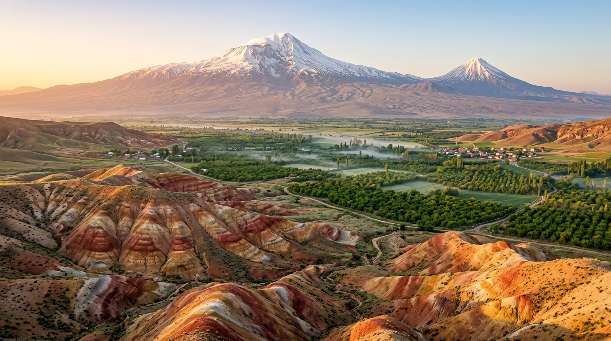
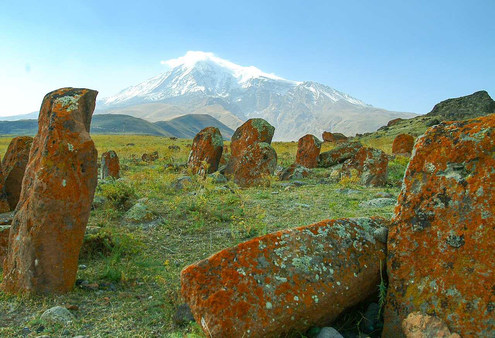

# 📍 Iğdır - Seyahat ve Tefekkür Notları

  

## 📜 Şehrin Ruhu
> "Üç ülkeye sınır açan serhat ovası, Doğu'nun Çukurova'sı mikroklima cenneti ve Tuzluca'nın yer altı kristal mağaraları."

### 🌍 Şehrin Dokusu ve Tarihsel Arka Planı
Türkiye'nin en doğu ucunda yer alan ve Ermenistan, Azerbaycan (Nahçıvan) ile İran'a komşu olan Iğdır, etrafı yüksek dağlarla çevrili korunaklı bir ovadır. Bu coğrafi yapısı sayesinde Doğu Anadolu'nun sert kış şartlarına tezat olarak mikroklima iklimi yaşar; kayısı bahçeleri, pamuk tarlaları ve bereketli tarım alanlarıyla "Doğu'nun Çukurova'sı" unvanını taşır. İlçelerindeki Tuzluca Tuz Mağaraları ise Hititlerden bu yana işletilen devasa yer altı galerileridir.

Tarihi İpekyolu'nun Kafkasya ve İran kapısında yükselen 12. yüzyıl Selçuklu eseri **Ejder (Harmandöven) Kervansarayı**, yüzlerce yıl kervanların sığınağı olmuştur. Koç başlı Karakoyunlu mezar taşları, Aras Nehri kuş cenneti ve Gökkuşağı Tepeleri'nin (Tuzluca) mineral renkleriyle bezeli jeolojik oluşumları Iğdır'ı hem tarih hem de doğa açısından benzersiz kılar.

### 🕌 Manevi Mimarlar ve Tarihî Şahsiyetler
- **Şerafeddin Ejder Bey:** 12. yüzyılda Sürmeli Emiri olarak İpekyolu ticaretini ve yolcuların emniyetini sağlamak üzere anıtsal Ejder Kervansarayı'nı inşa ettiren Selçuklu banisi.
- **Karakoyunlu ve Selçuklu Taş Ustaları:** Iğdır ovasındaki kadim mezarlıklarda yer alan koç başlı mezar taşlarıyla Orta Asya'dan Anadolu'ya uzanan kültürel hafızayı taşa nakşeden sanatkârlar.
- **Serhat Boyu Âlim ve Âşıkları:** Azerbaycan ve Anadolu kültür havzasının kesişiminde sözlü edebiyatı, deyişleri ve kardeşlik bağlarını yaşatan halk ozanları.

### 💬 Şehir Hakkında Edebi ve Tarihi Alıntılar
> "Iğdır Ovası, Aras Nehri'nin suladığı, Doğu'nun soğuğunda saklı sıcacık bir yeşil vahadır." — Seyyah Gözlemi
>
> "Tuzluca'nın devasa kaya tuzu mağaralarında yankılanan sessizlik, asırların yer altındaki sabır anıtıdır." — Gezi Notları

### 🕊️ Gezginin Not Defterinden (Manevi Boyut ve Tefekkür)
Aras Nehri boyunda üç farklı devletin sınır çizgilerinin birleştiği noktada durup sınırların geçiciliğini, kardeşlik bağlarının ve aynı gökyüzü altında paylaşılan yeryüzünün birliğini tefekkür edersiniz. Tuzluca Mağaraları'nın devasa tavanları altında yürürken yerin yüzlerce metre altındaki şifayı ve nimeti düşünürsünüz.

### 🍽️ Yöresel Lezzet Tavsiyeleri
- **Yerel Tatlar ve İkramlar:** Özel porsiyon kaplarında sunulan meşhur Bozbaş (Piti) aşı, Taş Köfte, Iğdır şalağı (kavunu), taze kayısı ve kete.
- **Tefekkür Eşliğinde Çay/Kahve:** Ağrı Dağı'nın eteklerinde ovaya karşı içilen semaver çayı.

### ⛺ Konaklama ve Bütçe Stratejisi
- **Sıfır Konaklama Maliyeti (Modern Kervansaraylar):** GSB Seyahatsever projesi kapsamında şehirdeki KYK yurtlarında 5 gün boyunca ücretsiz konaklanarak bütçe korunmuştur.
- **Ulaşım ve Lojistik Planlama:** Kars ve Ağrı rotası üzerinden geçiş yapılarak Doğu sınır hattı tamamlanmıştır.

### 💻 Yarı Göçebe Mesaisi (İlim Tahsili & Kütüphane)
- **Kütüphane Rutini:** Gündüz vakitlerinde şehrin İl Halk Kütüphanesinde zaman geçirilerek bilgisayar başında yazılım geliştirme ve ders çalışma faaliyetleri sürdürülmüştür.
  * *Seyyahın Kütüphane Notu:* Iğdır İl Halk Kütüphanesi - Şehir merkezinde sakin, aydınlık ve odaklanmayı kolaylaştıran ortam.
- **Süre ve Uyum:** Kütüphane mesaisi bitiminde şehrin Aras boyu vadileri ve tarihi durakları adımlanmıştır.

### 🧭 5 Günlük Menzil Rotası
- **1. Gün – Iğdır Merkez ve Ağrı Dağı Silüeti:** KYK yurduna yerleşme, Iğdır İl Halk Kütüphanesi'nde ilk çalışma mesaisi, Soykırım Anıtı ve Müzesi ziyareti, akşam çarşıda Bozbaş (Piti) ve Taş Köfte tadımı.
- **2. Gün – Tuzluca Tuz Mağaraları ve Gökkuşağı Tepeleri:** Tuzluca'daki devasa Tuz Terapi Mağaraları'nda yer altı yürüyüşü, ardından kırmızı-sarı-yeşil mineral katmanlarıyla büyüleyen Gökkuşağı Tepeleri'nde gün batımı fotoğrafçılığı.
- **3. Gün – Ejder Kervansarayı ve Karakoyunlu Koç Başlı Mezarları:** 12. yüzyıl Selçuklu eseri Ejder Kervansarayı'nın incelenmesi, Karakoyunlu ve Melekli çevresindeki tarihi koç başlı mezar taşlarının ziyareti.
- **4. Gün – Aralık, Aras Kuş Cenneti ve Nahçıvan Sınır Hattı:** Aras Nehri boyunca ilerleyerek Aras Kuş Araştırma Merkezi'nin görülmesi, Dilucu sınır hattı ve Büyük Ağrı Dağı'nın kuzey yamaçlarındaki Korhan Yaylası seyir noktası.
- **5. Gün – Karakale Ören Yeri ve Veda:** Urartu ve Orta Çağ izlerini taşıyan Karakale Ören Yeri gezisi, kayısı bahçeleri arasında veda yürüyüşü ve kütüphane notlarının toparlanması.

### ✨ Keşfedilesi Duraklar ve Landmarks
Bu şehrin havasını solumak, ruhuna dokunmak için mutlaka adımlanması gereken köşe taşları:
- [x] **Tuzluca Tuz Mağaraları (Tuz Terapi Merkezi)**
- [x] **Ejder Kervansarayı (Tarihi İpekyolu Hanı)**
- [x] **Ağrı Dağı Kuzey Yamaçları ve Milli Parkı**
- [x] **Karakale Ören Yeri ve Aras Nehri Kıyısı**
- [x] **Soykırım Anıtı ve Müzesi**

### 📸 Menzil Fotoğraf Galerisi
<table>
  <tr>
    <td align="center" width="50%">
       
      <b>Iğdır Ovası'ndan Ağrı Dağı'nın Heybetli Silüeti</b>
    </td>
    <td align="center" width="50%">
       
      <b>Tuzluca Tuz Mağaraları ve Doğu'nun Çukurova'sı</b>
    </td>
  </tr>
</table>

---
*Bu il bizzat deneyimlenmiş, yolları aşındırılmış ve seyahatnameye sevgiyle işlenmiştir.* ✅
