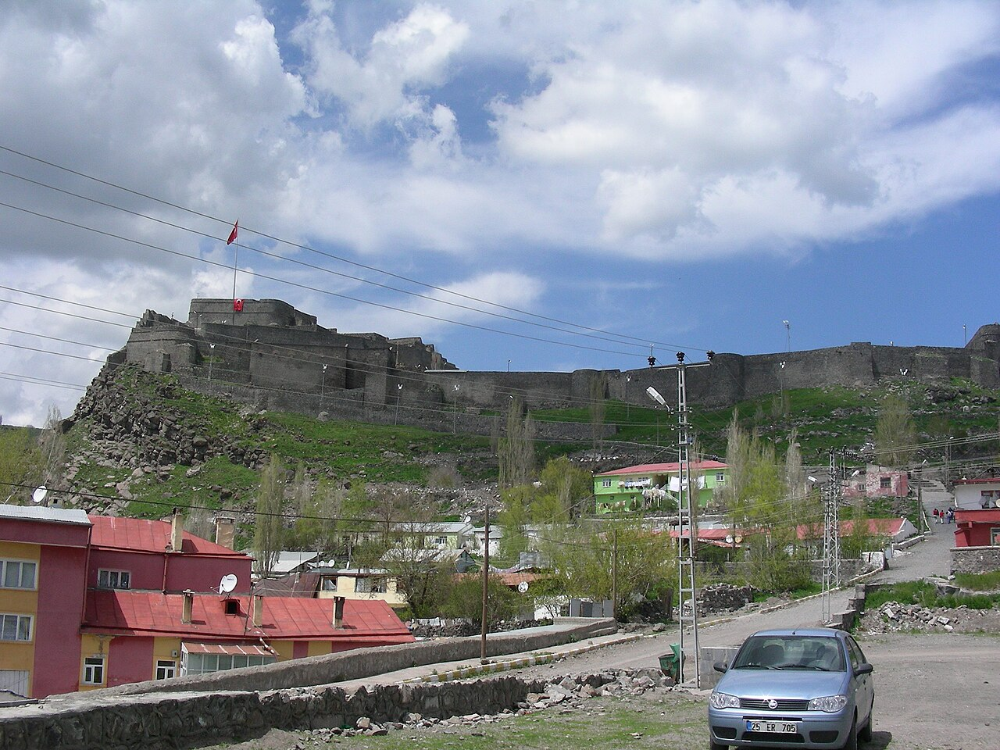

# 📍 Kars - Seyahat ve Tefekkür Notları

  

## 📜 Şehrin Ruhu
> "Ani Harabeleri'nin hüzünlü ve görkemli kalıntıları, Rus mimarisi tarihi sokaklarıyla sınır boyunun asil şehri."

### 🌍 Şehrin Dokusu ve Tarihsel Arka Planı
Bagratlı krallığından Selçuklu fethine, Rus işgali döneminden kurtuluşa kadar Kars, askeri ve kültürel tarihimizin en stratejik serhat kentidir.

Sultan Alparslan'ın 1064'te fethettiği ve Anadolu'daki ilk Türk camisi olan **Ebu'l-Menuçehr Camii**'ni barındıran UNESCO Dünya Mirası **Ani Ören Yeri**, Arpaçay kanyonunun kıyısında bin yıllık bir medeniyetler geçidi olarak yükselir. 19. yüzyılın son çeyreğinde Hollandalı ve Baltık mimarlarca ızgara planla kurulan kesme bazalt taşlı konakları, Kars Kalesi'nin gölgesindeki Taş Köprü, Fethiye Camii (Alexander Nevski Kilisesi), Sarıkamış'ın kristal karlı sarıçam ormanları ve Çıldır Gölü'ne uzanan yaylalarıyla Kars, Türkiye'nin en özgün kimliğe sahip şehirlerindendir.

### 🕌 Manevi Mimarlar ve Tarihî Şahsiyetler
- **Ebu'l-Hasan Harakânî Hazretleri (963–1033):** Anadolu'nun manevi fatihlerinden, "Her kim bu dergâha gelirse ekmeğini veriniz, inancını sormayınız" düsturuyla insanlık tarihine merhamet dersi veren büyük Horasan ereni; türbesi Kars Kalesi eteklerindeki Evliya Camii külliyesindedir.
- **Sultan Alparslan ve Ebu'l-Menuçehr:** 1064 Ani fethiyle Anadolu'nun kapılarını aralayan ve Anadolu'daki ilk camiyi inşa ettiren tarih yapıcı liderler.
- **Gazi Ahmed Muhtar Paşa ve Kâzım Karabekir Paşa:** 93 Harbi ve Milli Mücadele'de Doğu Cephesi'nin ve Kars'ın kurtuluşunun unutulmaz komutanları.
- **Âşık Murat Çobanoğlu ve Kars Âşıkları:** Kars Âşıklar Evi geleneğini yaşatan, atışmalarıyla Doğu'nun sözlü kültürünü bugüne taşıyan büyük halk ozanları.

### 💬 Şehir Hakkında Edebi ve Tarihi Alıntılar
> "Ani bir dünya ama dünya bir Ani değil." — Tarihi Selçuklu Özdeyişi
>
> "Kars Kalesi, doğu sınırımızın en dik duruşlu, en aşılmaz Selçuklu nöbetçisidir." — Evliya Çelebi

### 🕊️ Gezginin Not Defterinden (Manevi Boyut ve Tefekkür)
Ani Harabeleri'nde Bizans kiliseleri ile Selçuklu camilerinin yan yana duran kalıntılarında, tarihin çok sesliliğini ve medeniyetlerin faniliğini tefekkür edersiniz.

### 🍽️ Yöresel Lezzet Tavsiyeleri
- **Yerel Tatlar ve İkramlar:** Şehrin yerel esnaf lokantalarında ve pazar yerlerinde deneyimlenen bütçe dostu, kültürel dokuyu yansıtan eşsiz lezzetler; özellikle Kars Kaz Eti, coğrafi işaretli Kars Eski Kaşarı ve Gravyeri, Hangeli (Hıngel), Piti, Umaç Helvası ve Kars Balı.
- **Tefekkür Eşliğinde Çay/Kahve:** Şehrin tarihi kıraathanelerinde veya doğa manzaralı tepelerinde, özellikle Baltık taş binaları arasındaki kahvehanelerde ve Kars Âşıklar Evi'nde yudumlanan demli çaylar.

### ⛺ Konaklama ve Bütçe Stratejisi
- **Sıfır Konaklama Maliyeti (Modern Kervansaraylar):** GSB Seyahatsever projesi kapsamında şehirdeki KYK yurtlarında 5 gün boyunca ücretsiz konaklanarak bütçe korunmuştur.
- **Ulaşım ve Lojistik Planlama:** Rota optimizasyonuna uyularak komşu iller sırayla takip edilmiş, böylece hem yol maliyeti minimuma indirilmiş hem de karbon ayak izi azaltılmıştır.

### 💻 Yarı Göçebe Mesaisi (İlim Tahsili & Kütüphane)
- **Kütüphane Rutini:** Gündüz vakitlerinde şehrin İl Halk Kütüphanesinde zaman geçirilerek bilgisayar başında yazılım geliştirme ve ders çalışma faaliyetleri sürdürülmüştür.
  * *Seyyahın Kütüphane Notu:* Kars İl Halk Kütüphanesi - Sessiz, çalışma disiplinine uygun, internet imkanı sunan verimli bir ilim yuvası.
- **Süre ve Uyum:** Kütüphane mesaisi bitiminde şehrin ruhuna karışmak üzere yollara düşülmüş, 5 günlük menzil süresiyle şehir sindirilerek keşfedilmiştir.

### 🧭 5 Günlük Menzil Rotası
- **1. Gün – Kale İçi, Ebu'l-Hasan Harakânî ve Baltık Sokakları:** KYK yurduna yerleşme, Kars İl Halk Kütüphanesi mesaisi, Ebu'l-Hasan Harakânî Türbesi ve Evliya Camii ziyareti, Havariler Kilisesi (Kümbet Camii), Kars Kalesi'nden gün batımı ve Taş Köprü yürüyüşü.
- **2. Gün – UNESCO Mirası Ani Ören Yeri:** Sabah erken Ani'ye hareket; Aslanlı Kapı, Büyük Katedral (Fethiye Camii), Anadolu'nun ilk camisi Ebu'l-Menuçehr Camii, Tigran Honents Kilisesi ve Arpaçay kanyonu seyri.
- **3. Gün – Tarihi Merkez, Kafkas Cephesi ve Peynir Müzesi:** Fethiye Camii, Gazi Ahmet Muhtar Paşa Konağı, Kanlı Tabya (Kafkas Cephesi Harp Tarihi Müzesi), Türkiye'nin ilk Peynir Müzesi (Boğatepe / Süvari Tabyası) ve akşam Âşıklar Evi'nde saz dinletisi.
- **4. Gün – Sarıkamış Şehitliği ve Katerina Köşkü:** Sarıkamış Harekatı Şehitliği'nde dua ve tefekkür, sarıçam ormanları içinde yükselen tarihi Katerina Av Köşkü ziyareti ve yayla havasında yürüyüş.
- **5. Gün – Boğatepe Köyü, Kars Çarşısı ve Veda:** Gravyer peynirinin doğduğu Boğatepe köyü ziyareti, şehir merkezinde eski kaşar ve bal alışverişi, kütüphanede notların tamamlanmasıyla serhat şehrine veda.

### ✨ Keşfedilesi Duraklar ve Landmarks
Bu şehrin havasını solumak, ruhuna dokunmak için mutlaka adımlanması gereken köşe taşları:
- [x] **Ani Harabeleri**
- [x] **Kars Kalesi**
- [x] **Tarihi Kars Rus Evleri**
- [x] **Ebu'l Hasan Harakani Türbesi**
- [x] **Kafkas Cephesi Harp Tarihi Müzesi (Kanlı Tabya)**
- [x] **Sarıkamış Şehitliği ve Katerina Köşkü**

### 📸 Menzil Fotoğraf Galerisi
<table>
  <tr>
    <td align="center" width="50%">
       
      <b>UNESCO Dünya Mirası Ani Ören Yeri & Arpaçay</b>
    </td>
    <td align="center" width="50%">
       
      <b>Kars Kalesi ve Tarihi Baltık Taş Sokakları</b>
    </td>
  </tr>
</table>

---
*Bu il bizzat deneyimlenmiş, yolları aşındırılmış ve seyahatnameye sevgiyle işlenmiştir.* ✅
