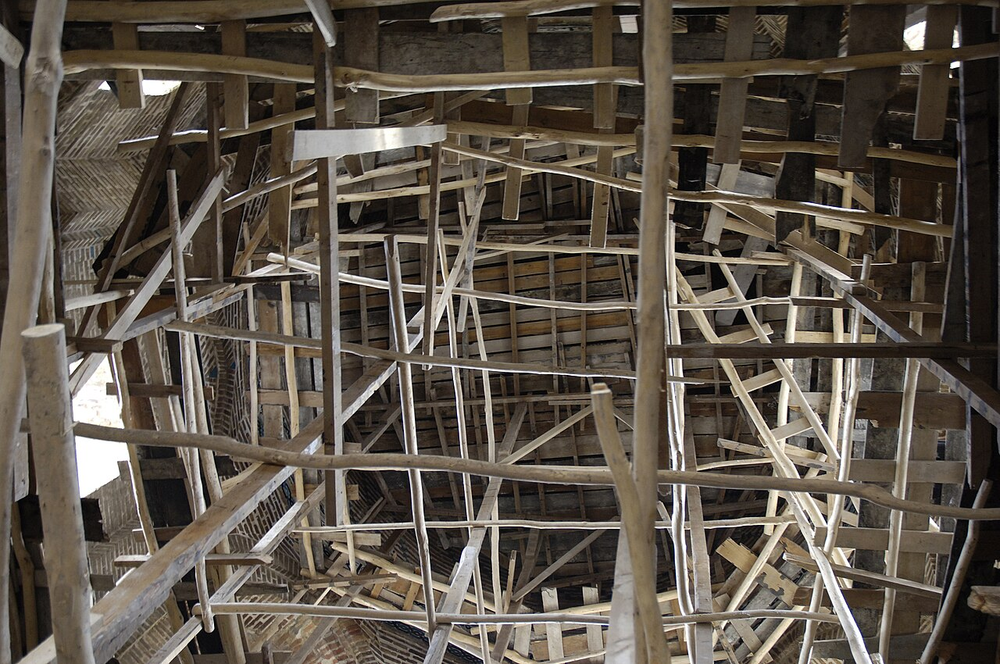

# 📍 Malatya - Seyahat ve Tefekkür Notları

  

## 📜 Şehrin Ruhu
> "Arslantepe Höyüğü ile devletleşmenin ilk adımlarına tanıklık eden, kayısının ve bereketli ovaların şehri."

### 🌍 Şehrin Dokusu ve Tarihsel Arka Planı
İnsanlık tarihinin en eski saray ve bürokrasi kalıntılarını barındıran Arslantepe'ye sahip olan Malatya, Fırat nehrinin suladığı en bereketli topraklardandır.

UNESCO Dünya Mirası Listesi'nde yer alan 5.500 yıllık **Arslantepe Höyüğü**, dünyadaki ilk mühürlü bürokrasi, kerpiç saray kompleksi ve devlet örgütlenmesi izleriyle insanlık tarihinin dönüm noktalarından biridir. Eski Malatya (Battalgazi) ise Selçuklu döneminin görkemli eseri Battalgazi Ulu Camii, Silahtar Mustafa Paşa Kervansarayı ve surlarıyla Anadolu'nun kapısındaki kadim İslam kentidir. Batıda Darende'nin Tohma Kanyonu, Günpınar Şelalesi ve Somuncu Baba Külliyesi, kuzeyde Arapgir'in tarihi taş konakları ve Levent Vadisi'nin 65 milyon yıllık kaya oluşumları Malatya'ya derin bir coğrafi ve manevi zenginlik katar.

### 🕌 Manevi Mimarlar ve Tarihî Şahsiyetler
- **Şeyh Hâmid-i Velî (Somuncu Baba, 1331–1412):** Bursa Ulu Camii'nin açılış hutbesini okuyan, Hacı Bayram-ı Velî'nin mürşidi büyük mutasavvıf; ömrünün son yıllarını Darende'de geçirmiş olup türbesi ve Balıklı Gölü gönüllerin şifa durağıdır.
- **Es-Seyyid Osman Hulusi Efendi (1914–1990):** Darende'nin manevi mimarı, şair ve hayırsever; Somuncu Baba Külliyesi'nin ihyasına ve şehrin kültür hayatına büyük hizmetler sunmuştur.
- **Seyyid Battal Gazi:** Emeviler ve Abbasiler döneminde Anadolu gaza geleneğinin destansı kahramanı; kadim Malatya (Battalgazi) ilçesi onun adıyla anılır.
- **Niyâzî-i Mısrî (1618–1694):** Malatya'nın Soğanlı köyünde doğmuş, tasavvuf edebiyatının en lirik divan şairlerinden büyük âlim ve mutasavvıf.

### 💬 Şehir Hakkında Edebi ve Tarihi Alıntılar
> "Malatya, Fırat'ın bereketiyle yoğrulmuş, kayısı bahçelerinin kokusunda dinlenen cennet köşesidir." — Evliya Çelebi
>
> "Somuncu Baba Külliyesi, ruhların arındığı, gönüllerin şifa bulduğu manevi bir limandır." — Es-Seyyid Osman Hulusi Efendi

### 🕊️ Gezginin Not Defterinden (Manevi Boyut ve Tefekkür)
Somuncu Baba Külliyesi'nin huzurlu manevi atmosferinde kalbi bir sükunete erer, Tohma Çayı'nın sesinde dinginliği tefekkür edersiniz.

### 🍽️ Yöresel Lezzet Tavsiyeleri
- **Yerel Tatlar ve İkramlar:** Şehrin yerel esnaf lokantalarında ve pazar yerlerinde deneyimlenen bütçe dostu, kültürel dokuyu yansıtan eşsiz lezzetler; özellikle dünya çapında tescilli Malatya Kayısısı, Kağıt Kebabı, Analı Kızlı, Kiraz Yaprağı Sarması, Gırık ve Kayısı Tatlısı.
- **Tefekkür Eşliğinde Çay/Kahve:** Şehrin tarihi kıraathanelerinde veya doğa manzaralı tepelerinde, özellikle Tohma Kanyonu kıyısında ve Battalgazi Kervansarayı avlusunda yudumlanan demli çaylar.

### ⛺ Konaklama ve Bütçe Stratejisi
- **Sıfır Konaklama Maliyeti (Modern Kervansaraylar):** GSB Seyahatsever projesi kapsamında şehirdeki KYK yurtlarında 5 gün boyunca ücretsiz konaklanarak bütçe korunmuştur.
- **Ulaşım ve Lojistik Planlama:** Rota optimizasyonuna uyularak komşu iller sırayla takip edilmiş, böylece hem yol maliyeti minimuma indirilmiş hem de karbon ayak izi azaltılmıştır.

### 💻 Yarı Göçebe Mesaisi (İlim Tahsili & Kütüphane)
- **Kütüphane Rutini:** Gündüz vakitlerinde şehrin İl Halk Kütüphanesinde zaman geçirilerek bilgisayar başında yazılım geliştirme ve ders çalışma faaliyetleri sürdürülmüştür.
  * *Seyyahın Kütüphane Notu:* Malatya İl Halk Kütüphanesi - Sessiz, çalışma disiplinine uygun, internet imkanı sunan verimli bir ilim yuvası.
- **Süre ve Uyum:** Kütüphane mesaisi bitiminde şehrin ruhuna karışmak üzere yollara düşülmüş, 5 günlük menzil süresiyle şehir sindirilerek keşfedilmiştir.

### 🧭 5 Günlük Menzil Rotası
- **1. Gün – UNESCO Mirası Arslantepe ve Battalgazi:** KYK yurduna yerleşme, Malatya İl Halk Kütüphanesi mesaisi, Arslantepe Höyüğü Açık Hava Müzesi, Battalgazi Ulu Camii, Silahtar Mustafa Paşa Kervansarayı ve Şire Pazarı'nda kayısı çeşitleri keşfi.
- **2. Gün – Darende, Somuncu Baba ve Tohma Kanyonu:** Darende'ye hareket; Somuncu Baba Türbesi ve Külliyesi, Balıklı Havuz, sarp kayalıklar arasındaki Tohma Kanyonu yürüyüşü ve üç kademeli Günpınar Şelalesi.
- **3. Gün – Akçadağ Levent Vadisi ve Seyir Terası:** 65 milyon yıllık jeolojik oluşumlarıyla Anadolu'nun Büyük Kanyonu sayılan Levent Vadisi'nin cam seyir terasından izlenmesi ve vadi içi kaya yerleşimlerinin keşfi.
- **4. Gün – Yeşilyurt Tarihi Konakları ve Arapgir:** Geleneksel kerpiç ve ahşap Yeşilyurt evleri, Çırmıktı sokakları ve vakit elverirse Cittaslow (Sakin Şehir) unvanlı Arapgir'in taş konakları ve Kayaarası Kanyonu.
- **5. Gün – Karakaya Baraj Gölü Kıyısı ve Veda:** Fırat'ın sularında sabah dinginliği, kütüphanede seyahat notlarının tamamlanması ve Kağıt Kebabı eşliğinde şehre veda.

### ✨ Keşfedilesi Duraklar ve Landmarks
Bu şehrin havasını solumak, ruhuna dokunmak için mutlaka adımlanması gereken köşe taşları:
- [x] **Arslantepe Höyüğü**
- [x] **Somuncu Baba Türbesi ve Külliyesi (Darende)**
- [x] **Tohma Kanyonu ve Günpınar Şelalesi**
- [x] **Battalgazi Ulu Camii ve Silahtar Mustafa Paşa Kervansarayı**
- [x] **Levent Vadisi Seyir Terası**

### 📸 Menzil Fotoğraf Galerisi
<table>
  <tr>
    <td align="center" width="50%">
       
      <b>Arslantepe Höyüğü ve Malatya'nın Kadim Mirası</b>
    </td>
    <td align="center" width="50%">
       
      <b>Darende Tohma Kanyonu ve Manevi Huzur</b>
    </td>
  </tr>
</table>

---
*Bu il bizzat deneyimlenmiş, yolları aşındırılmış ve seyahatnameye sevgiyle işlenmiştir.* ✅
