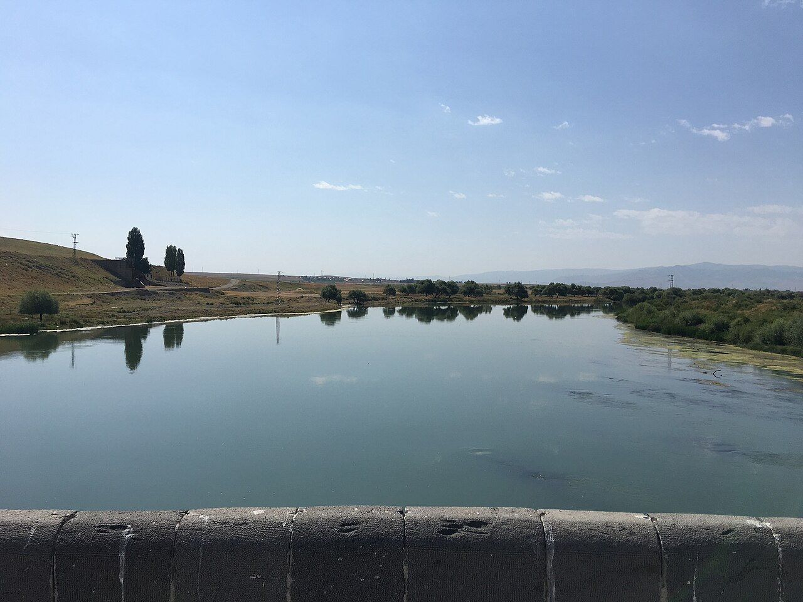
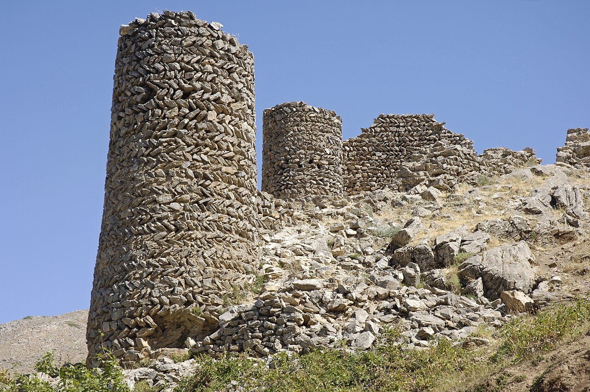

# 📍 Muş - Sefer Öncesi Hazırlık ve Seyahat Dosyası

  

## 📜 Seyyahın Beklentisi
> "Henüz adımlanmamış her yol, içinde koca bir hikaye saklar; Anadolu'nun kapılarını açan 1071 Malazgirt Ovası, baharda kıpkırmızı kesilen Muş laleleri ve Murat Nehri'nin asırlık taş köprüsü bu kadim hikayenin kalbidir."

### 🌍 Şehrin Dokusu ve Tarihsel Arka Planı
Doğu Anadolu'nun en geniş ve bereketli ovalarından birine kurulu olan Muş, Türk ve İslam tarihinin dönüm noktası olan **26 Ağustos 1071 Malazgirt Meydan Muharebesi**'ne ev sahipliği yapmasıyla Anadolu'nun tapu senedi sayılır. Urartular, Medler, Persler, Romalılar, Bizanslılar, Selçuklular ve Osmanlılar döneminde stratejik bir merkez olan şehir, her bahar ovasını baştan başa kırmızı bir halıya çeviren endemik **Muş Lalesi** ile şairlere ve türkülere ilham vermiştir.

Muş'un mimari mirası, 13. yüzyılda Selçuklu döneminde temelleri atılan ve 12 kemerli görkemli yapısıyla Murat Nehri'ni kucaklayan **Tarihi Murat Köprüsü**, 14. yüzyıl eseri **Muş Ulu Camii**, Alaeddin Bey Camii ve Hacı Şeref Camii ile şekillenir. Varto yakınlarındaki sönmüş volkanik **Hamurpet (Akdoğan) Gölleri**, Kayalıdere Urartu Kalesi ve Arak (Kutsal Havariler) Manastırı kalıntıları ise şehrin tarih ve tabiat katmanlarını tamamlar.

### 🕌 Manevi Mimarlar ve Tarihî Şahsiyetler
- **Sultan Alparslan (1029–1072):** 26 Ağustos 1071 Cuma günü kefenini giyerek çıktığı Malazgirt Ovası'nda Anadolu'nun kapılarını ebediyen açan Büyük Selçuklu Sultanı.
- **Şeyh Muhammed-i Mağribi:** Muş Ulu Camii'nin hemen yanında türbesi bulunan, şehrin manevi hafızasında derin bir yere sahip tasavvuf büyüğü.
- **Alaeddin Bey:** 18. yüzyılda Muş'ta inşa ettirdiği cami ve hayratlarla şehrin Osmanlı dönemindeki imar faaliyetlerine öncülük eden tarihi şahsiyet.

### 💬 Şehir Hakkında Edebi ve Tarihi Alıntılar
> "Size öyle bir vatan aldım ki, ebediyen sizin olacaktır." — Sultan Alparslan (Malazgirt, 1071)
>
> "Burası Muş'tur, yolu yokuştur; giden gelmiyor, acep ne iştir?" — Anadolu'nun Yürek Yakan Kadim Türküsü

### 🍽️ Yöresel Lezzet Rehberi
- **Muş Köftesi (Hafta Direği):** Dövülmüş et ve bulgurla hazırlanan, içi cevizli ve baharatlı kıymayla doldurulmuş, şehrin tescilli baş tacı yemeği.
- **Hez Dolması ve Çorti Aşı:** Lahana turşusu, kemikli et ve nohutla pişirilen kışlık Çorti aşı ile kavurmalı Hez dolması.
- **Muş Böreği ve Teter Helvası:** İnce açılmış yufkalarla hazırlanan börekler ve cevizli pekmezli geleneksel helvalar.
- **Tefekkür Eşliğinde Çay:** Tarihi Murat Köprüsü kıyısında nehrin akışına karşı veya Malazgirt Ovası rüzgârında yudumlanan sıcak çay.

### ⛺ Planlanan Konaklama ve Lojistik Stratejisi
- **Konaklama Planı:** GSB Seyahatsever programı kapsamında Muş merkezdeki KYK yurtlarında ücretsiz konaklanarak 5 günlük verimli bir keşif planlanmaktadır.
- **Ulaşım ve Rota Entegrasyonu:** Bingöl–Muş–Bitlis (Tatvan/Ahlat) hattı üzerinde kara yolu veya Van Gölü Ekspresi tren güzergâhıyla bütünleşik, ekonomik bir rota olarak kurgulanmıştır.

### 💻 Planlanan Kütüphane Mesaisi (Yarı Göçebe Ofis)
- **Hedef Çalışma Noktası:** Muş İl Halk Kütüphanesi ve Muş Alparslan Üniversitesi kütüphane çevresi.
- **Mesai Planı:** Sabah saatlerinde yazılım geliştirme, okuma ve Malazgirt tarihi üzerine araştırmalar; ikindi sonrası ova, köprü ve tarihi cami yürüyüşleri.

### 🧭 5 Günlük Planlanan Menzil Rotası
- **1. Gün – Muş Merkez ve Kadim Mahalleler:** Şehre varış, İl Halk Kütüphanesi mesaisi, Muş Kalesi Parkı'ndan ovaya bakış, Muş Ulu Camii, Alaeddin Bey Camii, Hacı Şeref Camii, Tarihi Yıldızlı Han ve akşam Muş Köftesi tadımı.
- **2. Gün – 1071 Malazgirt Ovası ve Milli Parkı:** Sabah Malazgirt'e hareket; Malazgirt Meydan Muharebesi Tarihi Milli Parkı, Malazgirt Kalesi surları, 1071 Zafer Anıtı ve tarihi savaş alanında derin tefekkür.
- **3. Gün – Tarihi Murat Köprüsü ve Muş Ovası Laleleri:** 12 kemerli Tarihi Murat Köprüsü'nde fotoğraf ve yürüyüş, bahar mevsimindeyse Muş Ovası'ndaki doğal lale tarlalarının seyri ve Arak Manastırı çevresi gezisi.
- **4. Gün – Varto, Hamurpet (Akdoğan) Gölleri ve Kayalıdere:** Varto ilçesine geçiş; 2.149 metre rakımlı Büyük ve Küçük Hamurpet Krater Gölleri'nin sakin kıyılarında doğa yürüyüşü ve Urartu eseri Kayalıdere Kalesi kalıntıları.
- **5. Gün – Bulanık, Haçlı Gölü ve Veda:** Kazan (Haçlı) Gölü çevresinde kuş gözlemi veya merkezde yerel çarşı gezisi, kütüphane notlarının toparlanması ve Anadolu'nun kapısı Muş'a veda.

### ✨ Keşfedilecek Duraklar ve Landmarks
- [ ] **Malazgirt Meydan Muharebesi Tarihi Milli Parkı ve Kalesi**
- [ ] **Tarihi Murat Köprüsü (12 Kemerli Selçuklu/Osmanlı Köprüsü)**
- [ ] **Muş Ulu Camii, Alaeddin Bey Camii ve Yıldızlı Han**
- [ ] **Hamurpet (Akdoğan) Krater Gölleri (Varto)**
- [ ] **Muş Ovası Lale Tarlaları ve Kayalıdere Urartu Kalesi**

### 📸 Menzil Fotoğraf Galerisi
<table>
  <tr>
    <td align="center" width="50%">
       
      <b>Tarihi Murat Köprüsü ve Malazgirt Ruhu</b>
    </td>
    <td align="center" width="50%">
       
      <b>Muş Ovası ve Hamurpet Gölleri Manzarası</b>
    </td>
  </tr>
</table>

---
*Henüz adımlanmamış bu Anadolu'nun fetih kapısı, gelecek seferlerde keşfedilmek üzere seyir defterine özenle not düşülmüştür.*
