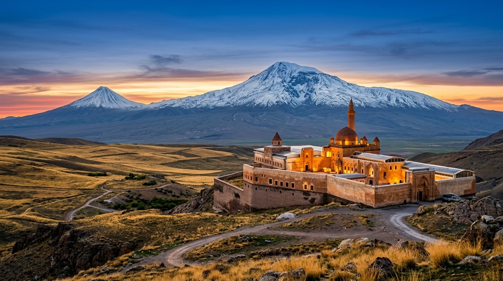
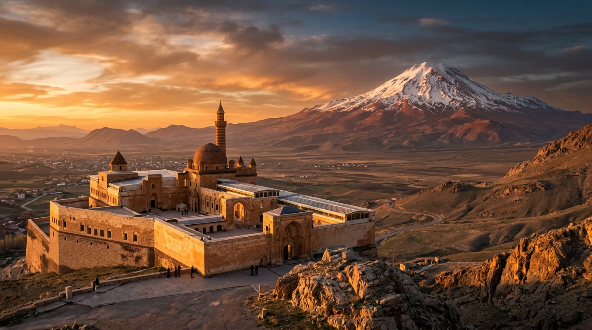
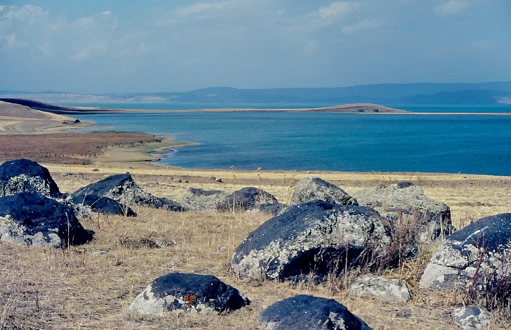
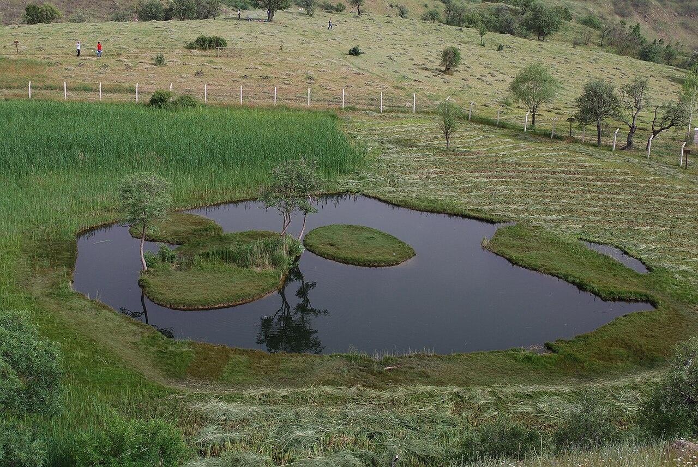
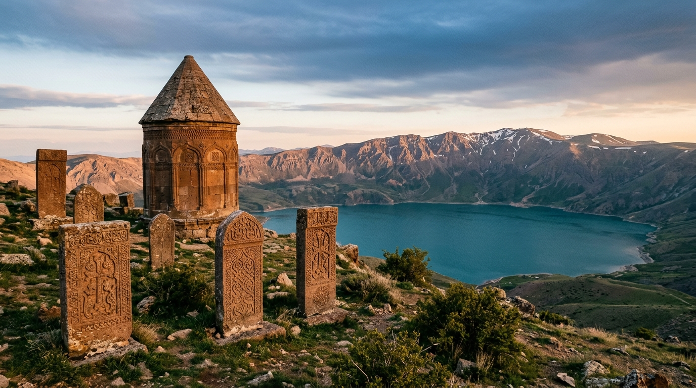
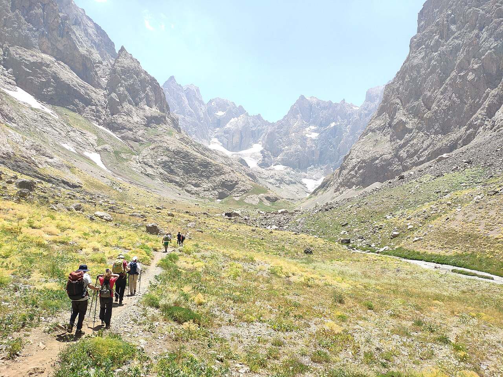
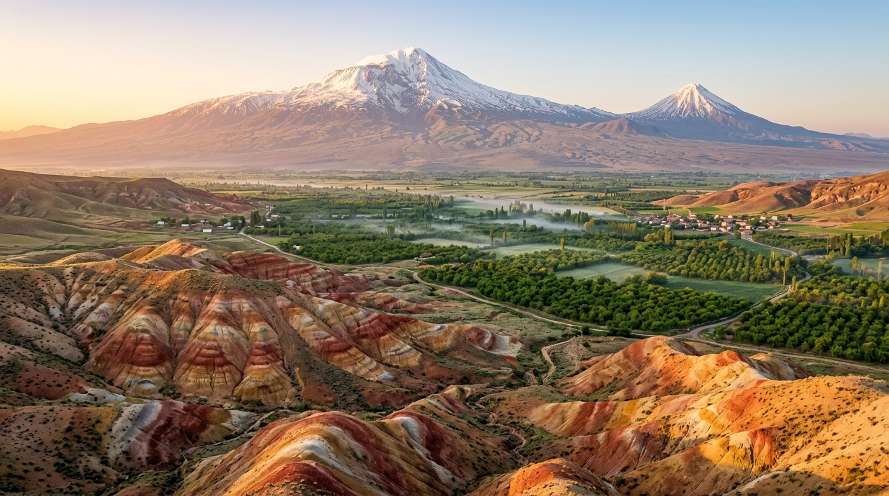
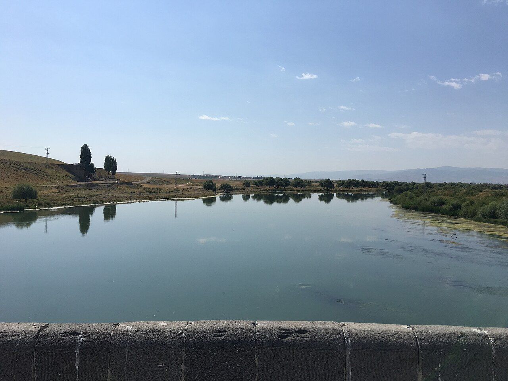
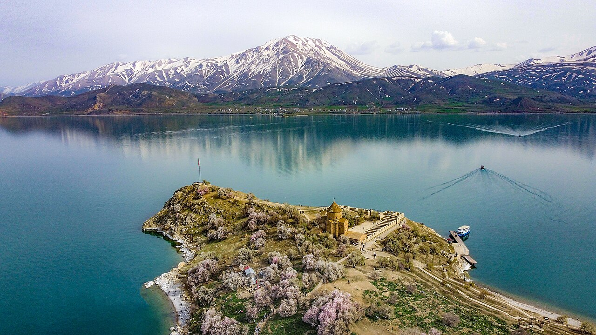

# 🏔️ Doğu Anadolu Bölgesi

> *Zirvelerin İhtişamı & Kaleler: Zorlu iklimlerde pişen hayatların ve sarsılmaz kalelerin vakur duruşu.*

**Keşif İlerlemesi:** `9 / 14 İl` (**%64.3**) &nbsp;•&nbsp; [🏠 Ana Sayfaya Dön](../README.md) &nbsp;•&nbsp; [🌐 Web Portalı](https://bahattinyunus.github.io/dijitalseyyah/)

---

## 🖼️ Bölge İlleri Görsel Rehberi

<table>
  <tr>
    <td align="center" width="33%" valign="top">
       
      <strong><a href="Agri/README.md">04 • Ağrı</a></strong> 
      ✅ Gezildi • 📍 İshak Paşa Sarayı 🍽️ Abdigör Köftesi
    </td>
    <td align="center" width="33%" valign="top">
       
      <strong><a href="Ardahan/README.md">75 • Ardahan</a></strong> 
      ⏳ Bekliyor • 📍 Çıldır Gölü (Kışın Donan) 🍽️ Kaşar Peyniri
    </td>
    <td align="center" width="33%" valign="top">
       
      <strong><a href="Bingol/README.md">12 • Bingöl</a></strong> 
      ⏳ Bekliyor • 📍 Yüzen Adalar (Solhan) 🍽️ Bingöl Balı
    </td>
  </tr>
  <tr>
    <td align="center" width="33%" valign="top">
       
      <strong><a href="Bitlis/README.md">13 • Bitlis</a></strong> 
      ✅ Gezildi • 📍 Nemrut Krater Gölü & Kalderası 🍽️ Bitlis Büryan Kebabı
    </td>
    <td align="center" width="33%" valign="top">
       
      <strong><a href="Elazig/README.md">23 • Elazığ</a></strong> 
      ✅ Gezildi • 📍 Harput Kalesi (Süt Kalesi) 🍽️ Harput Köftesi
    </td>
    <td align="center" width="33%" valign="top">
       
      <strong><a href="Erzincan/README.md">24 • Erzincan</a></strong> 
      ✅ Gezildi • 📍 Girlevik Şelalesi 🍽️ Erzincan Tulum Peyniri
    </td>
  </tr>
  <tr>
    <td align="center" width="33%" valign="top">
       
      <strong><a href="Erzurum/README.md">25 • Erzurum</a></strong> 
      ✅ Gezildi • 📍 Çifte Minareli Medrese 🍽️ Cağ Kebabı
    </td>
    <td align="center" width="33%" valign="top">
       
      <strong><a href="Hakkari/README.md">30 • Hakkari</a></strong> 
      ⏳ Bekliyor • 📍 Cilo Sat Buzul Gölleri 🍽️ Hakkari Çorti Aşı
    </td>
    <td align="center" width="33%" valign="top">
       
      <strong><a href="Igdir/README.md">76 • Iğdır</a></strong> 
      ✅ Gezildi • 📍 Tuzluca Tuz Mağaraları 🍽️ Bozbaş (Piti)
    </td>
  </tr>
  <tr>
    <td align="center" width="33%" valign="top">
       
      <strong><a href="Kars/README.md">36 • Kars</a></strong> 
      ✅ Gezildi • 📍 Ani Harabeleri (Binbir Kiliseli Şehir) 🍽️ Kars Kaşarı & Gravyeri
    </td>
    <td align="center" width="33%" valign="top">
       
      <strong><a href="Malatya/README.md">44 • Malatya</a></strong> 
      ✅ Gezildi • 📍 Arslantepe Höyüğü (UNESCO) 🍽️ Malatya Kayısısı
    </td>
    <td align="center" width="33%" valign="top">
       
      <strong><a href="Mus/README.md">49 • Muş</a></strong> 
      ⏳ Bekliyor • 📍 Tarihi Murat Köprüsü 🍽️ Muş Köftesi
    </td>
  </tr>
  <tr>
    <td align="center" width="33%" valign="top">
       
      <strong><a href="Tunceli/README.md">62 • Tunceli</a></strong> 
      ✅ Gezildi • 📍 Munzur Vadisi Milli Parkı 🍽️ Şavak Tulum Peyniri
    </td>
    <td align="center" width="33%" valign="top">
       
      <strong><a href="Van/README.md">65 • Van</a></strong> 
      ⏳ Bekliyor • 📍 Akdamar Adası ve Kilisesi 🍽️ Van Kahvaltısı
    </td>
    <td width="33%"></td>
  </tr>
</table>

---

*Anadolu Seyahatnamesi — Dijital Seyyah Bölge Dosyası*
