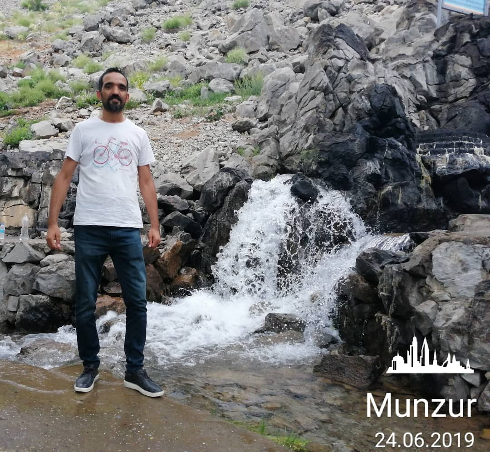

# 📍 Tunceli - Seyahat ve Tefekkür Notları

  

## 📜 Şehrin Ruhu
> "Munzur Vadisi'nin hırçın suları, Ovacık Gözeleri'nin kutsal kaynaklarıyla doğanın en el değmemiş mistik coğrafyası."

### 🌍 Şehrin Dokusu ve Tarihsel Arka Planı
Tarih boyunca sarp dağları sayesinde özgün kültürünü koruyan Tunceli (Dersim), Munzur efsaneleri ve el değmemiş doğasıyla Anadolu'nun gizemli coğrafyalarındandır.

3.000 metreyi aşan Munzur Dağları'nın eteklerinde kurulu şehir, Türkiye'nin en büyük ve biyolojik çeşitliliği en zengin milli parklarından biri olan **Munzur Vadisi Milli Parkı**'na ev sahipliği yapar. Urartu kaya mezarları, Mengücekli ve Akkoyunlu döneminden kalma **Pertek Kalesi**, Çemişgezek'in sarp kayalıklara oyulmuş İn Delikleri (Derviş Hücreleri), Uzun Hasan döneminin zarif eseri Elti Hatun Camii ve Keban Baraj Gölü'nün ortasında bir ada gibi yükselen kaleleriyle Tunceli, derin bir tarih ve tabiat sentezidir.

### 🕌 Manevi Mimarlar ve Tarihî Şahsiyetler
- **Munzur Baba:** Rivayete göre ağasına Mekke'de sıcak helva götüren ve ardından süt bakracının döküldüğü kırk ayrı noktadan berrak suların fışkırdığına inanılan, Ovacık Gözeleri'nin manevi hatırasıyla özdeşleşen gönül eri.
- **Düzgün Baba (Şah Haydar):** Nazımiye dağlarındaki zirvede makamı bulunan, doğaya, dağ keçilerine ve insanlara duyulan sevginin sembolü kadim veli.
- **Elti Hatun:** Akkoyunlu hükümdarı Uzun Hasan'ın kız kardeşi; Mazgirt'te yaptırdığı cami, türbe ve çeşme ile bölgenin 13.–15. yüzyıl taş mimarisine zarif bir mühür vurmuştur.
- **Seyyid Baba Mansur ve Kureyşan Ocağı Erenleri:** Yüzyıllar boyunca barış, rızalık ve irfan geleneğini Anadolu'nun bu sarp vadilerinde yaşatan manevi önderler.

### 💬 Şehir Hakkında Edebi ve Tarihi Alıntılar
> "Munzur Vadisi, dağların arasından süzülen hırçın sularıyla doğanın en saf zikir alanıdır." — Bedri Rahmi Eyüboğlu
>
> "Ovacık Gözeleri, toprağın altından fışkıran berrak sularıyla mistik bir yaratılış mucizesidir." — Evliya Çelebi

### 🕊️ Gezginin Not Defterinden (Manevi Boyut ve Tefekkür)
Munzur'un buz gibi berrak sularının yeryüzüne kaynadığı gözelerin başında durup, suyun hayat veren ilahi gücünü hayranlıkla tefekkür edersiniz.

### 🍽️ Yöresel Lezzet Tavsiyeleri
- **Yerel Tatlar ve İkramlar:** Şehrin yerel esnaf lokantalarında ve pazar yerlerinde deneyimlenen bütçe dostu, kültürel dokuyu yansıtan eşsiz lezzetler; özellikle sarımsaklı yoğurt ve tereyağlı Babuko (Şir), Gulik (Çiriş) otu yemeği, Pülümür/Ovacık Karakovan Balı, Çemişgezek Ulukale Dutu ve Munzur Alabalığı.
- **Tefekkür Eşliğinde Çay/Kahve:** Şehrin tarihi kıraathanelerinde veya doğa manzaralı tepelerinde, özellikle Munzur Çayı kenarında su sesine eşlik eden semaver çayları.

### ⛺ Konaklama ve Bütçe Stratejisi
- **Sıfır Konaklama Maliyeti (Modern Kervansaraylar):** GSB Seyahatsever projesi kapsamında şehirdeki KYK yurtlarında 5 gün boyunca ücretsiz konaklanarak bütçe korunmuştur.
- **Ulaşım ve Lojistik Planlama:** Rota optimizasyonuna uyularak komşu iller sırayla takip edilmiş, böylece hem yol maliyeti minimuma indirilmiş hem de karbon ayak izi azaltılmıştır.

### 💻 Yarı Göçebe Mesaisi (İlim Tahsili & Kütüphane)
- **Kütüphane Rutini:** Gündüz vakitlerinde şehrin İl Halk Kütüphanesinde zaman geçirilerek bilgisayar başında yazılım geliştirme ve ders çalışma faaliyetleri sürdürülmüştür.
  * *Seyyahın Kütüphane Notu:* Tunceli İl Halk Kütüphanesi - Sessiz, çalışma disiplinine uygun, internet imkanı sunan verimli bir ilim yuvası.
- **Süre ve Uyum:** Kütüphane mesaisi bitiminde şehrin ruhuna karışmak üzere yollara düşülmüş, 5 günlük menzil süresiyle şehir sindirilerek keşfedilmiştir.

### 🧭 5 Günlük Menzil Rotası
- **1. Gün – Tunceli Merkez ve Munzur Kıyısı:** KYK yurduna yerleşme, Tunceli İl Halk Kütüphanesi mesaisi, Tunceli Müzesi (tarihi kışla binası) gezisi, Munzur ve Pülümür çaylarının birleştiği Mameki Köprüsü çevresinde akşam yürüyüşü ve Babuko tadımı.
- **2. Gün – Munzur Vadisi Milli Parkı ve Ovacık Gözeleri:** Munzur Çayı boyunca ilerleyen eşsiz vadi yolundan Ovacık'a geçiş; kırk ayrı gözden kaynayan kutsal Munzur Gözeleri'nde tefekkür, Mercan Vadisi manzarası ve doğal yayla balı molası.
- **3. Gün – Pertek Kalesi ve Keban Gölü Feribotu:** Keban Baraj Gölü ortasında bir ada üzerinde yükselen Pertek Kalesi'ne tekneyle geçiş, tarihi Baysungur ve Çelebi Ağa camilerinin ziyareti ve göl kıyısında gün batımı.
- **4. Gün – Çemişgezek, Tağar Köprüsü ve İn Delikleri:** Tarihi Çemişgezek sokakları, Tağar (Yusuf Ziya Paşa) Köprüsü, sarp kayalara oyulmuş çok katlı İn Delikleri (Derviş Hücreleri) ve Süleymaniye Camii keşfi.
- **5. Gün – Pülümür Vadisi, Ağlayan Kayalar ve Veda:** Pülümür Çayı boyunca Ağlayan Kayalar ve Kutu Deresi'nde serin doğa yürüyüşü, kütüphanede notların derlenmesi ve Munzur'un berrak sularına veda.

### ✨ Keşfedilesi Duraklar ve Landmarks
Bu şehrin havasını solumak, ruhuna dokunmak için mutlaka adımlanması gereken köşe taşları:
- [x] **Munzur Vadisi Milli Parkı**
- [x] **Ovacık Gözeleri**
- [x] **Pertek Kalesi**
- [x] **Çemişgezek İn Delikleri ve Tağar Köprüsü**
- [x] **Tunceli Müzesi ve Pülümür Vadisi**

### 📸 Menzil Fotoğraf Galerisi
<table>
  <tr>
    <td align="center" width="50%">
       
      <b>Munzur Vadisi Milli Parkı ve Ovacık Gözeleri</b>
    </td>
    <td align="center" width="50%">
       
      <b>Pertek Kalesi ve El Değmemiş Doğa Dokusu</b>
    </td>
  </tr>
</table>

---
*Bu il bizzat deneyimlenmiş, yolları aşındırılmış ve seyahatnameye sevgiyle işlenmiştir.* ✅
