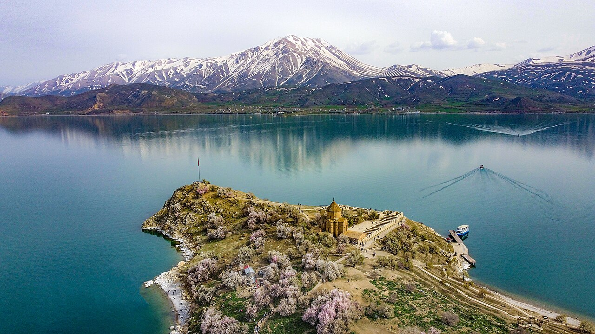
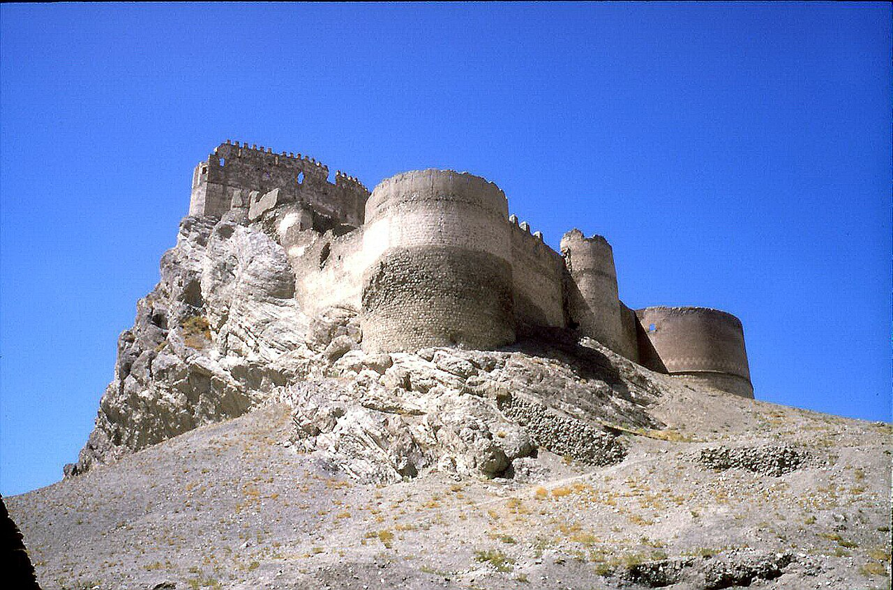

# 📍 Van - Sefer Öncesi Hazırlık ve Seyahat Dosyası

  

## 📜 Seyyahın Beklentisi
> "Henüz adımlanmamış her yol, içinde koca bir hikaye saklar; Urartuların başkenti Tuşpa'nın 3.000 yıllık kayalıkları, masmavi Van Gölü'nün ortasındaki Akdamar Adası ve baharda badem çiçekleriyle açan ufkun büyüsü seyyahını bekler."

### 🌍 Şehrin Dokusu ve Tarihsel Arka Planı
Türkiye'nin en büyük gölü ve dünyanın en büyük sodalı gölü olan **Van Gölü**'nün (halk dilinde Van Denizi) doğu kıyısında kurulu olan Van, MÖ 9. yüzyılda Urartu Krallığı'nın başkenti **Tuşpa** olarak tarih sahnesine çıkmıştır. Sarp bir kaya kütlesi üzerine kurulan **Van Kalesi**, çivi yazılı Urartu kitabeleri, kaya mezarları, Süleyman Han Camii ve hemen güneyindeki Eski Van Şehri kalıntılarıyla (Hüsrev Paşa Külliyesi, Kaya Çelebi Camii, Ulu Camii) Anadolu'nun en görkemli tarih sahnelerinden biridir.

Van Gölü'nün turkuaz sularında bir inci gibi parlayan **Akdamar Adası** ve 10. yüzyılda Vaspurakan Kralı I. Gagik tarafından yaptırılan eşsiz taş kabartmalı **Akdamar Kilisesi**, özellikle nisan ayında badem ağaçları çiçek açtığında karlı Artos Dağı fonuyla büyüleyici bir tablo sunar. Gürpınar'da kartal yuvası gibi yükselen 17. yüzyıl eseri **Hoşap Kalesi**, Urartu şaheseri **Çavuştepe Kalesi**, Muradiye Şelalesi, Başkale'nin Vanadokya peribacaları ve kehribar-mavi gözlü sevimli **Van Kedisi**, bu kadim doğu başkentinin unutulmaz imzalarıdır.

### 🕌 Manevi Mimarlar ve Tarihî Şahsiyetler
- **Abdurrahman Gazi:** Van Kalesi'nin kuzeydoğu yamacında türbesi bulunan, şehrin manevi muhafızı kabul edilen kadim ziyaretgâh.
- **Seyyid Fehim-i Arvâsî (1825–1896):** Bahçesaray'ın Arvas köyünde ve Van'da irşad faaliyetleriyle Doğu Anadolu'nun ilim ve tasavvuf geleneğine derin izler bırakan büyük âlim.
- **Köstendilli Hüsrev Paşa ve Mimar Sinan:** 1567 yılında Eski Van'da inşa edilen ve Mimar Sinan'ın Doğu Anadolu'daki nadide eserlerinden olan Hüsrev Paşa Külliyesi'nin banisi ve mimarı.
- **Kral I. Sarduri ve Urartu Mühendisleri:** MÖ 9. yüzyılda Tuşpa Kalesi'ni ve 51 kilometrelik hâlâ işleyen Menua (Şamram) Sulama Kanalı'nı inşa eden antik medeniyet ustaları.

### 💬 Şehir Hakkında Edebi ve Tarihi Alıntılar
> "Van Gölü, dağların ortasında gökyüzüne açılmış masmavi bir deniz, Tuşpa ise asırlara meydan okuyan bir taş tahttır." — Evliya Çelebi
>
> "Dünyada Van, ahirette iman." — Kadim Doğu Anadolu Deyişi

### 🍽️ Yöresel Lezzet Rehberi
- **Meşhur Van Kahvaltısı:** Otlu peynir, kavut, murtuğa, hakiki kara kovan balı, manda kaymağı, tandır ekmeği ve Van çöreğiyle donatılmış dünyaca ünlü sofra.
- **İnci Kefali (Van Balığı):** Yalnızca Van Gölü'nün sodalı sularında yaşayan ve baharda akıntıya karşı uçarak göç eden endemik balığın tandırda veya ızgarada pişirilmiş hali.
- **Kürt Köftesi, Keledoş ve Ayran Aşı:** Bölgenin asırlık şölen yemekleri; özellikle nohut, kavurma, mercimek ve kurutla hazırlanan Keledoş.
- **Tefekkür Eşliğinde Çay:** Edremit sahilinde Van Gölü'nün kızıl gün batımına karşı veya Akdamar Adası kıyısında içilen demli çay.

### ⛺ Planlanan Konaklama ve Lojistik Stratejisi
- **Konaklama Planı:** GSB Seyahatsever kapsamında Van merkez veya Edremit/Kampüs hattındaki KYK yurtlarında konaklanarak 5 günlük kapsamlı keşif hedeflenmektedir.
- **Ulaşım ve Rota Entegrasyonu:** Bitlis (Tatvan)–Gevaş–Van–Erciş–Doğubayazıt hattı üzerinden Van Gölü çevresi tam tur (ring) yapılarak maksimum verimlilik planlanmaktadır.

### 💻 Planlanan Kütüphane Mesaisi (Yarı Göçebe Ofis)
- **Hedef Çalışma Noktası:** Van İl Halk Kütüphanesi ve Van Yüzüncü Yıl Üniversitesi Merkez Kütüphanesi (göl manzaralı kampüs hattı).
- **Mesai Planı:** Sabah Van kahvaltısının ardından kütüphanede yazılım geliştirme ve okuma mesaisi; ikindi sonrası ise kale, göl sahili ve gün batımı keşifleri.

### 🧭 5 Günlük Planlanan Menzil Rotası
- **1. Gün – Tuşpa (Van Kalesi), Eski Van ve Van Müzesi:** Şehre varış, kütüphane mesaisi, dünyanın en zengin Urartu koleksiyonlarından birine sahip Van Müzesi, Van Kalesi zirvesinde gün batımı, Eski Van Şehri (Hüsrev Paşa Camii) ve Van Kedisi Villası.
- **2. Gün – Akdamar Adası ve Gevaş Selçuklu Mirası:** Gevaş'tan tekneyle Akdamar Adası'na geçiş, Akdamar Kilisesi kabartmalarının incelenmesi ve badem ağaçları arasında yürüyüş; dönüşte Gevaş Halime Hatun Kümbeti ve tarihi Selçuklu Mezarlığı.
- **3. Gün – Hoşap Kalesi ve Çavuştepe Urartu Kalesi:** Gürpınar rotasında 17. yüzyılda Mahmudi Süleyman Bey tarafından yaptırılan görkemli Hoşap Kalesi ve Urartu Kralı II. Sarduri'nin yaptırdığı Çavuştepe Kalesi (Sardurihinili) gezisi.
- **4. Gün – Muradiye Şelalesi ve Erciş İnci Kefali Göçü:** Kuzey kıyısı boyunca Erciş'te (mevsimindeyse) Deliçay İnci Kefali Tabiat Parkı'nda balıkların akıntıya karşı muhteşem göçünün izlenmesi, ardından Bend-i Mahi Çayı üzerindeki Muradiye Şelalesi ve Şeytan Köprüsü.
- **5. Gün – Edremit Sahili, Menua Kanalı ve Veda:** 2.800 yıldır akan Şamram (Menua) Sulama Kanalı'nın görülmesi, Edremit Kız Kalesi kıyısında son bir Van Kahvaltısı ve kütüphane notlarının derlenmesiyle Van Denizi'ne veda.

### ✨ Keşfedilecek Duraklar ve Landmarks
- [ ] **Akdamar Adası ve Kilisesi (Van Gölü)**
- [ ] **Van Kalesi (Tuşpa) ve Eski Van Şehri (Hüsrev Paşa Külliyesi)**
- [ ] **Hoşap Kalesi ve Çavuştepe Urartu Kalesi**
- [ ] **Muradiye Şelalesi ve İnci Kefali Göç Alanı (Erciş)**
- [ ] **Van Müzesi ve Gevaş Halime Hatun Kümbeti**

### 📸 Menzil Fotoğraf Galerisi
<table>
  <tr>
    <td align="center" width="50%">
       
      <b>Akdamar Adası ve Van Gölü'nün Turkuaz Ufku</b>
    </td>
    <td align="center" width="50%">
       
      <b>Tuşpa (Van Kalesi) ve Hoşap'ın Kadim Mirası</b>
    </td>
  </tr>
</table>

---
*Henüz adımlanmamış bu kadim Urartu ve Van Denizi durağı, gelecek seferlerde keşfedilmek üzere seyir defterine özenle not düşülmüştür.*
