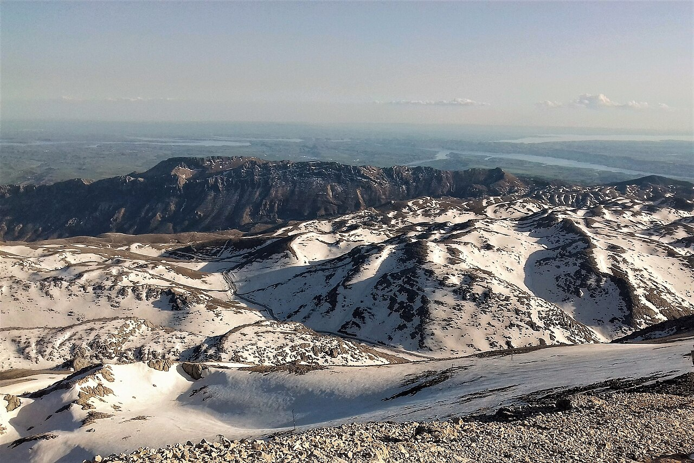
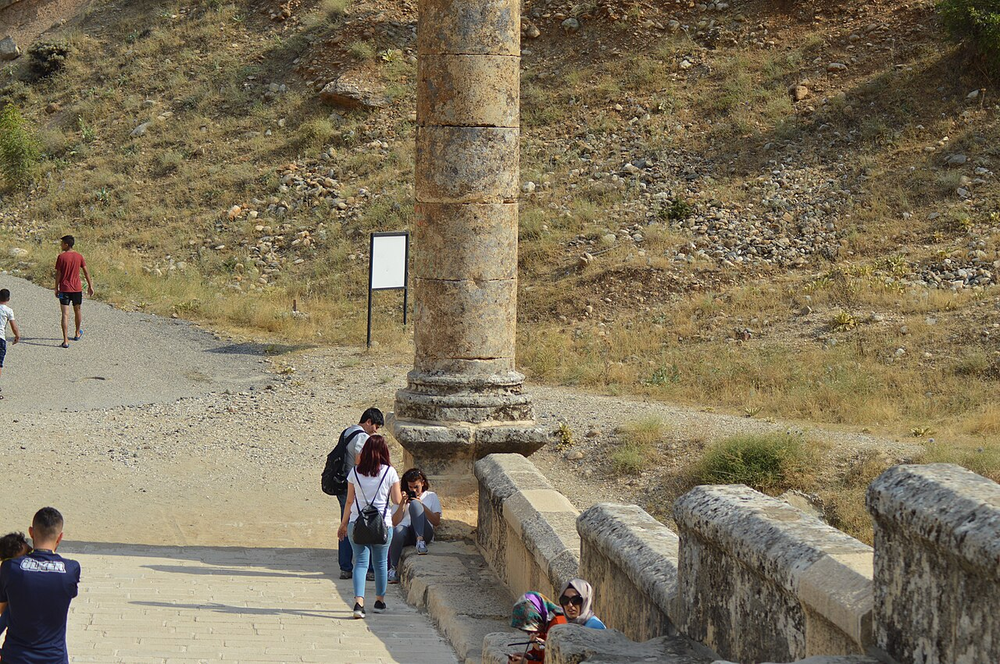

# 📍 Adıyaman - Mezopotamya Seferi Ön Keşif Dosyası

## 📜 Seyyahın Beklentisi
> "Kommagene Krallığı'nın tanrı heykelleriyle bezeli Nemrut Zirvesi ve güneşin en görkemli doğup battığı taht."

---

### 🌍 Şehrin Dokusu, Mezopotamya Tarihi ve Manevi Mirası
Fırat Nehri'nin bereketli havzası ile Güneydoğu Toroslar'ın sarp etekleri arasında yükselen **Adıyaman** (kadim adıyla *Hısn-ı Mansur*), Doğu ile Batı medeniyetlerinin taşta ve ruhta buluştuğu en görkemli eşiklerden biridir. Paleolitik çağlardan Palanlı Mağarası'ndaki duvar resimlerine, Hititlerden Asurlulara uzanan bu kadim topraklar, asıl ölümsüz mührünü MÖ 1. yüzyılda **Kommagene Krallığı** döneminde vurmuştur. Kral I. Antiochos'un Pers ve Yunan inançlarını birleştirerek 2.150 metre rakımlı **Nemrut Dağı** zirvesine inşa ettirdiği devasa tümülüs ve tanrı heykelleri, bugün UNESCO Dünya Mirası Listesi'nde insanlığın göğe yükselen bir anıtı olarak güneşin doğuşunu ve batışını karşılamaktadır.

Kommagene'nin yalnızca zirvesi değil, vadileri de mimari birer şaheserdir: Roma İmparatoru Septimius Severus döneminde 16. Lejyon tarafından harç kullanılmadan dev kesme taşlarla inşa edilen **Cendere Köprüsü**, krallığın yazlık başkenti **Arsemia Ören Yeri**, kraliyet kadınlarının ebedi istirahatgâhı **Karakuş Tümülüsü** ve binlerce kaya mezarını barındıran **Perre Antik Kenti**, Adıyaman'ı açık hava arkeoloji müzesine dönüştürür.

Şehrin manevi haritasında ise İslam tarihinin seçkin sahabelerinden **Safvan bin Muattal Hazretleri**'nin Samsat yakınlarındaki kabri müstesna bir yer tutar. Anadolu'da sahabe kabri bulunan nadir merkezlerden biri olan bu ziyaretgâh, Adıyaman'ın sadece taş anıtlar değil, derin bir gönül ve teslimiyet coğrafyası olduğunu fısıldar. 6 Şubat 2023 depreminin derin acılarını vakarla ve dayanışmayla saran şehir, kadim direncini koruyarak yeniden ayağa kalkmakta; seyyahları hürmetle, dualarla ve umutla beklemektedir.

### 💬 Şehir Hakkında Edebi ve Tarihi Alıntılar
> "Ben, Büyük Kral Antiochos; bu kutsal mekânı, göksel tahtlara en yakın yerde, zamanın tahribatına meydan okusun diye inşa ettirdim." — *Kral I. Antiochos (Nemrut Yazıtı, MÖ 1. yy)*
>
> "Nemrut'ta şafak sökerken taşlar konuşmaya başlar; insan, tarihin ne kadar kadim, kendi ömrünün ise bir nefes kadar kısa olduğunu orada idrak eder." — *Anadolu Seyyahları Güncesi*
>
> "Hısn-ı Mansur bağları, suları ve misafirperver ahalisiyle Fırat boyunun bereketli bir konağıdır." — *Evliya Çelebi, Seyahatnâme*

### 🕊️ Gezginin Sefer Öncesi Tefekkürü
Adıyaman'a doğru yola çıkmak, bir yandan 2.000 yıl önceki bir kralın ölümsüzlük arzusunu taşların sessizliğinde okumak, diğer yandan Fırat'ın sularına nazır bir sahabe kabrinin huzurunda fâniliği tefekkür etmektir. Nemrut Dağı'nın serin şafağında, ufuk çizgisi kızıla boyanırken doğan güneş, Mezopotamya seferinin ilk büyük uyanışı olacaktır. Kibirli tahtların zamanla nasıl toprağa karıştığını, buna karşılık hikmetin, duanın ve insan sevgisinin nasıl baki kaldığını bu zirvede derinlemesine hissetmeyi arzuluyorum.

### 🍽️ Yöresel Lezzet Rehberi (Gastronomi Rotası)
- **Adıyaman Çiğ Köftesi:** İsot, bulgur, salça ve baharatların ustalıkla yoğrulduğu, şehrin tüm Türkiye'ye armağan ettiği kadim lezzet.
- **Besni Tavası:** Kuzu eti, biber, domates ve sarımsağın taş fırında ağır ağır piştiği yöresel şölen.
- **Meyir Çorbası:** Yoğurt, dövme (yarma), patlıcan ve taze nane ile hazırlanan, sıcak yaz günlerinin serinletici şifası.
- **Buhara Pilavı & Tevenk Sarması:** Kuzu etli, nohutlu ve baharatlı pilav ile üzüm yaprağına sarılan yöresel lezzetler.
- **Şillik Tatlısı & Kervansaray Kahvesi:** Cevizli ince hamur tatlısı ve yedi çeşit karışımla kavrulan meşhur menengiçli Kervansaray kahvesi.

### 💻 Planlanan Kütüphane Mesaisi (Dijital Seyyah Ofisi)
- **Hedef Çalışma Durağı:** *Adıyaman İl Halk Kütüphanesi*
  * *Seyyahın Kütüphane Planı:* Nemrut'un gölgesinde, sabah erken saatlerde sakin bir odaklanma ve yazılım/araştırma mesaisi için merkezdeki kütüphane salonu hedefleniyor. Gündüz 4 saatlik derin çalışma bloğunun ardından öğleden sonraları antik kentlere ve Fırat kıyılarına doğru yola çıkılacak.
- **Konaklama & Lojistik Stratejisi:** GSB Seyahatsever programı kapsamında KYK yurtları veya Kahta merkezli bütçe dostu konaklama ile Nemrut şafak tırmanışına erkenden erişim planlanıyor.

### 🗺️ 5 Günlük Planlanan Keşif Rotası
- **1. Gün — Kadim Merkez & Perre:** Adıyaman şehir merkezi, Ulu Cami, Adıyaman Müzesi, Oturakçı Pazarı ve **Perre Antik Kenti** kaya mezarları.
- **2. Gün — Kommagene Zirvesi (Kahta & Nemrut):** Karakuş Tümülüsü, **Cendere Köprüsü**, **Arsemia Ören Yeri**, Yeni Kale ve gün batımında **Nemrut Dağı** zirvesi.
- **3. Gün — Maneviyat & Fırat Kıyısı:** Samsat'ta **Safvan bin Muattal Hazretleri Türbesi** ziyareti, Atatürk Baraj Gölü kıyısında tefekkür ve Kızılin Kanyonu.
- **4. Gün — Gölbaşı & Besni Hattı:** Gölbaşı Gölleri Tabiat Parkı, Besni'nin tarihi sokakları, Sugözü Mesire Alanı ve yöresel Besni Tavası deneyimi.
- **5. Gün — Kütüphane Mesaisi & Veda:** Adıyaman İl Halk Kütüphanesi'nde sefer notlarının temize çekilmesi, Kervansaray kahvesi eşliğinde Şanlıurfa'ya hareket hazırlığı.

### ✨ Keşfedilesi Duraklar ve Landmarks Checklist
- [ ] **Nemrut Dağı Milli Parkı (UNESCO — Gündoğumu & Günbatımı)**
- [ ] **Cendere Köprüsü (Roma Dönemi)**
- [ ] **Arsemia Ören Yeri ve Mithridates Kabartmaları**
- [ ] **Karakuş Tümülüsü**
- [ ] **Perre Antik Kenti**
- [ ] **Safvan bin Muattal Hazretleri Türbesi (Samsat)**
- [ ] **Adıyaman Arkeoloji Müzesi & Ulu Cami**

### 📸 Görsel Arşiv ve Beklenen Kadrajlar
| Panoramik Zirve Kadrajı | Tarih & Doğa Detayı |
| :---: | :---: |
|  |  |
| *Nemrut Dağı'nda şafak vakti dev heykeller* | *Cendere Köprüsü ve kadim Fırat vadisi* |

---
*Henüz adımlanmamış bu kadim Mezopotamya durağı, yaklaşan Güneydoğu Anadolu Seferi için ön keşif dosyası olarak hazırlanmıştır.*
