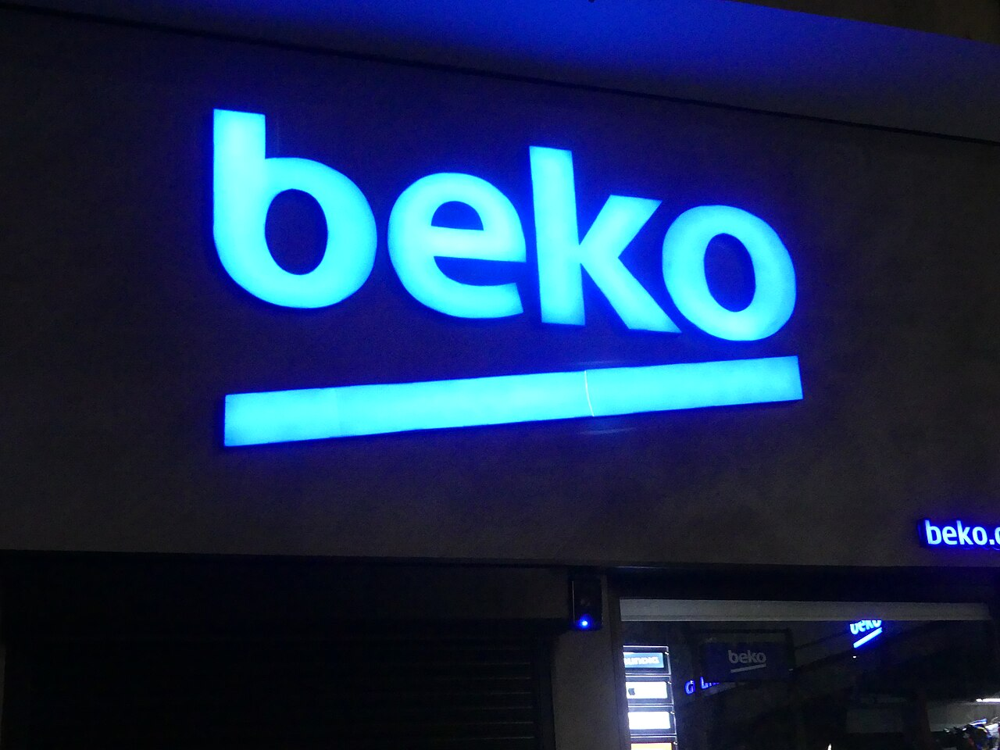
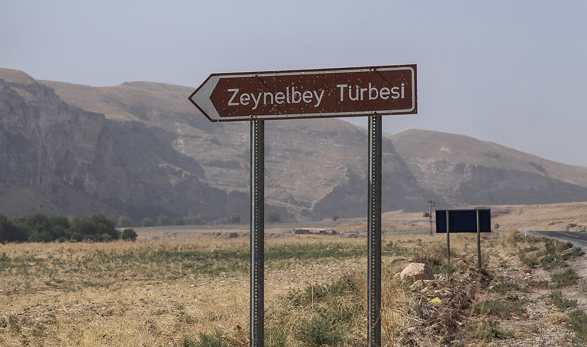

# 📍 Batman - Mezopotamya Seferi Ön Keşif Dosyası

## 📜 Seyyahın Beklentisi
> "Dicle Nehri'nin bağrından doğan 12 bin yıllık Hasankeyf mağaraları ve Zeynel Bey Türbesi'nin turkuaz çinileri."

---

### 🌍 Şehrin Dokusu, Mezopotamya Tarihi ve Manevi Mirası
Yukarı Mezopotamya'nın can damarı **Dicle Nehri**'nin sarp kanyonlarını yararak geçtiği **Batman**, genç bir modern sanayi kenti kimliğinin ardında 12.000 yılı aşan nefes kesici bir insanlık hafızası saklar. Neolitik dönemin en erken yerleşimlerinden biri olan **Hallan Çemi Höyüğü**, insanlığın yerleşik hayata geçişinin ilk izlerini bu topraklara bırakmıştır. Ancak Batman'ı dünya tarihinin unutulmazları arasına kazıyan asıl mücevher, kalker kayalara oyulmuş binlerce mağarası ve görkemli kalesiyle kadim **Hasankeyf** (*Hısn-ı Keyfa* — Kayalar Kalesi)'tir.

Asurlulardan Romalılara, Bizans'tan İslam fetihlerine, özellikle de **Artuklular** ve **Eyyubiler** dönemine başkentlik yapan Hasankeyf, Orta Çağ İslam mimarisinin ve ilim geleneğinin en zarif duraklarından biri olmuştur. Akkoyunlu Hükümdarı Uzun Hasan'ın Otlukbeli Savaşı'nda şehit düşen oğlu için yaptırdığı **Zeynel Bey Türbesi**, Anadolu'da benzerine nadir rastlanan turkuaz ve lacivert sırlı tuğla işçiliğiyle Orta Asya Timur mimarisinin Dicle kıyısındaki eşsiz bir yankısıdır. Baraj sularının yükselmesiyle özel bir mühendislik operasyonuyla yeni Arkeopark alanına taşınan Zeynel Bey Türbesi, Artuklu Hamamı, İmam Abdullah Zaviyesi ve El-Rızk Camii minaresi, bugün geçmiş ile gelecek arasında hüzünlü ama vakur bir köprü kurmaktadır.

Batman'ın kültür mozaiği sadece İslam eserleriyle sınırlı değildir. Beşiri ilçesi yakınlarında yükselen 5. yüzyıl eseri **Mor Kiryakus Manastırı**, Süryani manastır geleneğinin Tur Abdin'in kuzeyindeki en önemli halkalarındandır. Sınır hattında Diyarbakır-Batman yolunu taçlandıran ve Artukluların 1147'de inşa ettiği **Malabadi Köprüsü** ise 40,86 metrelik açıklığıyla dünyanın en geniş taş kemerli köprülerinden biri olarak Evliya Çelebi'yi dahi hayrete düşürmüştür.

### 💬 Şehir Hakkında Edebi ve Tarihi Alıntılar
> "Malabadi Köprüsü'nün altına Ayasofya'nın kubbesi girer. Dünyada bunun gibi bir taş kemer daha görülmemiştir." — *Evliya Çelebi, Seyahatnâme*
>
> "Hasankeyf'in kayalarında binlerce yılın rüzgârı uğuldar; Dicle, taşlara kazınmış medeniyetlerin hikâyesini denize taşır." — *Mezopotamya Gezi Notları*
>
> "İnsan suyla yaşar, suyla hatırlanır; Dicle'nin aktığı her yerde tarih durmaksızın yeniden yazılır." — *Kadim Dicle Sözü*

### 🕊️ Gezginin Sefer Öncesi Tefekkürü
Batman ve Hasankeyf durağı, bu seferde bana zamanın akışını ve medeniyetlerin suyla imtihanını düşündürecek. Zeynel Bey Türbesi'nin turkuaz çinilerine bakarken Semerkant'tan Dicle'ye uzanan sanat ruhunu, Hasankeyf'in yeni siluetinde ise kaybolanla korunan arasındaki ince çizgiyi tefekkür etmek istiyorum. Malabadi Köprüsü'nün kemerinin altında durup 900 yıldır zamana direnen Artuklu taş ustalığını selamlamak, bu yolculuğun en unutulmaz anlarından biri olacak.

### 🍽️ Yöresel Lezzet Rehberi (Gastronomi Rotası)
- **Batman Kütülk (İçli Köfte):** İnce bulgur hamurunun baharatlı kıymalı harçla doldurulup haşlandığı, yöre sofralarının baş tacı.
- **Şam Börek:** Sac üzerinde pişirilen, içi bol baharatlı kıyma ve maydanozlu yarım ay şeklinde çıtır yöresel börek.
- **Tırşık & Bumbar Dolması:** Güneydoğu'nun sıcak yaz sebzeleriyle hazırlanan sulu güveç yemeği ve ustalık isteyen geleneksel sakatat lezzeti.
- **Hevra Ekmeği & Sason Balı:** Yöresel tandır ekmeği ve Mereto Dağı eteklerindeki binbir çiçekten derlenen doğal Sason karakovan balı.
- **Perde Pilavı & Tandır Ekmeği Eşliğinde Yayık Ayranı:** Bölgenin komşu Siirt ile paylaştığı zengin sofra kültürü.

### 💻 Planlanan Kütüphane Mesaisi (Dijital Seyyah Ofisi)
- **Hedef Çalışma Durağı:** *Batman İl Halk Kütüphanesi (Şehit Şenay Aybüke Yalçın İl Halk Kütüphanesi)*
  * *Seyyahın Kütüphane Planı:* Dicle havzasında son derece modern, ferah ve gençlerin yoğun ilgi gösterdiği bu örnek kütüphanede sabah yazılım ve okuma mesaisi yapılacak; özellikle Şehit Öğretmen Şenay Aybüke Yalçın'ın aziz hatırasına hürmetle burada verimli saatler geçirilecek.
- **Konaklama & Lojistik Stratejisi:** Batman şehir merkezinde KYK/GSB Seyahatsever konaklaması; Hasankeyf'e sık kalkan ilçe minibüsleriyle ekonomik ve kolay ulaşım.

### 🗺️ 5 Günlük Planlanan Keşif Rotası
- **1. Gün — Batman Merkez & Kütüphane:** Şehit Şenay Aybüke Yalçın İl Halk Kütüphanesi'nde sabah mesaisi, Batman Müzesi (Hasankeyf ve Hallan Çemi buluntuları) ve şehir içi yürüyüş.
- **2. Gün — Kadim Hasankeyf:** Hasankeyf Arkeopark, **Zeynel Bey Türbesi**, Artuklu Hamamı, İmam Abdullah Zaviyesi, Hasankeyf Müzesi ve Dicle üzerinde tekne turu.
- **3. Gün — İnanç & Taş Mirası:** Beşiri'de **Mor Kiryakus Manastırı** ziyareti, Kıradağı manzarası ve akşam yöresel Batman Şam Böreği deneyimi.
- **4. Gün — Malabadi & Kozluk Hattı:** **Malabadi Köprüsü**'nde gün ortası tefekkürü, Kozluk (Hazzo) Kalesi ve İbrahim Bey Camii.
- **5. Gün — Sason Yaylaları & Veda:** Mereto Dağı eteklerine doğru kısa doğa rotası, Sason balı ve çileği tadımı, ardından Siirt veya Diyarbakır'a doğru yola çıkış.

### ✨ Keşfedilesi Duraklar ve Landmarks Checklist
- [ ] **Hasankeyf Tarihi Kenti ve Arkeopark**
- [ ] **Zeynel Bey Türbesi (Akkoyunlu Çinili Kümbet)**
- [ ] **Malabadi Köprüsü (Artuklu Mirası)**
- [ ] **Mor Kiryakus Manastırı (Beşiri)**
- [ ] **Batman Müzesi & Hasankeyf Müzesi**
- [ ] **Şehit Şenay Aybüke Yalçın İl Halk Kütüphanesi**
- [ ] **Kozluk Kalesi ve Sason Vadisi**

### 📸 Görsel Arşiv ve Beklenen Kadrajlar
| Hasankeyf & Dicle Panoraması | Artuklu & Akkoyunlu Mirası |
| :---: | :---: |
|  |  |
| *Dicle kıyısında kadim Hasankeyf silueti* | *Zeynel Bey Türbesi'nin turkuaz çinileri* |

---
*Henüz adımlanmamış bu kadim Mezopotamya durağı, yaklaşan Güneydoğu Anadolu Seferi için ön keşif dosyası olarak hazırlanmıştır.*
