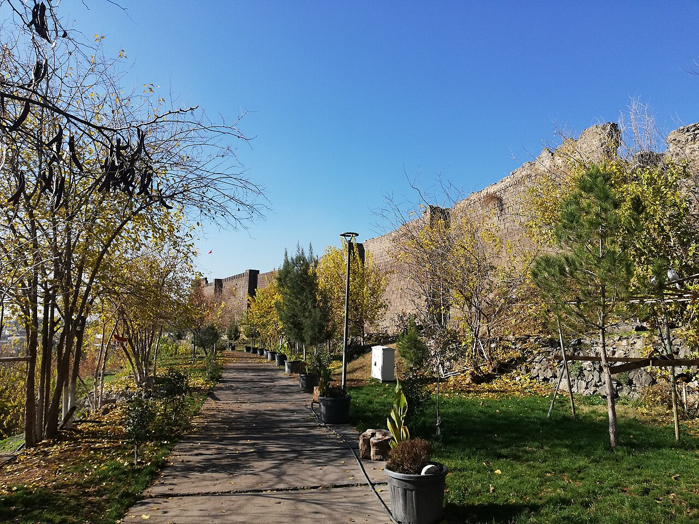
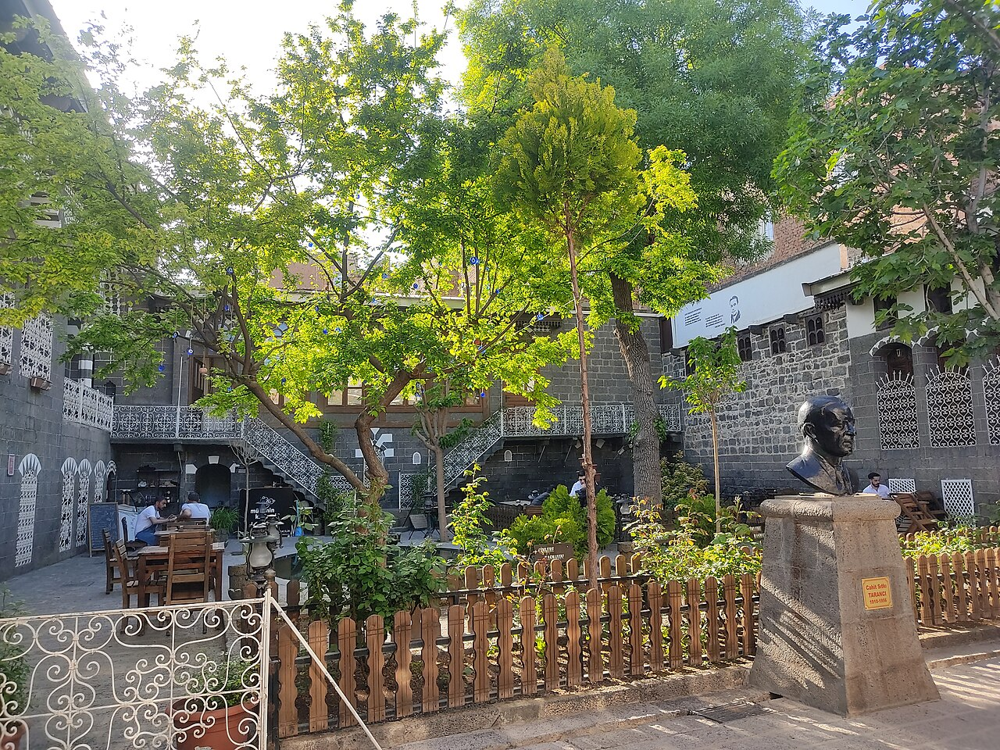

# 📍 Diyarbakır - Mezopotamya Seferi Ön Keşif Dosyası

## 📜 Seyyahın Beklentisi
> "Kara bazalt taşlı asırlık surlar, sahabe mezarları ve İslam aleminin 5. Harem-i Şerifi sayılan Ulu Camii."

---

### 🌍 Şehrin Dokusu, Mezopotamya Tarihi ve Manevi Mirası
Karacadağ'ın volkanik kara bazalt taşlarından örülü görkemli surları ve Dicle'nin kıyısında 8.000 yıldır kesintisiz bereket sunan **Hevsel Bahçeleri** ile **Diyarbakır** (*Amida* / *Diyar-ı Bekr*), UNESCO Dünya Mirası Listesi'nde parlayan bir medeniyetler ansiklopedisidir. Hurri-Mitannilerden Asurlulara, Romalılardan Mervanilere, Büyük Selçuklulardan Artuklulara, Akkoyunlulardan Osmanlı'ya kadar 33 medeniyetin izini bağrında taşıyan şehir, 5,8 kilometrelik surları ve 82 burcuyla (Keçi Burcu, Yedi Kardeş Burcu, Evli Beden) tarihin en heybetli taş hafızalarından biridir.

Diyarbakır, Anadolu'nun İslam'la şereflenmesinde müstesna bir manevi payitahttır. 639 yılında Hz. Ömer döneminde İyaz bin Ganem komutasındaki İslam ordusu tarafından fethedilen şehir, bugün **Hz. Süleyman Camii** yerleşkesinde Halid bin Velid'in oğlu Hz. Süleyman başta olmak üzere **27 Sahabe-i Kiram**'ın ebedi istirahatgâhına ev sahipliği yapar. Şehir merkezinin kalbinde yükselen **Diyarbakır Ulu Camii** ise 639 yılında Martoma Kilisesi'nin camiye dönüştürülmesi ve 1091'de Melikşah tarafından yeniden inşa edilmesiyle Anadolu'nun en eski camii ve İslam âleminin **5. Harem-i Şerifi** olarak kabul edilir. Avlusunda büyük mucit El-Cezeri'nin yaptığı 800 yıllık güneş saati hâlâ zamanı ölçmektedir. Ayrıca Eğil ilçesinde Dicle Baraj Gölü'ne nazır kayalıklarda **Hz. Zülkifl** ve **Hz. Elyesa** peygamberlerin makamları şehrin manevi ufkunu daha da derinleştirir.

Kültür ve edebiyat dünyasında da Diyarbakır apayrı bir ağırlığa sahiptir: **Cahit Sıtkı Tarancı**'nın "Otuz Beş Yaş"ı, **Ahmed Arif**'in "Hasretinden Prangalar Eskittim" dizeleri, **Sezai Karakoç**'un diriliş fikriyatı ve **Ziya Gökalp**'in düşünceleri hep bu kara taşlı avluların gölgesinde mayalanmıştır.

### 💬 Şehir Hakkında Edebi ve Tarihi Alıntılar
> "Diyarbakır Kalesi'nin etrafındaki surlar siyah taştan yapılmıştır; sağlamlığı ve heybeti bakımından dünyada eşi benzeri yoktur." — *İbn Battûta, Seyahatnâme (14. yy)*
>
> "Memleket isterim, gök mavi, dal yeşil, tarla sarı olsun; kuşların çiçeklerin diyarı olsun." — *Cahit Sıtkı Tarancı*
>
> "Bunlar, engerekler ve çıyanlardır; bunlar aşımıza, ekmeğimize göz koyanlardır... Tanı bunları, tanı da büyü!" — *Ahmed Arif*

### 🕊️ Gezginin Sefer Öncesi Tefekkürü
Diyarbakır'a girdiğimde önce Suriçi'nin dar bazalt sokaklarında sessizce yürümek, **Ulu Cami**'nin avlusunda ikindi güneşinin taşlara düşen gölgesinde oturmak istiyorum. İçkale'de 27 Sahabe'nin huzurunda fatiha okurken, Anadolu'nun İslam'la ilk tanıştığı o kutlu günlerin heyecanını hissetmek; akşamüstü ise **On Gözlü Köprü**'den Dicle'ye ve Hevsel'in yeşiline bakarak zamanın akışını dinlemek... Diyarbakır, hem keskin bir şiir hem derin bir dua gibi yüreğime işleyecek.

### 🍽️ Yöresel Lezzet Rehberi (Gastronomi Rotası)
- **Diyarbakır Ciğer Kebabı:** Sabahın erken saatlerinden gece yarısına kadar kor ateşte pişen, sumaklı soğan ve tandır ekmeğiyle servis edilen efsanevi sokak lezzeti.
- **Kaburga Dolması:** Kuzu kaburgasının bademli, reyhanlı ve baharatlı iç pilavla doldurulup saatlerce pişirildiği şölen yemeği.
- **Meftune:** Sumak ekşisi, patlıcan veya kabak, kuzu eti ve sarımsakla yapılan Diyarbakır'a özgü eşsiz tencere yemeği.
- **Burma Kadayıf & Diyarbakır Karpuzu:** Fıstıklı çıtır burma kadayıf ve yazın Dicle kıyılarının simgesi meşhur karpuz.
- **Hasan Paşa Hanı Kahvaltısı & Menengiç Kahvesi:** 1573 yapımı tarihi handa unutulmaz bir sabah sofrası.

### 💻 Planlanan Kütüphane Mesaisi (Dijital Seyyah Ofisi)
- **Hedef Çalışma Durağı:** *Diyarbakır İl Halk Kütüphanesi / Sur İlçe Halk Kütüphanesi (ve Ahmed Arif Edebiyat Müze Kütüphanesi)*
  * *Seyyahın Kütüphane Planı:* Tarihi surların gölgesindeki kütüphanelerde sabah kodlama ve okuma disiplini sürdürülecek; öğleden sonra ise Ahmed Arif Edebiyat Müze Kütüphanesi'nin avlulu Diyarbakır konağında şiir ve seyahat notları kaleme alınacak.
- **Konaklama & Lojistik Stratejisi:** GSB Seyahatsever KYK yurtları veya Suriçi'ne yakın ekonomik konaklama; şehrin tüm tarihi kalbi yürüyerek keşfedilebilecek kompakt bir yapıdadır.

### 🗺️ 5 Günlük Planlanan Keşif Rotası
- **1. Gün — Suriçi'nin Kalbi:** **Hasan Paşa Hanı**'nda kahvaltı, **Diyarbakır Ulu Camii**, **Cahit Sıtkı Tarancı Müzesi**, Sülüklü Han ve **Dört Ayaklı Minare**.
- **2. Gün — İçkale & Sahabe Huzuru:** **Hz. Süleyman Camii (27 Sahabe Türbesi)**, İçkale Müze Kompleksi, Saint George Kilisesi, **Keçi Burcu**'ndan **Hevsel Bahçeleri** panoraması ve **On Gözlü Köprü**.
- **3. Gün — Eğil Peygamberler Diyarı:** Eğil ilçesine günübirlik yolculuk; **Hz. Zülkifl ve Hz. Elyesa** peygamber makamları, Eğil Kalesi ve Dicle Baraj Gölü'nde tekne turu.
- **4. Gün — Surlar, Hanlar & Edebiyat:** Yedi Kardeş ve Evli Beden burçları, Surp Giragos Ermeni Kilisesi, Mar Petyun Keldani Kilisesi, **Ahmed Arif Edebiyat Müze Kütüphanesi** ve Dengbêj Evi'nde kadim sözlü gelenek dinletisi.
- **5. Gün — Çayönü / Zerzevan & Veda:** İmkâna göre Mithras Tapınağı'na ev sahipliği yapan **Zerzevan Kalesi**'ne (Çınar) uğrayarak Mardin'e doğru yola çıkış.

### ✨ Keşfedilesi Duraklar ve Landmarks Checklist
- [ ] **Diyarbakır Surları ve Hevsel Bahçeleri (UNESCO)**
- [ ] **Diyarbakır Ulu Camii (5. Harem-i Şerif & Güneş Saati)**
- [ ] **Hz. Süleyman Camii ve 27 Sahabe Türbesi (İçkale)**
- [ ] **On Gözlü Köprü (Dicle Köprüsü)**
- [ ] **Dört Ayaklı Minare ve Şeyh Mutahhar Camii**
- [ ] **Hasan Paşa Hanı & Sülüklü Han**
- [ ] **Cahit Sıtkı Tarancı Evi & Ahmed Arif Edebiyat Müze Kütüphanesi**
- [ ] **Eğil Peygamber Kabirleri & Zerzevan Kalesi**

### 📸 Görsel Arşiv ve Beklenen Kadrajlar
| Surlar ve Dicle Panoraması | Suriçi Mimari Detayı |
| :---: | :---: |
|  |  |
| *Kara bazalt surlar ve On Gözlü Köprü'de gün batımı* | *Ulu Camii avlusu ve asırlık taş işlemeleri* |

---
*Henüz adımlanmamış bu kadim Mezopotamya durağı, yaklaşan Güneydoğu Anadolu Seferi için ön keşif dosyası olarak hazırlanmıştır.*
