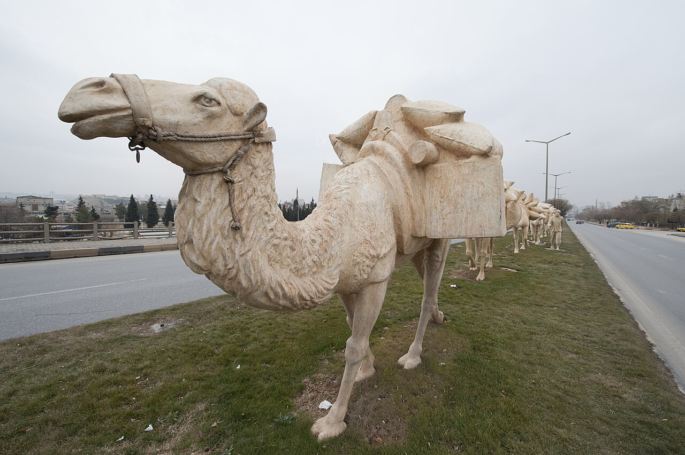
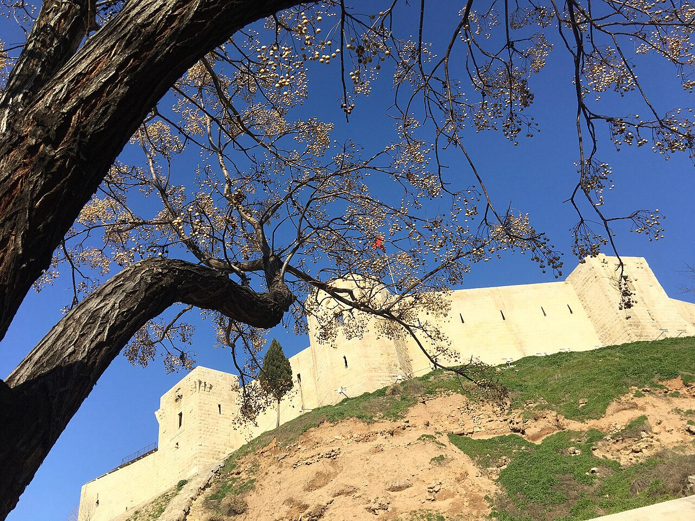

# 📍 Gaziantep - Mezopotamya Seferi Ön Keşif Dosyası

## 📜 Seyyahın Beklentisi
> "UNESCO Gastronomi Şehri; Zeugma'nın Çingene Kızı mozaiğinin derin bakışları ve asırlık hanların kahve kokusu."

---

### 🌍 Şehrin Dokusu, Mezopotamya Tarihi ve Manevi Mirası
İpek Yolu'nun Akdeniz'e ve Mezopotamya'ya açılan en canlı ticaret kapısı olan **Gaziantep** (*Ayıntab* — Güzel Pınar), binlerce yıllık zanaat geleneğini, destansı direniş ruhunu ve dünyaca tescilli mutfak kültürünü bir arada yaşatan eşsiz bir metropoldür. Hititlerin dev taş heykel atölyesi **Yesemek**'ten (İslahiye) Dülük Antik Kenti'ndeki yeraltı Mithras Tapınağı'na, Roma İmparatorluğu'nun Fırat kıyısındaki en zengin sınır kentlerinden **Zeugma**'ya kadar uzanan derin bir arkeolojik mirasa sahiptir. Dünyanın en büyük mozaik müzelerinden biri olan **Zeugma Mozaik Müzesi**, hüzünlü ve gizemli bakışlarıyla tüm dünyayı büyüleyen **"Çingene Kızı"** mozaiğini, Savaş Tanrısı Mars'ın bronz heykelini ve Fırat kıyısındaki antik villaların renkli taş tabanlarını korur.

Şehrin kuzeydoğusunda, Fırat Nehri ile Merzimen Çayı'nın birleştiği sarp yarımadada yükselen **Rumkale**, hem doğal görkemi hem de inanç tarihi açısından büyüleyicidir; Hz. İsa'nın havarilerinden Yohanna'nın (St. John) burada yaşayıp İncil nüshalarını çoğalttığına inanılır. Şehir merkezinde ise 6.000 yıllık bir höyük üzerine kurulu **Gaziantep Kalesi**, çevresindeki **Bakırcılar Çarşısı**, Zincirli Bedesten, Almacı Pazarı ve 1635 yılından beri hizmet veren **Tahmis Kahvesi** ile zanaatın çekiç sesini bugüne taşır.

Gaziantep'e "Gazi" unvanını kazandıran 1920–1921 **Antep Savunması** (Şahin Bey, Şehit Kamil, Karayılan ve 6.317 şehidin destanı), şehrin taş duvarlarında ve hafızasında dipdiri yaşar. 2015 yılında Türkiye'nin ilk **UNESCO Yaratıcı Şehirler Ağı Gastronomi Şehri** seçilen Gaziantep, yüzlerce çeşit yemeğiyle Mezopotamya'nın bereketini sofraya taşır.

### 💬 Şehir Hakkında Edebi ve Tarihi Alıntılar
> "Ben Gazianteplilerin gözlerinden nasıl öpmem ki? Onlar yalnız Gaziantep'i değil, Türkiye'yi de kurtardılar." — *Gazi Mustafa Kemal Atatürk*
>
> "Ayıntab şehri, bağları, bahçeleri, su kanalları (livasları), hanları ve hünerli sanatkârlarıyla âdeta bir dünya cennetidir." — *Evliya Çelebi, Seyahatnâme*
>
> "Gaziantep mutfağı bir yemek listesi değil, yüzyılların sabrıyla işlenmiş bir medeniyet felsefesidir." — *Anadolu Gastronomi Güncesi*

### 🕊️ Gezginin Sefer Öncesi Tefekkürü
Gaziantep, Mezopotamya seferinin en enerjik ve duyulara en çok hitap eden kapısı olacak. Sabahın ilk ışıklarıyla dumanı tüten bir beyranın ardından **Zeugma Mozaik Müzesi**'nde Çingene Kızı'nın gözlerinin içine bakmak, sonra **Bakırcılar Çarşısı**'nın ritmik çekiç sesleri arasında kaybolup **Tahmis Kahvesi**'nde menengiç yudumlamak... Tarihin, emeğin ve direnişin bu kadar canlı bir şehir hayatıyla iç içe geçtiği nadir yerlerden biri olarak Gaziantep'i her köşesiyle sindirerek yaşamak istiyorum.

### 🍽️ Yöresel Lezzet Rehberi (Gastronomi Rotası)
- **Beyran Çorbası:** Kuzu gerdan eti, pirinç, sarımsak, iç yağı ve bol pul biberle harlı ateşte hazırlanan, sabah kahvaltılarının şifalı efsanesi.
- **Katmer:** İncecik açılan hamurun içine taze kaymak ve zümrüt yeşili Antep fıstığı konularak taş fırında pişirilen sabah tatlısı.
- **Gaziantep Baklavası:** İnce yufkası, sade yağı ve boz fıstığıyla Avrupa Birliği coğrafi işaretli dünya mirası.
- **Ali Nazik & Küşleme & Yuvalama:** Közlenmiş patlıcanlı yoğurt yatağında kıyma/kuşbaşı, lokum gibi kuzu sırtı ve bayram sofralarının baş tacı nohutlu yoğurtlu yuvalama.
- **Menengiç Kahvesi & Zahter Çayı:** Sütle pişirilen kafeinsiz menengiç kahvesi ve dağ kekiğinden demlenen aromatik zahter.

### 💻 Planlanan Kütüphane Mesaisi (Dijital Seyyah Ofisi)
- **Hedef Çalışma Durağı:** *Gaziantep İl Halk Kütüphanesi / Hasan Celal Güzel Millet Kütüphanesi*
  * *Seyyahın Kütüphane Planı:* Modern donanımlı, geniş çalışma masalarına ve hızlı altyapıya sahip kütüphanede sabah 4 saatlik kodlama ve içerik üretimi mesaisi planlanıyor. Gaziantep'in dinamik öğrenci ve araştırmacı ortamı dijital seyyah temposuna büyük ivme katacak.
- **Konaklama & Lojistik Stratejisi:** Şehir içi tramvay (Gaziray) ağı oldukça gelişmiş; KYK/GSB Seyahatsever yurtlarından tarihi Kale çevresine ve Zeugma'ya kolayca ulaşım sağlanabilecek.

### 🗺️ 5 Günlük Planlanan Keşif Rotası
- **1. Gün — Mozaikler & Kale Çevresi:** **Zeugma Mozaik Müzesi**, Gaziantep Kalesi çevresi, Panorama 25 Aralık Kahramanlık Müzesi ve akşam **Tahmis Kahvesi**.
- **2. Gün — Zanaat Çarşıları & Bey Mahallesi:** Sabah beyran/katmer ritüeli, **Bakırcılar Çarşısı**, Zincirli Bedesten, Almacı Pazarı, Naib Hamamı, Bey Mahallesi taş sokakları ve Oyuncak Müzesi.
- **3. Gün — Fırat'ın İncisi Rumkale:** Yavuzeli üzerinden **Rumkale**'ye yolculuk, Fırat üzerinde tekne turu, cam teras manzarası ve dönüşte Nizip/Belkıs civarı gezisi.
- **4. Gün — Gastronomi & İlim Mirası:** Emine Göğüş Mutfak Müzesi, Gaziantep Hamam Müzesi, Kurtuluş Camii, Şeyh Fethullah Camii ve kütüphane mesaisi.
- **5. Gün — Yesemek veya Dülük & Kilis'e Hareket:** Hitit heykel atölyesi **Yesemek** veya Dülük Antik Kenti ziyareti, ardından komşu Kilis'e doğru yola çıkış.

### ✨ Keşfedilesi Duraklar ve Landmarks Checklist
- [ ] **Zeugma Mozaik Müzesi (Çingene Kızı & Mars Heykeli)**
- [ ] **Gaziantep Kalesi ve 25 Aralık Panorama Müzesi**
- [ ] **Tarihi Bakırcılar Çarşısı, Almacı Pazarı & Zincirli Bedesten**
- [ ] **Tahmis Kahvesi (1635)**
- [ ] **Rumkale (Fırat Kanyonu)**
- [ ] **Bey Mahallesi Tarihi Antep Evleri**
- [ ] **Yesemek Açık Hava Heykel Atölyesi & Dülük Antik Kenti**

### 📸 Görsel Arşiv ve Beklenen Kadrajlar
| Gaziantep Panoraması | Zeugma & Çarşı Detayı |
| :---: | :---: |
|  |  |
| *Tarihi Gaziantep silueti ve taş sokaklar* | *Zeugma mirası ve zanaat çarşıları* |

---
*Henüz adımlanmamış bu kadim Mezopotamya durağı, yaklaşan Güneydoğu Anadolu Seferi için ön keşif dosyası olarak hazırlanmıştır.*
