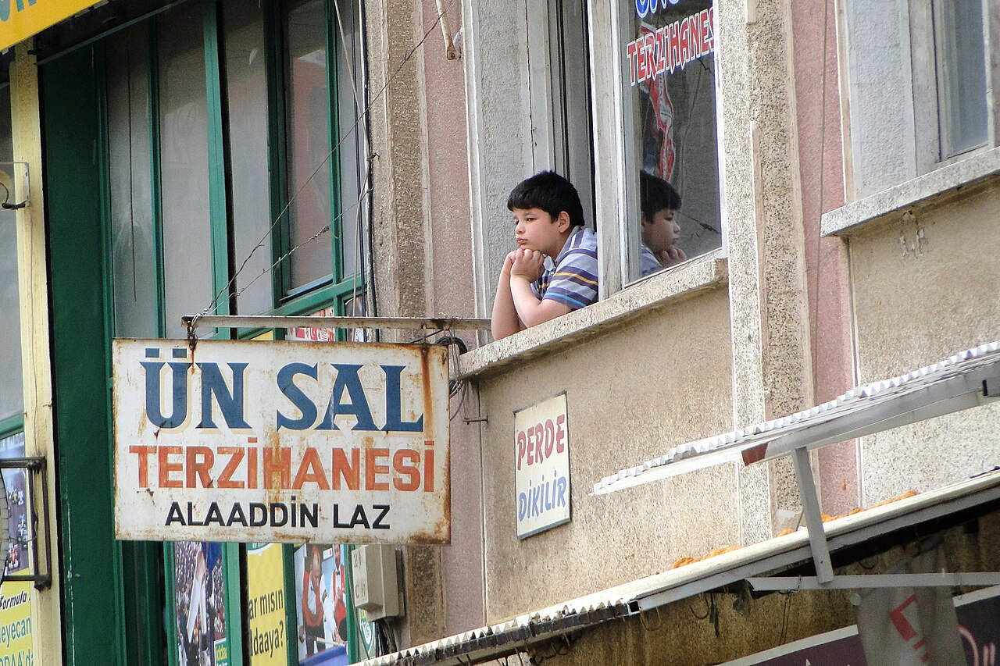
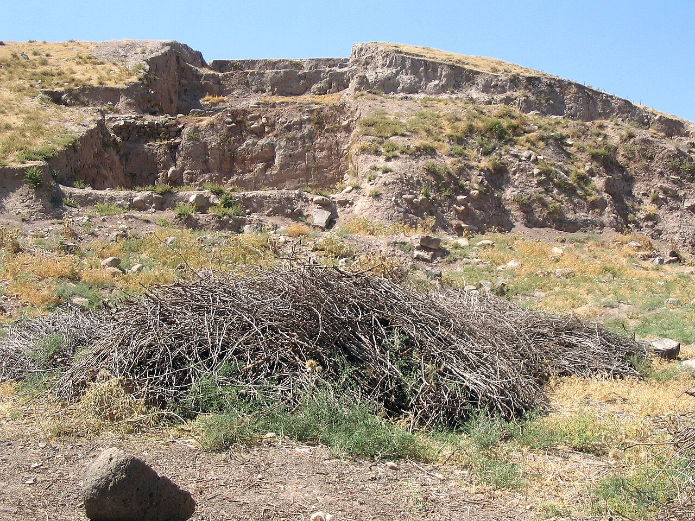

# 📍 Kilis - Mezopotamya Seferi Ön Keşif Dosyası

## 📜 Seyyahın Beklentisi
> "Zeytin ağaçlarının gölgesinde kadim kabaltılı sokaklar, lezzetli Kilis Tavası ve sınır boyunun sıcak insanları."

---

### 🌍 Şehrin Dokusu, Mezopotamya Tarihi ve Manevi Mirası
Anadolu ile Suriye (Halep) arasındaki kadim kültür köprüsü üzerinde, uçsuz bucaksız zeytinliklerin ve üzüm bağlarının koynunda uyuyan **Kilis**, mütevazı ölçüsüne karşın şaşırtıcı derecede derin bir tarih barındırır. Şehrin hemen doğusunda yükselen ve Güneydoğu Anadolu'nun en büyük höyüklerinden biri olan **Oylum Höyük**, Kalkolitik Çağ'dan (MÖ 3500) Tunç ve Demir çağlarına, Hititlerden Helenistik döneme kadar 5.500 yıllık kesintisiz bir uygarlık katmanını gözler önüne serer; bu yönüyle Anadolu ile Kuzey Mezopotamya arasındaki ilk büyük ticaret düğümlerinden biridir.

Kilis'in batısındaki sarp konik bir tepe üzerinde yükselen **Ravanda Kalesi** (Polateli), tarih boyunca Haçlılar, Zengîler, **Selahaddin Eyyubi**, Memlükler ve Osmanlılar arasında stratejik bir kartal yuvası olarak el değiştirmiştir. Şehir merkezinin mimari kimliğini ise sarı kesme taşlı, iç avlulu (**havuşlu**) Kilis evleri ve sokakların üstünü kemerlerle örterek yaz sıcağında serin gölgeler oluşturan özgün **"kabaltı"** geçitleri belirler. Osmanlı döneminde Halep eyaletinin en müreffeh ilim ve ticaret sancaklarından biri olan Kilis, 1388 tarihli **Ulu Cami**, Canbolat Bey (Tekye) Camii, Hacı Derviş Camii, tarihi Paşa Hamamı ve kadim **Sabunhane** binasıyla dingin bir Osmanlı zarafetini bugüne taşır.

Manevi ikliminde ise İslam fetihlerinin seçkin komutanı ve sahabe **Şurahbil bin Hasene**'nin makamı ile Şeyh Mansur ve Şeyh Muhammed Bedevi türbeleri önemli ziyaretgâhlardır. Yüzyıllardır komşuluk, misafirperverlik ve paylaşma kültürünü yaşatan Kilis, özellikle son on yılda sergilediği ensar duruşuyla da Anadolu'nun gönül başkentlerinden biri olarak anılmaktadır.

### 💬 Şehir Hakkında Edebi ve Tarihi Alıntılar
> "Kilis, bağları, zeytinlikleri, leziz üzümleri, camileri ve âlimleriyle Halep kapısının bereketli bir beldesidir." — *Evliya Çelebi, Seyahatnâme*
>
> "Kabaltılı sokakların serinliğinde yürürken zaman yavaşlar; taş avludan yükselen yasemin ve zeytinyağlı sabun kokusu insana evinde olduğunu hissettirir." — *Kilis Kültür Defteri*
>
> "Küçük görünen şehirler vardır ki toprağını kazdığınızda koca imparatorlukların nefesi çıkar." — *Anadolu Arkeoloji Notları*

### 🕊️ Gezginin Sefer Öncesi Tefekkürü
Kilis, büyük metropollerin kalabalığından sıyrılıp nefes alacağım, taşın ve zeytin ağacının sessizliğini dinleyeceğim bir durak olacak. **Oylum Höyük**'ün tepesinden verimli Kilis ovasına bakarken binlerce yıl önceki kervan yollarını hayal etmek, ardından kabaltıların serin gölgesinde yürüyüp **Şurahbil bin Hasene** makamında dua etmek istiyorum. Sınır boyu şehirlerinin o kendine has hüzünlü ama sımsıcak insan ilişkilerini, bir fincan mırra veya zahter çayı eşliğinde dinlemek bu seferin en samimi hatıralarından biri olacak.

### 🍽️ Yöresel Lezzet Rehberi (Gastronomi Rotası)
- **Kilis Tavası:** Zırhla çekilmiş kuzu kıymasının altına ince dilim patlıcan veya patates dizilip köz biber ve domatesle taş fırında pişirildiği, ekmek banılarak yenen efsanevi ana yemek.
- **Cennet Çamuru Tatlısı:** İnce tel kadayıfın tereyağında kavrulup bol Antep/Kilis fıstığı, şerbet ve kaymakla buluştuğu benzersiz yöresel tatlı.
- **Kilis Katmeri & Kübbülmüşviyye:** Şerbetli çıtır katmer ve kor ateşte pişen yöresel içli köfte.
- **Oruk & Şıhıl Mahşi:** Bulgurlu yöresel köfte ve kıymalı kabak dolması.
- **Kilis Zeytinyağı & Horoz Karası Üzümü:** Bölgenin asırlık zeytin ağaçlarından sızan aromatik yağ ve meşhur siyah üzüm pekmezi.

### 💻 Planlanan Kütüphane Mesaisi (Dijital Seyyah Ofisi)
- **Hedef Çalışma Durağı:** *Kilis İl Halk Kütüphanesi*
  * *Seyyahın Kütüphane Planı:* Şehir merkezindeki samimi, kalabalıktan uzak ve dingin çalışma ortamında sabah yazılım/araştırma mesaisi yapılacak. Küçük ve yürünebilir bir şehir olduğu için kütüphaneden çıkar çıkmaz 5 dakikada tarihi çarşıya ve kabaltılı sokaklara karışmak mümkün olacak.
- **Konaklama & Lojistik Stratejisi:** Gaziantep'e yalnızca 60 km mesafede olduğundan Gaziantep-Kilis hattı tek bir lojistik koridor olarak planlanıyor; GSB Seyahatsever KYK yurtlarıyla sıfır konaklama maliyeti hedefleniyor.

### 🗺️ 5 Günlük Planlanan Keşif Rotası
- **1. Gün — Kabaltılar & Tarihi Çarşı:** Kilis şehir merkezi, **Ulu Cami**, Canbolat (Tekye) Camii, Eski Hamam, **Tarihi Sabunhane** ve kabaltılı taş sokaklarda yürüyüş.
- **2. Gün — 5.500 Yıllık Miras (Oylum Höyük):** **Oylum Höyük** arkeolojik alanı, Neşet Efendi Konağı (Kilis Müzesi) ve akşam fırında **Kilis Tavası** + **Cennet Çamuru** şöleni.
- **3. Gün — Ravanda Kalesi & Zeytinlikler:** Polateli'ndeki **Ravanda Kalesi** tırmanışı, çevredeki asırlık zeytin bahçeleri ve Söğütlüdere piknik/tefekkür molası.
- **4. Gün — Manevi Duraklar & Kütüphane:** **Şurahbil bin Hasene Türbesi** ziyareti, Şeyh Mansur Makamı, Kilis İl Halk Kütüphanesi'nde yoğun çalışma ve akşam yerel esnafla sohbet.
- **5. Gün — Yorgan Sanatı & Veda:** Kilis'in tescilli el sanatı yorgancılık atölyeleri ve yemeniciler çarşısına uğrayış, zeytinyağlı sabun hatırasıyla Şanlıurfa/Adıyaman hattına hareket.

### ✨ Keşfedilesi Duraklar ve Landmarks Checklist
- [ ] **Oylum Höyük (5.500 Yıllık Kadim Yerleşim)**
- [ ] **Ravanda Kalesi (Polateli)**
- [ ] **Kilis Tarihi Taş Evleri ve Kabaltı Sokakları**
- [ ] **Kilis Ulu Camii ve Canbolat Bey (Tekye) Camii**
- [ ] **Neşet Efendi Konağı (Kilis Müzesi) & Tarihi Sabunhane**
- [ ] **Şurahbil bin Hasene Makamı (Sahabe Ziyaretgâhı)**
- [ ] **Kilis İl Halk Kütüphanesi**

### 📸 Görsel Arşiv ve Beklenen Kadrajlar
| Kilis Taş Sokakları | Ravanda Kalesi & Oylum Höyük |
| :---: | :---: |
|  |  |
| *Sarı kesme taşlı kabaltılı Kilis sokakları* | *Ravanda Kalesi ve zeytinlikler diyarı* |

---
*Henüz adımlanmamış bu kadim Mezopotamya durağı, yaklaşan Güneydoğu Anadolu Seferi için ön keşif dosyası olarak hazırlanmıştır.*
