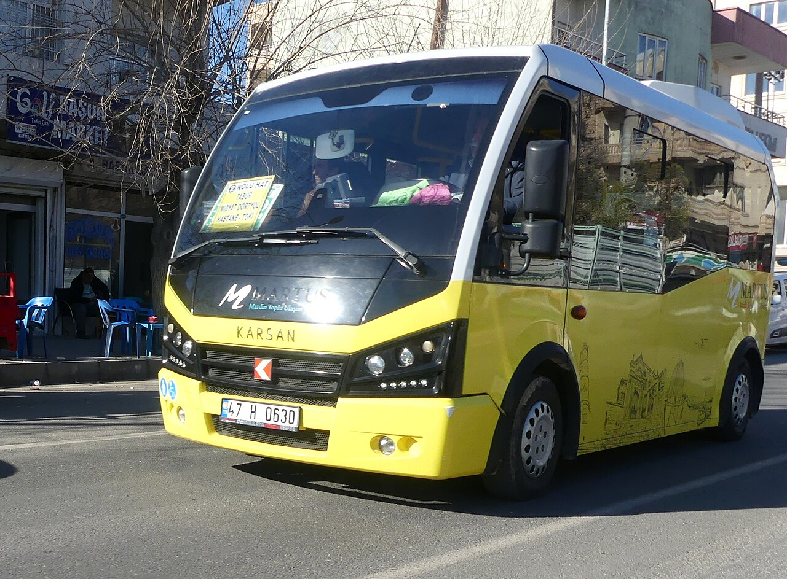
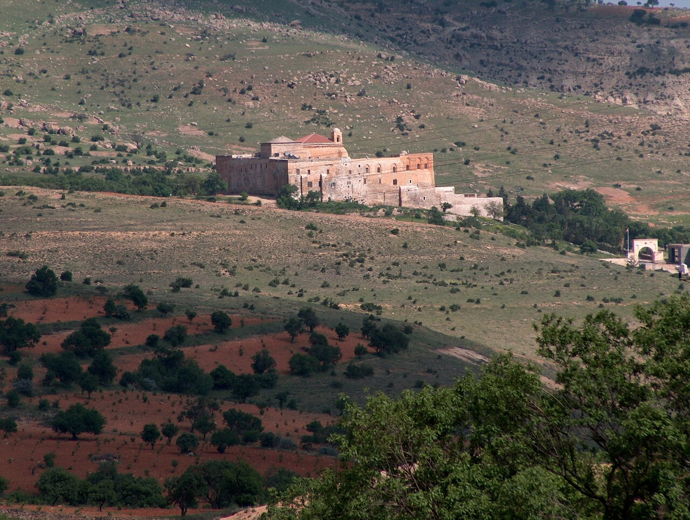

# 📍 Mardin - Mezopotamya Seferi Ön Keşif Dosyası

## 📜 Seyyahın Beklentisi
> "Gündüzü seyran, gecesi gerdanlık; Mezopotamya ovasına tepeden bakan sarı kalker taşlı masal diyarı."

---

### 🌍 Şehrin Dokusu, Mezopotamya Tarihi ve Manevi Mirası
Uçsuz bucaksız Mezopotamya ovasını bir kartal yuvası gibi tepeden izleyen **Mardin**, güneşin her saatinde rengi bal sarısından kızıla dönen kalker taşıyla yontulmuş, dünyanın en büyüleyici açık hava şehirlerinden biridir. Sümerlerden Akadlara, Babillilerden Asurlulara, Perslerden Romalılara, Emevilerden Abbasilere ve özellikle şehre bugünkü mimari ruhunu üfleyen **Artuklulara** uzanan binlerce yıllık bir kültür senfonisidir. Hiçbir evin diğerinin güneşini ve ufkunu kapatmadığı teraslı mimarisi, "abbara" adı verilen gizemli taş geçitleri, cami minareleriyle kilise çan kulelerinin yan yana göğe yükseldiği hoşgörü iklimiyle Mardin, insanlığın bir arada yaşama sanatının yaşayan anıtıdır.

Artuklu ve Akkoyunlu taş işçiliğinin zirvesi olan **Kasımiye Medresesi**, yalnızca bir ilim yuvası değil, taş ve suyla yazılmış bir tasavvuf risalesidir: Eyvandaki selsebil çeşmesinden doğan su, dar kanallardan geçip büyük havuza dökülerek insanın doğumdan çocukluğa, gençlikten yaşlılığa ve nihayet ölüm sonrası ahirete uzanan ömrünü simgeler. Şehir siluetinin tacı olan **Zinciriye (Sultan İsa) Medresesi** ve 12. yüzyıl Artuklu şaheseri **Mardin Ulu Camii**, gökyüzüne açılan taş nakışlarıyla görenleri büyüler.

Mardin aynı zamanda Süryani Kadim medeniyetinin kalbidir. Şehrin 5 km doğusunda, 4.000 yıllık bir Güneş Tapınağı'nın temelleri üzerine kurulan ve 640 yıl boyunca Süryani Patrikliği'ne merkezlik yapan **Deyrulzafaran (Safran) Manastırı** ile Midyat (Tur Abdin) yakınlarındaki 397 tarihli **Mor Gabriel Manastırı** (dünyanın ayakta duran en eski Süryani Ortodoks manastırlarından biri), kadim Doğu Hristiyanlığının yaşayan hafızasıdır. Güneydoğuda yer alan **Dara Mezopotamya Harabeleri** ise Doğu Roma İmparatorluğu'nun Sasani sınırındaki görkemli garnizon kenti olarak devasa yeraltı su sarnıçları (Zindan), kaya mezarları ve agorasıyla "Mezopotamya'nın Efes'i" unvanını hak eder.

### 💬 Şehir Hakkında Edebi ve Tarihi Alıntılar
> "Mardin, dağın eteğine kurulmuş İslam beldelerinin en güzel, en mükemmel, en sağlam ve çarşıları en süslü olanıdır." — *İbn Battûta, Seyahatnâme (14. yy)*
>
> "Mardin gündüzü seyranlık, gecesi gerdanlıktır; Mezopotamya ovası bir deniz gibi ayaklarının altına serilir." — *Kadim Mardin Sözü*
>
> "Taşın dile geldiği, zamanın bir eyvan gölgesinde durup dinlendiği şehirdir Mardin." — *Murathan Mungan (Mardin Hatıralarından)*

### 🕊️ Gezginin Sefer Öncesi Tefekkürü
Mardin'i yıllardır fotoğraflardan ve kitaplardan izlerken hep şu anı hayal ettim: **Kasımiye Medresesi**'nin avlusunda ikindi güneşi Mezopotamya ovasına devrilirken o küçük su kanalının kenarına oturup hayatın hızla akışını seyretmek... Abbaraların serin gölgesinde yürürken taş ustalarının sabrına hayran kalmak, **Deyrulzafaran**'da binlerce yıllık dua seslerinin yankısını duymak ve akşam karanlığı çöktüğünde ovanın ışıklarını bir gerdanlık gibi izlemek. Mardin, Mezopotamya seferinin en şiirsel durağı olacak.

### 🍽️ Yöresel Lezzet Rehberi (Gastronomi Rotası)
- **Mardin Kebabı & Kaburga Dolması:** Zırh kıymasıyla yapılan aromatik kebap ve baharatlı iç pilavlı kuzu kaburga.
- **Sembusek:** Sacda pişirilen, içi baharatlı kıyma ve soğanlı kapalı lahmacun benzeri nefis yöresel börek.
- **İrok & İkbebet:** Biri kızartılarak biri haşlanarak hazırlanan Mardin usulü ince bulgurlu içli köfteler.
- **Alluciye & Kibe (İşkembe Dolması):** Yeşil erikle pişirilen ekşili kuzu yahnisi ve geleneksel ziyafet yemekleri.
- **Mavi Badem Şekeri, Süryani Çöreği & Mırra:** Hayalet ağaç/lahor ağacı özüyle renklendirilen badem şekeri, tarçın-mahlep kokulu çörek ve kakuleli acı kahve mırra.

### 💻 Planlanan Kütüphane Mesaisi (Dijital Seyyah Ofisi)
- **Hedef Çalışma Durağı:** *Mardin İl Halk Kütüphanesi (ve Tarihi Eski Mardin Okuma Salonları)*
  * *Seyyahın Kütüphane Planı:* Taş mimarisi ve Mezopotamya ovasına bakan ferah atmosferiyle seyyah yazılımcıya benzersiz bir ilham kaynağı olacak. Sabah 09.00–13.00 arası kütüphane mesaisi, ardından taş sokaklarda ve medreselerde fotoğraf ve tefekkür yürüyüşü planlanıyor.
- **Konaklama & Lojistik Stratejisi:** Artuklu (Yenişehir) bölgesindeki GSB Seyahatsever KYK yurtlarında konaklayıp Eski Mardin'e sık kalkan minibüslerle 10 dakikada çıkış; Midyat ve Dara için ayrı günübirlik hatlar.

### 🗺️ 5 Günlük Planlanan Keşif Rotası
- **1. Gün — Eski Mardin & Artuklu Ruhu:** **Mardin Ulu Camii**, Bakırcılar ve Kayseriye Çarşısı, abbaralar, **Zinciriye Medresesi**, Mardin Müzesi ve gün batımında **Kasımiye Medresesi**.
- **2. Gün — Manastırlar & Mezopotamya'nın Efes'i:** Sabah **Deyrulzafaran Manastırı**, ardından **Dara Antik Kenti** (dev sarnıçlar, kaya mezarları, agora) ve akşamüstü Beyazsu vadisinde serinleme.
- **3. Gün — Midyat & Tur Abdin:** Midyat eski taş konakları (**Midyat Devlet Konukevi**), gümüş telkari atölyeleri, **Mor Gabriel Manastırı** ve Anıtlı (Hah) Meryem Ana Kilisesi.
- **4. Gün — Savur & Manevi İzler:** "Küçük Mardin" olarak bilinen yeşil **Savur** ilçesi, Hacı Abdullah Bey Konağı, Killit (Dereiçi) köyü ve Sultan Şeyhmus ziyareti.
- **5. Gün — Kütüphane Mesaisi & Veda:** Mardin İl Halk Kütüphanesi'nde gezi notlarının yazılması, mavi badem şekeri ve Süryani çöreği eşliğinde Şanlıurfa veya Şırnak'a hareket.

### ✨ Keşfedilesi Duraklar ve Landmarks Checklist
- [ ] **Eski Mardin Taş Evleri ve Abbaralar**
- [ ] **Kasımiye Medresesi (Selsebil & Mezopotamya Panoraması)**
- [ ] **Zinciriye (Sultan İsa) Medresesi & Mardin Ulu Camii**
- [ ] **Deyrulzafaran Manastırı**
- [ ] **Dara Mezopotamya Harabeleri (Antik Kent & Sarnıçlar)**
- [ ] **Midyat Konukevi, Telkari Çarşısı & Mor Gabriel Manastırı**
- [ ] **Savur Tarihi Evleri ve Mardin Müzesi**

### 📸 Görsel Arşiv ve Beklenen Kadrajlar
| Eski Mardin Panoraması | Kasımiye & Deyrulzafaran |
| :---: | :---: |
|  |  |
| *Sarı kalker taşlı Mardin ve sonsuz ova* | *Kasımiye Medresesi eyvanında ışık ve su* |

---
*Henüz adımlanmamış bu kadim Mezopotamya durağı, yaklaşan Güneydoğu Anadolu Seferi için ön keşif dosyası olarak hazırlanmıştır.*
