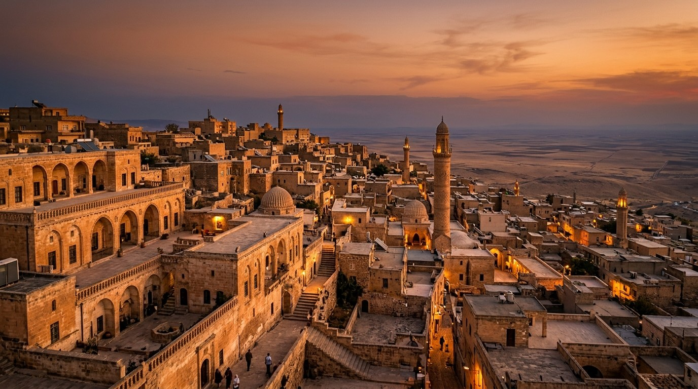
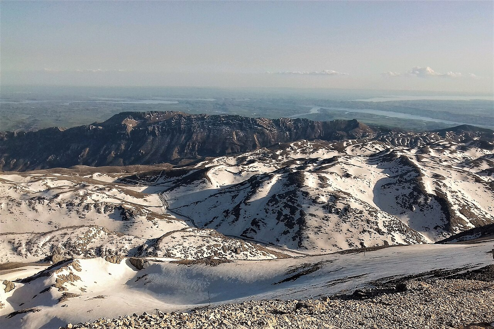
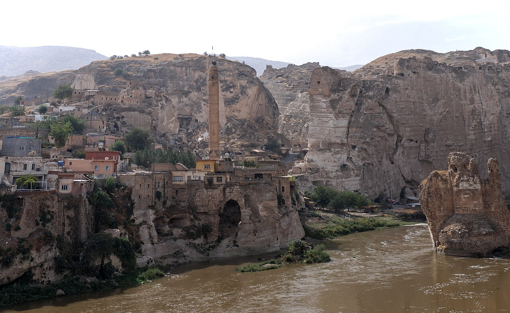
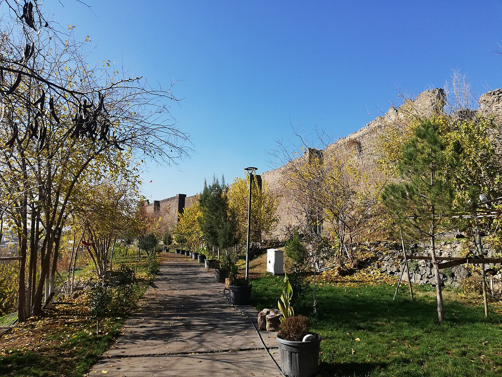
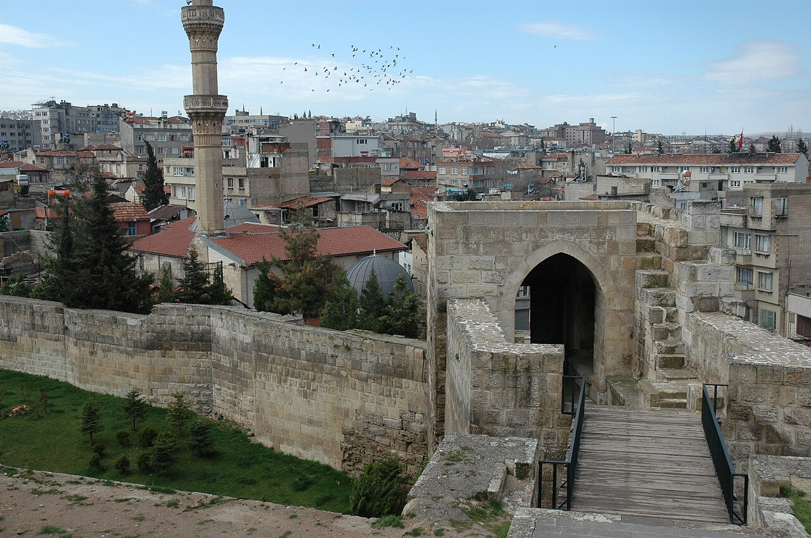
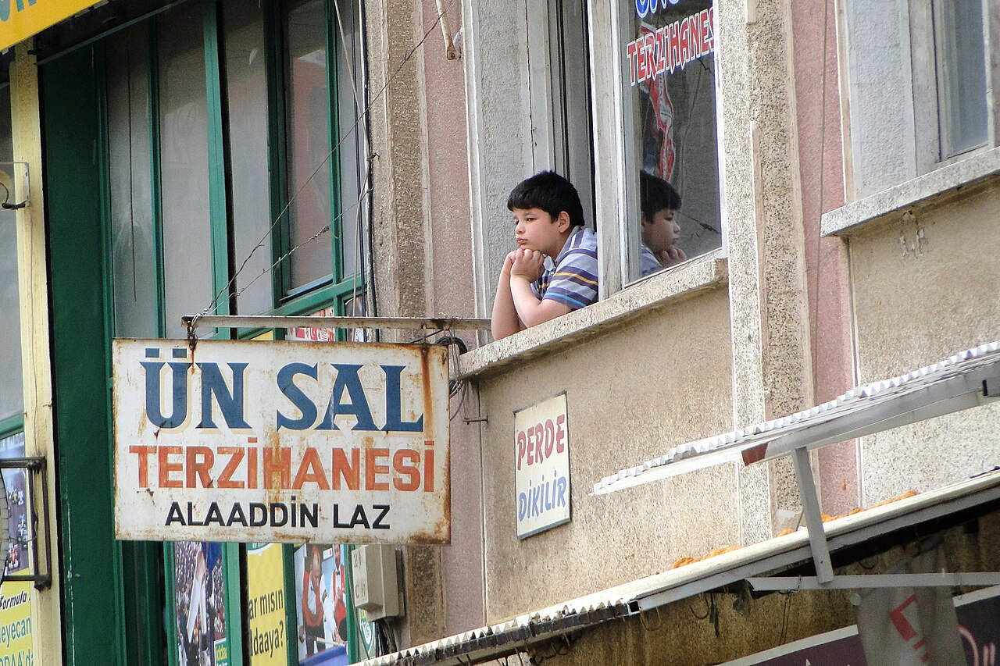
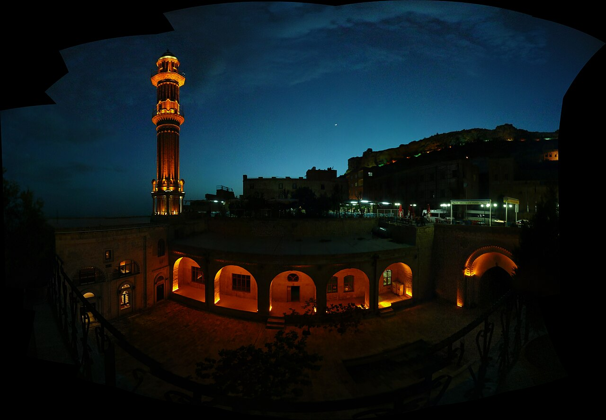
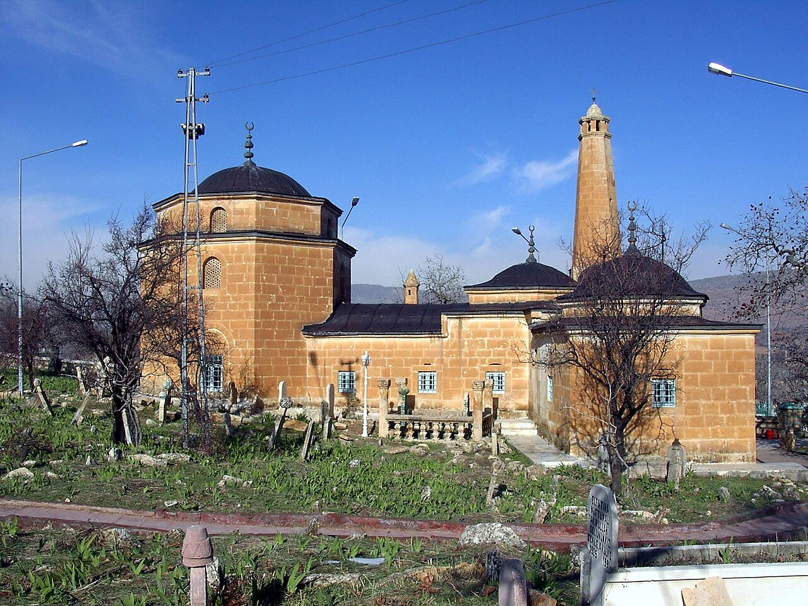
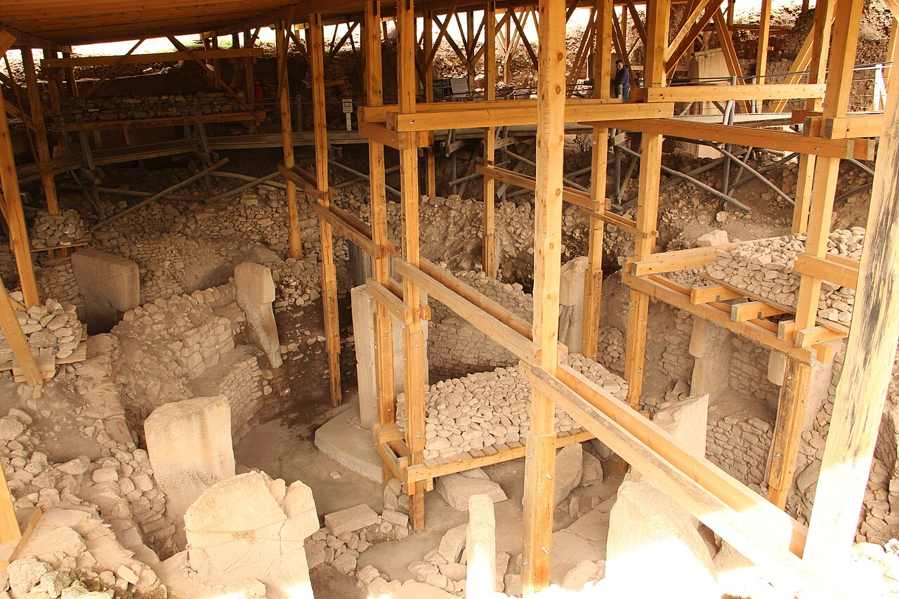
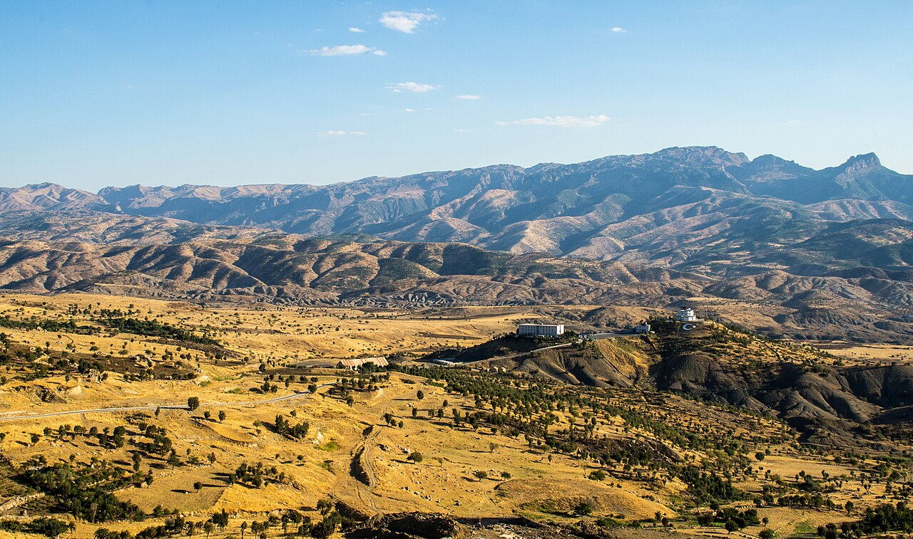

# 🏜️ Güneydoğu Anadolu Bölgesi

> *Mezopotamya'nın Ninnisi & Medeniyet Beşiği: Göbeklitepe'den Harran'a, toprağın taşa, taşın efsaneye dönüştüğü masal.*

**Keşif İlerlemesi:** `0 / 9 İl` (**%0.0**) &nbsp;•&nbsp; [🏠 Ana Sayfaya Dön](../README.md) &nbsp;•&nbsp; [🌐 Web Portalı](https://bahattinyunus.github.io/dijitalseyyah/)

---

## 🖼️ Bölge İlleri Görsel Rehberi

<table>
  <tr>
    <td align="center" width="33%" valign="top">
       
      <strong><a href="Adiyaman/README.md">02 • Adıyaman</a></strong> 
      ⏳ Bekliyor • 📍 Nemrut Dağı Heykelleri (Gündoğumu/Batımı) 🍽️ Adıyaman Çiğ Köftesi
    </td>
    <td align="center" width="33%" valign="top">
       
      <strong><a href="Batman/README.md">72 • Batman</a></strong> 
      ⏳ Bekliyor • 📍 Hasankeyf Tarihi Kenti 🍽️ Batman Kütülk (İçli Köfte)
    </td>
    <td align="center" width="33%" valign="top">
       
      <strong><a href="Diyarbakir/README.md">21 • Diyarbakır</a></strong> 
      ⏳ Bekliyor • 📍 Diyarbakır Surları (UNESCO) 🍽️ Diyarbakır Ciğeri
    </td>
  </tr>
  <tr>
    <td align="center" width="33%" valign="top">
       
      <strong><a href="Gaziantep/README.md">27 • Gaziantep</a></strong> 
      ⏳ Bekliyor • 📍 Zeugma Mozaik Müzesi (Çingene Kızı) 🍽️ Gaziantep Baklavası
    </td>
    <td align="center" width="33%" valign="top">
       
      <strong><a href="Kilis/README.md">79 • Kilis</a></strong> 
      ⏳ Bekliyor • 📍 Ravanda Kalesi 🍽️ Kilis Tavası
    </td>
    <td align="center" width="33%" valign="top">
       
      <strong><a href="Mardin/README.md">47 • Mardin</a></strong> 
      ⏳ Bekliyor • 📍 Mardin Taş Evleri 🍽️ Mardin Kebabı
    </td>
  </tr>
  <tr>
    <td align="center" width="33%" valign="top">
       
      <strong><a href="Siirt/README.md">56 • Siirt</a></strong> 
      ⏳ Bekliyor • 📍 İsmail Fakirullah & İbrahim Hakkı Türbesi (Işık Hadisesi - Tillo) 🍽️ Büryan Kebabı
    </td>
    <td align="center" width="33%" valign="top">
       
      <strong><a href="Sanliurfa/README.md">63 • Şanlıurfa</a></strong> 
      ⏳ Bekliyor • 📍 Göbeklitepe (Tarihin Sıfır Noktası) 🍽️ Urfa Kebabı
    </td>
    <td align="center" width="33%" valign="top">
       
      <strong><a href="Sirnak/README.md">73 • Şırnak</a></strong> 
      ⏳ Bekliyor • 📍 Cudi Dağı (Hz. Nuh'un Gemisi) 🍽️ Kutlık
    </td>
  </tr>
</table>

---

*Anadolu Seyahatnamesi — Dijital Seyyah Bölge Dosyası*
