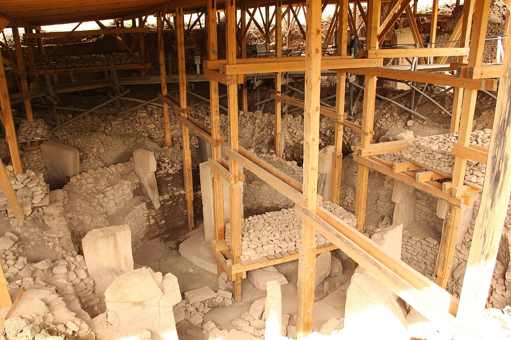
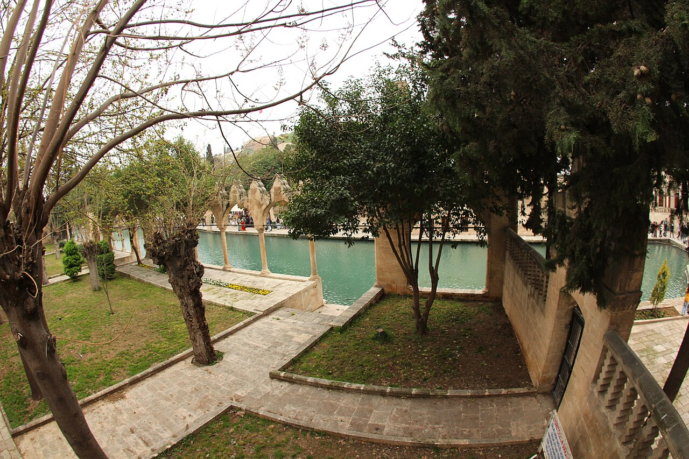

# 📍 Şanlıurfa - Mezopotamya Seferi Ön Keşif Dosyası

## 📜 Seyyahın Beklentisi
> "Peygamberler şehri; Hz. İbrahim'in ateşinin gül bahçesine dönüştüğü Balıklıgöl ve insanlık tarihinin sıfır noktası Göbeklitepe."

---

### 🌍 Şehrin Dokusu, Mezopotamya Tarihi ve Manevi Mirası
İnsanlık tarihinin bildiğimiz tüm kronolojisini baştan yazan **Şanlıurfa** (*Ur* / *Edessa* / *Ruha*), yeryüzünün en eski tapınak merkezlerinden peygamberlerin mukaddes izlerine uzanan 12.000 yıllık bir zaman tünelidir. Şehrin kuzeydoğusunda yükselen ve UNESCO Dünya Mirası Listesi'nde yer alan **Göbeklitepe** (MÖ 9600), henüz tarımın ve çömlekçiliğin bile başlamadığı avcı-toplayıcı çağda dikilen 6 metrelik T biçimli dikilitaşlarıyla **"Tarihin Sıfır Noktası"** unvanını taşır. Hemen yakınındaki **Karahantepe** ve *Taş Tepeler* arkeoloji havzası ise insanlığın ilk anıtsal mimarisini ve sembol dünyasını gün yüzüne çıkarmaya devam etmektedir.

Tevhid inancının ve "Peygamberler Şehri" kimliğinin kalbi ise **Balıklıgöl (Halil-ür Rahman ve Aynzeliha)** platosudur. **Hz. İbrahim**'in doğduğu mağara (Mevlid-i Halil), Nemrut tarafından mancınıkla ateşe atıldığında ateşin suya, odunların ise kutsal balıklara dönüştüğüne inanılan **Halil-ür Rahman Gölü** ve tepeden bu mucizeyi izleyen **Şanlıurfa Kalesi**, her gün binlerce ziyaretçiyi derin bir huşu içinde ağırlar. Şehir yalnızca Hz. İbrahim'in değil; sabır timsali **Hz. Eyyüb**'ün çile çektiği mağara ve şifa kuyusunun (Eyyüb Nebi), **Hz. Şuayb** antik kentinin ve Ay tanrısı Sin'e adanmış **Soğmatar** tapınaklarının da yurdudur.

Güneye inildiğinde, konik kerpiç **Harran Kümbet Evleri** ve dünyanın ilk İslam üniversitelerinden biri kabul edilen 8. yüzyıl eseri **Harran Ulu Camii** (El-Battânî ve Câbir bin Hayyân gibi dehaların ilim ocağı) seyyahı karşılar. Batıda Fırat'ın sularıyla yarısı sular altında kalan **Halfeti** ise dünyada yalnızca burada yetişen **Siyah Gül**'ü ve suyun içinden yükselen minaresiyle hüzünlü bir masal sunar.

### 💬 Şehir Hakkında Edebi ve Tarihi Alıntılar
> "Sakın terk-i edebden kûy-i mahbûb-i Hudâ'dır bu, Nazargâh-ı İlâhî'dir, Makâm-ı Mustafâ'dır bu." — *Urfalı Şair Nâbî (17. yy)*
>
> "Göbeklitepe, insanlığın önce tapınağı inşa edip sonra şehri kurduğunu kanıtlayarak tarihin bütün kitaplarını yeniden yazdırdı." — *Prof. Dr. Klaus Schmidt (Göbeklitepe Kazı Başkanı)*
>
> "Urfa, peygamberlerin nefesiyle yoğrulmuş, taşı sıcağıyla, gönlü ise musikisiyle yanan bir bereket diyarıdır." — *Evliya Çelebi İzinden Mezopotamya Notları*

### 🕊️ Gezginin Sefer Öncesi Tefekkürü
Şanlıurfa, 81 illik Anadolu Seyahatnamesi'nin en derin manevi ve tarihsel kırılma noktası olacak. Sabahın serinliğinde **Göbeklitepe**'nin 12.000 yıllık T sütunları arasında insanlığın ilk arayışına tanıklık etmek, öğlen **Gümrük Hanı**'nın asırlık taş avlusunda mırra yudumlamak, akşam ezanıyla birlikte ise **Balıklıgöl**'ün suyuna vuran kandil ışıkları altında Hz. İbrahim'in teslimiyetini ve Hz. Eyyüb'ün sabrını tefekkür etmek... Urfa, hem insanlığın başlangıcını hem de kalbin sükûnetini aynı günde yaşatacak.

### 🍽️ Yöresel Lezzet Rehberi (Gastronomi Rotası)
- **Urfa Kebabı & Haşhaş Kebabı:** Acısız, kuzu etinin zırhla çekilip közde piştiği sade ve asil lezzet.
- **Etli/Etsiz Çiğ Köfte & Sıra Gecesi:** İsotun başkenti Urfa'da, bağlama ve gazeller eşliğinde yoğrulan kadim sohbet sofrası.
- **Ciğer Kebabı & Lahmacun:** Sabahın 06.00'sında bile dumanı tüten sokak ciğercileri ve incecik çıtır Urfa lahmacunu.
- **Borani & Tirit:** Pazı, nohut, börülce ve kuzu etiyle hazırlanan geleneksel tencere yemeği ile sabahları yenilen kemik sulu tirit.
- **Şıllık Tatlısı & Mırra:** Cevizli/fıstıklı akıtma hamurunun şerbet ve sade yağla buluştuğu yöresel tatlı ve iki kez demlenen acı kahve mırra.

### 💻 Planlanan Kütüphane Mesaisi (Dijital Seyyah Ofisi)
- **Hedef Çalışma Durağı:** *Şanlıurfa İl Halk Kütüphanesi*
  * *Seyyahın Kütüphane Planı:* Peygamberler şehrinde zengin arkeoloji ve tarih kaynaklarına yakın, ferah çalışma salonunda sabah 4 saatlik yazılım ve seyahatname derleme mesaisi yapılacak. Sıcak Mezopotamya öğlen saatlerini kütüphanede verimli değerlendirip serin akşamüstlerinde sokaklara çıkmak en ideal ritim olacak.
- **Konaklama & Lojistik Stratejisi:** Şanlıurfa merkezde GSB Seyahatsever KYK yurtları; Göbeklitepe'ye belediye otobüsleriyle kolay erişim, Harran ve Halfeti için ise iki ayrı tam günlük keşif rotası planlanıyor.

### 🗺️ 5 Günlük Planlanan Keşif Rotası
- **1. Gün — Balıklıgöl & Tarihi Çarşılar:** **Halil-ür Rahman (Balıklıgöl)**, Aynzeliha Gölü, **Hz. İbrahim'in Doğduğu Mağara**, **Şanlıurfa Kalesi**, **Gümrük Hanı**, Sipahi ve Kazaz pazarları.
- **2. Gün — Tarihin Sıfır Noktası & Müze:** Sabah erkenden **Göbeklitepe**, ardından Türkiye'nin en büyük arkeoloji komplekslerinden **Şanlıurfa Arkeoloji Müzesi** ve **Haleplibahçe Mozaik Müzesi** (Amazonlar Mozaiği).
- **3. Gün — Harran, Soğmatar & Karahantepe:** **Harran Kümbet Evleri**, Harran Ulu Camii ve Höyüğü, imkâna göre **Karahantepe**, Hz. Şuayb Antik Kenti ve **Soğmatar**.
- **4. Gün — Sabır Makamı & Halfeti:** Sabah **Hz. Eyyüb Sabır Makamı**, ardından Fırat'ın sakin şehri **Halfeti**'de tekne turu, Savaşan Köyü batık minaresi ve Siyah Gül'ün izinde akşamüstü.
- **5. Gün — Kütüphane, Musiki & Veda:** Şanlıurfa İl Halk Kütüphanesi'nde notların yazılması, Ulu Cami ve Kızılkoyun Nekropolü, akşam otantik bir **Sıra Gecesi** dinletisiyle veda.

### ✨ Keşfedilesi Duraklar ve Landmarks Checklist
- [ ] **Göbeklitepe Arkeolojik Alanı (UNESCO — Tarihin Sıfır Noktası)**
- [ ] **Balıklıgöl (Halil-ür Rahman & Aynzeliha) ve Hz. İbrahim Makamı**
- [ ] **Şanlıurfa Arkeoloji Müzesi & Haleplibahçe Mozaik Müzesi**
- [ ] **Harran Kümbet Evleri ve Harran Ulu Camii**
- [ ] **Karahantepe & Taş Tepeler Havzası**
- [ ] **Gümrük Hanı, Tarihi Çarşılar & Şanlıurfa Kalesi**
- [ ] **Hz. Eyyüb Sabır Makamı**
- [ ] **Halfeti (Batık Kent & Siyah Gül)**

### 📸 Görsel Arşiv ve Beklenen Kadrajlar
| Balıklıgöl & Şehir Silueti | Göbeklitepe & Harran |
| :---: | :---: |
|  |  |
| *Balıklıgöl'de akşam ışıkları ve Halil-ür Rahman* | *Tarihin sıfır noktası Göbeklitepe T-sütunları* |

---
*Henüz adımlanmamış bu kadim Mezopotamya durağı, yaklaşan Güneydoğu Anadolu Seferi için ön keşif dosyası olarak hazırlanmıştır.*
