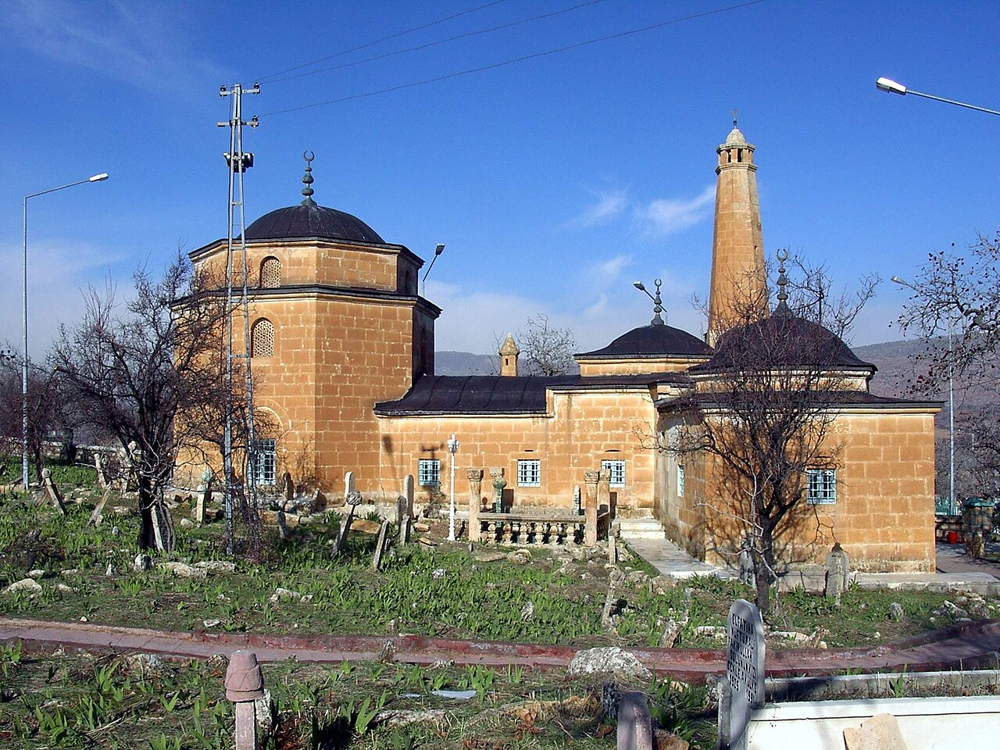
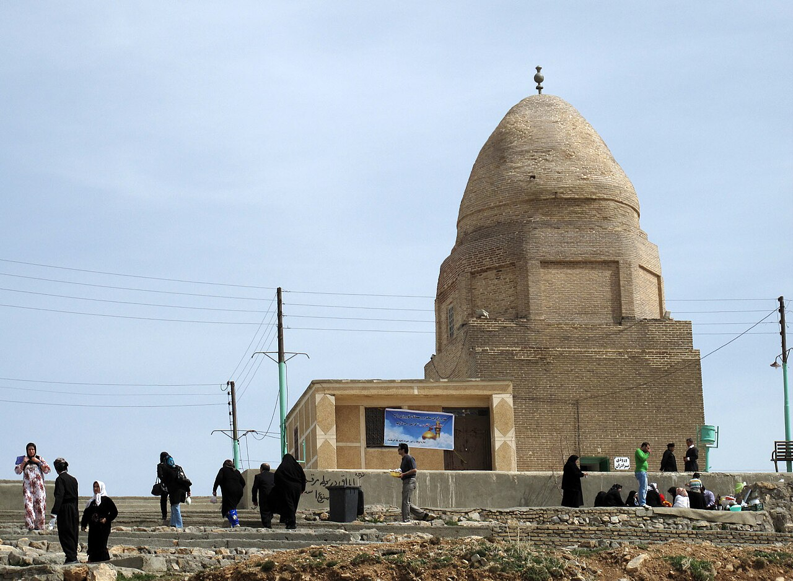

# 📍 Siirt - Mezopotamya Seferi Ön Keşif Dosyası

## 📜 Seyyahın Beklentisi
> "İlim ve irfan beldesi Tillo'daki güneş hadisesi, Veysel Karani Hazretleri'nin aşkı ve sarp Botan Kanyonu."

---

### 🌍 Şehrin Dokusu, Mezopotamya Tarihi ve Manevi Mirası
Botan Çayı'nın yonttuğu nefes kesici kanyonların ve bereketli fıstık bahçelerinin kucakladığı **Siirt**, Anadolu'da astronomi, bilim ve tasavvufun en zarif biçimde kucaklaştığı müstesna bir irfan ocağıdır. Şehrin yalnızca 9 km uzağındaki **Tillo (Aydınlar)** beldesi, asırlardır "evliyalar ve âlimler diyarı" olarak anılır. 18. yüzyılda büyük mürşid **İsmail Fakirullah Hazretleri** vefat ettiğinde, onun sadık talebesi ve *Marifetnâme* gibi anıtsal bir ansiklopedinin yazarı **Erzurumlu İbrahim Hakkı Hazretleri**, *"Hocamın başucuna doğmayan güneşi neyleyeyim!"* diyerek 1763 yılında dünya bilim tarihini hayrete düşüren bir astronomi düzeneği kurmuştur. Türbenin doğusundaki tepeye inşa ettiği taş duvar (Kal'atül Üstad) ve türbe kulesindeki kırılma sistemi sayesinde, her yıl **21 Mart ve 23 Eylül ekinokslarında** doğan güneşin ilk ışığı yalnızca İsmail Fakirullah Hazretleri'nin sandukasının başucunu aydınlatır. **Işık Hadisesi** olarak bilinen bu mucizevi düzenek, UNESCO Dünya Mirası Geçici Listesi'ndedir.

Siirt'in manevi ufkunun bir diğer büyük kutbu ise Baykan ilçesindeki **Veysel Karani Hazretleri Türbesi**'dir. Hz. Peygamber'i (s.a.v.) dünya gözüyle görmeden ona derin bir aşkla bağlanan, annesine hizmeti sebebiyle Medine'den dönen ve Hırka-i Şerif'e mazhar olan **Üveys el-Karanî**'nin makamı, yüzyıllardır Anadolu'nun dört bir yanından gelen gönül yolcularını ağırlar. Şehir merkezinde ise 1129 yılında Irak Selçuklu Sultanı Mugisüddin Mahmud tarafından yaptırılan **Siirt Ulu Camii**, çinili eğik minaresi ve bugün Ankara Etnografya Müzesi'nde sergilenen eşsiz ahşap minberiyle Selçuklu sanatının şaheseridir.

Doğal güzellikleriyle de büyüleyen şehirde **Botan Vadisi Milli Parkı** ve uçurumun kenarında doğal bir pencere gibi açılan **Rasıl Hacar (Delikli Taş)**, Botan Çayı'nın kıvrımlarına yukarıdan bakarak insanın nefesini keser. Tillo'nun hemen yakınındaki **Sağlarca (Billoris) Kaplıcası** ve asırlık Siirt tiftik battaniyesi dokumacılığı ise şehrin kadim yaşam kültürünü tamamlar.

### 💬 Şehir Hakkında Edebi ve Tarihi Alıntılar
> "Hak şerleri hayreyler, zannetme ki gayreyler; ârif ânı seyreyler, Mevlâ görelim neyler, neylerse güzel eyler." — *Erzurumlu İbrahim Hakkı Hazretleri (Tefviznâme, Tillo)*
>
> "Hocamın başucuna doğmayan güneşi neyleyeyim!" — *İbrahim Hakkı Hazretleri (Işık Hadisesi'nin hikâyesi)*
>
> "Veysel Karani'nin aşkı, görmeden sevmenin ve sadakatin en yüksek makamıdır." — *Anadolu Tasavvuf Geleneği*

### 🕊️ Gezginin Sefer Öncesi Tefekkürü
Siirt durağı, bu uzun Mezopotamya yolculuğunda hem bir bilim tarihçisi hem de bir gönül yolcusu gibi kalbimin en çok titrediği menzillerden biri olacak. Tillo'da **İbrahim Hakkı Hazretleri**'nin kurduğu **Işık Hadisesi** duvarına çıkıp bir öğrencinin hocasına duyduğu o derin vefayı astronomi ve geometriyle nasıl ölümsüzleştirdiğini yerinde görmek istiyorum. Ardından **Veysel Karani** huzurunda bir fatiha okuyup, **Rasıl Hacar**'dan Botan Kanyonu'nun derinliğine bakarken *"Mevlâ görelim neyler, neylerse güzel eyler"* dizelerini sessizce tekrarlamak... Bu şehir zihnimi de ruhumu da tazeleyecek.

### 🍽️ Yöresel Lezzet Rehberi (Gastronomi Rotası)
- **Siirt Büryan Kebabı:** İki-üç metre derinliğindeki yeraltı kuyu tandırlarında, meşe odunu közünün buharıyla saatlerce ağır ağır pişen, sabahın erken saatlerinde yenilen lokum gibi kuzu eti.
- **Perde Pilavı:** Badem, kuş üzümü, baharatlı pirinç ve tavuk/keklik etinin incecik açılmış hamur bohçası içinde fırınlandığı, evlilikte sır saklamayı ve bereketi simgeleyen sanat eseri yemek.
- **Siirt Fıstığı & Tayfi Üzümü:** İri taneli, aroması yüksek meşhur Siirt fıstığı ve ince kabuklu yöresel üzüm.
- **Kitil (Siirt İçli Köftesi) & Bumbar:** Yöreye özgü baharatlarla yoğrulan haşlama içli köfte ve geleneksel sakatat lezzeti.
- **Bıttım Sabunu & Pervari Karakovan Balı:** Yabani fıstık (menengiç) yağından yapılan şifalı bıttım sabunu ve yüksek yaylalardan gelen Pervari balı.

### 💻 Planlanan Kütüphane Mesaisi (Dijital Seyyah Ofisi)
- **Hedef Çalışma Durağı:** *Siirt İl Halk Kütüphanesi*
  * *Seyyahın Kütüphane Planı:* Tillo'nun manevi sükûnetinin hissedildiği şehir merkezinde, düzenli ve sakin kütüphane salonunda sabah 4 saatlik kodlama, okuma ve *Marifetnâme* notları derleme mesaisi yapılacak.
- **Konaklama & Lojistik Stratejisi:** Siirt merkezde GSB Seyahatsever KYK yurtları; Tillo yalnızca 9 km olduğundan ilçe dolmuşlarıyla çok kolay ulaşım, Veysel Karani (Baykan) ise Bitlis/Batman yolu üzerinde rahatça ziyaret edilebilecek.

### 🗺️ 5 Günlük Planlanan Keşif Rotası
- **1. Gün — Kadim Siirt & Ulu Cami:** Sabah erken saatte **Büryan Kebabı** ritüeli, **Siirt Ulu Camii**, Cumhuriyet Meydanı, tarihi tiftik battaniyesi atölyeleri ve Siirt İl Halk Kütüphanesi mesaisi.
- **2. Gün — İlim & Astronomi Beldesi Tillo:** **İsmail Fakirullah ve İbrahim Hakkı Hazretleri Türbesi**, Kal'atül Üstad (Işık Hadisesi duvarı), Tillo İbrahim Hakkı Astronomi ve Müze Evi, Memduhiye Medresesi.
- **3. Gün — Botan Kanyonu & Doğa:** **Botan Vadisi Milli Parkı**, **Rasıl Hacar (Delikli Taş)** seyir noktası, Botan Mağaraları ve **Sağlarca (Billoris) Kaplıcası**'nda dinlenme.
- **4. Gün — Aşk & Sadakat Menzili (Baykan):** **Veysel Karani Hazretleri Türbesi** ziyareti, çevredeki tarihi han ve köprüler, akşam merkezde **Perde Pilavı** deneyimi.
- **5. Gün — Pervari / Şirvan İzleri & Veda:** Yöresel bıttım sabunu, Pervari balı ve Siirt fıstığı hatıralarıyla kütüphane notlarını tamamlayıp Şırnak veya Batman'a doğru yola çıkış.

### ✨ Keşfedilesi Duraklar ve Landmarks Checklist
- [ ] **İsmail Fakirullah & İbrahim Hakkı Türbesi (Işık Hadisesi — Tillo)**
- [ ] **Veysel Karani Hazretleri Türbesi (Baykan)**
- [ ] **Siirt Ulu Camii (Selçuklu Çinili Minaresi)**
- [ ] **Botan Vadisi Milli Parkı ve Rasıl Hacar (Delikli Taş)**
- [ ] **Kal'atül Üstad (Tillo Gözlem Duvarı) & Tillo Müzesi**
- [ ] **Sağlarca (Billoris) Kaplıcası**
- [ ] **Siirt İl Halk Kütüphanesi & Tiftik Battaniyesi Atölyeleri**

### 📸 Görsel Arşiv ve Beklenen Kadrajlar
| Botan Vadisi & Rasıl Hacar | Tillo & Manevi Miras |
| :---: | :---: |
|  |  |
| *Botan Kanyonu ve Rasıl Hacar'dan sarp manzara* | *Tillo'da ilim, astronomi ve irfan kubbeleri* |

---
*Henüz adımlanmamış bu kadim Mezopotamya durağı, yaklaşan Güneydoğu Anadolu Seferi için ön keşif dosyası olarak hazırlanmıştır.*
