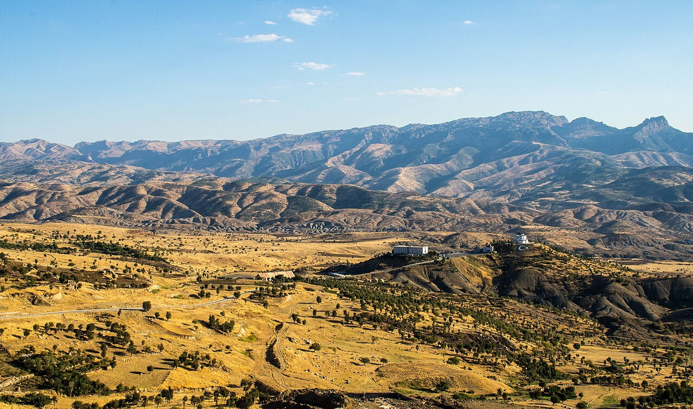
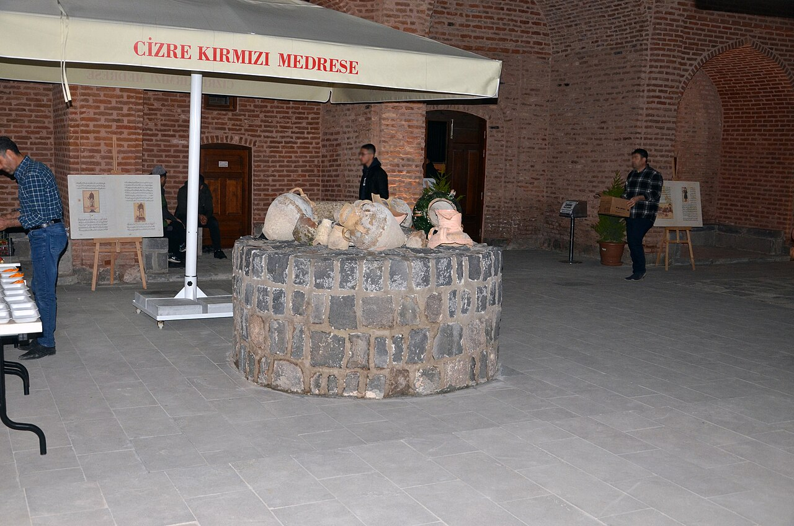

# 📍 Şırnak - Mezopotamya Seferi Ön Keşif Dosyası

## 📜 Seyyahın Beklentisi
> "Hz. Nuh'un gemisinin oturduğu Cudi Dağı, sibernetiğin kurucusu El-Cezeri'nin memleketi ve Mem û Zîn destanı."

---

### 🌍 Şehrin Dokusu, Mezopotamya Tarihi ve Manevi Mirası
Dicle Nehri'nin Türkiye topraklarından Mezopotamya ovasına süzüldüğü son büyük eşikte, heybetli **Cudi Dağı**'nın eteklerine yaslanan **Şırnak** (*Şehr-i Nuh*), insanlığın ikinci doğuşunun, Orta Çağ bilim dehasının ve Doğu edebiyatının en ölümsüz aşk destanının kesiştiği olağanüstü bir coğrafyadır. Kur'an-ı Kerim'de (Hûd Suresi, 44. ayet) Büyük Tufan'ın ardından **Hz. Nuh'un Gemisi**'nin üzerine oturduğu dağ olarak zikredilen **Cudi Dağı**, binlerce yıldır kutsal bir sığınak ve yeniden diriliş sembolü olarak görülür. Nitekim Cizre'de bulunan **Hz. Nuh Peygamber Türbesi** ve Şırnak'ın kadim adının *Şehr-i Nuh*'tan gelmesi, bu köklü geleneği bugüne taşır.

Dicle kıyısındaki kadim **Cizre** (*Cezîre-i İbn Ömer*), İslam bilim ve kültür tarihinin en parlak yıldızlarından birini yetiştirmiştir: **Sibernetiğin, robotiğin ve otomatik kontrol mühendisliğinin kurucusu İsmail Ebul-İz El-Cezeri** (1136–1206). *Kitâb-ül Hiyel* adlı eserinde su saatleri, otomatik abdest alma makineleri, şifreli kilitler, krank-biyel mekanizmaları ve su yükseltme pompaları tasarlayan bu büyük dâhinin türbesi Cizre'de, **Hz. Nuh Camii**'nin hemen yanında yer alır. Cizre Ulu Camii'nin birbirine dolanmış iki ejder figürlü bronz kapı tokmakları da bizzat El-Cezeri'nin elinden çıkmıştır.

Cizre aynı zamanda edebiyat ve tasavvufun da başkentidir: Kürt ve Doğu edebiyatının ölümsüz divan şairi **Melayê Cizîrî**'nin ders verdiği 15. yüzyıl eseri **Kırmızı Medrese (Medresa Sor)** ve Ahmed-i Hânî'nin kalemiyle dünya klasikleri arasına giren büyük aşk destanı **Mem û Zîn**'in türbesi bu şehrin taş sokaklarında yaşar. Doğal miras olarak ise Babil döneminden kalma kabartmaların bulunduğu **Kasrik Boğazı**, sarp **Cehennem Deresi Kanyonu** (İdil-Güçlükonak) ve **Beytüşşebap**'ın yüksek yaylaları Şırnak'ın keşfedilmeyi bekleyen saklı hazineleridir.

### 💬 Şehir Hakkında Edebi ve Tarihi Alıntılar
> "Ey yer suyunu yut ve ey gök suyunu tut! denildi. Su çekildi, iş bitirildi ve gemi Cûdî üzerine oturdu." — *Kur'an-ı Kerim (Hûd Suresi, 44)*
>
> "Uygulamaya geçirilmeyen her teknik ilim, doğru ile yanlış arasında asılı kalır." — *İsmail Ebul-İz El-Cezeri (Kitâb-ül Hiyel, Cizre, 1206)*
>
> "Aşk bir ateştir ki düşen yanar, fakat o ateşle pişen ruh ebediyete erer." — *Melayê Cizîrî (Kırmızı Medrese, Cizre)*

### 🕊️ Gezginin Sefer Öncesi Tefekkürü
Bir yazılımcı ve mühendislik tutkunu olarak Şırnak/Cizre durağının kalbimdeki yeri bambaşka: Bundan tam 820 yıl önce ilk programlanabilir otomasyon sistemlerini ve robotik mekanizmaları tasarlayan **El-Cezeri**'nin kabri başında durup ona bir meslektaş ve talebe hürmetiyle selam vermek, bu 81 illik yolculuğun en özel anlarından biri olacak. Ardından **Cudi Dağı**'nın vakur siluetine bakarak Hz. Nuh'un tufandan sonraki ilk şükür duasını düşünmek, **Kırmızı Medrese**'nin kızıl tuğlaları arasında **Mem û Zîn**'in hüzünlü hikâyesini dinlemek... Şırnak, hem bilimin hem de maneviyatın zirve yaptığı bir son durak olacak.

### 🍽️ Yöresel Lezzet Rehberi (Gastronomi Rotası)
- **Kutlık:** İnce bulgurun kıymalı, cevizli ve baharatlı iç harçla doldurulup haşlandığı Şırnak usulü içli köfte.
- **Serbıdev & Hekeheşandi:** Yoğurtlu, tereyağlı geleneksel buğday/pilav yemeği ve yöreye özgü içli yumurta/et yemeği.
- **Suryaz (Soryaz):** İlkbaharda dağlardan toplanan şifalı yabani otların tereyağı ve yumurta ile kavrulduğu nefis yöresel tat.
- **Perde Pilavı & Meyre (Mahir) Çorbası:** Bölgenin komşu Siirt ve Mardin ile paylaştığı zengin Mezopotamya sofra geleneği.
- **Beytüşşebap Balı & Şal-Şapik Dokuması:** Yüksek yaylaların saf çiçek balı ve tiftikten dokunan asırlık yöresel kumaş sanatı.

### 💻 Planlanan Kütüphane Mesaisi (Dijital Seyyah Ofisi)
- **Hedef Çalışma Durağı:** *Şırnak İl Halk Kütüphanesi (ve Cizre İlçe Halk Kütüphanesi)*
  * *Seyyahın Kütüphane Planı:* El-Cezeri'nin memleketinde, Cudi'nin eteklerindeki sessiz ve düzenli kütüphane salonunda yazılım geliştirme mesaisi yapmak apayrı bir anlam taşıyacak. Sabah odaklanma bloklarının ardından öğleden sonraları Cizre ve İdil tarihi rotalarına ayrılacak.
- **Konaklama & Lojistik Stratejisi:** Şırnak merkez ve Cizre hattında GSB Seyahatsever KYK yurtları; Cizre, İdil ve Kasrik Boğazı aynı karayolu ekseni üzerinde kolayca gezilebilecek şekilde planlanıyor.

### 🗺️ 5 Günlük Planlanan Keşif Rotası
- **1. Gün — Kadim Cizre & Bilim Mirası:** **Hz. Nuh Peygamber Türbesi**, **İsmail Ebul-İz El-Cezeri Türbesi**, Cizre Ulu Camii ve Bırca Belek (Cizre Kalesi) çevresi.
- **2. Gün — Edebiyat & Tasavvuf (Cizre):** **Kırmızı Medrese (Medresa Sor)**, **Mem û Zîn Türbesi**, Abdaliye Medresesi ve Dicle kıyısında akşamüstü yürüyüşü.
- **3. Gün — Cudi Etekleri & Kasrik:** **Kasrik Boğazı** antik kabartmaları, Şırnak şehir merkezi, **Cudi Dağı** seyir noktaları ve Şırnak İl Halk Kütüphanesi mesaisi.
- **4. Gün — İdil & Cehennem Deresi:** İdil'de Süryani mimarisinin izleri (Meryem Ana Kilisesi, Öğündük / Midin köyü) ve **Cehennem Deresi Kanyonu** / Finik Ören Yeri.
- **5. Gün — Doğa & Sefer Değerlendirmesi:** Güçlükonak/Belkısana kaplıca bölgesi veya Beytüşşebap yayla manzaraları, Güneydoğu Anadolu Seferi'nin genel tefekkür notlarının tamamlanması.

### ✨ Keşfedilesi Duraklar ve Landmarks Checklist
- [ ] **Cudi Dağı (Hz. Nuh'un Gemisi'nin Oturduğu Kadim Dağ)**
- [ ] **İsmail Ebul-İz El-Cezeri Türbesi (Sibernetiğin Kurucusu — Cizre)**
- [ ] **Hz. Nuh Peygamber Türbesi ve Camii (Cizre)**
- [ ] **Kırmızı Medrese (Medresa Sor — Melayê Cizîrî)**
- [ ] **Mem û Zîn Türbesi & Abdaliye Medresesi**
- [ ] **Cizre Ulu Camii ve Bırca Belek (Cizre Kalesi)**
- [ ] **Kasrik Boğazı, Finik Ören Yeri & Cehennem Deresi Kanyonu**

### 📸 Görsel Arşiv ve Beklenen Kadrajlar
| Cudi Dağı & Dicle Panoraması | Cizre Medrese & Bilim Mirası |
| :---: | :---: |
|  |  |
| *Heybetli Cudi Dağı etekleri ve Dicle vadisi* | *Kadim Cizre, Kırmızı Medrese ve El-Cezeri'nin izleri* |

---
*Henüz adımlanmamış bu kadim Mezopotamya durağı, yaklaşan Güneydoğu Anadolu Seferi için ön keşif dosyası olarak hazırlanmıştır.*
