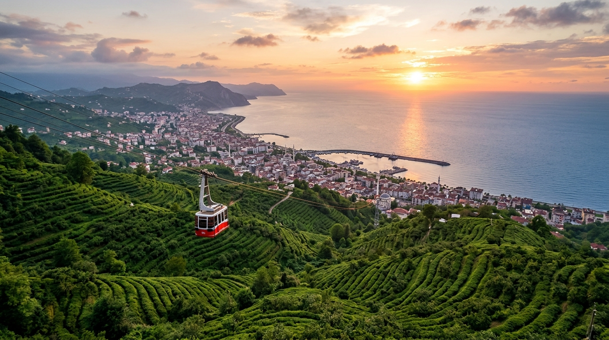
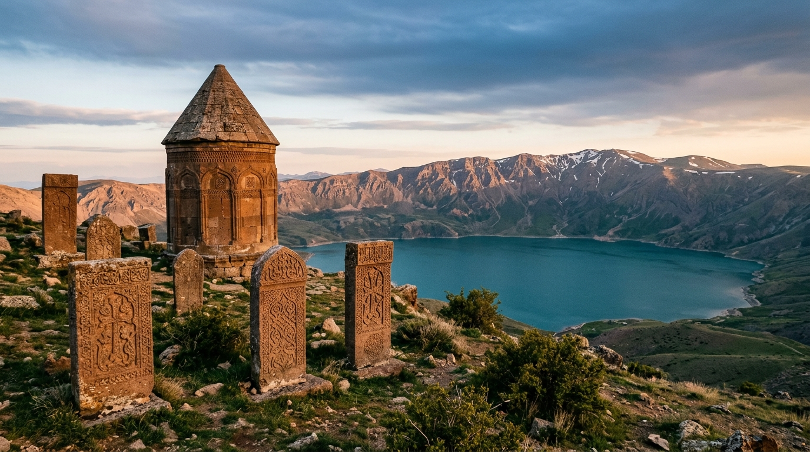
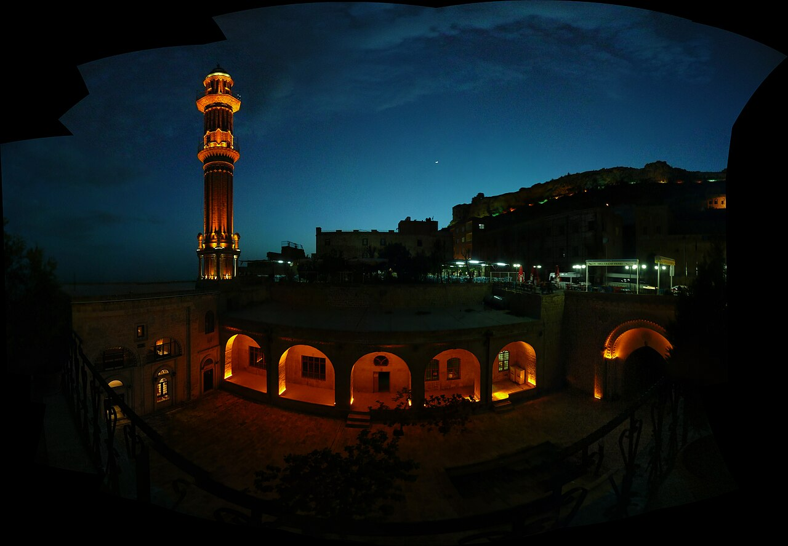
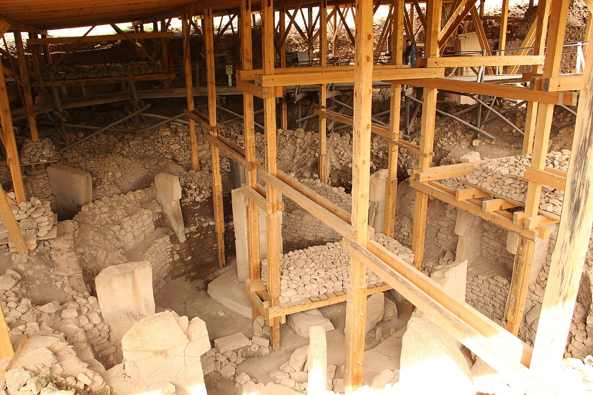
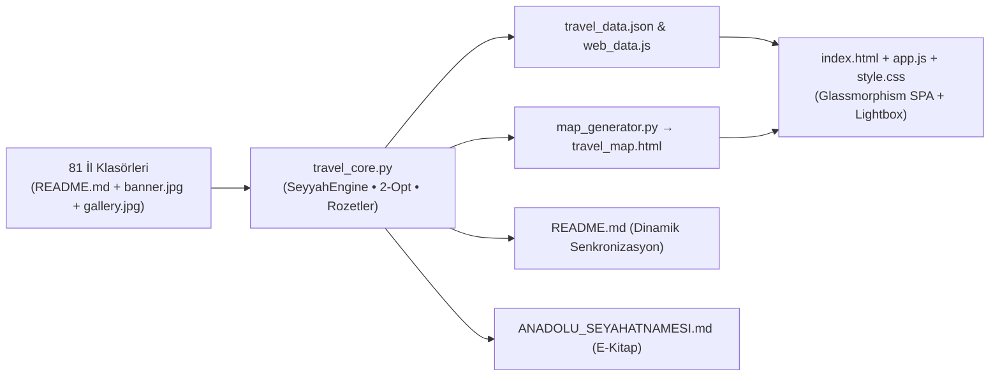

<div align="center">


<br/><br/>


<br/>

<p align="center">
  <a href="https://resilient-semifreddo-6651ec.netlify.app/" target="_blank"></a>
  
  
  
  
  
  <a href="LICENSE"></a>
</p>

<p align="center">
  <a href="#-81-il-keşif-durumu-ve-bölgesel-dağılım"><b>📊 İstatistikler</b></a> &nbsp;•&nbsp;
  <a href="#️-anadoludan-görsel-kesitler-7-bölge-menzil-galerisi"><b>🖼️ 7 Bölge Galerisi</b></a> &nbsp;•&nbsp;
  <a href="#-seyyah-rütbe-merhaleleri-ve-başarım-rozetleri"><b>🏆 Rütbeler & Rozetler</b></a> &nbsp;•&nbsp;
  <a href="#-interaktif-web-portalı-ve-öne-çıkan-özellikler"><b>✨ Web Portalı</b></a> &nbsp;•&nbsp;
  <a href="#️-teknik-mimari-ve-veri-akışı"><b>🏗️ Mimari</b></a> &nbsp;•&nbsp;
  <a href="#️-dijital-seyyah-python-cli-aracı"><b>🛠️ CLI</b></a> &nbsp;•&nbsp;
  <a href="#-seyyah-yazılım-serisi-medium-makaleleri"><b>📚 Makaleler</b></a>
</p>

<br/>

> **🕌 *"De ki: Yeryüzünde gezip dolaşın da Allah'ın yaratmaya nasıl başladığını görün..."*** — *Kur'an-ı Kerim (Ankebût, 20)*

</div>

---

### ⚡ Hızlı Erişim & Canlı Gösterge Paneli

<table>
  <tr>
    <td align="center" width="25%">
      <h3>🎯 39 / 81 İl</h3>
      <sub><strong>%48.1 Keşif Oranı</strong><br/>Anadolu Kâşifi Rütbesi</sub>
    </td>
    <td align="center" width="25%">
      <h3>🛣️ 10,898 km</h3>
      <sub><strong>Karayolu Menzil İzi</strong><br/>6 / 7 Coğrafi Bölge</sub>
    </td>
    <td align="center" width="25%">
      <h3>📸 162 Fotoğraf</h3>
      <sub><strong>81 İl × 2 Görsel (%100)</strong><br/>Banner + Lightbox Galeri</sub>
    </td>
    <td align="center" width="25%">
      <h3>📖 780 Saat</h3>
      <sub><strong>39 İl Halk Kütüphanesi</strong><br/>5 Gün Kuralı İlim Mesaisi</sub>
    </td>
  </tr>
</table>

| 🌐 Canlı Web Uygulaması | 🗺️ İnteraktif Folium Haritası | 📚 Derlenmiş E-Kitap Külliyatı | 💻 Python CLI Motoru |
| :---: | :---: | :---: | :---: |
| [**Dijital Seyyah Portalı ➔**](https://resilient-semifreddo-6651ec.netlify.app/) | [**travel_map.html ➔**](travel_map.html) | [**ANADOLU_SEYAHATNAMESI.md ➔**](ANADOLU_SEYAHATNAMESI.md) | `python dijital_seyyah.py status` |

---

## 📜 Seyahat ve Tefekkür Manifestosu

> *"Biz yolların bitmediği, keşfin son bulmadığı bir alemde Hakikati ve Güzelliği arayan yolcularız. Her konak yeni bir hikmet, her şehir içsel bir hicrettir. Bu seyir defteri, modern bir derviş edasıyla yollara düşmüş bir seyyahın zikir, fikir, kod ve şükür günlüğüdür."*

<table>
  <tr>
    <td width="50%" valign="top">
      <h4>🕌 İrfani Seyahat Merhaleleri</h4>
      <ol>
        <li><b>Sefer-i Sûrî (Zahiri Sefer):</b> Yeryüzünü adımlamak, önyargıları kırıp farklı kültürleri ve kadim mimariyi bizzat görmek.</li>
        <li><b>Sefer-i Manevî (Batıni Sefer):</b> Gurbetteki sükûnet içinde nefsin terbiyesi, kalbin saflaşması ve içsel muhasebe.</li>
        <li><b>Sefer der Vatan (Halk İçinde Hak ile):</b> Şehirlerin kesreti (kalabalığı) içinde vahdeti (birliği) ve içsel huzuru korumak.</li>
      </ol>
    </td>
    <td width="50%" valign="top">
      <h4>🎒 Menzil Disiplini & Açık Kaynak Usulü</h4>
      <ul>
        <li>⛺ <b>Modern Kervansaraylar:</b> GSB Seyahatsever yurtlarıyla sıfır konaklama maliyeti ve sürdürülebilir keşif.</li>
        <li>🐎 <b>5 Gün Kuralı:</b> Her şehirde ortalama 5 gün kalarak şehri tüketmeden sindirme ve tefekkür etme.</li>
        <li>📚 <b>Yolda İlim Tahsili:</b> Her şehrin İl Halk Kütüphanesinde yazılım, okuma ve araştırma mesaisi.</li>
        <li>🧭 <b>2-Opt Rota Optimizasyonu:</b> Minimum kilometre ve karbon ayak iziyle komşu iller arası en verimli sefer hattı.</li>
      </ul>
    </td>
  </tr>
</table>

<details>
<summary><b>📖 Evliya Çelebi, İbn Battûta & Dünya Düşünürlerinden Seyahat Hikmetleri (Açmak için tıklayın)</b></summary>
<br/>

> *"Yolculuğa çıkın ki sıhhat bulasınız ve ganimet elde edesiniz."* — **Hz. Muhammed (s.a.v.)**
>
> *"Dünyada tıpkı bir garip veya bir yolcu (garîbün ev âbiru sebîl) gibi ol."* — **Hz. Muhammed (s.a.v.)**
>
> *"Gurbet ara, seyahat et; çünkü seyahatte beş fayda vardır: Kederden arınmak, geçim kapısı bulmak, ilim tahsil etmek, edep öğrenmek ve ulu zatlarla dostluk kurmak."* — **İmam Şâfiî**
>
> *"Su akar ve hareket ederse tatlanır ve temiz kalır; durursa bozulur ve kokar. İnsan da seyahat ettikçe kemale erer."* — **İmam Şâfiî**
>
> *"Yolculuk; varlığın hakikatini, insanın acziyetini ve nefsin gizli köşelerini ortaya çıkaran en berrak aynadır."* — **Muhyiddin İbnü'l-Arabî**
>
> *"Yola çık ki yol sana görünsün; kendini yola bırak ki menzile eresin."* — **Ferîdüddin Attar (Mantıku't-Tayr)**
>
> *"Yolculuk, önce seni sessizleştirir, sonra da iyi bir hikâye anlatıcısına dönüştürür."* — **İbn Battûta**
>
> *"Dünya bir kitaptır ve seyahat etmeyenler onun sadece bir sayfasını okur."* — **Aurelius Augustinus**
>
> *"Gerçek keşif yolculuğu yeni manzaralar bulmak değil, yeni gözlerle bakmaktır."* — **Marcel Proust**

</details>

---

## 🏛️ Evliya Çelebi & İbn Battûta Ekolü

| Öncü Seyyah | Eseri & İzlediği Yol | Dijital Seyyah'a İlhamı |
| :--- | :--- | :--- |
| **📜 Evliya Çelebi** *(1611–1682)* | *Seyahatnâme* — 10 ciltlik dev külliyat, 50 yılı aşkın Anadolu ve Osmanlı gözlemleri | Her şehrin tarihini, yerel kültürünü, mutfağını ve manevi şahsiyetlerini kalıcı **Markdown Seyahatnamesi** olarak kayıt altına almak. |
| **🌍 İbn Battûta** *(1304–1369)* | *Rihle* — 29 yıl boyunca 120.000 km'yi aşan, üç kıtayı kapsayan ilim ve irfan yolculuğu | Gidilen her beldede ilim halkalarına ve kütüphanelere uğramak; kervansaray ve yol kardeşliği kültürünü yaşatmak. |
| **💻 Dijital Seyyah** *(2026)* | *Anadolu Seyahatnamesi* — 81 İl, 162 Görsel, Python CLI, 2-Opt Motoru & Web Portalı | Klasik seyahatname ruhunu açık kaynak yazılım, coğrafi veri bilimi ve interaktif görselleştirme ile geleceğe taşımak. |

---

## 🖼️ Anadolu'dan Görsel Kesitler (7 Bölge Menzil Galerisi)

81 ilin tamamı (`81 / 81`) 2'şer yüksek çözünürlüklü görsele (**162 fotoğraf**: `banner.jpg` + `gallery.jpg`) ve zenginleştirilmiş seyahatname dosyasına sahiptir. Türkiye'nin 7 coğrafi bölgesinden seçilmiş kareler:

<table>
  <tr>
    <td align="center" width="33%">
      <a href="01_Marmara/Istanbul/README.md"></a><br/>
      <sub><strong>🏰 İstanbul</strong> • Marmara'nın İki Kıtalı Payitahtı</sub>
    </td>
    <td align="center" width="33%">
      <a href="02_Ege/Izmir/README.md"></a><br/>
      <sub><strong>🌊 İzmir</strong> • Saat Kulesi & Ege Kordon</sub>
    </td>
    <td align="center" width="33%">
      <a href="03_Akdeniz/Antalya/README.md"></a><br/>
      <sub><strong>☀️ Antalya</strong> • Toroslar & Akdeniz Limanı</sub>
    </td>
  </tr>
  <tr>
    <td align="center" width="33%">
      <a href="04_IcAnadolu/Nevsehir/README.md"></a><br/>
      <sub><strong>🌾 Nevşehir</strong> • Kapadokya Vadileri</sub>
    </td>
    <td align="center" width="33%">
      <a href="05_Karadeniz/Ordu/README.md"></a><br/>
      <sub><strong>🌲 Ordu</strong> • Boztepe & Karadeniz Sahili</sub>
    </td>
    <td align="center" width="33%">
      <a href="06_DoguAnadolu/Agri/README.md"></a><br/>
      <sub><strong>🏔️ Ağrı</strong> • İshak Paşa Sarayı & Ağrı Dağı</sub>
    </td>
  </tr>
  <tr>
    <td align="center" width="33%">
      <a href="06_DoguAnadolu/Bitlis/README.md"></a><br/>
      <sub><strong>🏔️ Bitlis</strong> • Ahlat Kümbetleri & Nemrut Gölü</sub>
    </td>
    <td align="center" width="33%">
      <a href="07_GuneydoguAnadolu/Mardin/README.md"></a><br/>
      <sub><strong>🏜️ Mardin</strong> • Mezopotamya'nın Taş Masalı</sub>
    </td>
    <td align="center" width="33%">
      <a href="07_GuneydoguAnadolu/Sanliurfa/README.md"></a><br/>
      <sub><strong>🏜️ Şanlıurfa</strong> • Göbeklitepe & Balıklıgöl</sub>
    </td>
  </tr>
</table>

---

## 📊 81 İl Keşif Durumu ve Bölgesel Dağılım

**🏆 Genel İlerleme:** %48.1 (39 / 81 İl)
🟩🟩🟩🟩🟩🟩🟩🟩🟩🟩⬜⬜⬜⬜⬜⬜⬜⬜⬜⬜

```
Toplam Ziyaret Edilen İl:  39 / 81
Tahmini Karayolu İzi:      10,898 km
Kütüphane Ofis Mesaisi:    39 İl Halk Kütüphanesi (780 saat)
Coğrafi Bölge Kapsamı:     6 / 7 (%85.7)
```

### 🏰 7 Bölge İlerleme Tablosu

| Bölge | İlerleme | Ziyaret Edilen İller | Durum |
| :--- | :---: | :---: | :---: |
| **🏰 Marmara** | `%27.3` (3/11) | Bursa, İstanbul, Kocaeli | 🟩⬜⬜⬜⬜ |
| **🌊 Ege** | `%37.5` (3/8) | Denizli, İzmir, Muğla | 🟩🟩⬜⬜⬜ |
| **☀️ Akdeniz** | `%62.5` (5/8) | Adana, Antalya, Hatay, Isparta, Mersin | 🟩🟩🟩⬜⬜ |
| **🌾 İç Anadolu** | `%61.5` (8/13) | Aksaray, Ankara, Eskişehir, Kırıkkale, Konya, Nevşehir, Sivas, Yozgat | 🟩🟩🟩⬜⬜ |
| **🌲 Karadeniz** | `%61.1` (11/18) | Amasya, Artvin, Bayburt, Çorum, Giresun, Gümüşhane, Ordu, Rize, Samsun, Sinop, Trabzon | 🟩🟩🟩⬜⬜ |
| **🏔️ Doğu Anadolu** | `%64.3` (9/14) | Ağrı, Bitlis, Elazığ, Erzincan, Erzurum, Iğdır, Kars, Malatya, Tunceli | 🟩🟩🟩⬜⬜ |
| **🏜️ Güneydoğu Anadolu** | `%0.0` (0/9) | *Sıradaki Keşif Seferi* | ⬜⬜⬜⬜⬜ |

> [!TIP]
> **🏜️ Sıradaki Büyük Sefer — Mezopotamya Hattı:** Sadece **2 il** sonra **📜 Evliya Çelebi İzinde (41+ İl)** mertebesine, Güneydoğu Anadolu seferi ile de **🌍 Yedi İklim Fatihi (7/7 Bölge)** rozetine ulaşılacak!
> **Önerilen 2-Opt Rota:** `Gaziantep` ➔ `Kilis` ➔ `Adıyaman` ➔ `Şanlıurfa` ➔ `Diyarbakır` ➔ `Mardin` ➔ `Batman` ➔ `Siirt` ➔ `Şırnak`

---

## 🏆 Seyyah Rütbe Merhaleleri ve Başarım Rozetleri

| Mertebe | Eşik | Rütbe Unvanı | Durum |
| :---: | :---: | :--- | :---: |
| 🌱 | 0+ İl | **Yolun Başında (Sâlik)** | ✅ Aşıldı |
| 🧭 | 10+ İl | **Menzil Yolcusu** | ✅ Aşıldı |
| 🗺️ | 25+ İl | **Anadolu Kâşifi** *(Mevcut: 39 İl)* | 🔥 **Aktif Rütbe** |
| 📜 | 41+ İl | **Evliya Çelebi İzinde** | ⏳ +2 İl Kaldı |
| 🕌 | 61+ İl | **İbn Battûta Mertebesi** | 🔒 Kilitli |
| 👑 | 81 İl | **Hâfız-ı Anadolu** | 🔒 Kilitli |

**🎖️ 8 Dinamik Başarım Rozeti:**
`✅ 👣 İlk Adım` • `✅ 🛣️ 10.000 km Menzil` • `✅ 📚 Kütüphane Müdavimi (30+ İl)` • `✅ 🌲 Karadeniz Kâşifi (10+ İl)` • `✅ 🏔️ Doğu Zirveleri (8+ İl)` • `🔒 ⭐ Yarı Yol Eşiğinde (41+ İl)` • `🔒 🌍 Yedi İklim Fatihi (7/7 Bölge)` • `🔒 👑 Hâfız-ı Anadolu (81/81 İl)`

---

## ✅ 81 İl Detaylı Keşif Listesi

**🏰 Marmara Bölgesi (3/11)**
- ❌ Balıkesir
- ❌ Bilecik
- ✅ [**Bursa**](01_Marmara/Bursa/README.md)
- ❌ Çanakkale
- ❌ Edirne
- ✅ [**İstanbul**](01_Marmara/Istanbul/README.md)
- ❌ Kırklareli
- ✅ [**Kocaeli**](01_Marmara/Kocaeli/README.md)
- ❌ Sakarya
- ❌ Tekirdağ
- ❌ Yalova

**🌊 Ege Bölgesi (3/8)**
- ❌ Afyonkarahisar
- ❌ Aydın
- ✅ [**Denizli**](02_Ege/Denizli/README.md)
- ✅ [**İzmir**](02_Ege/Izmir/README.md)
- ❌ Kütahya
- ❌ Manisa
- ✅ [**Muğla**](02_Ege/Mugla/README.md)
- ❌ Uşak

**☀️ Akdeniz Bölgesi (5/8)**
- ✅ [**Adana**](03_Akdeniz/Adana/README.md)
- ✅ [**Antalya**](03_Akdeniz/Antalya/README.md)
- ❌ Burdur
- ✅ [**Hatay**](03_Akdeniz/Hatay/README.md)
- ✅ [**Isparta**](03_Akdeniz/Isparta/README.md)
- ❌ Kahramanmaraş
- ✅ [**Mersin**](03_Akdeniz/Mersin/README.md)
- ❌ Osmaniye

**🌾 İç Anadolu Bölgesi (8/13)**
- ✅ [**Aksaray**](04_IcAnadolu/Aksaray/README.md)
- ✅ [**Ankara**](04_IcAnadolu/Ankara/README.md)
- ❌ Çankırı
- ✅ [**Eskişehir**](04_IcAnadolu/Eskisehir/README.md)
- ❌ Karaman
- ❌ Kayseri
- ✅ [**Kırıkkale**](04_IcAnadolu/Kirikkale/README.md)
- ❌ Kırşehir
- ✅ [**Konya**](04_IcAnadolu/Konya/README.md)
- ✅ [**Nevşehir**](04_IcAnadolu/Nevsehir/README.md)
- ❌ Niğde
- ✅ [**Sivas**](04_IcAnadolu/Sivas/README.md)
- ✅ [**Yozgat**](04_IcAnadolu/Yozgat/README.md)

**🌲 Karadeniz Bölgesi (11/18)**
- ✅ [**Amasya**](05_Karadeniz/Amasya/README.md)
- ✅ [**Artvin**](05_Karadeniz/Artvin/README.md)
- ❌ Bartın
- ✅ [**Bayburt**](05_Karadeniz/Bayburt/README.md)
- ❌ Bolu
- ✅ [**Çorum**](05_Karadeniz/Corum/README.md)
- ❌ Düzce
- ✅ [**Giresun**](05_Karadeniz/Giresun/README.md)
- ✅ [**Gümüşhane**](05_Karadeniz/Gumushane/README.md)
- ❌ Karabük
- ❌ Kastamonu
- ✅ [**Ordu**](05_Karadeniz/Ordu/README.md)
- ✅ [**Rize**](05_Karadeniz/Rize/README.md)
- ✅ [**Samsun**](05_Karadeniz/Samsun/README.md)
- ✅ [**Sinop**](05_Karadeniz/Sinop/README.md)
- ❌ Tokat
- ✅ [**Trabzon**](05_Karadeniz/Trabzon/README.md)
- ❌ Zonguldak

**🏔️ Doğu Anadolu Bölgesi (9/14)**
- ✅ [**Ağrı**](06_DoguAnadolu/Agri/README.md)
- ❌ Ardahan
- ❌ Bingöl
- ✅ [**Bitlis**](06_DoguAnadolu/Bitlis/README.md)
- ✅ [**Elazığ**](06_DoguAnadolu/Elazig/README.md)
- ✅ [**Erzincan**](06_DoguAnadolu/Erzincan/README.md)
- ✅ [**Erzurum**](06_DoguAnadolu/Erzurum/README.md)
- ❌ Hakkari
- ✅ [**Iğdır**](06_DoguAnadolu/Igdir/README.md)
- ✅ [**Kars**](06_DoguAnadolu/Kars/README.md)
- ✅ [**Malatya**](06_DoguAnadolu/Malatya/README.md)
- ❌ Muş
- ✅ [**Tunceli**](06_DoguAnadolu/Tunceli/README.md)
- ❌ Van

**🏜️ Güneydoğu Anadolu Bölgesi (0/9)**
- ❌ Adıyaman
- ❌ Batman
- ❌ Diyarbakır
- ❌ Gaziantep
- ❌ Kilis
- ❌ Mardin
- ❌ Siirt
- ❌ Şanlıurfa
- ❌ Şırnak

---

## ✨ İnteraktif Web Portalı ve Öne Çıkan Özellikler

<table>
  <tr>
    <td width="50%" valign="top">
      <h4>🗺️ Çoklu Katmanlı Harita & 2-Opt Rota Motoru</h4>
      <ul>
        <li><b>3 Harita Teması:</b> Gece (Dark Matter), Gündüz (Positron) ve OpenStreetMap katmanları.</li>
        <li><b>2-Opt TSP Optimizasyonu:</b> Çapraz yolları ortadan kaldıran akıllı rota planlayıcı, tasarruf göstergesi ve canlı <b>SVG Türkiye Rota Haritası</b>.</li>
        <li><b>Bölge Filtresi:</b> Tek bir bölgeye (örn. sadece Güneydoğu Anadolu) özel keşif rotası üretme.</li>
      </ul>
    </td>
    <td width="50%" valign="top">
      <h4>📸 Lightbox Galeri, Tefekkür Sesi & Mobil UX</h4>
      <ul>
        <li><b>81×2 Fotoğraf Galerisi:</b> Her ilde <code>banner.jpg</code> + <code>gallery.jpg</code> vitrini ve klavye destekli tam ekran <b>Lightbox Modal</b>.</li>
        <li><b>Web Audio API Tefekkür Sesleri:</b> Harici dosya olmadan üretilen 3 huzur modu (<i>Ney & Bozkır, Kütüphane Yağmuru, Kervansaray Sükuneti</i>).</li>
        <li><b>Mobil Çekmece & Türkçe Arama:</b> <code>/</code> kısayolu ile Türkçe karakter duyarsız anlık arama ve mobil uyumlu 81 il gezgini.</li>
      </ul>
    </td>
  </tr>
</table>

---

## 🏗️ Teknik Mimari ve Veri Akışı

> [!IMPORTANT]
> **Tek Doğruluk Kaynağı (Single Source of Truth):** 81 il klasöründeki herhangi bir `README.md` veya `banner.jpg` / `gallery.jpg` güncellendiğinde `python dijital_seyyah.py build` komutu tüm JSON/JS verisini, Folium haritasını, `README.md` istatistiklerini ve `ANADOLU_SEYAHATNAMESI.md` e-kitabını otomatik olarak senkronize eder.



---

## 🛠️ Dijital Seyyah Python CLI Aracı

```bash
# 1. Genel seyahat durumunu, rütbeyi ve istatistikleri görüntüle
python dijital_seyyah.py status

# 2. İnteraktif haritayı, web veritabanını, README ve külliyatı yeniden derle
python dijital_seyyah.py build

# 3. 2-Opt TSP rota algoritmasıyla en verimli keşif rotasını planla
python dijital_seyyah.py plan-route --start Ankara --stops 8 --region 07_GuneydoguAnadolu

# 4. Belirli bir ilin profilini ve en yakın komşu menzillerini incele
python dijital_seyyah.py info 42

# 5. İl, miras, lezzet veya kütüphane ara (Türkçe karakter duyarsız)
python dijital_seyyah.py search Mevlana

# 6. Seyyah rütbesi ve başarım rozetlerini görüntüle
python dijital_seyyah.py badges

# 7. Tüm seyahat notlarını tek bir e-kitaba (Markdown) derle
python dijital_seyyah.py export-book

# 8. 20 testlik doğrulama paketini çalıştır
pytest -v
```

---

## 📚 Seyyah Yazılım Serisi (Medium Makaleleri)

| # | Makale | Odak Konusu |
| :---: | :--- | :--- |
| **01** | [**Sefer Der Vatan Manifestosu**](medium_yazilari/01_manifesto_v2.md) | Yollara düşüş felsefesi ve içsel hicret |
| **02** | [**GSB Seyahatsever Rehberi**](medium_yazilari/02_seyahatsever_rehberi_v2.md) | Modern kervansaraylarda sıfır maliyetle barınma stratejisi |
| **03** | [**Kütüphane Ofisleri**](medium_yazilari/03_kutuphane_ofisleri_v2.md) | 81 il halk kütüphanesinde yazılımcı disiplini ve verimlilik |
| **04** | [**5 Gün Kuralı**](medium_yazilari/04_bes_gun_kurali_v2.md) | Şehirleri tüketmeden sindirerek yaşama sanatı |
| **05** | [**Kod ve Yol**](medium_yazilari/05_kod_ve_yol_v2.md) | Yarı göçebe bir yazılımcının sırt çantasındaki tech-stack |
| **06** | [**Yedi Bölge Yedi Ders**](medium_yazilari/06_yedi_bolge_yedi_ders_v2.md) | Anadolu coğrafyasından devşirilen evrensel hikmetler |
| **07** | [**Rota Optimizasyonu**](medium_yazilari/07_rota_optimizasyonu_v2.md) | En az karbon ayak iziyle en verimli menzil planlaması |

---

## 🚀 Kurulum & Katkıda Bulunma

```bash
git clone https://github.com/bahattinyunus/dijitalseyyah.git
cd dijitalseyyah
pip install -r requirements.txt
python dijital_seyyah.py build
pytest -v
python -m http.server 8000
```

Bu proje açık kaynaklı bir kültür ve yazılım mirasıdır ([MIT Lisansı](LICENSE)). Katkı rehberi için [`CONTRIBUTING.md`](CONTRIBUTING.md) dosyasına göz atabilirsiniz.

<br/>

<div align="center">
  
  <sub>Made with 💻, 🎒 & ☕ by <strong>bahattinyunus</strong> © 2026 • Dijital Seyyah: Anadolu Seyahatnamesi</sub>
</div>
