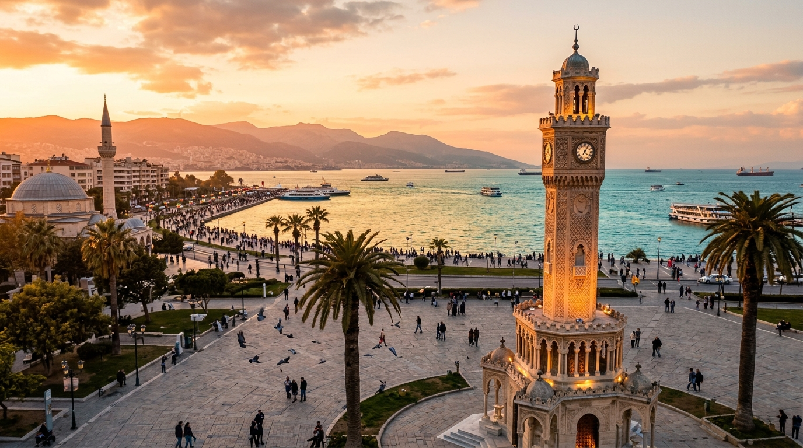
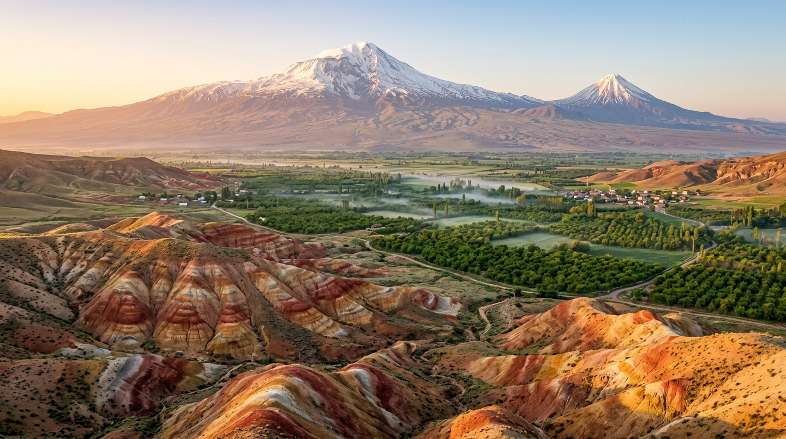
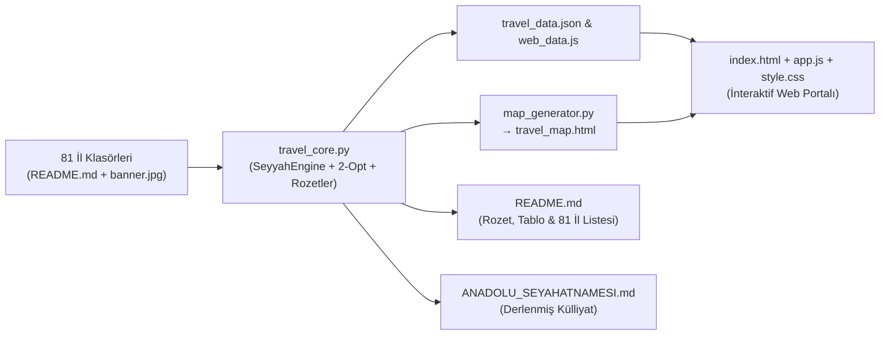

<p align="center">
    
</p>

<p align="center">
    <!-- Dynamic Badges -->
    <a href="https://resilient-semifreddo-6651ec.netlify.app/" target="_blank"></a>
    
    
    
    
    
    <br><br>
    <strong>🕌 "Yeryüzünde gezip dolaşın ve tefekkür edin..." (Ankebût, 20)</strong>
</p>

---

<div align="center">
  <h3>🚶 SEFER DER VATAN: HAKİKATE GİDEN YOL</h3>
  <p><em>"Biz yolların bitmediği, keşfin son bulmadığı bir alemde Hakikati ve Güzelliği arayan yolcularız. Her konak yeni bir hikmet, her şehir içsel bir hicrettir. Bu seyir defteri, modern bir derviş edasıyla yollara düşmüş bir seyyahın zikir, fikir ve şükür günlüğüdür."</em></p>
</div>

---

## ⚡ Hızlı Erişim ve İnteraktif Araçlar

| 🗺️ Web Uygulaması | 🧭 İnteraktif Harita | 📚 Külliyat Kitabı | 💻 CLI Komutları |
| :---: | :---: | :---: | :---: |
| [**Canlı Web Portalı**](https://resilient-semifreddo-6651ec.netlify.app/) | [**Folium Keşif Haritası**](travel_map.html) | [**Seyahatname E-Kitap**](ANADOLU_SEYAHATNAMESI.md) | `python dijital_seyyah.py status` |

### 🧭 İçindekiler
- [📜 Seyahat ve Tefekkür Manifestosu](#-seyahat-ve-tefekkür-manifestosu)
- [🏛️ Evliya Çelebi & İbn Battûta Ekolü](#️-evliya-çelebi--ibn-battûta-ekolü)
- [🎒 Seyahat Usulü ve Menzil Disiplini](#-seyahat-usulü-sefer-der-vatan-ve-menzil-disiplini)
- [🖼️ Anadolu'dan Görsel Kesitler](#️-anadoludan-görsel-kesitler-menzil-galerisi)
- [📊 81 İl Keşif Durumu ve Bölgesel Dağılım](#-81-il-keşif-durumu-ve-bölgesel-dağılım)
- [🏆 Seyyah Rütbeleri ve Başarım Rozetleri](#-seyyah-rütbe-merhaleleri-ve-başarım-rozetleri)
- [✅ 81 İl Detaylı Keşif Listesi](#-81-il-detaylı-keşif-listesi)
- [✨ İnteraktif Web Portalı ve Öne Çıkan Özellikler](#-interaktif-web-portalı-ve-öne-çıkan-özellikler)
- [🏗️ Teknik Mimari ve Veri Akışı](#️-teknik-mimari-ve-veri-akışı)
- [🛠️ Dijital Seyyah Python CLI Aracı](#️-dijital-seyyah-python-cli-aracı)
- [🏜️ Sıradaki Büyük Sefer: Güneydoğu Anadolu](#️-sıradaki-büyük-sefer-güneydoğu-anadolu-mezopotamya)
- [📚 Seyyah Yazılım Serisi (Medium Makaleleri)](#-seyyah-yazılım-serisi-medium-makaleleri)
- [🚀 Kurulum, Test ve Katkıda Bulunma](#-kurulum-test-ve-katkıda-bulunma)

---

# 🕌 DİJİTAL SEYYAH: ANADOLU SEYAHATNAMESİ

<div align="center">

### 🌍 Dünya Düşünürlerinden Seyahat Aforizmaları

> *"Dünya bir kitaptır ve seyahat etmeyenler onun sadece bir sayfasını okur."* <br> — **Aurelius Augustinus**
>
> *"İyi bir gezginin sabit planları ve varmak gibi bir amacı yoktur."* <br> — **Lao Tzu**
>
> *"Gerçek keşif yolculuğu yeni manzaralar bulmak değil, yeni gözlerle bakmaktır."* <br> — **Marcel Proust**
>
> *"Kıyıyı gözden kaybetmeye cesaret edemeyenler, yeni okyanuslar keşfedemezler."* <br> — **Andre Gide**
>
> *"Yollar, sadece ayakların değil, zihnin de özgürleştiği patikalardır."* <br> — **Friedrich Nietzsche**
>
> *"Gezgin, vardığı yerdeki her taşı bir anı, her insanı bir öğretmen gibi selamlar."* <br> — **Hint Özdeyişi**

### 🕌 İslam Kültüründe Seyyahlık, Tefekkür ve Sefer

> *"De ki: Yeryüzünde gezip dolaşın da Allah’ın yaratmaya nasıl başladığını görün..."* <br> — **Kur'an-ı Kerim (Ankebût Suresi, 20. Ayet)**
>
> *"Yolculuğa çıkın ki sıhhat bulasınız ve ganimet elde edesiniz."* <br> — **Hz. Muhammed (s.a.v.)**
>
> *"Dünyada tıpkı bir garip veya bir yolcu (garîbün ev âbiru sebîl) gibi ol."* <br> — **Hz. Muhammed (s.a.v.)**
>
> *"Gurbet ara, seyahat et; çünkü seyahatte beş fayda vardır: Kederden arınmak, geçim kapısı bulmak, ilim tahsil etmek, edep öğrenmek ve ulu zatlarla dostluk kurmak."* <br> — **İmam Şâfiî**
>
> *"Su akar ve hareket ederse tatlanır ve temiz kalır; durursa bozulur ve kokar. İnsan da seyahat ettikçe kemale erer."* <br> — **İmam Şâfiî**
>
> *"Yolculuk; varlığın hakikatini, insanın acziyetini ve nefsin gizli köşelerini ortaya çıkaran en berrak aynadır."* <br> — **Muhyiddin İbnü'l-Arabî**
>
> *"Yola çık ki yol sana görünsün; kendini yola bırak ki menzile eresin."* <br> — **Ferîdüddin Attar (Mantıku't-Tayr)**
>
> *"Her şeyden önce gezgin olunmalı; dünya ancak o zaman gerçekten hissedilir. Yolculuk, önce seni sessizleştirir, sonra da iyi bir hikâye anlatıcısına dönüştürür."* <br> — **Mevlânâ Celâleddîn-i Rûmî & İbn Battûta**

</div>

---

## 📜 Seyahat ve Tefekkür Manifestosu

Bu defter, Anadolu'nun kadim topraklarında adım adım yürüyen bir **dijital seyyahın ibret ve tefekkür günlüğüdür.** Amacımız sadece "nereleri gördüğümüzü" listelemek değil; o coğrafyanın tarihini, manevi mimarlarını, yöresel kültürünü ve ruhumuza fısıldadığı evrensel hikmetleri açık kaynaklı bir dijital külliyat olarak kayıt altına almaktır.

*   🕌 **Tefekkür ve İbret:** Gidilen her tarihi mekânda, kadim mescitte ve antik harabede geçmiş medeniyetlerin izlerini sürüp yeryüzünün geçiciliğini idrak etmek.
*   🚶 **Zahiri ve Batıni Sefer:** Seyahati sadece bedenen yer değiştirmek değil, nefsin perdelerini aralayan manevi bir hicret (*sefer der vatan*) olarak yaşamak.
*   ✍️ **Seyyahlık Geleneği:** Evliya Çelebi ve İbn Battûta gibi öncülerimizin izinden giderek, coğrafyanın ruhunu ve halkın irfanını kelimelerle ve kodla geleceğe aktarmak.
*   🤝 **İrfani ve Açık Kaynak Paylaşım:** Yollardan devşirdiğimiz tüm hikmetleri, optimize edilmiş rotaları, kütüphane notlarını ve gözlemleri seyahat severlerle hesapsızca paylaşmak.

### 🕌 İrfani Seyahat Merhaleleri (Tasavvuf Felsefesi)

1.  **Sefer-i Sûrî (Zahiri Seyahat):** Bedenen yollara düşmek, yeryüzünü adımlamak, farklı kültürleri ve insanları tanımaktır. Seyyahın dış dünyadaki bu yolculuğu, zihnindeki önyargıları yıkar ve dünyayı daha geniş bir açıyla görmesini sağlar.
2.  **Sefer-i Manevî (Batıni Seyahat):** Seyyahın kendi içine yaptığı yolculuktur. Kötü huylardan arınma, nefsin terbiyesi ve kalbin saflaşması hedeflenir. Gurbetteki yalnızlık, bu manevi sefere zemin hazırlar.
3.  **Sefer der Vatan (Halk İçinde Hak ile Olmak):** Seyyahın en büyük mertebesidir. Yolların kalabalığında, şehirlerin gürültüsünde ve insanların arasında yürürken bile kalben yaratıcıyla olan bağı korumak, kesret (kalabalık) içinde vahdeti (birliği) bulmaktır.

---

## 🏛️ Evliya Çelebi & İbn Battûta Ekolü

Klasik İslam coğrafyasının iki büyük seyyahı, bu projenin hem ruhsal hem de metodolojik pusulasıdır:

| Öncü Seyyah | Eseri & İzlediği Yol | Dijital Seyyah'a İlhamı |
| :--- | :--- | :--- |
| **📜 Evliya Çelebi** (1611–1682) | *Seyahatnâme* — 10 ciltlik dev külliyat, 50 yılı aşkın Anadolu ve Osmanlı coğrafyası gözlemleri | Her şehrin mimarisini, yerel ağzını, mutfağını ve manevi şahsiyetlerini ayrıntılı bir **Markdown Seyahatnamesi** olarak kayıt altına almak. |
| **🌍 İbn Battûta** (1304–1369) | *Rihle* — 29 yıl boyunca 120.000 km'yi aşan, üç kıtayı kapsayan ilim ve irfan yolculuğu | Gidilen her beldede ilim halkalarına ve kütüphanelere uğramak; yol arkadaşlığı ve konaklama kültürünü modern kervansaraylarla yaşatmak. |
| **💻 Dijital Seyyah** (2026) | *Anadolu Seyahatnamesi* — 81 İl, 7 Bölge, Python CLI, 2-Opt Rota Motoru & İnteraktif Web Portalı | Geleneksel seyahatname ruhunu açık kaynak yazılım, coğrafi veri bilimi ve interaktif haritalama ile birleştirerek yeni nesle aktarmak. |

---

## 🎒 Seyahat Usulü: "Sefer Der Vatan" ve Menzil Disiplini

Seyahatlerimiz, sırt çantalı bir irfan arayışı ve sürdürülebilir yarı-göçebe üretim disiplini üzerine kurulmuştur:

*   ⛺ **Modern Kervansaraylar (GSB Seyahatsever):** Gidilen her ilde seyyahların barınması için sunulan KYK yurtları adeta modern birer *kervansaray* gibi kullanılır. Konaklama maliyetinin sıfırlanması sürdürülebilir ve uzun soluklu keşif sunar.
*   🐎 **Menzil Stratejisi (5 Gün Kuralı):** Her şehirde ortalama **5 gün** kalınır. Şehri alelacele tüketmek için değil, durağanlaşarak o menzili sindirmek, insanıyla hemhâl olmak ve tefekkür etmek için ideal süredir.
*   📚 **Yolda İlim Tahsili:** Her şehrin İl Halk Kütüphanesi, seyyahın geçici ofisi ve ilim durağıdır. Yazılım geliştirme, okuma ve araştırma mesaisi bu sessiz limanlarda yürütülür; kalan vakitlerde ise coğrafyanın sırları adımlanır.
*   🧭 **2-Opt Rota Optimizasyonu:** Komşu iller arasında en kısa karayolu mesafesi hesaplanarak hem bütçe hem zaman korunur, hem de karbon ayak izi en aza indirilir.

---

## 🖼️ Anadolu'dan Görsel Kesitler (Menzil Galerisi)

81 ilin tamamı (`81 / 81`) 2'şer yüksek çözünürlüklü görsele (**162 fotoğraf**: `banner.jpg` + `gallery.jpg`) ve zenginleştirilmiş seyahatname içeriğine sahiptir. Anadolu'nun farklı coğrafyalarından seçilmiş kareler:

<table>
  <tr>
    <td align="center" width="33%">
      <br>
      <sub><strong>🏔️ Ağrı</strong> — İshak Paşa Sarayı & Ağrı Dağı</sub>
    </td>
    <td align="center" width="33%">
      <br>
      <sub><strong>🌊 İzmir</strong> — Saat Kulesi & Ege Kordon</sub>
    </td>
    <td align="center" width="33%">
      <br>
      <sub><strong>🏔️ Bitlis</strong> — Ahlat Kümbetleri & Nemrut Gölü</sub>
    </td>
  </tr>
  <tr>
    <td align="center" width="33%">
      <br>
      <sub><strong>🌅 Iğdır</strong> — Gökkuşağı Tepeleri & Ağrı Dağı</sub>
    </td>
    <td align="center" width="33%">
      <br>
      <sub><strong>🌲 Ordu</strong> — Boztepe & Karadeniz Sahili</sub>
    </td>
    <td align="center" width="33%">
      <br>
      <sub><strong>🌾 Nevşehir</strong> — Kapadokya Peribacaları</sub>
    </td>
  </tr>
</table>

---

## 📊 81 İl Keşif Durumu ve Bölgesel Dağılım

**🏆 Genel İlerleme:** %48.1 (39 / 81 İl)
🟩🟩🟩🟩🟩🟩🟩🟩🟩🟩⬜⬜⬜⬜⬜⬜⬜⬜⬜⬜

```
Toplam Ziyaret Edilen İl:  39 / 81
Tahmini Karayolu İzi:      10,898 km
Kütüphane Ofis Mesaisi:    39 İl Halk Kütüphanesi (780 saat)
Coğrafi Bölge Kapsamı:     6 / 7 (%85.7)
```

### 🏰 7 Bölge İlerleme Tablosu

| Bölge | İlerleme | Ziyaret Edilen İller | Durum |
| :--- | :---: | :---: | :---: |
| **🏰 Marmara** | `%27.3` (3/11) | Bursa, İstanbul, Kocaeli | 🟩⬜⬜⬜⬜ |
| **🌊 Ege** | `%37.5` (3/8) | Denizli, İzmir, Muğla | 🟩🟩⬜⬜⬜ |
| **☀️ Akdeniz** | `%62.5` (5/8) | Adana, Antalya, Hatay, Isparta, Mersin | 🟩🟩🟩⬜⬜ |
| **🌾 İç Anadolu** | `%61.5` (8/13) | Aksaray, Ankara, Eskişehir, Kırıkkale, Konya, Nevşehir, Sivas, Yozgat | 🟩🟩🟩⬜⬜ |
| **🌲 Karadeniz** | `%61.1` (11/18) | Amasya, Artvin, Bayburt, Çorum, Giresun, Gümüşhane, Ordu, Rize, Samsun, Sinop, Trabzon | 🟩🟩🟩⬜⬜ |
| **🏔️ Doğu Anadolu** | `%64.3` (9/14) | Ağrı, Bitlis, Elazığ, Erzincan, Erzurum, Iğdır, Kars, Malatya, Tunceli | 🟩🟩🟩⬜⬜ |
| **🏜️ Güneydoğu Anadolu** | `%0.0` (0/9) | *Sıradaki Keşif Seferi* | ⬜⬜⬜⬜⬜ |

---

## 🏆 Seyyah Rütbe Merhaleleri ve Başarım Rozetleri

Keşif ilerledikçe `travel_core.py` motoru seyyahın rütbesini ve açılan başarım rozetlerini otomatik olarak hesaplar ve hem web arayüzüne hem de CLI paneline yansıtır:

| Mertebe | Eşik | Rütbe Unvanı | Açıklama |
| :---: | :---: | :--- | :--- |
| 🌱 | 0+ İl | **Yolun Başında (Sâlik)** | İlk menzillere niyet eden, haritayı açan yolcu. |
| 🧭 | 10+ İl | **Menzil Yolcusu** | Anadolu yollarında toz yutan, kütüphane disiplini edinen gezgin. |
| 🗺️ | 25+ İl | **Anadolu Kâşifi** *(Mevcut: 39 İl)* | Bölgeleri aşan, kadim şehirlerin ruhunu kayda geçiren seyyah. |
| 📜 | 41+ İl | **Evliya Çelebi İzinde** *(+2 İl kaldı)* | Anadolu'nun yarısını aşmış, seyahatnamesini olgunlaştırmış üstat. |
| 🕌 | 61+ İl | **İbn Battûta Mertebesi** | Yedi iklimin irfanını harmanlayan, yolların bilgesi. |
| 👑 | 81 İl | **Hâfız-ı Anadolu** | 81 ilin tamamını adımlamış, *Sefer der Vatan*'ı tamamlamış seyyah. |

> **🎖️ Başarım Rozetleri:** `👣 İlk Adım` • `🛣️ 10.000 km Menzil` • `📚 Kütüphane Müdavimi (30+ İl)` • `🌲 Karadeniz Kâşifi (10+ İl)` • `🏔️ Doğu Zirveleri (8+ İl)` • `⭐ Yarı Yol Eşiğinde (41+ İl)` • `🌍 Yedi İklim Fatihi (7/7 Bölge)` • `👑 Hâfız-ı Anadolu (81/81 İl)`

---

## ✅ 81 İl Detaylı Keşif Listesi

**🏰 Marmara Bölgesi (3/11)**
- ❌ Balıkesir
- ❌ Bilecik
- ✅ [**Bursa**](01_Marmara/Bursa/README.md)
- ❌ Çanakkale
- ❌ Edirne
- ✅ [**İstanbul**](01_Marmara/Istanbul/README.md)
- ❌ Kırklareli
- ✅ [**Kocaeli**](01_Marmara/Kocaeli/README.md)
- ❌ Sakarya
- ❌ Tekirdağ
- ❌ Yalova

**🌊 Ege Bölgesi (3/8)**
- ❌ Afyonkarahisar
- ❌ Aydın
- ✅ [**Denizli**](02_Ege/Denizli/README.md)
- ✅ [**İzmir**](02_Ege/Izmir/README.md)
- ❌ Kütahya
- ❌ Manisa
- ✅ [**Muğla**](02_Ege/Mugla/README.md)
- ❌ Uşak

**☀️ Akdeniz Bölgesi (5/8)**
- ✅ [**Adana**](03_Akdeniz/Adana/README.md)
- ✅ [**Antalya**](03_Akdeniz/Antalya/README.md)
- ❌ Burdur
- ✅ [**Hatay**](03_Akdeniz/Hatay/README.md)
- ✅ [**Isparta**](03_Akdeniz/Isparta/README.md)
- ❌ Kahramanmaraş
- ✅ [**Mersin**](03_Akdeniz/Mersin/README.md)
- ❌ Osmaniye

**🌾 İç Anadolu Bölgesi (8/13)**
- ✅ [**Aksaray**](04_IcAnadolu/Aksaray/README.md)
- ✅ [**Ankara**](04_IcAnadolu/Ankara/README.md)
- ❌ Çankırı
- ✅ [**Eskişehir**](04_IcAnadolu/Eskisehir/README.md)
- ❌ Karaman
- ❌ Kayseri
- ✅ [**Kırıkkale**](04_IcAnadolu/Kirikkale/README.md)
- ❌ Kırşehir
- ✅ [**Konya**](04_IcAnadolu/Konya/README.md)
- ✅ [**Nevşehir**](04_IcAnadolu/Nevsehir/README.md)
- ❌ Niğde
- ✅ [**Sivas**](04_IcAnadolu/Sivas/README.md)
- ✅ [**Yozgat**](04_IcAnadolu/Yozgat/README.md)

**🌲 Karadeniz Bölgesi (11/18)**
- ✅ [**Amasya**](05_Karadeniz/Amasya/README.md)
- ✅ [**Artvin**](05_Karadeniz/Artvin/README.md)
- ❌ Bartın
- ✅ [**Bayburt**](05_Karadeniz/Bayburt/README.md)
- ❌ Bolu
- ✅ [**Çorum**](05_Karadeniz/Corum/README.md)
- ❌ Düzce
- ✅ [**Giresun**](05_Karadeniz/Giresun/README.md)
- ✅ [**Gümüşhane**](05_Karadeniz/Gumushane/README.md)
- ❌ Karabük
- ❌ Kastamonu
- ✅ [**Ordu**](05_Karadeniz/Ordu/README.md)
- ✅ [**Rize**](05_Karadeniz/Rize/README.md)
- ✅ [**Samsun**](05_Karadeniz/Samsun/README.md)
- ✅ [**Sinop**](05_Karadeniz/Sinop/README.md)
- ❌ Tokat
- ✅ [**Trabzon**](05_Karadeniz/Trabzon/README.md)
- ❌ Zonguldak

**🏔️ Doğu Anadolu Bölgesi (9/14)**
- ✅ [**Ağrı**](06_DoguAnadolu/Agri/README.md)
- ❌ Ardahan
- ❌ Bingöl
- ✅ [**Bitlis**](06_DoguAnadolu/Bitlis/README.md)
- ✅ [**Elazığ**](06_DoguAnadolu/Elazig/README.md)
- ✅ [**Erzincan**](06_DoguAnadolu/Erzincan/README.md)
- ✅ [**Erzurum**](06_DoguAnadolu/Erzurum/README.md)
- ❌ Hakkari
- ✅ [**Iğdır**](06_DoguAnadolu/Igdir/README.md)
- ✅ [**Kars**](06_DoguAnadolu/Kars/README.md)
- ✅ [**Malatya**](06_DoguAnadolu/Malatya/README.md)
- ❌ Muş
- ✅ [**Tunceli**](06_DoguAnadolu/Tunceli/README.md)
- ❌ Van

**🏜️ Güneydoğu Anadolu Bölgesi (0/9)**
- ❌ Adıyaman
- ❌ Batman
- ❌ Diyarbakır
- ❌ Gaziantep
- ❌ Kilis
- ❌ Mardin
- ❌ Siirt
- ❌ Şanlıurfa
- ❌ Şırnak

---

## ✨ İnteraktif Web Portalı ve Öne Çıkan Özellikler

`index.html` üzerinde çalışan sıfır-bağımlılıklı **Single Page Application (SPA)** şu yeteneklerle donatılmıştır:

*   🗺️ **Çoklu Katmanlı İnteraktif Harita (`travel_map.html`):** Gece (Dark Matter), Gündüz (Positron) ve OpenStreetMap temaları; açılıp kapanabilir ziyaret/bekleyen/rota katmanları; daraltılabilir glassmorphism bilgi paneli ve görselli popup kartları.
*   🧭 **2-Opt TSP Rota Planlayıcı & SVG Harita:** Seçilen başlangıç şehrinden ve isteğe bağlı bölge filtresinden başlayarak en kısa rotayı hesaplar, 2-Opt algoritmasıyla çapraz yolları düzeltir, tasarruf edilen kilometreyi ve 5 Gün Kuralı sefer süresini anlık SVG Türkiye haritası üzerinde çizer.
*   📖 **Zengin Şehir Seyir Defteri:** Her ilin tarihsel arka planı, manevi tefekkür notu, edebi alıntıları, yöresel lezzetleri, kütüphane ofisi incelemesi ve tıklanabilir **En Yakın 4 Komşu Menzil** kartı.
*   🎧 **Web Audio API Tefekkür Sesleri:** Harici ses dosyası gerektirmeden tarayıcıda gerçek zamanlı sentezlenen 3 farklı huzur modu (*Ney & Bozkır*, *Kütüphane Yağmuru*, *Kervansaray Sükuneti*).
*   📱 **Tam Mobil Uyum & Klavye Kısayolları:** Mobil cihazlar için açılır-kapanır 81 il çekmecesi, `/` ile anında Türkçe-duyarsız arama (`istanbul` → `İstanbul`, `igdir` → `Iğdır`), `Esc` ile modal kapatma, rastgele menzil keşfi (`🎲 Keşfet`) ve tek tıkla Markdown e-kitap indirme.

---

## 🏗️ Teknik Mimari ve Veri Akışı

Proje **tek doğruluk kaynağı (Single Source of Truth)** ilkesiyle çalışır. Herhangi bir ilin klasörüne `README.md` (ve `banner.jpg`) eklendiğinde `python dijital_seyyah.py build` komutu tüm çıktıları tek seferde senkronize eder:



```text
travel.log/
├── 01_Marmara/ ... 07_GuneydoguAnadolu/  # 7 bölge, 81 il klasörü (README.md + banner.jpg)
├── assets/                               # Ana kapak görselleri (banner.jpg, banner.svg)
├── travel_core.py                        # 81 il veritabanı, Haversine, 2-Opt TSP, rütbe & senkronizasyon
├── map_generator.py                      # Folium/Leaflet çoklu katmanlı harita üreteci
├── dijital_seyyah.py                     # Zengin terminal CLI aracı
├── index.html / style.css / app.js       # İnteraktif Glassmorphism Web SPA
├── travel_data.json / web_data.js        # Otomatik derlenen veri modülleri
├── travel_map.html                       # Otomatik derlenen interaktif harita
├── ANADOLU_SEYAHATNAMESI.md              # Otomatik derlenen tek dosya Markdown e-kitap
├── medium_yazilari/                      # 7 bölümlük Seyyah Yazılım Serisi makaleleri
├── tests/test_seyyah.py                  # 17 kapsamlı Pytest doğrulama testi
└── .github/workflows/                    # CI (test + build) ve GitHub Pages otomatik dağıtım
```

---

## 🛠️ Dijital Seyyah Python CLI Aracı

Seyahatnamenizi terminalden yönetmek, haritayı ve web verisini derlemek, rota hesaplamak ve arama yapmak için dahili CLI aracı:

```bash
# 1. Genel seyahat durumunu, rütbeyi ve istatistikleri görüntüle
python dijital_seyyah.py status

# 2. İnteraktif haritayı, web veritabanını, README ve külliyatı yeniden derle
python dijital_seyyah.py build

# 3. 2-Opt TSP rota algoritmasıyla en verimli keşif rotasını planla
python dijital_seyyah.py plan-route --start Ankara --stops 8 --region 07_GuneydoguAnadolu

# 4. Belirli bir ilin profilini ve en yakın komşu menzillerini incele
python dijital_seyyah.py info 42

# 5. İl, miras, lezzet veya kütüphane ara (Türkçe karakter duyarsız)
python dijital_seyyah.py search Mevlana

# 6. Seyyah rütbesi ve başarım rozetlerini görüntüle
python dijital_seyyah.py badges

# 7. Tüm seyahat notlarını tek bir e-kitaba (Markdown) derle
python dijital_seyyah.py export-book

# 8. Test paketini çalıştır
pytest -v
```

---

## 🏜️ Sıradaki Büyük Sefer: Güneydoğu Anadolu (Mezopotamya)

Anadolu'nun 6 bölgesini adımlayan seyyah için **7/7 Bölge (*Yedi İklim Fatihi*)** rozetine ve **Evliya Çelebi İzinde (41+ İl)** mertebesine açılan sıradaki büyük hedef Mezopotamya hattıdır:

> **Önerilen 2-Opt Sefer Hattı:** `Gaziantep` ➔ `Kilis` ➔ `Adıyaman (Nemrut)` ➔ `Şanlıurfa (Göbeklitepe & Balıklıgöl)` ➔ `Diyarbakır (Surlar & On Gözlü Köprü)` ➔ `Mardin (Taş Konaklar & Dara)` ➔ `Batman (Hasankeyf)` ➔ `Siirt (Tillo)` ➔ `Şırnak (Cudi & Cizre)`

---

## 📚 Seyyah Yazılım Serisi (Medium Makaleleri)

Anadolu'da yol alırken kaleme alınmış derinlemesine rehberler ve yazılım seyahatnamesi makaleleri:

1. [**01. Sefer Der Vatan Manifestosu**](medium_yazilari/01_manifesto_v2.md) — *Yollara düşüş felsefesi ve içsel hicret.*
2. [**02. GSB Seyahatsever Rehberi**](medium_yazilari/02_seyahatsever_rehberi_v2.md) — *Modern kervansaraylarda sıfır maliyetle barınma stratejisi.*
3. [**03. Kütüphane Ofisleri**](medium_yazilari/03_kutuphane_ofisleri_v2.md) — *81 il halk kütüphanesinde yazılımcı disiplini ve verimlilik.*
4. [**04. 5 Gün Kuralı**](medium_yazilari/04_bes_gun_kurali_v2.md) — *Şehirleri tüketmeden sindirerek yaşama sanatı.*
5. [**05. Kod ve Yol**](medium_yazilari/05_kod_ve_yol_v2.md) — *Yarı göçebe bir yazılımcının sırt çantasındaki tech-stack.*
6. [**06. Yedi Bölge Yedi Ders**](medium_yazilari/06_yedi_bolge_yedi_ders_v2.md) — *Anadolu coğrafyasından devşirilen evrensel hikmetler.*
7. [**07. Rota Optimizasyonu**](medium_yazilari/07_rota_optimizasyonu_v2.md) — *En az karbon ayak iziyle en verimli menzil planlaması.*

---

## 🚀 Kurulum, Test ve Katkıda Bulunma

Projeyi yerel bilgisayarınızda çalıştırmak ve geliştirmek için:

```bash
# Depoyu klonlayın
git clone https://github.com/bahattinyunus/dijitalseyyah.git
cd dijitalseyyah

# Python bağımlılıklarını kurun
pip install -r requirements.txt

# Tüm çıktıları derleyin ve testleri doğrulayın
python dijital_seyyah.py build
pytest -v

# Web uygulamasını yerelde önizleyin
python -m http.server 8000
# Ardından tarayıcıda http://localhost:8000 adresini açın
```

### 🤝 Katkıda Bulunma (Contributing)
Bu proje açık kaynaklı bir kültür ve yazılım mirasıdır. Gezdiğiniz menzilleri eklemek, kütüphane notlarını zenginleştirmek, yeni rota algoritmaları önermek veya arayüzü geliştirmek isterseniz lütfen [`CONTRIBUTING.md`](CONTRIBUTING.md) rehberine göz atın. Proje [MIT Lisansı](LICENSE) ile lisanslanmıştır.

---

<p align="center">
    <sub>Made with 💻, 🎒 & ☕ by <strong>bahattinyunus</strong> © 2026 • Anadolu Seyahatnamesi</sub>
</p>
