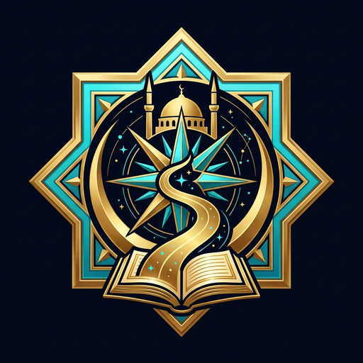
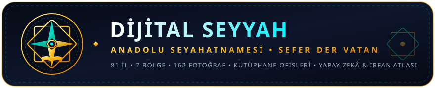
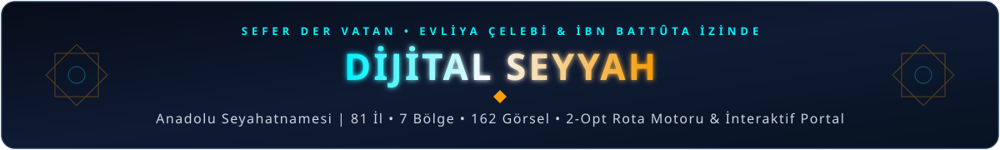
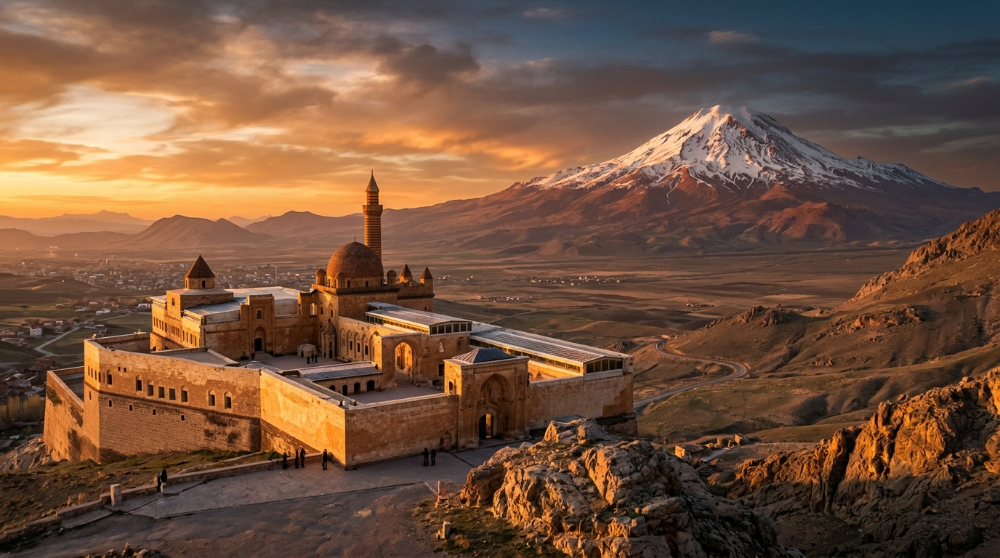
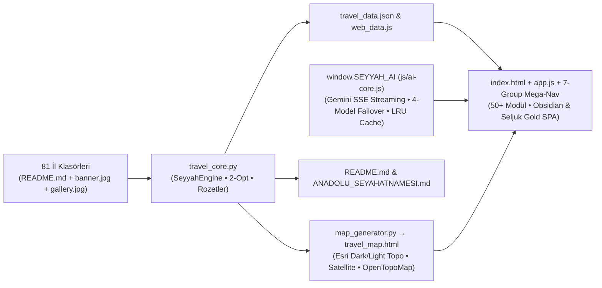

<div align="center">


<br/><br/>



<br/><br/>



<br/><br/>



<br/>

<p align="center">
  <a href="https://bahattinyunus.github.io/dijitalseyyah/" target="_blank"></a>
  
  
  
  
  
  
  
  <a href="LICENSE"></a>
</p>

<p align="center">
  <a href="#-81-il-keşif-durumu-ve-bölgesel-dağılım"><b>📊 İstatistikler</b></a> &nbsp;•&nbsp;
  <a href="#️-anadoludan-görsel-kesitler-7-bölge-menzil-galerisi"><b>🖼️ 7 Bölge Galerisi</b></a> &nbsp;•&nbsp;
  <a href="#-seyyah-rütbe-merhaleleri-ve-başarım-rozetleri"><b>🏆 Rütbeler & Rozetler</b></a> &nbsp;•&nbsp;
  <a href="#-interaktif-web-portalı-ve-öne-çıkan-özellikler"><b>✨ Web Portalı</b></a> &nbsp;•&nbsp;
  <a href="#️-teknik-mimari-ve-veri-akışı"><b>🏗️ Mimari</b></a> &nbsp;•&nbsp;
  <a href="#️-dijital-seyyah-python-cli-aracı"><b>🛠️ CLI</b></a> &nbsp;•&nbsp;
  <a href="#-seyyah-yazılım-serisi-medium-makaleleri"><b>📚 Makaleler</b></a>
</p>

<br/>

> **🕌 *"De ki: Yeryüzünde gezip dolaşın da Allah'ın yaratmaya nasıl başladığını görün..."*** — *Kur'an-ı Kerim (Ankebût, 20)*

</div>

---

### ⚡ Hızlı Erişim & Canlı Gösterge Paneli

<table>
  <tr>
    <td align="center" width="25%">
      <h3>🎯 39 / 81 İl</h3>
      <sub><strong>%48.1 Keşif Oranı</strong><br/>Anadolu Kâşifi Rütbesi</sub>
    </td>
    <td align="center" width="25%">
      <h3>🛣️ 10,898 km</h3>
      <sub><strong>Karayolu Menzil İzi</strong><br/>6 / 7 Coğrafi Bölge</sub>
    </td>
    <td align="center" width="25%">
      <h3>📸 162 Fotoğraf</h3>
      <sub><strong>81 İl × 2 Görsel (%100)</strong><br/>Banner + Lightbox Galeri</sub>
    </td>
    <td align="center" width="25%">
      <h3>📖 780 Saat</h3>
      <sub><strong>39 İl Halk Kütüphanesi</strong><br/>5 Gün Kuralı İlim Mesaisi</sub>
    </td>
  </tr>
</table>

| 🌐 Canlı Web Uygulaması (GitHub Pages) | 🗺️ İnteraktif Folium Haritası | 📚 Derlenmiş E-Kitap Külliyatı | 💻 Python CLI Motoru |
| :---: | :---: | :---: | :---: |
| [**bahattinyunus.github.io/dijitalseyyah ➔**](https://bahattinyunus.github.io/dijitalseyyah/) | [**travel_map.html ➔**](travel_map.html) | [**ANADOLU_SEYAHATNAMESI.md ➔**](ANADOLU_SEYAHATNAMESI.md) | `python dijital_seyyah.py status` |

---

## 📜 Seyahat ve Tefekkür Manifestosu

> *"Biz yolların bitmediği, keşfin son bulmadığı bir alemde Hakikati ve Güzelliği arayan yolcularız. Her konak yeni bir hikmet, her şehir içsel bir hicrettir. Bu seyir defteri, modern bir derviş edasıyla yollara düşmüş bir seyyahın zikir, fikir, kod ve şükür günlüğüdür."*

<table>
  <tr>
    <td width="50%" valign="top">
      <h4>🕌 İrfani Seyahat Merhaleleri</h4>
      <ol>
        <li><b>Sefer-i Sûrî (Zahiri Sefer):</b> Yeryüzünü adımlamak, önyargıları kırıp farklı kültürleri ve kadim mimariyi bizzat görmek.</li>
        <li><b>Sefer-i Manevî (Batıni Sefer):</b> Gurbetteki sükûnet içinde nefsin terbiyesi, kalbin saflaşması ve içsel muhasebe.</li>
        <li><b>Sefer der Vatan (Halk İçinde Hak ile):</b> Şehirlerin kesreti (kalabalığı) içinde vahdeti (birliği) ve içsel huzuru korumak.</li>
      </ol>
    </td>
    <td width="50%" valign="top">
      <h4>🎒 Menzil Disiplini & Açık Kaynak Usulü</h4>
      <ul>
        <li>⛺ <b>Modern Kervansaraylar:</b> GSB Seyahatsever yurtlarıyla sıfır konaklama maliyeti ve sürdürülebilir keşif.</li>
        <li>🐎 <b>5 Gün Kuralı:</b> Her şehirde ortalama 5 gün kalarak şehri tüketmeden sindirme ve tefekkür etme.</li>
        <li>📚 <b>Yolda İlim Tahsili:</b> Her şehrin İl Halk Kütüphanesinde yazılım, okuma ve araştırma mesaisi.</li>
        <li>🧭 <b>2-Opt Rota Optimizasyonu:</b> Minimum kilometre ve karbon ayak iziyle komşu iller arası en verimli sefer hattı.</li>
      </ul>
    </td>
  </tr>
</table>

<details>
<summary><b>📖 Evliya Çelebi, İbn Battûta & Dünya Düşünürlerinden Seyahat Hikmetleri (Açmak için tıklayın)</b></summary>
<br/>

> *"Yolculuğa çıkın ki sıhhat bulasınız ve ganimet elde edesiniz."* — **Hz. Muhammed (s.a.v.)**
>
> *"Dünyada tıpkı bir garip veya bir yolcu (garîbün ev âbiru sebîl) gibi ol."* — **Hz. Muhammed (s.a.v.)**
>
> *"Gurbet ara, seyahat et; çünkü seyahatte beş fayda vardır: Kederden arınmak, geçim kapısı bulmak, ilim tahsil etmek, edep öğrenmek ve ulu zatlarla dostluk kurmak."* — **İmam Şâfiî**
>
> *"Su akar ve hareket ederse tatlanır ve temiz kalır; durursa bozulur ve kokar. İnsan da seyahat ettikçe kemale erer."* — **İmam Şâfiî**
>
> *"Yolculuk; varlığın hakikatini, insanın acziyetini ve nefsin gizli köşelerini ortaya çıkaran en berrak aynadır."* — **Muhyiddin İbnü'l-Arabî**
>
> *"Yola çık ki yol sana görünsün; kendini yola bırak ki menzile eresin."* — **Ferîdüddin Attar (Mantıku't-Tayr)**
>
> *"Yolculuk, önce seni sessizleştirir, sonra da iyi bir hikâye anlatıcısına dönüştürür."* — **İbn Battûta**
>
> *"Dünya bir kitaptır ve seyahat etmeyenler onun sadece bir sayfasını okur."* — **Aurelius Augustinus**
>
> *"Gerçek keşif yolculuğu yeni manzaralar bulmak değil, yeni gözlerle bakmaktır."* — **Marcel Proust**

</details>

---

## 🏛️ Evliya Çelebi & İbn Battûta Ekolü

| Öncü Seyyah | Eseri & İzlediği Yol | Dijital Seyyah'a İlhamı |
| :--- | :--- | :--- |
| **📜 Evliya Çelebi** *(1611–1682)* | *Seyahatnâme* — 10 ciltlik dev külliyat, 50 yılı aşkın Anadolu ve Osmanlı gözlemleri | Her şehrin tarihini, yerel kültürünü, mutfağını ve manevi şahsiyetlerini kalıcı **Markdown Seyahatnamesi** olarak kayıt altına almak. |
| **🌍 İbn Battûta** *(1304–1369)* | *Rihle* — 29 yıl boyunca 120.000 km'yi aşan, üç kıtayı kapsayan ilim ve irfan yolculuğu | Gidilen her beldede ilim halkalarına ve kütüphanelere uğramak; kervansaray ve yol kardeşliği kültürünü yaşatmak. |
| **💻 Dijital Seyyah** *(2026)* | *Anadolu Seyahatnamesi* — 81 İl, 162 Görsel, Python CLI, 2-Opt Motoru & Web Portalı | Klasik seyahatname ruhunu açık kaynak yazılım, coğrafi veri bilimi ve interaktif görselleştirme ile geleceğe taşımak. |

---

## 🖼️ Anadolu'dan Görsel Kesitler (7 Bölge Menzil Galerisi)

81 ilin tamamı (`81 / 81`) 2'şer yüksek çözünürlüklü görsele (**162 fotoğraf**: `banner.jpg` + `gallery.jpg`) ve zenginleştirilmiş seyahatname dosyasına sahiptir. Türkiye'nin 7 coğrafi bölgesinden seçilmiş kareler:

<table>
  <tr>
    <td align="center" width="33%">
      <a href="01_Marmara/Istanbul/README.md"></a><br/>
      <sub><strong>🏰 İstanbul</strong> • Marmara'nın İki Kıtalı Payitahtı</sub>
    </td>
    <td align="center" width="33%">
      <a href="02_Ege/Izmir/README.md"></a><br/>
      <sub><strong>🌊 İzmir</strong> • Saat Kulesi & Ege Kordon</sub>
    </td>
    <td align="center" width="33%">
      <a href="03_Akdeniz/Antalya/README.md"></a><br/>
      <sub><strong>☀️ Antalya</strong> • Toroslar & Akdeniz Limanı</sub>
    </td>
  </tr>
  <tr>
    <td align="center" width="33%">
      <a href="04_IcAnadolu/Nevsehir/README.md"></a><br/>
      <sub><strong>🌾 Nevşehir</strong> • Kapadokya Vadileri</sub>
    </td>
    <td align="center" width="33%">
      <a href="05_Karadeniz/Ordu/README.md"></a><br/>
      <sub><strong>🌲 Ordu</strong> • Boztepe & Karadeniz Sahili</sub>
    </td>
    <td align="center" width="33%">
      <a href="06_DoguAnadolu/Agri/README.md"></a><br/>
      <sub><strong>🏔️ Ağrı</strong> • İshak Paşa Sarayı & Ağrı Dağı</sub>
    </td>
  </tr>
  <tr>
    <td align="center" width="33%">
      <a href="06_DoguAnadolu/Bitlis/README.md"></a><br/>
      <sub><strong>🏔️ Bitlis</strong> • Ahlat Kümbetleri & Nemrut Gölü</sub>
    </td>
    <td align="center" width="33%">
      <a href="07_GuneydoguAnadolu/Mardin/README.md"></a><br/>
      <sub><strong>🏜️ Mardin</strong> • Mezopotamya'nın Taş Masalı</sub>
    </td>
    <td align="center" width="33%">
      <a href="07_GuneydoguAnadolu/Sanliurfa/README.md"></a><br/>
      <sub><strong>🏜️ Şanlıurfa</strong> • Göbeklitepe & Balıklıgöl</sub>
    </td>
  </tr>
</table>

---

## 📊 81 İl Keşif Durumu ve Bölgesel Dağılım

**🏆 Genel İlerleme:** %48.1 (39 / 81 İl)
🟩🟩🟩🟩🟩🟩🟩🟩🟩🟩⬜⬜⬜⬜⬜⬜⬜⬜⬜⬜

```
Toplam Ziyaret Edilen İl:  39 / 81
Tahmini Karayolu İzi:      10,898 km
Kütüphane Ofis Mesaisi:    39 İl Halk Kütüphanesi (780 saat)
Coğrafi Bölge Kapsamı:     6 / 7 (%85.7)
```

### 🏰 7 Bölge İlerleme Tablosu

| Bölge | İlerleme | Ziyaret Edilen İller | Durum |
| :--- | :---: | :---: | :---: |
| **🏰 Marmara** | `%27.3` (3/11) | Bursa, İstanbul, Kocaeli | 🟩⬜⬜⬜⬜ |
| **🌊 Ege** | `%37.5` (3/8) | Denizli, İzmir, Muğla | 🟩🟩⬜⬜⬜ |
| **☀️ Akdeniz** | `%62.5` (5/8) | Adana, Antalya, Hatay, Isparta, Mersin | 🟩🟩🟩⬜⬜ |
| **🌾 İç Anadolu** | `%61.5` (8/13) | Aksaray, Ankara, Eskişehir, Kırıkkale, Konya, Nevşehir, Sivas, Yozgat | 🟩🟩🟩⬜⬜ |
| **🌲 Karadeniz** | `%61.1` (11/18) | Amasya, Artvin, Bayburt, Çorum, Giresun, Gümüşhane, Ordu, Rize, Samsun, Sinop, Trabzon | 🟩🟩🟩⬜⬜ |
| **🏔️ Doğu Anadolu** | `%64.3` (9/14) | Ağrı, Bitlis, Elazığ, Erzincan, Erzurum, Iğdır, Kars, Malatya, Tunceli | 🟩🟩🟩⬜⬜ |
| **🏜️ Güneydoğu Anadolu** | `%0.0` (0/9) | *Sıradaki Keşif Seferi* | ⬜⬜⬜⬜⬜ |

> [!TIP]
> **🧭 Aktif Sefer Koridoru (Batı Karadeniz ➔ Trakya Hattı — 10 Durak):**
> `Ankara` ➔ `Çankırı` ➔ `Kastamonu` ➔ `Karabük` ➔ `Bartın` ➔ `Zonguldak` ➔ `Düzce` ➔ `Sakarya` ➔ `İstanbul` ➔ `Edirne`
>
> **🏜️ Sıradaki Büyük Sefer — Mezopotamya Hattı:** Sadece **2 il** sonra **📜 Evliya Çelebi İzinde (41+ İl)** mertebesine, Güneydoğu Anadolu seferi ile de **🌍 Yedi İklim Fatihi (7/7 Bölge)** rozetine ulaşılacak!
> **Önerilen 2-Opt Rota:** `Gaziantep` ➔ `Kilis` ➔ `Adıyaman` ➔ `Şanlıurfa` ➔ `Diyarbakır` ➔ `Mardin` ➔ `Batman` ➔ `Siirt` ➔ `Şırnak`

---

## 🏆 Seyyah Rütbe Merhaleleri ve Başarım Rozetleri

| Mertebe | Eşik | Rütbe Unvanı | Durum |
| :---: | :---: | :--- | :---: |
| 🌱 | 0+ İl | **Yolun Başında (Sâlik)** | ✅ Aşıldı |
| 🧭 | 10+ İl | **Menzil Yolcusu** | ✅ Aşıldı |
| 🗺️ | 25+ İl | **Anadolu Kâşifi** *(Mevcut: 39 İl)* | 🔥 **Aktif Rütbe** |
| 📜 | 41+ İl | **Evliya Çelebi İzinde** | ⏳ +2 İl Kaldı |
| 🕌 | 61+ İl | **İbn Battûta Mertebesi** | 🔒 Kilitli |
| 👑 | 81 İl | **Hâfız-ı Anadolu** | 🔒 Kilitli |

**🎖️ 8 Dinamik Başarım Rozeti:**
`✅ 👣 İlk Adım` • `✅ 🛣️ 10.000 km Menzil` • `✅ 📚 Kütüphane Müdavimi (30+ İl)` • `✅ 🌲 Karadeniz Kâşifi (10+ İl)` • `✅ 🏔️ Doğu Zirveleri (8+ İl)` • `🔒 ⭐ Yarı Yol Eşiğinde (41+ İl)` • `🔒 🌍 Yedi İklim Fatihi (7/7 Bölge)` • `🔒 👑 Hâfız-ı Anadolu (81/81 İl)`

---

## ✅ 81 İl Detaylı Keşif Listesi

**🏰 Marmara Bölgesi (3/11)**
- ❌ Balıkesir
- ❌ Bilecik
- ✅ [**Bursa**](01_Marmara/Bursa/README.md)
- ❌ Çanakkale
- ❌ Edirne
- ✅ [**İstanbul**](01_Marmara/Istanbul/README.md)
- ❌ Kırklareli
- ✅ [**Kocaeli**](01_Marmara/Kocaeli/README.md)
- ❌ Sakarya
- ❌ Tekirdağ
- ❌ Yalova

**🌊 Ege Bölgesi (3/8)**
- ❌ Afyonkarahisar
- ❌ Aydın
- ✅ [**Denizli**](02_Ege/Denizli/README.md)
- ✅ [**İzmir**](02_Ege/Izmir/README.md)
- ❌ Kütahya
- ❌ Manisa
- ✅ [**Muğla**](02_Ege/Mugla/README.md)
- ❌ Uşak

**☀️ Akdeniz Bölgesi (5/8)**
- ✅ [**Adana**](03_Akdeniz/Adana/README.md)
- ✅ [**Antalya**](03_Akdeniz/Antalya/README.md)
- ❌ Burdur
- ✅ [**Hatay**](03_Akdeniz/Hatay/README.md)
- ✅ [**Isparta**](03_Akdeniz/Isparta/README.md)
- ❌ Kahramanmaraş
- ✅ [**Mersin**](03_Akdeniz/Mersin/README.md)
- ❌ Osmaniye

**🌾 İç Anadolu Bölgesi (8/13)**
- ✅ [**Aksaray**](04_IcAnadolu/Aksaray/README.md)
- ✅ [**Ankara**](04_IcAnadolu/Ankara/README.md)
- ❌ Çankırı
- ✅ [**Eskişehir**](04_IcAnadolu/Eskisehir/README.md)
- ❌ Karaman
- ❌ Kayseri
- ✅ [**Kırıkkale**](04_IcAnadolu/Kirikkale/README.md)
- ❌ Kırşehir
- ✅ [**Konya**](04_IcAnadolu/Konya/README.md)
- ✅ [**Nevşehir**](04_IcAnadolu/Nevsehir/README.md)
- ❌ Niğde
- ✅ [**Sivas**](04_IcAnadolu/Sivas/README.md)
- ✅ [**Yozgat**](04_IcAnadolu/Yozgat/README.md)

**🌲 Karadeniz Bölgesi (11/18)**
- ✅ [**Amasya**](05_Karadeniz/Amasya/README.md)
- ✅ [**Artvin**](05_Karadeniz/Artvin/README.md)
- ❌ Bartın
- ✅ [**Bayburt**](05_Karadeniz/Bayburt/README.md)
- ❌ Bolu
- ✅ [**Çorum**](05_Karadeniz/Corum/README.md)
- ❌ Düzce
- ✅ [**Giresun**](05_Karadeniz/Giresun/README.md)
- ✅ [**Gümüşhane**](05_Karadeniz/Gumushane/README.md)
- ❌ Karabük
- ❌ Kastamonu
- ✅ [**Ordu**](05_Karadeniz/Ordu/README.md)
- ✅ [**Rize**](05_Karadeniz/Rize/README.md)
- ✅ [**Samsun**](05_Karadeniz/Samsun/README.md)
- ✅ [**Sinop**](05_Karadeniz/Sinop/README.md)
- ❌ Tokat
- ✅ [**Trabzon**](05_Karadeniz/Trabzon/README.md)
- ❌ Zonguldak

**🏔️ Doğu Anadolu Bölgesi (9/14)**
- ✅ [**Ağrı**](06_DoguAnadolu/Agri/README.md)
- ❌ Ardahan
- ❌ Bingöl
- ✅ [**Bitlis**](06_DoguAnadolu/Bitlis/README.md)
- ✅ [**Elazığ**](06_DoguAnadolu/Elazig/README.md)
- ✅ [**Erzincan**](06_DoguAnadolu/Erzincan/README.md)
- ✅ [**Erzurum**](06_DoguAnadolu/Erzurum/README.md)
- ❌ Hakkari
- ✅ [**Iğdır**](06_DoguAnadolu/Igdir/README.md)
- ✅ [**Kars**](06_DoguAnadolu/Kars/README.md)
- ✅ [**Malatya**](06_DoguAnadolu/Malatya/README.md)
- ❌ Muş
- ✅ [**Tunceli**](06_DoguAnadolu/Tunceli/README.md)
- ❌ Van

**🏜️ Güneydoğu Anadolu Bölgesi (0/9)**
- ❌ Adıyaman
- ❌ Batman
- ❌ Diyarbakır
- ❌ Gaziantep
- ❌ Kilis
- ❌ Mardin
- ❌ Siirt
- ❌ Şanlıurfa
- ❌ Şırnak

---

## 🕌 İrfan, Tefekkür ve Sefer Felsefesi Külliyatı

**Dijital Seyyah**, yalnızca coğrafi koordinatları işaretleyen bir gezi haritası değil; **Ferîdüddin Attâr**'ın *Mantıku't-Tayr*'ından **Muhyiddin İbnü'l-Arabî**'nin *Kitâbü'l-İsfâr* (Seferlerin Sırrı) risalesine, **İbn Haldûn**'un *Mukaddime*'deki *Umran İlmi*'nden **Ahmet Hamdi Tanpınar**'ın *Beş Şehir* estetiğine uzanan yaşayan bir **felsefe, irfan ve dijital göçebe külliyatıdır**.

### 🕊️ 1. Mantıku't-Tayr: Yedi Vadi ve İçsel Sefer Merhaleleri (`js/seven-valleys-sefer.js`)

| Vadi | Menzil Eşiği | Tasavvufi & Felsefi Hakikati | Dijital Seyyah Pratiği |
| :---: | :---: | :--- | :--- |
| **1. Talep (İstek) Vadisi** | `1 – 10 İl` | Konfor alanını ve alışkanlık kafesini kırıp yola çıkma iradesi. | Sırt çantasını kuşanıp ilk GSB kervansarayına ve kütüphaneye adım atmak. |
| **2. Aşk Vadisi** | `11 – 22 İl` | Coğrafyaya, taşa, suya ve yaratılışa hayranlık ve muhabbetle bakmak. | Şehirleri turist gibi tüketmek yerine bir dost meclisi gibi dinlemek. |
| **3. Marifet (İlim) Vadisi** | `23 – 34 İl` | Görünenin ardındaki hikmeti okumak; yolu medreseye dönüştürmek. | Her ilin İl Halk Kütüphanesinde kodlama, okuma ve araştırma mesaisi. |
| **4. İstiğna (Kanaat) Vadisi** | `35 – 46 İl` | **🔥 Aktif Vadi (39/81):** Az eşya ile çok hürriyet; dünyaya esir olmamak. | Tek çanta, sıfır otel maliyeti ve sade yaşamla Anadolu'yu adımlamak. |
| **5. Tevhid Vadisi** | `47 – 58 İl` | *Kesrette Vahdet*: 7 bölgenin binbir renginde tek bir medeniyet ruhunu görmek. | Doğu'dan Batı'ya her lehçede, türküde ve kubbede ortak irfanı sezmek. |
| **6. Hayret Vadisi** | `59 – 70 İl` | Göbeklitepe'den Selimiye'ye zaman, fanilik ve sanat karşısında derin hayret. | 12.000 yıllık insanlık hafızası önünde tevazuya bürünmek. |
| **7. Fakr u Fenâ & Vuslat** | `71 – 81 İl` | *"Yolun kendisi menzildir"* sırrına ermek; **Hâfız-ı Anadolu** mertebesi. | 81 ilin tamamını kalbe, koda ve külliyata nakşetmek. |

### ⚖️ 2. Dijital Seyyahın 7 Fütüvvet ve Kervansaray İlkesi (`js/nomad-ethos-manifesto.js`)

1. **İbret Nazarı:** Tüketmek veya gösteriş için değil, şahitlik etmek ve anlamak için gezmek.
2. **Mekânın Ruhu ve Edep:** Kadim taşa, mabede, kütüphaneye ve belde halkına hürmetle yaklaşmak.
3. **Yolda İlim Disiplini:** Her şehirde İl Halk Kütüphanesini birincil çalışma ve tefekkür ocağı bilmek.
4. **Tecerrüd (Az Eşya, Çok Hikmet):** Yükü azaltarak ruhun ve zihnin hareket kabiliyetini artırmak.
5. **Kervansaray Hukuku:** 13. yüzyıl Selçuklu Sultan Hanlarının ücretsiz misafirperverlik mirasını bugünün GSB Seyahatsever yurtlarında şükür ve temizlikle yaşatmak.
6. **Halvet der Encümen (Halk İçinde Hak İle):** Kalabalık garlarda ve meydanlarda bile içsel sükûneti korumak.
7. **Evliya Çelebi Sorumluluğu:** Görülen her eseri, tadılan her nimeti ve öğrenilen her hikmeti gelecek nesiller için açık kaynak olarak kayıt altına almak.

---

## ✨ İnteraktif Web Portalı ve AI-Native Kurumsal Mimari (50+ Modül • 7 Mega-Kategori)

Canlı web uygulaması ([**bahattinyunus.github.io/dijitalseyyah**](https://bahattinyunus.github.io/dijitalseyyah/)), sıfır harici framework bağımlılığıyla kurgulanmış **Obsidian + Selçuklu Altın Varak Glassmorphism** tasarım sistemine, **7 Gruplu Mega-Navigasyon** mimarisine ve **Birleşik Gemini AI Çekirdeğine (`window.SEYYAH_AI`)** sahiptir.

<table>
  <tr>
    <td width="50%" valign="top">
      <h4>🧠 Birleşik Gemini AI Çekirdeği & 10 Yapay Zekâ Stüdyosu</h4>
      <ul>
        <li><b><code>window.SEYYAH_AI</code> (<code>js/ai-core.js</code>):</b> Gerçek zamanlı kelime kelime <b>SSE Streaming</b> (<code>:streamGenerateContent?alt=sse</code>), 4'lü otomatik model yedekleme (<code>gemini-flash-lite-latest</code> ➔ <code>gemini-3.5-flash-lite</code> ➔ <code>gemini-3.8-flash</code>), 30 dk LRU önbellek, canlı telemetri HUD rozeti (<code>🟢 AI</code>) ve sıfır DOM anahtar sızıntısı.</li>
        <li><b>✨ Sağ Alt Yüzen AI Copilot (<code>js/floating-ai-copilot.js</code>):</b> O an incelenen ili/sayfayı bilen, bağlama özel tek tık sorular sunan ve bahsedilen illeri tıklanabilir kartlara dönüştüren yüzen asistan küresi.</li>
        <li><b>🧠 81 İl İçi AI Rehber Çubuğu (<code>js/ai-city-concierge.js</code>):</b> Her il sayfasında tek tıkla <i>5 Günlük Plan</i>, <i>Tefekkür Notu</i>, <i>Kütüphane Stratejisi</i> ve <i>Gurme Rota</i> üretimi.</li>
        <li><b>🧭 AI Sefer Mühendisi (<code>js/smart-route-ai.js</code>):</b> Başlangıç ili, gün (3/5/7/14), odak ve GSB KYK bütçesine göre tam sefer planlayıcı.</li>
        <li><b>🎭 AI Ruh Hali Kaşifi (<code>js/ai-mood-discovery.js</code>):</b> Ruh hali, mevsim ve yol arkadaşına göre %96–99 uyumlu 3 menzil eşleştirici.</li>
        <li><b>✍️ AI Evliya Çelebi Seyahatname Yazarı (<code>js/ai-journal-writer.js</code>):</b> Kısa notlardan 4 edebi üslupta canlı akan (streaming) seyahatname ve blog yazarı.</li>
        <li><b>⚔️ AI Şehir Düellosu & Uzman Hakem (<code>js/ai-city-vs-battle.js</code>):</b> İki ili 5 kriterde yan yana yarıştırıp canlı Gemini hakem kararı alan arena.</li>
        <li><b>🧩 Sonsuz AI Kültür Yarışması (<code>js/ai-smart-quiz.js</code>):</b> Zorluk ve kategoriye göre anlık üretilen 4 şıklı dinamik bilgi yarışması.</li>
        <li><b>🔎 AI Doğal Dil Akıllı Arama (<code>js/ai-semantic-search.js</code>) & 🍽️ AI Gurme Şef (<code>js/ai-gastronomy-chef.js</code>):</b> Çok kriterli doğal Türkçe semantik arama ve öğün bazlı yöresel sofra rehberi.</li>
      </ul>
    </td>
    <td width="50%" valign="top">
      <h4>🕌 İrfan, Rasathane, Kervansaray & Edebiyat Stüdyoları</h4>
      <ul>
        <li><b>🕌 Anadolu İrfan & Gönül Coğrafyası Atlası (<code>js/sufi-atlas-irfan.js</code>):</b> Mevlânâ, Yunus Emre, İbnü'l-Arabî, Hacı Bayram-ı Velî dahil 24 gönül sultanı + 81 ilden 303 manevi şahsiyet ve canlı AI tefekkür sohbeti.</li>
        <li><b>📜 Hikmet Meclisi (<code>js/philosophy-dialogues.js</code>):</b> Evliya Çelebi, İbn Battûta, İbnü'l-Arabî, Yunus Emre ve İbn Haldûn (veya 5'li Ortak Meclis) ile kendi üsluplarında canlı felsefi diyalog.</li>
        <li><b>🕯️ Halvet & Tefekkür Odası (<code>js/tefekkur-zen-mode.js</code>):</b> 8 köşeli Selçuklu yıldızı nefes ritmi (4-4-6), gerçek kayıt <b>Tasavvufi Ney Taksimi</b> (<code>assets/ney_tasavvuf.mp3</code>) ve 18 kadim hikmet külliyatı.</li>
        <li><b>🌌 Anadolu Semâsı: 81 Yıldız Haritası (<code>js/constellation-sky-map.js</code>):</b> 81 ili gece göğünde Selçuklu yıldızları ve bölgesel takımyıldızları olarak çizen, aktif <code>Ankara ➔ Edirne</code> seferini kuyrukluyıldız iziyle gösteren rasathane haritası.</li>
        <li><b>🏰 Kervansaray & İpek Yolu Atlası (<code>js/karavansaray-network.js</code>):</b> 13 tarihi Sultan Hanı ile 81 ilin modern GSB Seyahatsever + İl Halk Kütüphanesi eşleştiricisi.</li>
        <li><b>🖋️ Şiir, Türkü & "Beş Şehir" Divanı (<code>js/anadolu-poetry-divan.js</code>):</b> Tanpınar <i>Beş Şehir</i>, Yunus Emre, Âşık Veysel, Karacaoğlan, Neşet Ertaş antolojisi ve canlı AI şiir/deneme yazarı.</li>
        <li><b>🏛️ 7 Medeniyet Katmanı (<code>js/civilization-layers.js</code>) & 🗣️ Anadolu Sözlüğü (<code>js/anadolu-dialect-proverbs.js</code>):</b> Göbeklitepe'den Osmanlı'ya taşın hafızası ve 7 bölgeden 28 yol atasözü/duası.</li>
        <li><b>📜 1920×1080 Sefer Beratı (<code>js/expedition-certificate.js</code>) & 💻 780+ Saat Kütüphane Heatmap (<code>js/library-work-log.js</code>):</b> Selçuklu altın mühürlü HD PNG berat üretici ve 81 plaka çalışma matrisi.</li>
      </ul>
    </td>
  </tr>
</table>

### 🧭 7 Kategorili Mega-Navigasyon & Stüdyo Rehberi (`js/modern-nav-shell.js`)

| Mega-Kategori | İçerdiği Stüdyolar ve Modüller |
| :--- | :--- |
| **🏠 Keşif** | Genel Bakış (`dashboard`) • Vektör Atlas (`atlas`) • Anadolu Semâsı 81 Yıldız (`skyMap`) • 7 Bölge Dosyası (`regions`) • 162 Kare Mozaik (`photoWall`) • Fotoğraf Galerisi (`gallery`) • Sinematik Tur (`cinematicTour`) |
| **✨ Yapay Zekâ (`AI`)** | Akıllı Seyyah Rehberi (`advisor`) • AI Sefer Mühendisi (`aiPlanner`) • AI Ruh Hali Kaşifi (`aiMood`) • AI Seyahatname Yazarı (`aiWriter`) • AI Şehir Düellosu (`aiBattle`) • Sonsuz AI Yarışma (`aiQuiz`) • AI Gurme Şef (`aiChef`) • AI Doğal Dil Arama (`aiSearch`) • Sağ Alt Yüzen AI Copilot (`floatingCopilot`) • 81 İl İçi AI Rehber (`aiCityConcierge`) |
| **🕌 İrfan & Felsefe (`İRFAN`)** | İrfan & Gönül Atlası (`irfanAtlas`) • Hikmet Meclisi 5 Bilge AI (`hikmetMeclisi`) • Yedi Vadi Mantıku't-Tayr (`sevenValleys`) • Halvet & Tefekkür Odası (`halvet`) • Seyyah Ahlâkı & 24 Kavram Lügatı (`ethos`) • 7 Medeniyet & Zaman Felsefesi (`civLayers`) • Şiir & Beş Şehir Divanı (`divan`) • Anadolu Sözleri & Yol Duaları (`proverbs`) • Manifesto & Makaleler (`reader`) |
| **🧭 Rota & Plan** | 2-Opt Rota & GPX (`route`) • Menzil Radarı (`radar`) • Kervansaray & İpek Yolu (`caravanserai`) • 24 Görevli Bucket List (`bucketList`) • GSB Bütçe Simülatörü (`budget`) • Sırt Çantası (`packing`) • Mevsim & İklim (`seasons`) |
| **🏛️ Kültür & Miras** | UNESCO 21 Dünya Mirası (`unesco`) • 373 Tarihi Miras Ansiklopedisi (`landmarks`) • Medeniyet Kronolojisi (`timeline`) • 81 İl Gastronomi Atlası (`gastronomy`) • 81 İl Halk Kütüphanesi Rehberi (`libraries`) |
| **🎮 Stüdyo & Odak** | Kütüphane Pomodoro (`pomodoro`) • 1920×1080 Sefer Beratı (`certificate`) • Dijital Pasaport (`passport`) • HD Kartpostal Stüdyosu (`postcard`) • 5 Kanallı Sufi Ses Stüdyosu (`sound`) • 4 Modlu Bilgi Yarışması (`quiz`) • Mesafe Düellosu (`distanceGame`) |
| **📊 Analiz & Defter** | İleri Analitik & 81/81 Tahmin (`deepStats`) • Kütüphane Mesai Heatmap (`workLog`) • 81 Plaka Matrisi (`analytics`) • 23 Rozetli Başarım Motoru (`achievements`) • Seyir Defterim (`journal`) • Şehir Karşılaştır (`compare`) |

### ⌨️ Hızlı Klavye Kısayolları

| Kısayol | İşlev |
| :---: | :--- |
| **`Ctrl + K`** / **`Cmd + K`** | Spotlight Komut Paleti (81 il, 50+ stüdyo, miras, lezzet veya aksiyon ara) |
| **`/`** | Sol 81 İl Keşif Çekmecesinde anlık arama kutusuna odaklan |
| **`?`** *(Shift + /)* | Klavye Kısayolları Rehberi & Güvenli Kişisel JSON Veri Yedekleme / Geri Yükleme |
| **`Alt + ←`** / **`Alt + →`** | Şehir detay sayfasındayken `01` Adana'dan `81` Düzce'ye plaka sırasıyla önceki/sonraki ile geç |
| **`←`** / **`→`** / **`Esc`** | Lightbox fotoğraf galerisi ve Tam Ekran Hikayeler (Stories) içinde gezin / kapat |

---

## 🏗️ Teknik Mimari, Dizin Yapısı ve Veri Akışı

> [!IMPORTANT]
> **Tek Doğruluk Kaynağı (Single Source of Truth):** 81 il klasöründeki herhangi bir `README.md` veya `banner.jpg` / `gallery.jpg` güncellendiğinde `python dijital_seyyah.py build` komutu tüm JSON/JS verisini, 4 katmanlı Esri/OpenTopoMap Folium haritasını, `README.md` istatistiklerini ve `ANADOLU_SEYAHATNAMESI.md` e-kitabını otomatik olarak senkronize eder.



<details>
<summary><b>📂 Proje Dizin ve Modül Mimarisi (Açmak için tıklayın)</b></summary>

```text
dijitalseyyah/
├── 01_Marmara/ ... 07_GuneydoguAnadolu/   # 81 İl klasörü (81 README.md + 81 banner.jpg + 81 gallery.jpg = 162 görsel)
├── assets/
│   ├── logo.png & logo.svg                # Selçuklu Yıldızı, Pusula & Seyahatname 3D/Vektör Marka Amblemi
│   ├── logo_wordmark.svg & banner.jpg     # Yatay marka logosu ve 3D Anadolu topoğrafik kapak görseli
│   └── ney_tasavvuf.mp3                   # Gerçek kayıt Türk Tasavvuf Ney Taksimi (Irak Makamı, 75 sn)
├── css/
│   ├── modules.css & modules-v2.css       # Temel modül ve stüdyo bileşen stilleri
│   ├── awwwards-polish.css & nextgen-v4.css
│   ├── wave5-masterpiece.css & wave6-architecture.css
│   ├── wave7-irfan-aesthetic.css          # Selçuklu hendesesi, altın varak ve irfani tipografi
│   ├── wave8-magnum-opus.css              # Magnum Opus görsel hiyerarşi sistemi
│   └── mobile-responsive-fix.css          # 320px–960px tam mobil & tablet uyumluluk katmanı
├── js/
│   ├── ai-core.js                         # window.SEYYAH_AI Birleşik Gemini SSE Streaming & LRU Cache SDK
│   ├── floating-ai-copilot.js             # Sağ alt yüzen bağlam duyarlı Gemini AI Copilot küresi
│   ├── ai-city-concierge.js               # 81 il sayfa içi tek tık AI rehber çubuğu
│   ├── smart-route-ai.js                  # AI Sefer Mühendisi (gün, odak, GSB bütçe planlayıcı)
│   ├── ai-mood-discovery.js               # AI Ruh Hali & Kişilik Kaşifi (%96-99 uyumlu 3 menzil)
│   ├── ai-journal-writer.js               # AI Evliya Çelebi Seyahatname Yazarı (canlı SSE akışlı)
│   ├── ai-city-vs-battle.js               # AI Şehir Düellosu & 5 Kriterli Uzman Hakem
│   ├── ai-smart-quiz.js                   # Sonsuz AI Anadolu Kültür & Tarih Yarışması
│   ├── ai-semantic-search.js & ai-gastronomy-chef.js
│   ├── sufi-atlas-irfan.js                # 24 Gönül Sultanı + 303 Manevi Şahsiyet İrfan Atlası
│   ├── philosophy-dialogues.js            # Hikmet Meclisi (Evliya Çelebi, İbn Battûta, İbnü'l-Arabî, Yunus, İbn Haldûn)
│   ├── seven-valleys-sefer.js             # Mantıku't-Tayr Yedi Vadi & Kaf Dağı SVG Yükseliş Haritası
│   ├── tefekkur-zen-mode.js               # Halvet & Tefekkür Odası (Selçuklu nefes ritmi + Ney + 18 hikmet)
│   ├── nomad-ethos-manifesto.js           # 7 Fütüvvet İlkesi & 24 Kavramlık İrfan Lügatı
│   ├── civilization-layers.js             # 7 Medeniyet Katmanı & Zaman Felsefesi (Taşın Hafızası)
│   ├── constellation-sky-map.js           # Anadolu Semâsı: 81 Yıldız Takımyıldızı & Rasathane Haritası
│   ├── karavansaray-network.js            # 13 Tarihi Sultan Hanı & 81 GSB Kervansaray Eşleştirici
│   ├── anadolu-poetry-divan.js            # Şiir, Türkü & Tanpınar "Beş Şehir" Edebiyat Divanı
│   ├── library-work-log.js                # 81 İl Halk Kütüphanesi Mesai Defteri & 780+ Saat Heatmap
│   ├── expedition-certificate.js          # 1920×1080 Selçuklu Mühürlü HD PNG Sefer Beratı Stüdyosu
│   ├── anadolu-dialect-proverbs.js        # 7 Bölge Deyimler, Atasözleri & Kadim Yol Duaları
│   ├── modern-nav-shell.js & dashboard-orchestrator.js
│   ├── city-soul-inscriptions.js & city-breadcrumb-nav.js
│   ├── pomodoro-library.js, achievement-engine.js, bucket-list.js, photo-map-wall.js, stats-deep-analytics.js
│   └── admin-panel.js                     # SHA-256 Kilitli Yönetici Komuta Merkezi & GitHub Doğrudan Commit
├── travel_core.py & dijital_seyyah.py     # Python çekirdek veri motoru, 2-Opt TSP çözücü ve CLI aracı
├── map_generator.py & travel_map.html     # 4 katmanlı Esri/OpenTopoMap Folium/Leaflet harita üreteci
└── tests/test_seyyah.py                   # 20 birim ve entegrasyon test paketi (20/20 Passing)
```

</details>

---

## 🛠️ Dijital Seyyah Python CLI Aracı

```bash
# 1. Genel seyahat durumunu, rütbeyi ve istatistikleri görüntüle
python dijital_seyyah.py status

# 2. İnteraktif haritayı, web veritabanını, README ve külliyatı yeniden derle
python dijital_seyyah.py build

# 3. 2-Opt TSP rota algoritmasıyla en verimli keşif rotasını planla
python dijital_seyyah.py plan-route --start Ankara --stops 8 --region 07_GuneydoguAnadolu

# 4. Belirli bir ilin profilini ve en yakın komşu menzillerini incele
python dijital_seyyah.py info 42

# 5. İl, miras, lezzet veya kütüphane ara (Türkçe karakter duyarsız)
python dijital_seyyah.py search Mevlana

# 6. Seyyah rütbesi ve başarım rozetlerini görüntüle
python dijital_seyyah.py badges

# 7. Tüm seyahat notlarını tek bir e-kitaba (Markdown) derle
python dijital_seyyah.py export-book

# 8. 20 testlik doğrulama paketini çalıştır
pytest -v
```

---

## 📚 Seyyah Yazılım Serisi (Medium Makaleleri)

| # | Makale | Odak Konusu |
| :---: | :--- | :--- |
| **01** | [**Sefer Der Vatan Manifestosu**](medium_yazilari/01_manifesto_v2.md) | Yollara düşüş felsefesi ve içsel hicret |
| **02** | [**GSB Seyahatsever Rehberi**](medium_yazilari/02_seyahatsever_rehberi_v2.md) | Modern kervansaraylarda sıfır maliyetle barınma stratejisi |
| **03** | [**Kütüphane Ofisleri**](medium_yazilari/03_kutuphane_ofisleri_v2.md) | 81 il halk kütüphanesinde yazılımcı disiplini ve verimlilik |
| **04** | [**5 Gün Kuralı**](medium_yazilari/04_bes_gun_kurali_v2.md) | Şehirleri tüketmeden sindirerek yaşama sanatı |
| **05** | [**Kod ve Yol**](medium_yazilari/05_kod_ve_yol_v2.md) | Yarı göçebe bir yazılımcının sırt çantasındaki tech-stack |
| **06** | [**Yedi Bölge Yedi Ders**](medium_yazilari/06_yedi_bolge_yedi_ders_v2.md) | Anadolu coğrafyasından devşirilen evrensel hikmetler |
| **07** | [**Rota Optimizasyonu**](medium_yazilari/07_rota_optimizasyonu_v2.md) | En az karbon ayak iziyle en verimli menzil planlaması |

---

## 🚀 Kurulum & Katkıda Bulunma

```bash
git clone https://github.com/bahattinyunus/dijitalseyyah.git
cd dijitalseyyah
pip install -r requirements.txt
python dijital_seyyah.py build
pytest -v
python -m http.server 8000
```

Bu proje açık kaynaklı bir kültür ve yazılım mirasıdır ([MIT Lisansı](LICENSE)). Katkı rehberi için [`CONTRIBUTING.md`](CONTRIBUTING.md) dosyasına göz atabilirsiniz.

<br/>

<div align="center">
  
  <sub>Made with 💻, 🎒 & ☕ by <strong>bahattinyunus</strong> © 2026 • Dijital Seyyah: Anadolu Seyahatnamesi</sub>
</div>
